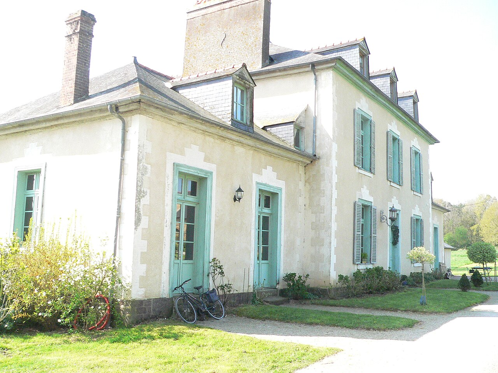

# 波美侯

波美侯（Pomerol）是多尔多涅河右岸、利布尔讷以东的红葡萄酒法定产区，1936 年 12 月 8 日获得 AOC 地位。它的核心台地只有约 4 公里乘 3 公里，却集中了右岸最昂贵的酒庄之一；与左岸不同，波美侯从未建立官方分级，声誉完全建立在具体酒庄与地块之上。

图：波美侯。图片：Flomacon35，CC BY-SA 3.0，via Wikimedia Commons（[原图页面](https://commons.wikimedia.org/wiki/File:Chateau_Le_Pin.JPG)）。

## 定义与范围

Pomerol 只适用于来自波美侯公社划定地块、并在区内完成发酵与陈年的静止红[葡萄酒](ref:red-wine)。产区位于[波尔多](ref:bordeaux)右岸，紧邻圣埃美隆，但行政上独立；它不依赖任何“列级庄”名单，酒标上通常只写 Pomerol 与酒庄名。

这种“无分级”的结构意味着，产区内部没有官方等级可以参照。消费者只能通过酒庄历史、地块位置与年份表现来判断质量，这也使波美侯的市场信息比左岸更依赖声誉与口碑。

产区内酒庄规模普遍很小，平均持有面积远小于左岸列级庄；这种碎片化使同一地块的相邻所有者可能做出完全不同的酒。产区名称本身来自公社，而不是某个葡萄园，这一点与勃艮第的地块命名逻辑完全不同。

## 右岸的无分级村庄

波美侯从未像梅多克那样在 1855 年建立分级，也没有像圣埃美隆那样在 1955 年建立并定期修订自己的分级。它的行业组织成立于 1900 年，是吉伦特地区最早的一批葡萄酒行业协会之一；圣埃美隆的同类组织则成立于 1884 年。

没有分级并不等于没有秩序。波美侯的排序由市场完成：Petrus、Lafleur、Trotanoy、Vieux Château Certan、La Conseillante、L'Évangile 与 Clinet 等酒庄，长期以地块位置、年代与稀缺性形成价格层级。这种层级是隐性的，也更容易随年份与所有权变化而移动。

没有分级也意味着没有“升等”或“降等”的官方机制，酒庄只能通过年份表现与市场评价慢慢积累地位。对消费者而言，这要求更主动地核对酒庄背景，而不能依赖名单。

## 黏土-铁质土与砾石

波美侯台地的表层是砾石，砾石密度、黏土与砂的比例在各处不同；下层是富含铁氧化物的黏土，当地称为 crasse de fer。这种铁质层近乎不透水，会在雨季形成上层滞水，又在夏季缓慢释放水分，使[梅洛](ref:merlot)在干旱年份仍能稳定成熟。

台地边缘与东侧的地块砂质更多、排水更快，风格通常更轻盈；台地中央的黏土-铁质土保水性强，酒体更饱满。这种“中央重、边缘轻”的差异，是波美侯同一产区内部风格分化的地质基础。

crasse de fer 的厚度与埋深在台地上并不一致，有的地块铁质层接近地表，有的则被更厚的砾石覆盖；这造成同一村庄内排水与保水的微妙差别，也解释了为什么相邻地块的酒体可以明显不同。

## 梅洛与 Petrus

梅洛占波美侯种植面积约 80%，是绝对主导品种；品丽珠、赤霞珠、马尔贝克与小维多只占较小比例。梅洛带来李子、黑樱桃、紫罗兰与松露的气息，单宁柔顺，年轻时即可饮用，优质年份也能陈年数十年。

Petrus 位于台地中央的黏土-铁质土上，以梅洛为主体，是波美侯最知名的酒庄。它的存在常被用来解释“无分级也能产生顶级价格”：在没有官方名单的情况下，地块、历史与市场共识共同承担了分级的功能。

Petrus 的园地面积很小，产量有限，稀缺性进一步放大了价格；这也提醒读者，波美侯的“顶级”往往与面积和产量直接相关，而不是与某个等级称号挂钩。

## 法规与数字

法定品种为梅洛、品丽珠、赤霞珠、马尔贝克与小维多。最低自然酒精度为 11%，产量上限 49 百升/公顷，封顶产量 60 百升/公顷，种植密度至少 5,500 株/公顷，最大田间负载 8,000 公斤/公顷。采收时梅洛的最低糖度为 194 克/升，其他品种为 180 克/升。

与波亚克相比，波美侯的产量上限更低、种植密度更小，这与右岸黏土土壤、梅洛品种和较高比例的老藤有关。数字只说明法定框架，实际酒体仍取决于地块、树龄与酿造。

## 酿造与陈年

发酵后在[橡木桶](ref:oak-ageing)中陈年，多数酒庄使用较高比例的新桶，桶陈时间通常为一年至两年。新桶带来香草、烘烤与香料气息，也会增加单宁的聚合感；老桶则更强调果味与质地。

波美侯的梅洛单宁较柔，年轻时即可饮用，但优质年份在瓶中会发展出松露、铁质矿物与皮革的气息。与左岸赤霞珠主导的酒相比，它的适饮窗口通常更早打开，也更适合搭配禽类、蘑菇与炖菜。

波美侯的酒通常不追求强力萃取，而是强调质地与香气；发酵温度、浸渍时间与压帽频率都会影响最终的柔顺度。过高的萃取会掩盖梅洛的果香，因此酒庄更倾向于温和提取。

## 酒标与选购

酒标上的 Pomerol 必须与产区一致；核对年份、酒精度、容量、装瓶者与酒庄名。由于没有官方分级，任何“列级”“一级”字样都不属于波美侯的法定等级，遇到此类标注应格外谨慎。

购买波美侯时，酒庄名与年份比产区名更重要；同一产区内的价格差距可以达到数十倍，单看 Pomerol 无法判断质量。

由于没有分级，酒评与拍卖记录成为重要的参考；同一酒庄不同年份的价格波动，往往比不同酒庄之间的差异更值得关注。

**关键事实。**

| 项目 | 内容 |
| --- | --- |
| 一句话定位 | 多尔多涅河右岸、利布尔讷以东的红葡萄酒法定产区，1936 年 12 月 8 日获 AOC 地位，核心台地约 4 公里乘 3 公里；表层为砾石与砂黏土，下层为富铁氧化物的黏土-铁质土（crasse de fer），梅洛占种植面积约 80%，法定最低自然酒精度 11%，产量上限 49 百升/公顷、封顶 60 百升/公顷，种植密度至少 5,500 株/公顷 |
| 所属 | 法国 |
| 国家代码 | FR |

## 参考资料

- [法国](ref:france)：AOC 制度与国家级产区框架。
- [波尔多](ref:bordeaux)：右岸与左岸的产区结构差异。
- [梅洛](ref:merlot)：波美侯的主导品种与成熟特征。
- [品丽珠](ref:cabernet-franc)：在右岸混酿中提供香气与结构。
- [红葡萄酒](ref:red-wine)：波美侯的类别、单宁与酿造概览。
- [橡木桶陈年](ref:oak-ageing)：新桶比例对香气与单宁的影响。
