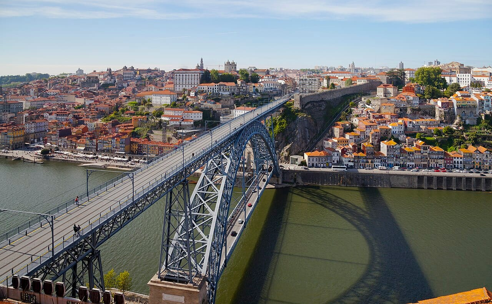

# 波特

波特（Porto）是[葡萄牙](ref:portugal)杜罗河谷出产、经强化并在加亚新城或杜罗陈年的甜型[加强酒](ref:fortified-wine)法定产区。它以 Touriga Nacional 等品种酿造，按“单一年份或混酿”与“木桶氧化或瓶中还原”两条轴分为多个类别。

图：波特。图片：Diego Delso，CC BY-SA 3.0，via Wikimedia Commons（[原图页面](https://commons.wikimedia.org/wiki/File:Puente_Don_Luis_I,_Oporto,_Portugal,_2012-05-09,_DD_13.JPG)）。

## 定义与范围

波特是加强酒，不是普通干红：发酵中途加入葡萄酒精，停止发酵并保留残糖，因此酒精度较高、口感偏甜。产区范围与[杜罗](ref:douro)河谷的葡萄种植区重叠，陈年可在加亚新城的酒窖或杜罗完成。

“Porto”是葡萄牙语名称，“Port”是英语简称。酒标上的类别名称（Ruby、Tawny、Vintage、LBV 等）是识别风格的核心，不能只看颜色。

## 「波特」的时间线
杜罗河谷在 1756 年完成边界划定，是世界上最早的葡萄酒产区划界之一。18 世纪的英葡贸易推动了波特在英国市场的流行，加亚新城的酒窖体系也由此发展。

历史路径决定了波特的两种形态：一种强调瓶中陈年与单一年份的表达，另一种强调木桶氧化与混合稳定。理解这两条路径，比记住某个年份或品牌更重要。

## 地理与气候

葡萄园位于杜罗河及其支流的陡峭坡地上，多采用石墙梯田，海拔可达 700 米以上。气候属大陆性，夏季炎热、冬季寒冷，片岩土壤排水性好、肥力低。

产区内部从西到东分为下科尔戈（Baixo Corgo）、上科尔戈（Cima Corgo）与杜罗高级区（Douro Superior）三段，越往东越干燥、越偏远，成熟度与产量差异明显。坡向、海拔与河流调节温度，构成波特基酒的风格基础。

## 品种与原料

红葡萄以 Touriga Nacional、Touriga Franca、Tinta Roriz、Tinta Barroca 与 Tinto Cão 为主；白波特使用 Malvasia Fina、Viosinho 等白葡萄。原料是[葡萄](ref:grape)。

Touriga Nacional 带来花香、黑色果味与结构，Touriga Franca 增加香气与柔顺度，Tinta Roriz 提供成熟果味。混酿的目的不是统一味道，而是用不同品种补齐结构、香气与酸度。

## 「波特」怎么做出来
葡萄经破碎、浸渍与[发酵](ref:fermentation)，在残糖仍高时加入葡萄酒精进行强化，停止发酵并保留甜度。强化酒精度、加入时机与基酒风格决定最终的糖分与酒体。

部分传统酒庄仍用脚踩与花岗岩酒槽，现代酒庄则使用温控不锈钢罐与自动压榨。基酒完成后进入陈年体系，使用[橡木桶](ref:oak-ageing)或惰性容器。

## 陈年体系与类别

波特的类别可以按两条轴理解：第一条是“单一年份还是多年混酿”，第二条是“木桶氧化陈年还是瓶中还原陈年”。

- Ruby：多年混酿，木桶或大罐短期陈年，颜色深、红果味直接，酒体年轻。
- Tawny：多年混酿，木桶中长期氧化陈年，颜色转为茶色，带坚果、焦糖与干果气息；标注 10、20、30、40 年表示陈年风格的目标年龄。
- Vintage：单一年份，经 IVDP 认可后在瓶中陈年，颜色深、结构强，饮用前需要醒酒。
- LBV：单一年份，木桶陈年 4–6 年后装瓶；部分经过滤、即开即饮，部分不过滤、可继续瓶中陈年。
- Colheita：单一年份的茶色波特，木桶中长期氧化陈年，装瓶时标注采收年份。
- Crusted：多年混酿，木桶短期陈年后装瓶，瓶中形成沉淀，风格接近年轻 Vintage。
- White Port：白葡萄酿造，从干型到甜型都有，常作为开胃酒。

这张表的关键不是颜色深浅，而是“年份”与“容器”两个变量。Vintage 与 LBV 都是单一年份，差别在瓶中还是桶中完成主要陈年；Tawny 与 Colheita 都走氧化路径，差别在混酿还是单一年份。

## 「波特」的瓶型与标签
常见容量为 750 mL，[酒精度](ref:abv)约 19%–20% vol，具体随类别与酒庄变化。标签应核对类别名称、年份或年龄标示、装瓶者与产地。

Vintage 标注采收年份，LBV 标注年份与装瓶年份，Tawny 标注年龄，Colheita 标注采收年份。以瓶身实际标注为准。

## 市场与饮用

Ruby、LBV 与 Vintage 适合搭配巧克力、蓝纹奶酪与坚果；Tawny 适合搭配焦糖甜点、坚果与干果；White Port 可冰镇作为开胃酒。

Vintage 建议温度约 16–18 摄氏度，饮用前醒酒；Tawny 建议温度约 12–14 摄氏度；Ruby 与 LBV 约 14–16 摄氏度。开瓶后应冷藏并在数周内喝完。本页关于波特的内容涉及酒精饮料；过量饮酒有害健康，未成年人不应饮酒。

## 「波特」容易被读错的地方
第一，认为波特都是甜的红酒。White Port 也存在，且甜度跨度大。
第二，按颜色判断类别。颜色反映陈年路径，不直接等于类别。
第三，把 LBV 当成 Vintage 的廉价替代。两者都是单一年份，但陈年容器与饮用窗口不同。
第四，认为 Tawny 越老越甜。年龄标示描述风格目标，甜度取决于残糖与工艺。
第五，把 Crusted 与 Vintage 混为一谈。Crusted 是多年混酿。

波特是杜罗河谷出产、经强化并在加亚新城或杜罗陈年的甜型加强酒，不是“葡萄牙甜红酒”的通称。Ruby、Tawny、Vintage、LBV、Colheita 与 Crusted 按陈年与氧化路径分类；酒标上的年份、类别与装瓶信息要一起读，不能只看颜色判断年龄。

对照阅读：[葡萄牙](ref:portugal)、[葡萄](ref:grape)。

**关键事实。**

| 项目 | 内容 |
| --- | --- |
| 一句话定位 | 葡萄牙杜罗河谷出产、经强化并在加亚新城或杜罗陈年的甜型加强酒法定产区；以 Touriga Nacional 等品种酿造，按“单一年份或混酿”与“木桶氧化或瓶中还原”两条轴分为 Ruby、Tawny、Vintage、LBV、Colheita 与 Crusted，常见 750 mL、酒精度约 19%–20% vol |
| 层级 | 其他 |
| 所属 | 葡萄牙 |
| 国家代码 | PT |

**来源与边界。** 本页关于「波特」的关键事实，主要由以下来源交叉核对：IVDP（波特的类别、陈年要求与标签规则；由原条目末尾参考资料迁移，未逐条复核访问日期）、European Union（欧盟加强酒类别、地理标志与传统术语规则）、Oxford University Press（提供关于波特、年份波特与茶色波特的条目；由原条目末尾参考资料迁移，未逐条复核访问日期）。价格、批次与状态会变，涉及这些字段时以页面所列来源的最新版本为准。正文为项目自写，来源只作核验，不复制原文。

**并读。** 把「波特」与「葡萄牙」、「加强葡萄酒」、「葡萄」放在一起读时，先确认它们是同一层级还是上下游关系：先确认边界与法定分类，再比较气候、土壤、海拔与代表酒款。本页负责给出产区的基本坐标，对照条目补上具体案例与差异；读完再回到本页，才能分清哪些差别属于产区本身，哪些只是产地、批次或品牌选择。

## 参考资料
- [葡萄牙](ref:portugal)：波特所属的国家产区框架。
- [杜罗](ref:douro)：波特葡萄的来源产区。
- [加强酒](ref:fortified-wine)：强化酒的类别与工艺框架。
- [葡萄](ref:grape)：波特所用葡萄的成熟度、酸度与单宁判断。
- [发酵](ref:fermentation)：波特在发酵中途强化的基础逻辑。
- [橡木桶陈年](ref:oak-ageing)：Tawny 与 Colheita 的氧化路径。
- [葡萄酒](ref:wine)：理解波特的类别、年份与产地规则的入口。
- [酒精度](ref:abv)：19%–20% vol 在标签上的含义。

## 相关图像

图：杜罗。图片：Vitor Oliveira from Torres Vedras, PORTUGAL，CC BY-SA 2.0，via Wikimedia Commons（[原图页面](https://commons.wikimedia.org/wiki/File:Rio_Douro_-_Portugal_(32615481975)_(cropped).jpg)）。关联图像：波特。

图：葡萄牙类别配图。图片：John Hayes from San Antonio, Texas, USA，CC BY-SA 2.0，via Wikimedia Commons（[原图页面](https://commons.wikimedia.org/w/index.php?curid=151531010)）。关联图像：波特。
