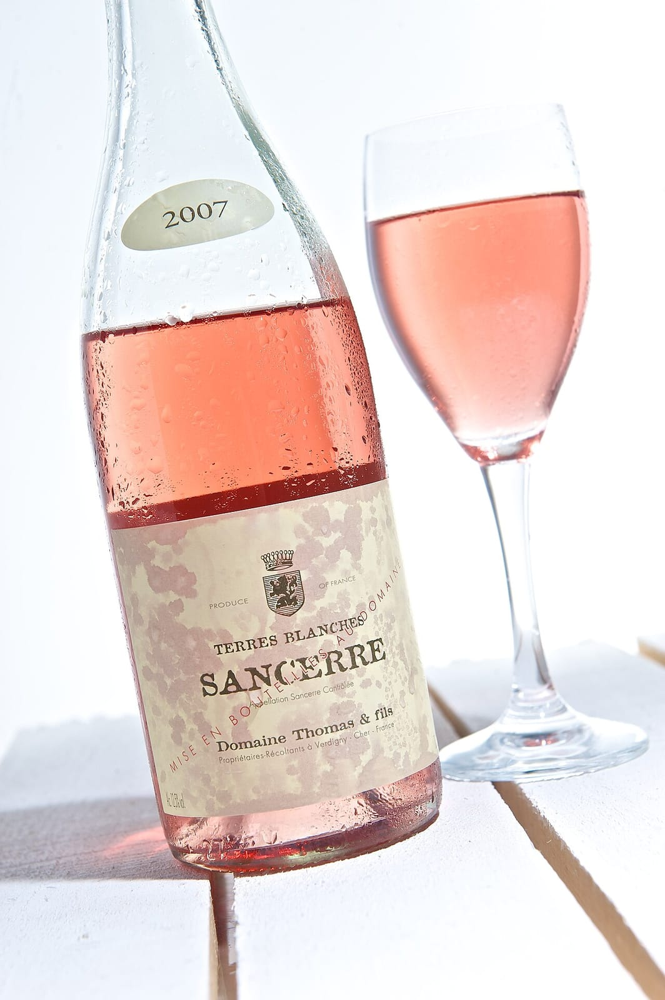

# 葡萄牙

葡萄牙位于伊比利亚半岛西部，葡萄酒传统深厚。它的国际形象常与波特、马德拉等加强酒联系在一起，但葡萄牙也有杜罗河红葡萄酒、阿连特茹的温暖风格、维尼奥维德的白葡萄酒与清新的桃红。本土品种丰富，是理解葡萄牙葡萄酒的关键。

图：葡萄牙地区的一处实景。摄影：Porto-Matosinhos, , June 2 (53870205083)。署名：John Hayes from San Antonio, Texas, USA，CC BY-SA 2.0，来自 Wikimedia Commons（[来源](https://commons.wikimedia.org/w/index.php?curid=151531010)）。这张照片来自葡萄牙产区内已核实条目，用于说明当地风貌，不是葡萄牙的全区域地图。

## 地理与气候

葡萄牙西临大西洋，北接西班牙，地形从北部山地与河谷过渡到中部的山脉，再到南部的阿连特茹平原。北部与西北部受大西洋影响，降水较多、气候温和湿润；东北部与杜罗河谷更大陆性，夏季炎热、冬季寒冷；南部阿连特茹炎热干燥，昼夜温差大；马德拉与亚速尔是岛屿产区，气候受海洋强烈调节。

水分与热量分布不均，是葡萄牙葡萄种植的主要变量。北部要控制病害与成熟不足，南部要面对干旱与高温；杜罗河谷的片岩坡地与河流调节，让晚熟品种能够在较热的条件下保持结构。不同产区的品种与栽培方式因此差异很大。

## 「葡萄牙」的时间线
葡萄牙的葡萄种植可追溯到古代，罗马时期已有酿酒传统。中世纪修道院与地方领主推动了产区形成。18 世纪以后，波特酒在英国市场的贸易推动了杜罗河谷的规模化种植与分级管理；葡萄牙也是较早建立产区划定制度的国家之一。20 世纪后期，合作社与现代投资提升了品质与出口能力。

## 葡萄酒产区

- 杜罗：陡峭的片岩坡地，波特酒与红葡萄酒的核心产区。
- 阿连特茹：炎热干燥的平原，红葡萄酒与白葡萄酒都有规模生产。
- 维尼奥维德：西北部的清爽白葡萄酒与桃红。
- 杜奥：中部山地的红白葡萄酒。
- 塞图巴尔：半岛南部的麝香与甜型酒。
- 马德拉与亚速尔：岛屿产区，马德拉以加强酒闻名。

## 「葡萄牙」的品种与风格坐标
葡萄牙的本土品种很多。杜罗河以 Touriga Nacional、Touriga Franca、Tinta Roriz 等红品种为主，酒色深、单宁与香气浓郁；阿连特茹常用本土红品种与混酿；维尼奥维德以 Alvarinho、Arinto 等白品种见长。[红葡萄酒](ref:red-wine)与[白葡萄酒](ref:white-wine)的风格差异，来自产区热量、品种与酿造方式，而不是单一的国家风格。

[桃红](ref:rose-wine)在葡萄牙也有稳定生产，风格从清爽干型到果味更浓都有。葡萄经[发酵](ref:fermentation)得到葡萄酒，发酵温度、浸渍时间与酵母选择会影响香气与结构。

## 加强酒与马德拉

[加强酒](ref:fortified)是葡萄牙最具国际认知的类型。波特酒在葡萄发酵过程中加入葡萄酒精，停止发酵并保留残糖，再经橡木桶陈年；风格从 Ruby、Tawny 到 Vintage 都有。[蒸馏](ref:distillation)得到的葡萄酒精是强化工艺的关键，[橡木桶陈年](ref:oak-ageing)则影响颜色、香气与质地。

马德拉在发酵后强化，并通过加热与氧化陈年形成独特风味。马德拉的甜度与陈年时间决定风格，从年轻清爽到长期氧化的复杂香气都有。加强酒不是简单的“甜酒”，其工艺与陈年体系需要单独理解。

## 法规与分级

葡萄牙葡萄酒与欧盟的 PDO/PGI 体系衔接，产区名称受保护，品种、产量与标签有相应规则。杜罗、阿连特茹等产区还有更细的地名与分级。波特与马德拉有各自的强化酒规则与陈年用语。

阅读酒标时，要区分国家名、产区名、酒庄名与类型名。“Porto”“Madeira”等名称受保护，不能随意使用。分级保证规则与产地，不等于每瓶的感官质量。

## 气候与土壤数据

| 区域 | 气候 | 主要土壤 | 代表酒类 |
| --- | --- | --- | --- |
| 西北部（维尼奥维德、杜奥） | 大西洋气候，湿润温和 | 花岗岩、片岩 | 白葡萄酒、桃红 |
| 东北部（杜罗） | 大陆性，夏季炎热 | 片岩、梯田坡地 | 波特、红葡萄酒 |
| 中部与南部（阿连特茹） | 地中海，炎热干燥 | 石灰岩、砂土、黏土 | 红葡萄酒、白葡萄酒 |
| 岛屿（马德拉、亚速尔） | 海洋性，温和湿润 | 火山土、玄武岩 | 马德拉加强酒 |

就「葡萄牙」而言，这张表是宏观对照，具体地块的土壤、海拔与朝向仍需看单个产区。把国家气候当成酒款风格保证，会忽略产区内部的差异。

## 代表酒款与生产者

葡萄牙的波特酒、马德拉与杜罗红葡萄酒都有代表性生产者，具体酒款请参见酒款页。产区页只描述地理、品种与制度框架，不评价单个品牌。日常消费中，维尼奥维德的白葡萄酒与阿连特茹的红葡萄酒也有稳定市场。

## 市场与饮用

葡萄牙是重要的葡萄酒生产与出口国，国内消费以餐饮与日常饮用为主。[葡萄酒](ref:wine)的价格跨度很大，从日常餐酒到长期陈年的名庄酒都有。波特适合餐后与甜点，马德拉适合餐后与烹饪，杜罗红葡萄酒适合肉类与奶酪，维尼奥维德白葡萄酒适合海鲜与轻食。

饮用应适量，开瓶后的保存与温度会影响体验。对具体酒款，酒标上的产区、年份、类型与酒精度是最直接的信息。

## 「葡萄牙」容易被读错的地方
第一，葡萄牙只有波特酒。它也有大量干型红白葡萄酒与桃红。

第二，波特都是甜的红酒。波特有白波特、茶色波特与年份波特等多种类型。

第三，马德拉只是 cooking wine。马德拉有不同甜度与陈年等级的饮用酒。

第四，葡萄牙品种不重要。本土品种是葡萄牙风格的核心。

第五，加强酒越甜越好。甜度与酸度、陈年与香气需要平衡。

对照阅读：[葡萄酒](ref:wine)、[白葡萄酒](ref:white-wine)。

**关键事实。**

| 项目 | 内容 |
| --- | --- |
| 一句话定位 | 伊比利亚半岛西部的葡萄酒生产国，以波特、马德拉等加强酒与杜罗河红葡萄酒著称；本土品种丰富，产区制度与欧盟框架衔接 |
| 层级 | 国家 |
| 国家代码 | PT |

## 参考资料
- [葡萄酒](ref:wine)：理解葡萄牙的分类、酿造与产区框架。
- [红葡萄酒](ref:red-wine)与[白葡萄酒](ref:white-wine)：葡萄牙干型酒的两条主线。
- [桃红](ref:rose-wine)：葡萄牙桃红的风格与场景。
- [加强酒](ref:fortified)：波特与马德拉的强化体系。
- [蒸馏](ref:distillation)：葡萄酒精与强化工艺。
- [橡木桶陈年](ref:oak-ageing)：波特与马德拉的陈年。
- [发酵](ref:fermentation)：葡萄酒与加强酒的基础工艺。

## 相关图像

图：桃红葡萄酒。图片：THOR，CC BY 2.0，via Wikimedia Commons（[原图页面](https://commons.wikimedia.org/wiki/File:Sancerre_rose_Wine.jpg)）。关联图像：葡萄牙。

图：加强葡萄酒。图片：Jon Sullivan，Public domain，via Wikimedia Commons（[原图页面](https://commons.wikimedia.org/wiki/File:Port_wine.jpg)）。关联图像：葡萄牙。
