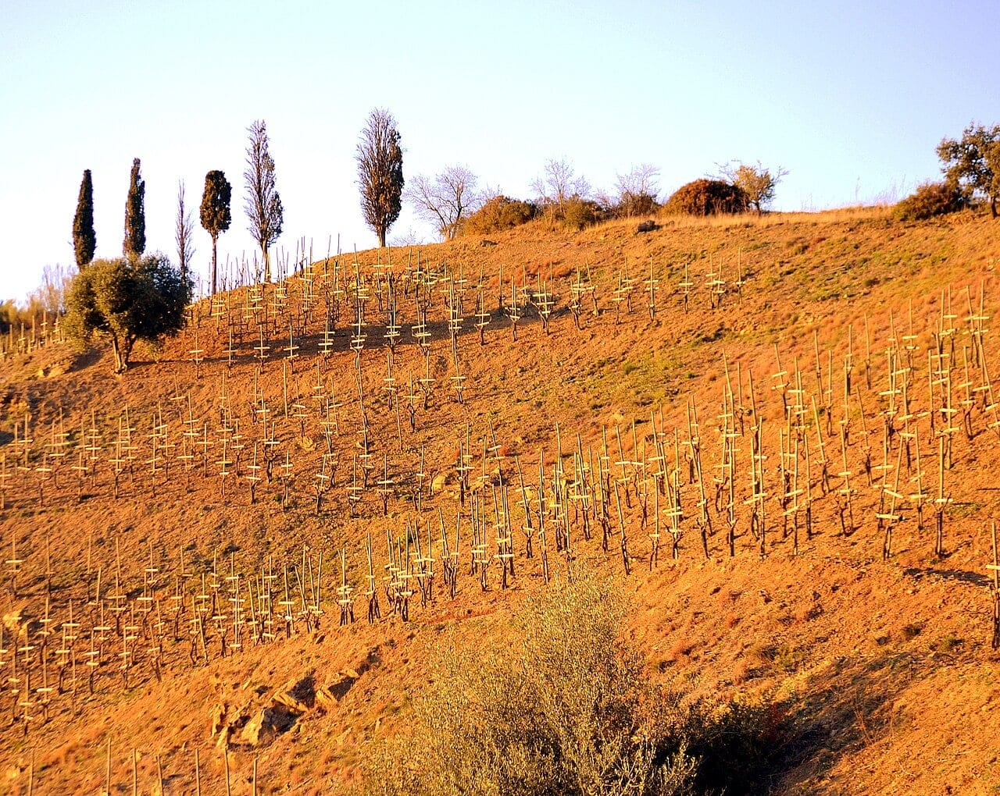

# 普里奥拉托

普里奥拉托（Priorat，西班牙语 Priorato）位于西班牙东北部加泰罗尼亚的塔拉戈纳省内陆，是一处被群山包围的山区葡萄酒产区。它在 2009 年获得 DOQ（Denominació d'Origen Qualificada）等级，与里奥哈同属西班牙目前仅有的两个最高等级原产地名称。产区以[红葡萄酒](ref:red-wine)为主，兼产少量[白葡萄酒](ref:white-wine)，是西班牙现代精品酒复兴的代表之一。

图：普里奥拉托格拉塔洛普斯（Gratallops）的 l'Ermita 葡萄园，板岩坡地上的低矮老藤。图片：Angela Llop，CC BY-SA 2.0，via [原图页面](https://commons.wikimedia.org/wiki/File:Vinyes_del_Priorat,_l%27Ermita,_Gratallops.jpg)。

## 地理与气候

产区沿西乌拉山脉（Serra de les Güixeres 等山系）之间的谷地与陡坡分布，行政上属 Priorat 地区，涵盖 Gratallops、Porrera、Poboleda、Torroja del Priorat、Bellmunt del Priorat、El Lloar、La Vilella Alta 与 La Vilella Baixa 等村庄，Falset 是地区行政中心。葡萄园多在海拔 100–700 米的陡坡上，梯田以干砌石墙支撑。

土壤是产区的标志：llicorella，即板岩与石英碎片混合的风化层，持水力差、排水极快，根系必须深扎才能获取水分，因此产量天然偏低。它常被误认为火山岩，实际上是变质岩。

气候为地中海与大陆性的过渡：夏季炎热、冬季偏冷，降水偏少，生长季水分压力是常态。山地海拔带来明显昼夜温差，延长成熟期并保留酸度。密史脱拉风方向的山口风对湿度与病害有一定抑制作用。

## 历史

十二世纪，加泰罗尼亚的加尔都西会修士在今日的 Scala Dei（Escaladei）建立修道院，并开垦葡萄园，产区名称即来自“Priorato”（修道院辖区）。十九世纪末根瘤蚜几乎摧毁全部葡萄园，此后人口外流、产业衰落，二十世纪中期主要依靠合作社维持生产。

1980 年代后期，一批外来酿酒师与本地种植者在 Gratallops 一带合作，以低产老藤、小地块分酿与国际品种混种重建产区形象，这批酒庄常被合称为“Gratallops 群体”。此后产区知名度与价格快速上升，2009 年获得 DOQ 等级。

## 品种与风格

传统品种是[歌海娜](ref:grenache)（当地称 Garnatxa）与佳丽酿（当地称 Samsó），前者提供成熟果味与酒精，后者提供酸度、单宁与陈年潜力。现代种植中也常见[西拉](ref:syrah)与[赤霞珠](ref:cabernet-sauvignon)，用于增加颜色与结构，但 DOQ 规则对品种比例有明确限制。

[红葡萄酒](ref:red-wine)通常颜色深、酒体饱满，酒精度偏高，香气以黑莓、黑樱桃、甘草、香料与明显的矿物气息为主，单宁扎实，常需要数年瓶中陈年才进入适饮期。[橡木桶](ref:oak-ageing)使用普遍，但近年趋势是减少新桶比例，以避免掩盖果味与矿物感。

白葡萄酒以白歌海娜、马卡贝奥等品种酿造，产量小，风格多为中等酒体、带咸鲜与草本气息。[发酵](ref:fermentation)多以控温不锈钢罐或水泥罐完成，部分酒庄保留整串发酵。

## 分级与标识

DOQ 是西班牙原产地分级中的最高一级，要求比 DO 更严格：产区范围限定、品种与产量上限、必须在产区范围内酿造与装瓶，并接受监管委员会的检查与品评。普里奥拉托的酒标通常标注 DOQ Priorat；“Priorat”单独使用时指同一产区。

DOQ 之下没有官方村庄级分级，但酒庄常以村庄名或单一园（vi de finca）标识地块来源，这些属于生产者自述，不构成法定等级。

## 代表酒款与生产者

- Clos Mogador：Gratallops 的早期复兴酒庄之一，常被视为产区现代风格的起点。
- Clos Erasmus：以低产老藤歌海娜著称，产量极小。
- L'Ermita（Álvaro Palacios）：单一园老藤歌海娜，是产区价格与声誉的标杆之一。
- Clos Dofí、Clos Martinet：同属 Gratallops 群体，代表不同混酿取向。
- 传统合作社：如 Falset 一带的合作酒庄，保留了产区在大规模精品化之前的生产形态。

## 常见误区

第一，把 llicorella 当成火山岩。它是板岩与石英的变质岩组合。
第二，认为普里奥拉托只产红葡萄酒。DOQ 允许并实际生产白葡萄酒。
第三，把 DOQ 当成“比 DO 更好喝”的保证。它是更严格的产地与工艺约束，不等于质量排名。
第四，以为产区一直很贵。它的高价形象形成于 1990 年代之后，此前长期是衰退的农村产区。
第五，把所有酒都归为“重桶重酒精”。近年风格明显分化，轻萃取与少新桶的酒款在增加。

普里奥拉托是西班牙加泰罗尼亚的内陆山区 DOQ，llicorella 板岩与石英碎片的陡坡梯田、低产老藤与地中海—大陆性过渡气候塑造出以歌海娜与佳丽酿为主的红葡萄酒。DOQ 是西班牙较高等级，但产区等级不等于每一瓶酒的品质；具体村庄、酒庄与年份更关键。DOQ 规则约束的是产区范围、品种比例与陈年方式，不是每一瓶酒的分数；村庄、坡向与老藤比例仍会造成明显差异。llicorella 的名字来自当地板岩，不宜被当成单一风味标签。

对照阅读：[西班牙](ref:spain)、[西拉](ref:syrah)。

## 延伸阅读

- [西班牙](ref:spain)：普里奥拉托所属的国家产区框架。
- [歌海娜](ref:grenache)：产区的核心品种。
- [西拉](ref:syrah)与[赤霞珠](ref:cabernet-sauvignon)：用于混酿的国际品种。
- [红葡萄酒](ref:red-wine)与[白葡萄酒](ref:white-wine)：产区的两类产品。
- [葡萄酒](ref:wine)：普里奥拉托的产区层级与酒标规则。
- [发酵](ref:fermentation)与[橡木桶陈年](ref:oak-ageing)：影响风格的关键工艺。

**关键事实。**

| 项目 | 内容 |
| --- | --- |
| 一句话定位 | 西班牙加泰罗尼亚塔拉戈纳省的内陆山区产区，2009 年获得 DOQ 最高等级；llicorella 板岩与石英碎片的陡坡梯田、低产老藤与地中海—大陆性过渡气候，塑造出以歌海娜与佳丽酿为主、酒体饱满且带矿物感的红葡萄酒 |
| 层级 | 省/大区 |
| 所属 | 西班牙 |
| 国家代码 | ES |

**来源与边界。** 本页关于「普里奥拉托」的关键事实，主要由以下来源交叉核对：Consell Regulador de la DOQ Priorat（DOQ Priorat 的产区范围、品种与生产规则；由原条目末尾参考资料迁移，未逐条复核访问日期）、Generalitat de Catalunya（加泰罗尼亚葡萄酒产区与 DOQ 制度概况；由原条目末尾参考资料迁移，未逐条复核访问日期）、European Commission（Priorat 原产地名称的注册状态与产品规格；由原条目末尾参考资料迁移，未逐条复核访问日期）等 8 条来源。价格、批次与状态会变，涉及这些字段时以页面所列来源的最新版本为准。正文为项目自写，来源只作核验，不复制原文。

**并读。** 把「普里奥拉托」与「西班牙」、「歌海娜」、「西拉」放在一起读时，先确认它们是同一层级还是上下游关系：先确认边界与法定分类，再比较气候、土壤、海拔与代表酒款。本页负责给出产区的基本坐标，对照条目补上具体案例与差异；读完再回到本页，才能分清哪些差别属于产区本身，哪些只是产地、批次或品牌选择。

**适用边界。** 对「普里奥拉托」而言，产区边界、面积与法定分类会随法规更新；气候描述是长期趋势，不是某一年的天气预报。

## 相关图像

图：Uga - Lanzarote - Spain. Vineyards -U16。摄影：Luis Miguel Bugallo Sánchez，CC BY-SA 3.0，来自 Wikimedia Commons。。图片：Luis Miguel Bugallo Sánchez，CC BY-SA 3.0，via Wikimedia Commons（[原图页面](https://commons.wikimedia.org/w/index.php?curid=17458062)）。关联图像：普里奥拉托。

图：歌海娜。图片：Jules Troncy，Public domain，via Wikimedia Commons（[原图页面](https://commons.wikimedia.org/wiki/File:Grenache_N.jpg)）。关联图像：普里奥拉托。
