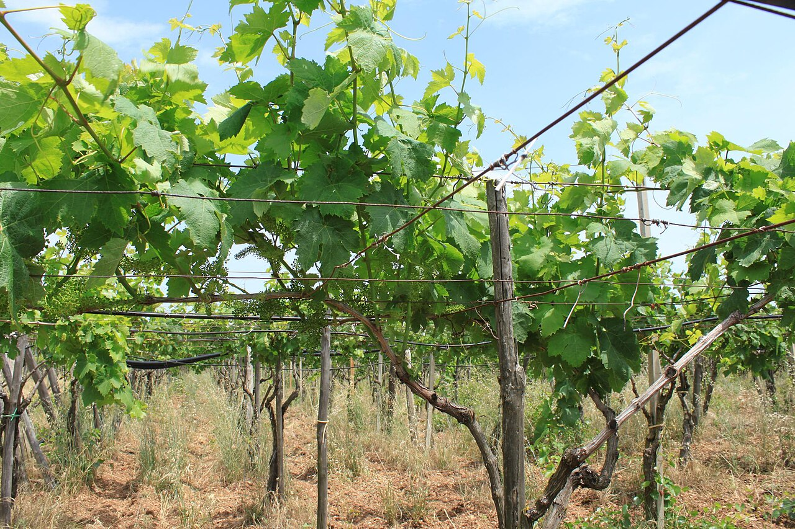

# 普利亚

普利亚（Puglia，英语称 Apulia）是意大利半岛“靴跟”，东西临海，地中海阳光、石灰岩与红土、老藤灌木与 Masseria 农庄构成其形象；红葡萄以黑曼罗、普里米蒂沃与黑博比诺为主，萨伦托半岛与曼杜里亚是核心。

图：Puglia：Italia 2010 - Perrini vineyards in Puglia（Wikimedia Commons）。图片：drdcuddy，CC BY-SA 2.0，via Wikimedia Commons（[原图页面](https://commons.wikimedia.org/wiki/File:Italia_2010_-_Perrini_vineyards_in_Puglia.jpg)）。

## 先划清「普利亚」的边界
普利亚位于意大利东南角，沿海岸纵向分为三个省：北部福贾、中部巴里与塔兰托、南部布林迪西与莱切；传统意义上的普利亚酒区在布林迪西—塔兰托线以南，即萨伦托半岛。北面的莫尔贾与卡斯特尔德尔蒙特一带以 Nero di Troia 为主，品种与中北部意大利更接近。普利亚半岛两侧分别临亚得里亚海与伊奥尼亚海，海岸平直、沙滩与石灰岩崖岸相间；内陆是干旱的石灰岩台地与橄榄林，葡萄园多沿坡地与台地边缘分布。

产区法规分层：最宽的是 Salento IGT，允许约 50 个品种与红、白、桃红、起泡、passito 等风格，品种酒需至少 85% 对应品种；其上是一系列 DOC，最高等级为 DOCG。曼杜里亚一带的普里米蒂沃与萨伦托的黑曼罗是两条主线。IGT 酒标可标注地区名与品种，是日常佐餐与出口款常见标签；DOC/DOCG 则对品种比例、产量与酿造规范有更细限制。

## 历史与命名

普利亚葡萄种植有古希腊与罗马时期渊源，沿海 Masseria 农庄与灌木式老藤（alberello）是传统耕作的标志；20 世纪大部分时间，本地酒以散装与佐餐酒为主，合作社承担大规模生产。1962 年，十九名种植者在 San Marzano 创立合作社，后来的 Sessantanni 普里米蒂沃推动了普利亚红酒的国际形象。Masseria 原为庄园农庄中心，兼有仓储、榨油与酿酒功能；灌木藤离地矮、树冠小，在强风与干旱中保住水分，老藤产量低但果实集中。

品质转型从 1970 年代以后逐步展开：曼杜里亚普里米蒂沃 DOC 1974 年设立，萨利切萨伦托 DOC 规范 1976 年出台；2010 年普里米蒂沃迪曼杜里亚 Dolce Naturale 成为普利亚第一个 DOCG，2011 年获官方认可。近二十年精品酒庄与外来资本进入，把老藤地块与本土品种重新推到前台。普利亚长期是意大利大批量葡萄酒的供应地，20 世纪后半叶合作社把果实酿成瓶装酒外销；近二十年本土品种复兴，让外界重新认识萨伦托之外的北部丘陵。

## 「普利亚」的地理与风土
半岛炎热干燥，海边海风与内陆海拔带来局部降温；土壤以石灰岩、富含铁的红土与砂质土为主，排水快。老藤灌木式栽培根扎得深，在干旱年份维持产量；沿海台地与石灰岩高地昼夜温差略大，利于保留酸度。红土来自含铁风化层，日照下偏赭红；石灰岩风化后形成碎石与黏土夹层，既排水又在底土留住水分，沿海空气湿度比内陆高，霉菌压力略大。

萨伦托地势低平，光照强、成熟度高；北部莫尔贾丘陵与 Castel del Monte 海拔略高，土壤偏石灰岩土，适合 Nero di Troia 这类结构较强的红葡萄。主要风险是夏季干旱、高温与采收期局地降雨，沿海葡萄园还要留意盐风。橄榄林、杏树与麦地穿插在葡萄园之间，地貌开阔；夏季干热，秋季海面升温后偶有降雨。

## 原料与风格

黑曼罗（Negroamaro）是萨伦托骨干红葡萄，颜色深、单宁中高，带黑莓、干果与香料；普里米蒂沃与加州仙粉黛（Zinfandel）及克罗地亚 Crljenak Kaštelanski 基因相同，早熟、酒精度高、果味浓。黑博比诺多用于桃红与轻红；白葡萄有维蒙蒂诺、菲亚诺、Verdeca 与 Bianco d'Alessano，Locorotondo 是代表性白葡萄酒 DOC。Verdeca 是伊特里亚谷传统白葡萄，Bianco d'Alessano 常用于本地白混酿；Locorotondo 以清新花果与微泡口感著称。

普里米蒂沃干红通常 14% 上下酒精，果味浓、单宁柔；Dolce Naturale 甜红由挂熟葡萄酿成，残糖至少 50 克/升、天然酒精度约 16%，不经加强。黑曼罗红酒与桃红在萨利切萨伦托等 DOC 中占主导，常带草本与泥土气息；Susumaniello、Nero di Troia 是近年受关注的本土品种。Susumaniello 来自布林迪西附近，单宁细腻、果味新鲜；Nero di Troia 结构较强、适合陈酿，是 Castel del Monte 产区的主力。

## 代表生产者与酒款

代表酒庄包括 Antinori 旗下 Tormaresca、Masseria Li Veli、Vallone、Cantine San Marzano（合作社，Sessantanni 老藤普里米蒂沃）、Varvaglione 1921、Le Vigne di Sammarco 与 Due Palme；合作社产量大，精品酒庄近二十年来增多。Due Palme 与多家合作社覆盖萨伦托大众市场；Varvaglione 为四代家族经营，从 1921 年起在塔兰托附近种植本土品种。

这些名字不是官方分级，而是市场参照。合作社与家族酒庄并存，旗舰老藤款价高量小，入门款覆盖日常餐桌；比较同一品种在萨伦托沿海与北部丘陵的差别，比记酒庄名单更有效。

## 「普利亚」的上桌方式
干红适饮 16 至 18 摄氏度，桃红与轻红 12 至 14 摄氏度，白葡萄酒 10 至 12 摄氏度；高酒精普里米蒂沃不必冰得太低，单宁柔的年轻款可稍提前开瓶。桃红在本地夏季最常见，冰镇后配海鲜与时蔬；高酒精度红葡萄酒开瓶后放久一点，单宁会更柔顺。

配餐围绕地中海饮食：烤羊肉、香肠、炖牛肉、蘑菇意面与陈奶酪配黑曼罗或普里米蒂沃；桃红配海鲜、沙拉与冷切；白葡萄酒配贝类、烤鱼与蔬菜开胃菜。Dolce Naturale 配蓝纹奶酪、坚果、干果或作为餐后甜酒。

## 选购、标签与误区

读标签先分 DOCG/DOC/IGT 层级与品种比例；普里米蒂沃迪曼杜里亚 DOC 要求至少 85% 普里米蒂沃、最低 13.5% 酒精，Riserva 需陈酿至少 24 个月、其中橡木至少 9 个月。萨利切萨伦托以黑曼罗为主导，种植面积约 1,950 公顷。

常见误区是把普利亚红酒都当成高酒精甜腻风格，或把普里米蒂沃与仙粉黛当成两个品种。多数干红是干型、果味直接；老藤与地块、年份干旱程度都会改变浓度与酸度。购买时留意生产者、产地村镇与储存条件。普利亚酒价跨度大，合作社基础款与精品老藤款不可同日而语；包装与营销语不能替代对产地、品种与年份的判断。

## 「普利亚」周边怎么走
塔兰托距曼杜里亚约三十公里，莱切与布林迪西是萨伦托主要门户；酒庄之间车程多在 20 至 50 分钟，品鉴预约制，单次留 60 至 90 分钟。采收季（8 至 9 月）最忙。莱切有巴洛克老城与石灰岩街巷，布林迪西是通往希腊与地中海的港口；曼杜里亚周边散布老藤灌木园。

萨伦托沿海有古城、橄榄林与海滩，可结合 Masseria 农庄拜访、橄榄油品鉴与海岸路线；北部可安排 Castel del Monte 与 Nero di Troia 产区行程。公共交通有限，自驾或参加当地小团更方便。橄榄磨坊、奶酪作坊与面包店常可安排小份品鉴；夏季正午炎热，户外活动安排在早晚更舒适。

- 相关条目：[italy](ref:italy)、[barbera](ref:barbera)、[red-wine](ref:red)、[rose-wine](ref:rose)、[oak-ageing](ref:oak)。
- 普利亚夏季炎热干燥，出行前可在大区酒业机构或酒庄官网核对当年开放时间、品鉴预约与公路路况。

相关条目：[意大利](ref:italy)、[巴贝拉](ref:barbera)、[红葡萄酒](ref:red)。
