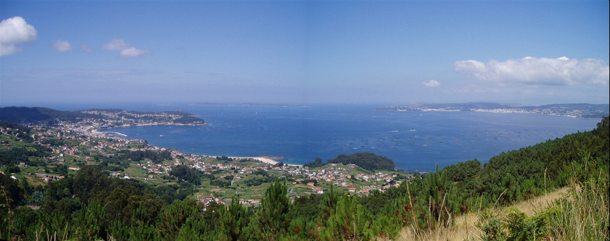

# 下海湾

下海湾（Rías Baixas）是西班牙西北部加利西亚的葡萄酒法定产区，主体位于蓬特韦德拉省，以海洋性气候、花岗岩土壤与 Albariño 白葡萄闻名。它不是单一葡萄园，而是由五个子区拼成的 DO，1988 年才以现在的名称获得法定产区地位。

图：下海湾。图片：No machine-readable author provided. Triart3d assumed (based on copyright claims).，Public domain，via Wikimedia Commons（[原图页面](https://commons.wikimedia.org/wiki/File:Panoramica_bueu_1.jpg)）。

## 定义与地理边界

Rías Baixas 的字面意思是"下海湾"，指加利西亚西南部一系列向大西洋敞开的入海口与河谷。产区覆盖蓬特韦德拉省大部分地区，只有 Ribeira do Ulla 子区的一部分延伸到拉科鲁尼亚省。按欧盟单一文件，法定区域内的葡萄园海拔均低于 300 米，集中在河谷低地、坡脚与花岗岩丘陵之间。

按产区推广机构公布的数据，全区葡萄园约 10,677 英亩，折合约 4,320 公顷；由约 6,500 名种植者经营 22,800 多个地块，注册酒庄约 180 家。地块细碎是当地景观与成本结构的根源，也是许多酒款以小区块混酿为基础的原因。

## 从品种专项到法定产区

下海湾的现代制度起点是 1980 年的 Denominación Específica Albariño，一个专门为 Albariño 品种设立的专项产区。1988 年，西班牙加入欧洲共同体后，这一名称改为 Denominación de Origen Rías Baixas，因为欧共体的葡萄酒法规不允许产区以单一品种命名。同年获批的产区章程划定了子区范围与生产规则。

这段历史解释了一个常见现象：产区的国际名声几乎与一个品种绑定，但法定名称必须使用地名。名称变更不是简单的行政手续，它把原本的品种品牌转为地理品牌，也让其他允许品种获得法律位置。

## 大西洋气候与花岗岩

产区的气候由大西洋主导：冬季温和多雨，夏季不炎热，全年湿度高，海风与入海口的水汽调节温度。与西班牙内陆产区相比，这里的成熟期更长、昼夜温差更小，酸度保留得更好。降雨与湿度也带来霉病压力，迫使种植者采用较高的架势与通风良好的树形。

基岩以花岗岩为主，表层常是粗砂、碎石与少量冲积土。花岗岩风化形成的砂质土排水快、肥力低，根系需要向下寻找水分与养分，这被认为有助于控制产量与风味浓度。土壤与海风的组合构成产区的[风土](ref:terroir)基础。

年份差异在这里并不表现为大幅的冷热摆动，而是湿度与降雨时机的差别。开花期遇雨会影响坐果，采收前遇雨则放大灰霉风险，因此同一酒庄不同年份的酒款在浓度与香气纯净度上常有明显落差。多数酒庄通过分批采收与严格的果实筛选来应对，而不是依赖单一的大产量。

## 五个子区

法定范围由五个子区组成，各自的气候与品种结构不同：

- Val do Salnés：历史核心，也是面积最大、最靠近大西洋的子区。气温较凉、湿度较高，花岗岩与砂土为主，Albariño 占绝对多数。
- Condado do Tea：位于产区南部、米尼奥河上游，更靠内陆，夏季更暖，Treixadura 在这里更有存在感。
- O Rosal：米尼奥河下游南向坡地，受河风影响，允许在 Albariño 基础上加入 Loureira 与 Caíño Blanco 等品种，香气更外放。
- Soutomaior：面积最小的子区，围绕单一河谷，产量有限。
- Ribeira do Ulla：最靠北，部分进入拉科鲁尼亚省，是较晚成形的子区。

这些子区是法定地理单元，不是质量等级。酒标上是否标注子区，取决于酒庄的选择与法规条件，不标注并不等于混酿劣质酒。

## Albariño 与其他品种

Albariño 是产区的绝对主导品种，果皮较厚、酸度高、香气以苹果、柑橘、白花与核果为主，常带轻微的咸感。它在本产区的表现与在葡萄牙北部作为 Alvarinho 时相近，但成熟度与风格取向不同。

其他允许的白品种包括 Loureira、Treixadura、Caíño Blanco、Torrontés 与 Godello。红品种如 Caíño Tinto、Espadeiro、Sousón 与 Mencía 种植面积很小，近年才被重新重视。原料是[葡萄](ref:grape)，品种比例直接决定酒标可以写什么。

## 酿造与酒标规则

白葡萄通常低温[发酵](ref:fermentation)，多在不锈钢罐中进行，以保留香气与[酸度](ref:acidity)。部分酒款延长[酒泥陈酿](ref:lees-ageing)以增加质地，或在橡木桶中短暂陈年，后者可标注为 Rías Baixas Barrica。避免过度氧化是当地酿造的核心课题。

法定最高产量为每公顷 12,500 公斤葡萄或 90 百升酒。标注 Rías Baixas Albariño 的酒款须全部由 Albariño 酿成；标注子区的酒款须满足该子区的产地与品种要求。酒标还应核对[酒精度](ref:abv)、容量与装瓶者。市面上的多数酒款为[干型](ref:dry)，但也有少量保留残糖的风格。

## 饮用与常见误区

下海湾白葡萄酒建议在 8 至 10 摄氏度饮用，适合贝类、鱼、海鲜饭与清淡禽肉。它的酸度足以搭配柠檬与醋类调味，也能平衡油炸食物的油腻感，但不适合搭配重酱汁红肉。陈年后的酒款温度可略高，以释放更复杂的香气。开瓶后应冷藏并尽快喝完。

常见误区有四。第一，以为产区只有一个品种：Albariño 占主导，但法规允许多个白品种与少量红品种。第二，把"Rías Baixas"当成品牌：它是地理标识，酒庄名与品牌名是另一回事。第三，以为子区越靠北越好：子区是地理单元，风格差异不等于质量排序。第四，把所有下海湾酒都当成必须趁鲜喝：部分酒款经酒泥或木桶处理，可以短期陈年。

**关键事实。**

| 项目 | 内容 |
| --- | --- |
| 一句话定位 | 西班牙加利西亚蓬特韦德拉省为主的 DO 产区，1980 年以 Denominación Específica Albariño 起步、1988 年改称 Rías Baixas；由 Val do Salnés、Condado do Tea、O Rosal、Soutomaior 与 Ribeira do Ulla 五个子区组成 |
| 层级 | 其他 |
| 所属 | 西班牙 |
| 国家代码 | ES |

**来源与边界。** 本页关于「下海湾」的关键事实，主要由以下来源交叉核对：D.O. Rías Baixas（葡萄园英亩数、种植者与地块数、注册酒庄数、海拔上限，以及 1980 年品种专项与 1988 年改称 DO 的历史）、Official Journal of the European Union（五个子区、海拔低于 300 米、最高产量与 Albariño 单一品种标注规则）、Boletín Oficial del Estado（1988 年获批的产区章程与 Val do Salnés 等子区范围）等 4 条来源。价格、批次与状态会变，涉及这些字段时以页面所列来源的最新版本为准。正文为项目自写，来源只作核验，不复制原文。

## 参考资料

- [葡萄酒](ref:wine)：理解下海湾的大类归属与产地规则。
- [白葡萄酒](ref:white-wine)：白葡萄酒的酿造与风格框架。
- [西班牙](ref:spain)：西班牙葡萄酒产区的整体格局。
- [Albariño](ref:albarino)：本产区的主导品种。
- [发酵](ref:fermentation)：低温发酵与香气保留。
- [酸度](ref:acidity)：海洋性气候下的酸度表现。
- [风土](ref:terroir)：花岗岩、海风与子区差异。
- [葡萄](ref:grape)：酿酒葡萄的成熟指标。
- [干型](ref:dry)：干型与残糖风格的区分。
- [酒泥陈酿](ref:lees-ageing)：延长酒泥接触对质地的影响。
- [酒精度](ref:abv)：酒标上 % vol 的含义。
