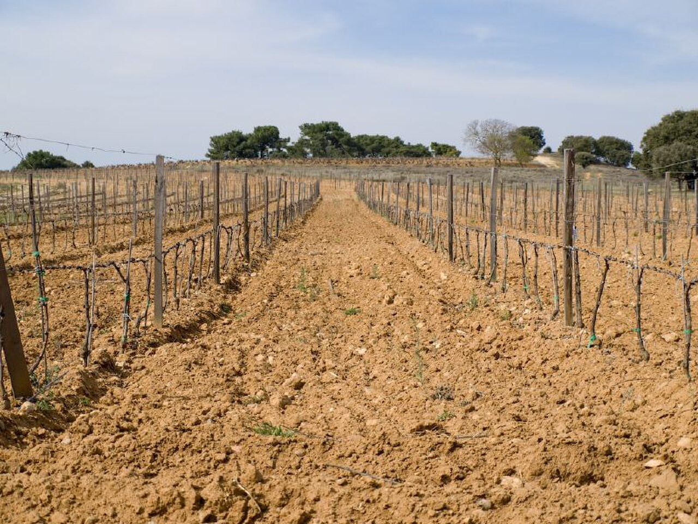

# 杜埃罗河岸

杜埃罗河岸（Ribera del Duero）是[西班牙](ref:spain)卡斯蒂利亚-莱昂自治区杜埃罗河沿岸的葡萄酒法定产区，以当地称为 Tinto Fino 的[丹魄](ref:tempranillo)为主。葡萄园位于海拔约 700–1000 米的高原，[红葡萄酒](ref:red-wine)以结构、成熟果味与橡木桶陈年见长。

图：杜埃罗河岸。摄影：Clear cultivation in Viñedos en la Ribera del Duero。署名：Raúl Hernández González，CC BY 2.0，来自 Wikimedia Commons（[来源](https://commons.wikimedia.org/w/index.php?curid=16192222)）。

## 地理与气候

杜埃罗河岸位于西班牙北部高原，杜埃罗河自东向西穿过产区，葡萄园分布在河谷两侧的台地与坡地上，海拔约 700–1000 米。气候属极端大陆性：夏季炎热、冬季寒冷，昼夜温差大，生长季较短。

高海拔与冷凉夜晚使葡萄在积累糖分的同时保留酸度；春季霜冻与秋季早霜是主要风险。年份差异明显，同一地块在不同年份的成熟度与产量可以相差很大。

## 「杜埃罗河岸」的时间线
杜埃罗河岸的现代声誉与贝加西西里亚等酒庄在 19 世纪后期以来的长期实践有关。1982 年产区获得法定产区地位，此后在国际市场上快速扩张，成为西班牙最重要的红葡萄酒产区之一。

历史与市场共同塑造了产区的风格取向：以丹魄为主体，强调成熟果味、结构与橡木桶陈年；与里奥哈相比，整体风格更集中、酒体更饱满。

## 子产区与范围

产区覆盖巴利亚多利德、布尔戈斯、索里亚与塞戈维亚等省份的部分市镇，沿杜埃罗河及其支流分布。不同地段的海拔、土壤与朝向造成成熟度差异。

产区内部没有像里奥哈那样固定的三个子区划分，但可按河流位置粗略区分：西部与中部海拔较高、气候更冷凉；东部部分地块更温暖。酒标上的村庄与酒庄信息比“子区”更具参考价值。

## 「杜埃罗河岸」的品种与风格坐标
[红葡萄酒](ref:red-wine)以[丹魄](ref:tempranillo)为主，当地称 Tinto Fino；常搭配[歌海娜](ref:grenache)、[赤霞珠](ref:cabernet-sauvignon)与[梅洛](ref:merlot)。丹魄带来黑樱桃、李子与烟草气息，赤霞珠与梅洛增加结构与香气层次。

白葡萄酒产量很小，主要使用阿比略等本地白葡萄。产区整体以红葡萄酒为核心，白葡萄酒多为清新风格，不是市场关注重点。

## 分级与陈年

红葡萄酒的常见分级为：Crianza 最短陈年 24 个月，其中至少 12 个月在橡木桶；Reserva 最短 36 个月，其中至少 12 个月在橡木桶；Gran Reserva 最短 60 个月，其中至少 24 个月在橡木桶。

桶陈使用[橡木桶](ref:oak-ageing)，法国桶与混合桶使用较普遍。新桶比例、烘烤程度与陈年长度决定香草、香料与单宁质感；部分酒庄刻意减少新桶比例以保留果味。发酵的基本逻辑可参见[发酵](ref:fermentation)。

## 土壤与地形

土壤以石灰岩、白垩土与冲积土为主，部分地块含砾石与黏土。排水性与保水性差异明显，影响根系深度与成熟节奏；高海拔地块通常酸度更好，低海拔地块果味更成熟。

地形以高原与河谷为主，坡向与河流调节温度。朝南坡面更温暖，靠近河流的地块湿度更高、霜冻风险不同。土壤与地形共同构成产区的风格基础。

## 酒标与年份

酒标通常标注 D.O. Ribera del Duero、年份、酒精度、容量与装瓶者。Crianza、Reserva、Gran Reserva 是陈年术语，不等于质量等级；同一术语下不同酒庄的表现差别很大。

年份反映当年的气候条件。春季霜冻、夏季高温与秋季降雨都会影响成熟度与产量，购买时应把年份与酒庄、地块一起看，而不是只看术语。

## 市场与饮用

杜埃罗河岸是西班牙高价红葡萄酒的重要来源，价格从日常酒款到顶级酒庄都有。市场风格长期在“浓郁桶陈”与“保留果味与酸度”之间摆动。

红葡萄酒常见[酒精度](ref:abv)约 13.5%–15% vol，适合搭配烤肉、炖肉、野味、菌菇与硬质奶酪，建议温度约 16–18 摄氏度。开瓶后可醒酒 30–60 分钟，具体因年份与酒款而异。本页关于杜埃罗河岸的内容涉及酒精饮料；过量饮酒有害健康，未成年人不应饮酒。

## 「杜埃罗河岸」容易被读错的地方
第一，把杜埃罗河岸与里奥哈等同。两者品种相近，但气候、海拔与风格重心不同。
第二，认为所有杜埃罗河岸红酒都很浓重。年份、地块与酒庄会带来明显差异。
第三，认为 Tinto Fino 是独立品种。它是丹魄在当地叫法。
第四，把 Gran Reserva 当成质量保证。术语描述陈年方式，不保证每一瓶都更好。
第五，把“Ribera”与“Ribera del Guadiana”混淆。后者是西班牙另一个产区。

杜埃罗河岸以当地称为 Tinto Fino 的丹魄为主，葡萄园位于海拔较高的高原，极端大陆性气候让成熟果味与结构并存；Crianza、Reserva 与 Gran Reserva 是按陈年时间划分的标识。高海拔与橡木桶不是质量保证，具体酒庄、年份与陈年方式才是判断依据。

对照阅读：[西班牙](ref:spain)、[歌海娜](ref:grenache)。

**关键事实。**

| 项目 | 内容 |
| --- | --- |
| 一句话定位 | 西班牙卡斯蒂利亚-莱昂自治区杜埃罗河沿岸的葡萄酒法定产区，以当地称为 Tinto Fino 的丹魄为主；葡萄园位于海拔约 700–1000 米的高原，气候极端大陆性，红葡萄酒以结构、成熟果味与橡木桶陈年见长，按 Crianza、Reserva 与 Gran Reserva 分级 |
| 层级 | 其他 |
| 所属 | 西班牙 |
| 国家代码 | ES |

**来源与边界。** 本页关于「杜埃罗河岸」的关键事实，主要由以下来源交叉核对：Consejo Regulador de la D.O. Ribera del Duero（杜埃罗河岸的范围、品种与陈年分级）、European Union（欧盟葡萄酒类别、地理标志与传统术语规则）、Oxford University Press（提供关于杜埃罗河岸、丹魄与贝加西西里亚的条目；由原条目末尾参考资料迁移，未逐条复核访问日期）等 5 条来源。价格、批次与状态会变，涉及这些字段时以页面所列来源的最新版本为准。正文为项目自写，来源只作核验，不复制原文。

**并读。** 把「杜埃罗河岸」与「西班牙」、「丹魄」、「歌海娜」放在一起读时，先确认它们是同一层级还是上下游关系：先确认边界与法定分类，再比较气候、土壤、海拔与代表酒款。本页负责给出产区的基本坐标，对照条目补上具体案例与差异；读完再回到本页，才能分清哪些差别属于产区本身，哪些只是产地、批次或品牌选择。

## 参考资料
- [西班牙](ref:spain)：杜埃罗河岸所属的国家产区框架。
- [丹魄](ref:tempranillo)：杜埃罗河岸的核心品种，当地称 Tinto Fino。
- [歌海娜](ref:grenache)、[赤霞珠](ref:cabernet-sauvignon)与[梅洛](ref:merlot)：常见的搭配品种。
- [红葡萄酒](ref:red-wine)：杜埃罗河岸最具代表性的类型。
- [橡木桶陈年](ref:oak-ageing)：Crianza 与 Reserva 分级的关键工艺。
- [发酵](ref:fermentation)：葡萄酒酿造的基础环节。
- [葡萄酒](ref:wine)：理解杜埃罗河岸的类别、年份与产地规则的入口。
- [酒精度](ref:abv)：13.5%–15% vol 在标签上的含义。
