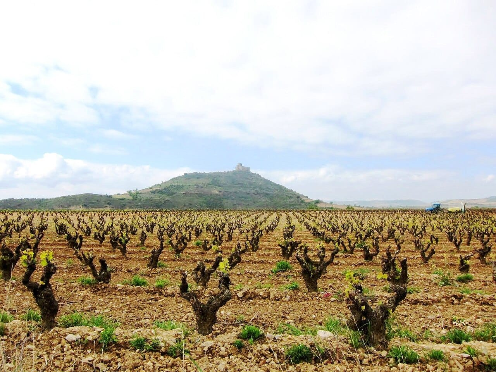
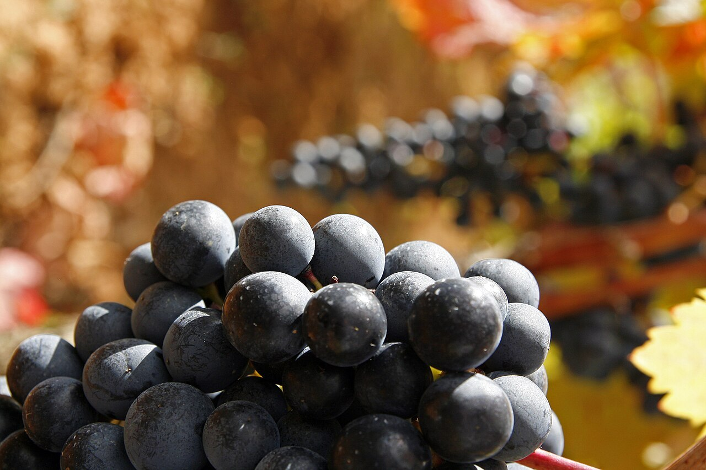

# 里奥哈

里奥哈（Rioja）是[西班牙](ref:spain)北部埃布罗河上游的葡萄酒法定产区，以[丹魄](ref:tempranillo)为主。产区分为里奥哈阿尔塔、里奥哈阿拉韦萨与里奥哈东方三个子区，[红葡萄酒](ref:red-wine)按 Crianza、Reserva 与 Gran Reserva 分级陈年。

图：里奥哈。摄影：A Rioja Vineyard - panoramio。署名：Art Anderson，CC BY-SA 3.0，来自 Wikimedia Commons（[来源](https://commons.wikimedia.org/w/index.php?curid=56546384)）。

## 地理与气候

里奥哈位于西班牙北部的埃布罗河谷及其支流地带，葡萄园分布在海拔约 400–700 米的丘陵与台地上。气候受大西洋与地中海双重影响：西部更凉爽湿润，东部更温暖干燥。

昼夜温差与秋季降雨决定成熟节奏。坎塔布连山脉阻挡部分大西洋湿气，使产区内部形成明显差异；同一品种在西部与东部可以表现出不同的酸度与果味成熟度。

## 「里奥哈」的时间线
里奥哈的现代葡萄酒业在 19 世纪后期快速发展，部分原因与法国葡萄园遭受根瘤蚜打击后市场空缺有关。20 世纪初产区开始建立规范，1925 年获得法定产区地位，1991 年成为西班牙首个 DOCa。

历史积累下来的陈年传统，使 Crianza、Reserva 与 Gran Reserva 这类术语成为里奥哈酒标的核心信息之一。理解这些术语，比记住某家酒庄的历史更重要。

## 子产区

- 里奥哈阿尔塔：位于产区西部，海拔较高、气候较凉爽，丹魄表现更紧致，酸度更清晰。
- 里奥哈阿拉韦萨：位于埃布罗河以北，土壤多石灰岩，酒体通常较轻，香气更细腻。
- 里奥哈东方：位于产区东部，气候更温暖干燥，歌海娜比例较高，果味更成熟。

三个子区不是等级高低，而是风格差异。同一酒庄可能跨子区收购葡萄，酒标上的子区信息应以法规与实际来源为准。

## 「里奥哈」的品种与风格坐标
[红葡萄酒](ref:red-wine)以[丹魄](ref:tempranillo)为主，常搭配[歌海娜](ref:grenache)、格拉西亚诺与马苏埃洛。丹魄带来红樱桃、李子与烟草气息，歌海娜增加成熟果味与酒精感，格拉西亚诺提升酸度与香气。

[白葡萄酒](ref:white-wine)以维乌拉为主，也有马尔瓦西亚与白歌海娜。白葡萄酒风格从清爽柑橘到桶陈的坚果与奶油气息都有，产量远小于红葡萄酒。

## 分级与陈年

红葡萄酒的常见分级为：Crianza 最短陈年 24 个月，其中至少 12 个月在橡木桶；Reserva 最短 36 个月，其中至少 12 个月在橡木桶；Gran Reserva 最短 60 个月，其中至少 24 个月在橡木桶。桃红与白葡萄酒的 Reserva 最短为 24 个月，其中至少 6 个月在橡木桶。

桶陈使用[橡木桶](ref:oak-ageing)，历史上美国桶使用较多，现代酒庄也使用法国桶或混合使用。桶的新旧比例、烘烤程度与陈年长度决定香草、香料与单宁质感。发酵的基本逻辑可参见[发酵](ref:fermentation)。

## 土壤与地形

里奥哈的土壤类型多样：西部与阿拉韦萨多石灰岩与黏土，东部多冲积土与砾石。排水性与保水性在不同地块差异明显，影响根系深度与成熟节奏。

地形以埃布罗河谷为中心，葡萄园分布在河谷两侧的坡地与台地。坡向、海拔与离河距离共同决定温度与湿度，这也是子区差异的物理基础。

## 酒标与年份

酒标通常标注 DOCa Rioja、子区、年份、酒精度、容量与装瓶者。Crianza、Reserva、Gran Reserva 是陈年术语，不等于质量等级；同一术语下不同酒庄的表现差别很大。

年份反映当年的气候条件。里奥哈的年份差异主要体现在成熟度、酸度与产量，购买时应把年份与子区、酒庄一起看，而不是只看术语。

## 市场与饮用

里奥哈是西班牙出口量最大的葡萄酒产区之一，价格从日常餐酒到高价 Gran Reserva 都有。市场风格长期在“传统长时间桶陈”与“现代果味优先”之间摆动。

红葡萄酒常见[酒精度](ref:abv)约 13%–14.5% vol，适合搭配烤肉、炖肉、菌菇与硬质奶酪，建议温度约 16–18 摄氏度。白葡萄酒适合海鲜与软质奶酪，建议温度约 8–10 摄氏度。本页关于里奥哈的内容涉及酒精饮料；过量饮酒有害健康，未成年人不应饮酒。

## 「里奥哈」容易被读错的地方
第一，把里奥哈等同于红葡萄酒。产区也生产白葡萄酒与桃红。
第二，把 Crianza 当成“年轻酒”。它要求最短 24 个月陈年。
第三，认为 Gran Reserva 一定优于 Reserva。术语描述陈年方式，不保证每一瓶都更好。
第四，认为里奥哈只用丹魄。歌海娜、格拉西亚诺与马苏埃洛也参与混酿。
第五，认为桶陈越久越好。过长桶陈可能掩盖果味，风格取决于目标。

里奥哈以丹魄为主，分为里奥哈阿尔塔、里奥哈阿拉韦萨与里奥哈东方三个子区；Crianza、Reserva 与 Gran Reserva 是按陈年时间划分的等级标识。它既有清爽红果，也有长时间桶陈带来的香料与皮革气息；“里奥哈”是大区名，子区与酒庄决定具体风格。

对照阅读：[西班牙](ref:spain)、[歌海娜](ref:grenache)。

**关键事实。**

| 项目 | 内容 |
| --- | --- |
| 一句话定位 | 西班牙北部埃布罗河上游的葡萄酒法定产区，以丹魄为主，分为里奥哈阿尔塔、里奥哈阿拉韦萨与里奥哈东方三个子区；红葡萄酒按 Crianza、Reserva 与 Gran Reserva 分级陈年，风格从清爽红果到长时间桶陈的香料与皮革气息都有 |
| 层级 | 其他 |
| 所属 | 西班牙 |
| 国家代码 | ES |

**来源与边界。** 本页关于「里奥哈」的关键事实，主要由以下来源交叉核对：Consejo Regulador de la DOCa Rioja（里奥哈的子区、品种与陈年分级）、European Union（欧盟葡萄酒类别、地理标志与传统术语规则；Reserva 与 Gran Reserva 的最短陈年与橡木桶时间）、Oxford University Press（提供关于里奥哈、丹魄与歌海娜的条目；由原条目末尾参考资料迁移，未逐条复核访问日期）等 7 条来源。价格、批次与状态会变，涉及这些字段时以页面所列来源的最新版本为准。正文为项目自写，来源只作核验，不复制原文。

**并读。** 把「里奥哈」与「西班牙」、「丹魄」、「歌海娜」放在一起读时，先确认它们是同一层级还是上下游关系：先确认边界与法定分类，再比较气候、土壤、海拔与代表酒款。本页负责给出产区的基本坐标，对照条目补上具体案例与差异；读完再回到本页，才能分清哪些差别属于产区本身，哪些只是产地、批次或品牌选择。

## 参考资料
- [西班牙](ref:spain)：里奥哈所属的国家产区框架。
- [丹魄](ref:tempranillo)：里奥哈的核心红葡萄品种。
- [歌海娜](ref:grenache)：里奥哈红葡萄酒的重要搭配品种。
- [红葡萄酒](ref:red-wine)与[白葡萄酒](ref:white-wine)：里奥哈的两个基本类型。
- [橡木桶陈年](ref:oak-ageing)：Crianza 与 Reserva 分级的关键工艺。
- [发酵](ref:fermentation)：葡萄酒酿造的基础环节。
- [葡萄酒](ref:wine)：理解里奥哈的类别、年份与产地规则的入口。
- [酒精度](ref:abv)：13%–14.5% vol 在标签上的含义。

## 相关图像

图：Tempranillo grapes from Rioja Alavesa。图片：María Jesús Tomé，CC BY 2.0，via Wikimedia Commons（[原图页面](https://commons.wikimedia.org/w/index.php?curid=16191821)）。关联图像：里奥哈。

图：Uga - Lanzarote - Spain. Vineyards -U16。图片：Luis Miguel Bugallo Sánchez，CC BY-SA 3.0，via Wikimedia Commons（[原图页面](https://commons.wikimedia.org/w/index.php?curid=17458062)）。关联图像：里奥哈。
