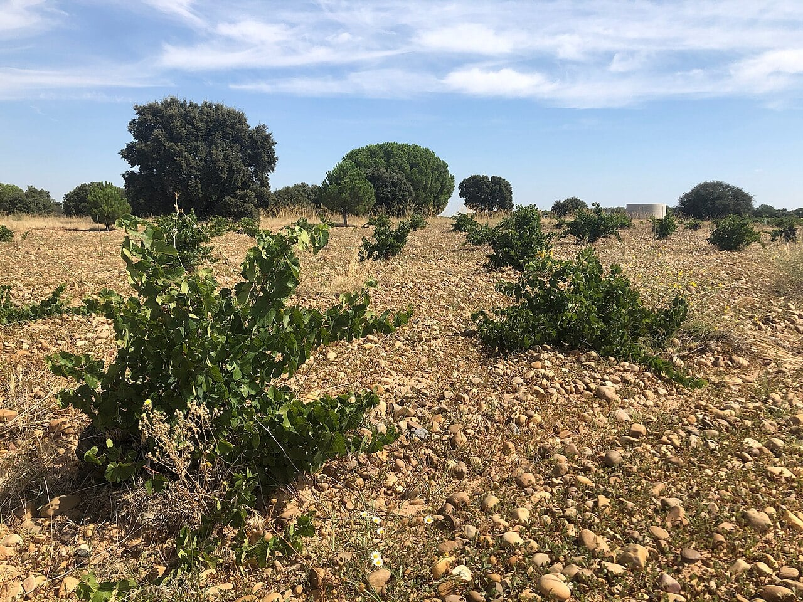

# 卢埃达

卢埃达（Rueda）是西班牙卡斯蒂利亚-莱昂的法定白葡萄酒产区，位于杜埃罗河上游的高平原上。它靠 Verdejo 建立起国际声誉，并在 1980 年成为该自治区第一个 DO，是理解西班牙现代白葡萄酒的关键产区。

图：卢埃达马丁桑乔（Martinsancho）葡萄园，石砾地上的老藤。图片：Carlosmartinmm34，CC BY-SA 4.0，via [原图页面](https://commons.wikimedia.org/wiki/File:Martinsancho_Vineyard.jpg)。

## 高原上的白葡萄酒产区

卢埃达位于卡斯蒂利亚-莱昂中部，葡萄园分布在巴利亚多利德、塞哥维亚与阿维拉三省交界的 74 个市镇。产区以白葡萄酒为主，也生产少量红与桃红。它与北面的鲁埃达河、杜埃罗河及其支流特拉班科斯、萨帕尔迭尔与阿达哈的阶地联系在一起。

产区的平均海拔远高于西班牙多数 DO：葡萄园位于 700 至 870 米之间。这个高度让它脱离典型的地中海低地气候，形成大陆性特征，也让卢埃达在西班牙白葡萄酒版图中显得格外清凉。

杜埃罗河在这里仍是年轻的河流，河谷尚未深切，台地开阔。这样的地形让冷空气在夜间沉积于低处，形成明显的温度分层；酒庄因此偏爱坡地与排水良好的砾石高地，而不是容易积霜的谷底。

## 1980 年与卡斯蒂利亚-莱昂的第一次

卢埃达的现代制度史可以精确到日期：1980 年 1 月 12 日，西班牙农业部正式授予其 DO 地位，使它成为卡斯蒂利亚-莱昂的第一个法定葡萄酒产区。在此之前，当地生产商已为争取承认与保护努力多年，1977 年还成立了临时监管委员会。

这一先发地位带来制度红利：卢埃达较早建立了品种与产量的规则体系，也较早把 Verdejo 从混酿配角推到前台。今天产区监管委员会仍负责酒标背标、年份评级与新增法定类别，例如 2021 年推出的 Gran Vino de Rueda。

## 海拔与大陆性气候

卢埃达的冬季寒冷而漫长，春季短暂且常有晚霜，夏季炎热干燥，间或出现雷暴。年降雨只有 300 至 500 升/平方米，根系必须深入底土寻找水分。年日照可达 2,600 小时，如果没有高海拔带来的凉爽夜晚，这样的日照会显得过量。

昼夜温差是产区的核心机制：白天的高温推动糖分积累，夜晚的低温保住酸度，使葡萄在成熟时仍能维持清晰的骨架。晚霜是主要风险，发芽晚、修剪常延续到 3 月或 4 月初，正是对这种风险的回应。

除霜冻之外，夏季雷暴与冰雹也会在短时间内破坏叶幕与果实，干旱年份则让产量进一步下降。当地种植者通过选择排水良好的地块、保留覆盖作物与分批采收来分散风险，这也是卢埃达酒款年份差异的主要来源之一。

## Verdejo 的十世纪

Verdejo 在卢埃达的种植历史已超过十个世纪。它皮较厚、酸度高，香气以野生草本、茴香、柑橘与核果为主，口感带有明显的提取物感与轻微的苦味收尾。这种"苦感"不是缺陷，而是许多卢埃达白葡萄酒辨识度的一部分。

2025 年采收中，Verdejo 占全部收成的 88.82%，白品种合计占 99.77%。这种单一品种的集中度在欧洲 DO 中相当少见。Sauvignon Blanc 也被允许种植，常用于增加香气张力；红品种如 Tempranillo 只占很小比例，多用于桃红或轻酒体红酒。

## 砾石阶地、老藤与栽培

产区的土壤以杜埃罗河及其支流的冲积与洪积阶地为主，表层是富含钙镁的棕色土，质地从砂壤到壤土，排水良好。山坡顶部有石灰岩露头，最优质的葡萄园常位于典型的砾石地块，砾石在白昼吸热、夜间释放，帮助成熟并促进排水。

卢埃达的葡萄树多为灌木式或短架式栽培，旱作依赖自然降水。老藤并非法定等级，但低产老藤在浓缩度上确有优势。当地也在推广滴灌与覆盖作物以应对干旱，不过灌溉受 DO 规则与水资源管理约束。

## 法定规则与酒标

卢埃达的法定产量、品种比例与陈年方式由监管委员会章程规定。酒标上可以出现 Rueda、Rueda Verdejo、Rueda Sauvignon Blanc 等不同标注，各自的品种要求不同；标注 Rueda Verdejo 的酒款须以 Verdejo 为主体，具体比例以官方章程为准。Gran Vino de Rueda 是面向高端餐饮的类别，对产量与来源有更严格的要求。

购买时应核对产区名、品种、年份与[酒精度](ref:abv)，并区分"Rueda"与"Rueda Verdejo"。不是所有卢埃达白葡萄酒都以 Verdejo 为主，混酿与单一品种的规则不同。

## 餐桌与常见误区

卢埃达白葡萄酒建议在 8 至 10 摄氏度饮用，适合海鲜、白肉、沙拉、软质奶酪与以香草调味的菜肴。温度过低会压抑香气，过高则让酸度显得松散，因此不要长时间把酒放在室温下。经[酒泥陈酿](ref:lees-ageing)或橡木桶处理的酒款可搭配烤鱼与奶油酱汁，陈年潜力也更好。多数酒款为[干型](ref:dry)，酸度是配餐的核心。

常见误区有三。第一，以为卢埃达只有 Verdejo：Sauvignon Blanc 与少量红品种也在法定范围内。第二，把高海拔等同于寒冷产区：卢埃达夏季依然炎热，关键是昼夜温差而非绝对低温。第三，认为所有卢埃达酒都必须年轻时喝：部分酒泥或桶陈酒款可以陈放数年。

对照阅读：[葡萄酒](ref:wine)、[西班牙](ref:spain)。

**关键事实。**

| 项目 | 内容 |
| --- | --- |
| 一句话定位 | 西班牙卡斯蒂利亚-莱昂的 DO 白葡萄酒产区，1980 年 1 月 12 日获得法定产区资格，是该自治区第一个 DO；范围覆盖巴利亚多利德、塞哥维亚与阿维拉三省的 74 个市镇 |
| 层级 | 其他 |
| 所属 | 西班牙 |
| 国家代码 | ES |

**来源与边界。** 本页关于「卢埃达」的关键事实，主要由以下来源交叉核对：Consejo Regulador de la D.O. Rueda（海拔 700–870 米、年降雨 300–500 升/平方米、年日照 2,600 小时、大陆性气候与砾石阶地；74 个市镇、1980 年 1 月 12 日获得官方地位以及卡斯蒂利亚-莱昂首个 DO）、Vinetur（2025 年采收中 Verdejo 占 88.82%、白品种占 99.77%）。价格、批次与状态会变，涉及这些字段时以页面所列来源的最新版本为准。正文为项目自写，来源只作核验，不复制原文。

## 参考资料

- [葡萄酒](ref:wine)：理解卢埃达的大类归属与产地规则。
- [白葡萄酒](ref:white-wine)：白葡萄酒的酿造与风格框架。
- [西班牙](ref:spain)：西班牙葡萄酒产区的整体格局。
- [Tempranillo](ref:tempranillo)：产区少量红葡萄酒使用的品种。
- [Sauvignon Blanc](ref:sauvignon-blanc)：常用于提升香气张力的白品种。
- [发酵](ref:fermentation)：低温发酵与香气保留。
- [酸度](ref:acidity)：昼夜温差对酸度的作用。
- [风土](ref:terroir)：高海拔、砾石与大陆性气候。
- [酒泥陈酿](ref:lees-ageing)：延长酒泥接触对质地的影响。
- [干型](ref:dry)：干型与残糖风格的区分。
- [酒精度](ref:abv)：酒标上 % vol 的含义。
