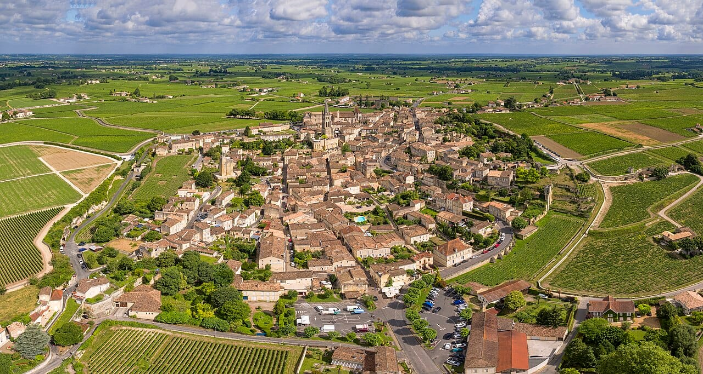

# 圣埃美隆

圣埃美隆是[波尔多](ref:bordeaux)右岸最容易被“分级”遮住的产区。人们记得 1955 年开始的列级名单，却容易忽略两套更基础的法定产区规则：圣埃美隆 AOC 与圣埃美隆特级（Saint-Émilion Grand Cru）AOC。前者产量上限为 46 百升/公顷，后者收紧到 40 百升/公顷，并要求至少 12 个月陈年与酒庄内装瓶。分级名单是在这两套规则之上再加的一层，理解顺序反过来，就会把“Grand Cru”误当成最高等级。

图：圣埃美隆。图片：Chensiyuan，CC BY-SA 4.0，via Wikimedia Commons（[原图页面](https://commons.wikimedia.org/wiki/File:1_Saint-%C3%89milion_aerial_pano_2016.jpg)）。

## 地理与范围

圣埃美隆位于吉伦特省，利布尔讷东北，葡萄园分布在圣埃美隆镇周边的台地、坡地与谷底。法定范围覆盖 9 个公社：圣埃美隆、圣克里斯托夫-德巴尔德（Saint-Christophe-des-Bardes）、圣艾蒂安-德利斯（Saint-Étienne-de-Lisse）、圣伊波利特（Saint-Hippolyte）、圣洛朗-德孔布（Saint-Laurent-des-Combes）、圣佩-达尔芒（Saint-Pey-d'Armens）、圣叙尔皮斯-德法莱朗（Saint-Sulpice-de-Faleyrens）、维尼奥内（Vignonet），以及利布尔讷南部的一小部分。两个 AOC 合计约 5400 公顷，800 多家酒庄，平均每家约 8 公顷，地块细碎是这个产区的基本事实。

## 气候

产区属海洋性气候，但受多尔多涅河与伊斯勒河影响，夏季比左岸更早升温，秋季降雨仍是主要风险。台地排水快、升温早，适合梅洛成熟；谷底湿度高、空气流动差，霜冻与霉病风险更大。近年高温与干旱频率上升，酒庄通过调整采收日期、保留覆盖作物与树冠管理来应对；年份差异因此不仅体现在糖度，也体现在酸度、单宁成熟与酒精度的平衡。

## 土壤与坡度：四种基本单元

圣埃美隆的[风土](ref:terroir)常被概括为石灰岩台地、黏土-石灰岩坡地、铁质砂层与谷底冲积土。台地覆盖星形石灰岩（calcaire à astéries），土层薄、排水好，赋予酒体结构与矿物感；坡地由弗龙萨代黏土（molasses du Fronsadais）与石灰岩碎屑混合，保水性强，适合梅洛的饱满果味；局部“铁渣层”（crasse de fer）含铁与砂，排水极快，常与品丽珠的花香和线条感联系在一起；谷底冲积土肥沃、水分多，通常用于较年轻的藤或产量较高的酒款。坡度不大，但海拔、朝向与土层厚度的微小变化足以改变成熟节奏。

## 品种与混酿

[红葡萄酒](ref:red-wine)以[梅洛](ref:merlot)为主，约占种植面积的 60%；[品丽珠](ref:cabernet-franc)约占 30%，赤霞珠约占 10%，另有少量马尔贝克与味而多。梅洛带来李子、黑樱桃、巧克力与柔顺单宁，品丽珠增加花香、铅笔芯、胡椒与结构，赤霞珠则在温暖年份补充骨架与黑色果味。混酿比例因酒庄、地块与年份而异；石灰岩台地上的品丽珠比例往往更高，黏土坡地则以梅洛为主。这里的酒不以左岸赤霞珠式的硬度取胜，而强调质地、果味密度与香料层次。

## 法定规则：两个 AOC

圣埃美隆 AOC 与圣埃美隆特级 AOC 是两个独立的法定产区，不是同一产区的质量分级。圣埃美隆 AOC 的产量上限为 46 百升/公顷；圣埃美隆特级 AOC 收紧到 40 百升/公顷，并要求至少 12 个月陈年、在酒庄内装瓶，还要通过两次品鉴审核。两套规则都规定品种、最低酒精度、修剪方式与采收条件。把“Grand Cru”理解为“特级”并不算错，但它首先是 AOC 名称，而不是 2022 年列级名单中的某个席位；列级名单只覆盖特级 AOC 范围内的部分酒庄。

## 分级制度：1955 年至 2022 年

圣埃美隆分级于 1955 年首次制定，此后大致每十年修订一次，是波尔多唯一会定期重排的列级体系。2022 年是第 7 次分级，于 9 月 8 日公布，共列出 85 家酒庄：2 家一级特等 A（Premiers Grands Crus Classés A）、12 家一级特等 B、71 家特等列级（Grands Crus Classés）。一级特等 A 为 Pavie 与 Figeac；Figeac 在 2022 年由 B 升入 A。分级依据包括酒款历年表现、地块、酿造与市场推广等多项指标，评审委员会由独立人士组成，名单每十年整体重审，而不是终身制。

## 退出与争议

2022 年名单最受关注的是退出。Ausone 与 Cheval Blanc 在 2021 年宣布不申请复核，Angélus 于 2022 年 1 月 5 日退出，La Gaffelière 于同年 6 月退出；四家酒庄仍以圣埃美隆特级 AOC 销售，只是不再出现在列级名单中。退出理由集中在评审标准对市场推广、接待设施与“声誉”权重过高，以及对生物动力、低 Intervention 等不同路线的兼容性。争议说明分级既是质量信号，也是商业与制度博弈的结果；读名单时需要同时看规则与酒庄选择。

## 卫星产区

圣埃美隆四周有四个卫星 AOC：蒙塔涅（Montagne）、吕萨克（Lussac）、皮瑟吉安（Puisseguin）与圣乔治（Saint-Georges），名称均以“-Saint-Émilion”结尾。它们共享相近的品种与气候，但法定范围、产量上限与市场定位不同，价格通常低于圣埃美隆核心区。卫星产区不是“次等圣埃美隆”，而是独立命名的产地；部分地块与核心区相邻，土壤连续，风格差异更多来自酒庄而非边界。

## 风格与年份

圣埃美隆的酒通常比左岸更早适饮，年轻时有红樱桃、李子、甘草与可可，陈年后发展出雪松、皮革、松露与泥土。好年份与好地块仍可陈年数十年，关键在酸度、单宁质量与萃取克制。2018、2019 与 2020 普遍被视为成熟度高、果味充沛的年份；2021 更凉爽，酒体较轻、酸度更高；2022 炎热干旱，酒精度与浓度偏高，酒庄通过早采与柔和萃取保持平衡。年份描述是倾向，不是统一结论，地块与酒庄差异会覆盖年份平均值。

## 代表生产者

除 2022 年列级名单中的 Pavie、Figeac、Canon、Bélair-Monange、Beau-Séjour Bécot、Troplong Mondot 等，圣埃美隆还有 Valandraud、Tertre Roteboeuf、La Mondotte 等推动“车库酒”与低产量路线的酒庄，以及大量家族小庄园。Ausone、Cheval Blanc、Angélus 与 La Gaffelière 虽退出分级，仍是产区最重要的名字之一。评价酒款时，分级、年份、地块、酿造与装瓶信息应一起看；单看级别容易把制度标签当成风味判断。

## 市场与旅游

圣埃美隆是波尔多右岸的旅游中心。中世纪小镇与地下采石场在 1999 年以“圣埃美隆辖区”列入联合国教科文组织世界遗产；始于 12 世纪的 Jurade 至今仍承担产区大使与春季评酒的角色。销售上，期酒体系、酒商网络与出口市场并行，中国、美国、日本与欧洲是重要买家；卫星产区与小型酒庄更多依赖直销、餐厅与酒庄旅游。分级变动会短期影响价格，但长期仍由年份、供需与酒款表现决定。

## 常见误区

第一，把“Grand Cru”当成分级最高等级。它首先是法定产区名称，与列级名单不是同一回事。
第二，认为分级一成不变。分级每十年重审，酒庄可能升降或退出。
第三，认为右岸只用梅洛。品丽珠约占 30%，在部分地块承担主导角色。
第四，把圣埃美隆当成波尔多的次要部分。右岸有独立的土壤、品种与市场逻辑。
第五，认为右岸酒不耐陈年。结构好的酒款可以陈年很久，关键是年份与保存状态。
第六，只看分级不看年份与酒庄选择。分级反映某一轮评审，年份与酿造才决定当下表现。

## 延伸阅读

- [波尔多](ref:bordeaux)：圣埃美隆所属的上级产区。
- [梅洛](ref:merlot)：右岸的主力品种。
- [品丽珠](ref:cabernet-franc)：提供花香与结构的混酿品种。
- [红葡萄酒](ref:red-wine)：圣埃美隆的主要酒类。
- [风土](ref:terroir)：台地、坡地与土壤如何影响风格。

## 相关图像

图：品丽珠。图片：Viala et Vermorel，Public domain，via Wikimedia Commons（[原图页面](https://commons.wikimedia.org/wiki/File:Cabernet-franc.jpg)）。关联图像：圣埃美隆。

图：风土（terroir）。图片：Friedrich Petersdorff，CC BY-SA 2.0 de，via Wikimedia Commons（[原图页面](https://commons.wikimedia.org/wiki/File:080110_zell_mosel.JPG)）。关联图像：圣埃美隆。
