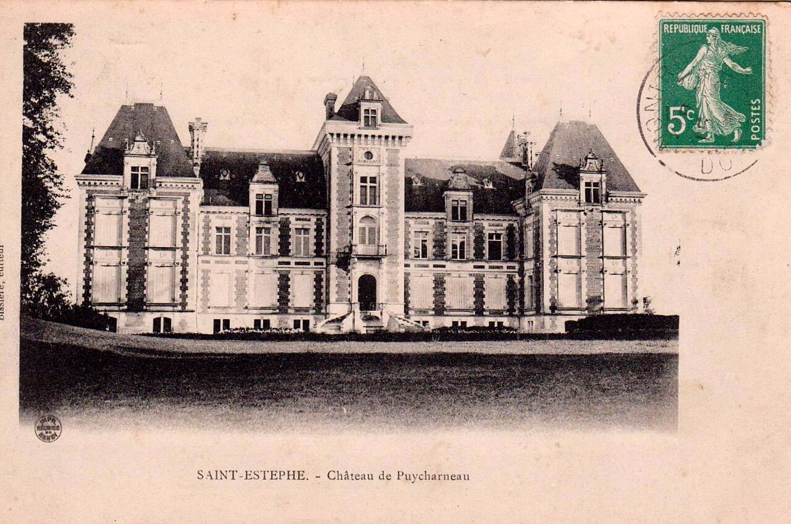

# 圣埃斯泰夫

梅多克最北端的村庄级 AOC，以黏土与砾石混合的土壤、较高比例的梅洛与更紧的单宁著称；1855 年分级的二级庄 Cos d’Estournel、Montrose 与三级庄 Calon-Ségur 是产区标志。

圣埃斯泰夫是波尔多左岸最北的产区，黏土比例高、Cabernet Sauvignon 成熟慢；酒体紧、单宁高、陈年长，风格比 Pauillac 更泥土、更质朴。

图：Saint-Estèphe：Saint-Estèphe - château du Puycharneau 1（Wikimedia Commons）。图片：Unknown Unknown circa 1900-1920，Public domain，via Wikimedia Commons（[原图页面](https://commons.wikimedia.org/wiki/File:Saint-Est%C3%A8phe_-_ch%C3%A2teau_du_Puycharneau_1.jpg)）。

## 定义与边界

圣埃斯泰夫是[波尔多](ref:bordeaux)左岸梅多克最北的葡萄酒产区，位于吉伦特河口西岸，北接 Saint-Seurin、南邻 Pauillac；它以黏土与砾石土壤、高单宁与强陈年潜力著称。

圣埃斯泰夫不是“Pauillac 的附属”：它的土壤更黏、气候更冷，Cabernet Sauvignon 成熟更慢，酒体更紧、更质朴；与 Pauillac 的雪松与力量比，它更偏泥土与单宁。

产区的边界包括 Saint-Estèphe 村与周边地块，AOC 只覆盖指定区域；酒标上的“Saint-Estèphe”比“Médoc”更能说明风格。

## 历史与命名

圣埃斯泰夫的葡萄酒史与修道院、贵族庄园和港口贸易有关；18 世纪，Cos d’Estournel、Montrose 等酒庄已向英国与荷兰出口。

1855 年分级把 Cos d’Estournel 与 Montrose 列为二级庄，Calon-Ségur 列为三级庄；这些酒庄的排名与风格，至今仍是圣埃斯泰夫的标志。

“Saint-Estèphe”以圣埃斯泰夫教堂命名，产区历史与村庄、教堂、河口贸易交织，不是单一的“名庄叙事”。

Cos d’Estournel 的“pagoda”塔楼建于 19 世纪，是圣埃斯泰夫最醒目的地标；Montrose 的城堡与砾石丘，则展示产区更冷、更紧的一面。

1855 年分级后，圣埃斯泰夫的二级庄与三级庄在市场上形成不同定位；20 世纪，酒庄更新酒窖与种植，风格从粗犷转向更精细。

圣埃斯泰夫的村庄与教堂在 18 世纪已是葡萄酒贸易的中心；1855 年分级后，Cos d’Estournel 与 Montrose 的竞争，推动了产区的酒窖与种植改良。

## 地理与风土

圣埃斯泰夫的土壤以黏土、砾石与砂土为主，黏土比例高于 Pauillac；黏土保水、保肥，让 Cabernet Sauvignon 在干燥年份也能成熟，但也让单宁更紧、成熟更慢。

吉伦特河口调节温度，海洋性气候让生长季较长；北部的酒庄更冷、更晚熟，南部的砾石丘更暖、更早熟。

圣埃斯泰夫的风险是春季霜冻、夏季冰雹与采收期降雨；黏土排水差，需要深根砧木与排水管理。

圣埃斯泰夫的黏土来自河口沉积，保水性强；砾石丘排水好、储热强，适合 Cabernet Sauvignon。黏土与砾石的分布，决定酒庄的品种比例与风格。

吉伦特河口与海洋性气候让圣埃斯泰夫比 Pauillac 更冷、更晚熟；北部的酒庄常需要更长时间陈年，南部的砾石丘更早熟、更柔。

圣埃斯泰夫的黏土在干旱年份能保住水分，在潮湿年份则排水较慢；酒庄通过深根砧木、排水沟与冠层管理来平衡。砾石丘的储热，让 Cabernet 在冷凉年份也能成熟。

## 原料与风格

圣埃斯泰夫以[赤霞珠](ref:cabernet)（Cabernet Sauvignon）为主，[梅洛](ref:merlot)（Merlot）、Cabernet Franc、Petit Verdot 为辅；红葡萄酒带黑醋栗、黑樱桃、泥土、雪松、烟草与皮革，单宁高、酸度中等，陈年潜力 15–30 年。

与 Pauillac 比，圣埃斯泰夫更质朴、更泥土、更少雪松；与 Margaux 比，它更紧、更少花香。年轻时常显得硬，陈年后才展开。

部分酒庄用较高比例的 Merlot 柔化单宁，但圣埃斯泰夫的核心仍是 Cabernet 的骨架与黏土的重量。

圣埃斯泰夫的 Cabernet Sauvignon 常占 60–70%，Merlot 20–30%，Petit Verdot 与 Cabernet Franc 少量；酒精度 13–13.5%，单宁高、酸度中等。

年轻酒带黑醋栗、黑樱桃、泥土、雪松与烟草；陈年后出现皮革、蘑菇、干果与矿物。与 Pauillac 的雪松与力量比，它更泥土、更质朴。

圣埃斯泰夫的 Petit Verdot 常在高比例混酿中出现，给酒增加颜色、单宁与香料；Cabernet Franc 则给花香与酸度。读背标的品种比例，能解释酒的紧致与香气。

## 代表生产者与酒款

Cos d’Estournel 以异国情调的塔楼与香料风格闻名；Montrose 以紧致、长寿与泥土感著称；Calon-Ségur 以“心形”酒标与优雅风格代表；Lafon-Rochet、Phélan Ségur 也是产区代表。

这些酒庄的酒标常标“Saint-Estèphe”与分级；读背标的品种比例与年份，比只看酒庄名更能判断风格。

Cos d’Estournel 的“G d’Estournel”与正牌、Montrose 的正牌与“Dame de Montrose”、Calon-Ségur 的正牌，是圣埃斯泰夫的代表；Lafon-Rochet 与 Phélan Ségur 更亲民。

## 上桌方式

温度 16–18°C，用大肚红酒杯；年轻酒醒酒 2 小时以上，老酒换瓶去沉淀。配餐适合烤牛排、羊排、野味、蘑菇与硬质奶酪；高单宁需要脂肪与蛋白质。

圣埃斯泰夫不适合配清淡海鲜或辛辣菜；年轻酒的紧涩是正常的，配餐与醒酒能柔化。

圣埃斯泰夫的红葡萄酒适合配烤牛排、羊排、野味、蘑菇与硬质奶酪；年轻酒醒酒 2 小时以上，老酒换瓶去沉淀。温度 16–18°C，杯型宜大，单宁需要空气。

圣埃斯泰夫的老酒适合配简单烤肉，让泥土、皮革与雪松的香气自己展开。

## 选购与误区

买圣埃斯泰夫先看年份：冷凉年份更紧、更需要陈年，温暖年份更饱满、更早熟；再看酒庄与分级，Cos、Montrose、Calon-Ségur 风格差异大。

常见误读：把圣埃斯泰夫当成 Pauillac 的“北部延伸”；以为高单宁就是粗糙；以为所有圣埃斯泰夫都一样重。黏土与年份让它的风格从紧到柔都有。

圣埃斯泰夫的年份差异大：冷凉年份更紧、更需要陈年，温暖年份更饱满、更早熟；买老酒时，看储存与装瓶历史，比看年份更重要。

常见误读：把圣埃斯泰夫当成“Pauillac 的北部”；以为高单宁就是粗糙；以为所有圣埃斯泰夫都一样重。黏土、年份与酒庄让风格有细有粗。

圣埃斯泰夫的酒适合长期存放，买之前确认储存条件；如果只想近期饮用，选年份较暖、Merlot 比例较高的酒款，单宁会更柔。

## 参见

- [波尔多](ref:bordeaux)：左岸与右岸的产区体系。
- [赤霞珠](ref:cabernet)：圣埃斯泰夫的主导品种。
- [梅洛](ref:merlot)：柔化单宁的混酿品种。
- [红葡萄酒](ref:red)：红葡萄的发酵与结构。
- [橡木桶陈酿](ref:oak)：桶陈与单宁柔化。

**关键事实。**

| 项目 | 内容 |
| --- | --- |
| 一句话定位 | 梅多克最北端的村庄级 AOC，以黏土与砾石混合的土壤、较高比例的梅洛与更紧的单宁著称；1855 年分级的二级庄 Cos d’Estournel、Montrose 与三级庄 Calon-Ségur 是产区标志 |
| 层级 | 其他 |
| 所属 | 波尔多 |
| 国家代码 | FR |

**来源与边界。** 本页关于「圣埃斯泰夫」的关键事实，主要由以下来源交叉核对：INAO（法国原产地与地理标志主管机构）、OIV（葡萄酒定义、产区统计与全球生产框架）、FAO（农业地理、气候与土地利用背景）等 4 条来源。价格、批次与状态会变，涉及这些字段时以页面所列来源的最新版本为准。正文为项目自写，来源只作核验，不复制原文。

## 相关图像

图：梅洛。图片：Felloni claire，CC BY-SA 4.0，via Wikimedia Commons（[原图页面](https://commons.wikimedia.org/wiki/File:Merlot.jpg)）。关联图像：圣埃斯泰夫。

图：红葡萄酒类型示意图。项目自制双语视觉卡，示意性编辑图，不是现场照片。关联图像：圣埃斯泰夫。
