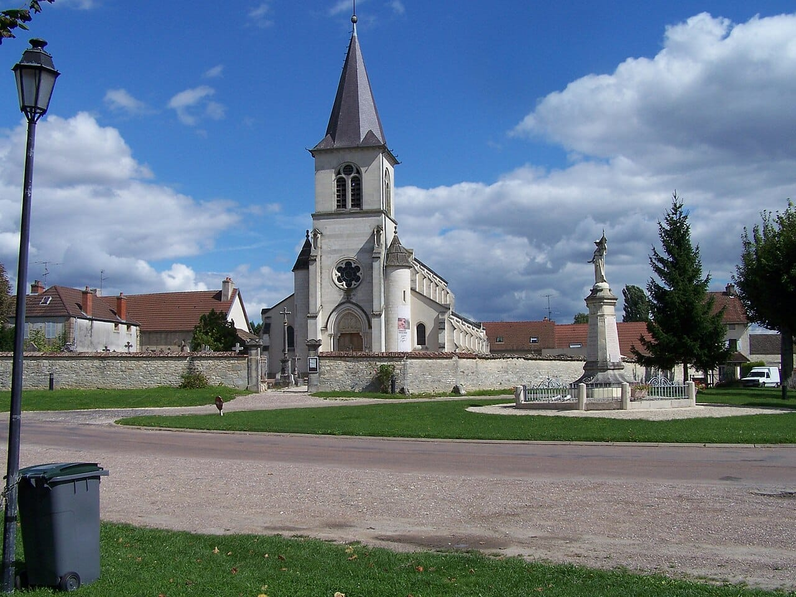

# 圣朱利安

圣朱利安（Saint-Julien）是吉伦特河口左岸、波亚克与玛歌之间的红葡萄酒法定产区，1936 年 11 月 14 日获得 AOC 地位。它的葡萄园面积不大，却集中了 11 家 1855 年列级庄，其中 5 家为二级庄；整个村庄没有一级庄，这种“高密度、无顶点”的结构，是它与波亚克、玛歌最显著的差别。

图：圣朱利安。图片：Christian LAFORET，CC0，via Wikimedia Commons（[原图页面](https://commons.wikimedia.org/wiki/File:EGLISE_DE_SAINT_jULIEN-20-11-2010.jpg)）。

## 定义与范围

Saint-Julien 只适用于来自划定地块、并在区内完成发酵与陈年的静止红[葡萄酒](ref:red-wine)。法定范围以 Saint-Julien-Beychevelle 公社为主体，北接波亚克，南邻玛歌，东侧面向吉伦特河口。村庄名中的 Beychevelle 既是地名，也是产区历史的一部分，容易与酒庄名混淆。

产区面积不大，地块却相对集中，因此“圣朱利安”在酒标上往往意味着一个清晰的风格预期：结构完整、单宁细密、果味与雪松气息平衡。它不像波亚克那样以三大一级庄为标志，也不像玛歌那样以香气取胜，而是靠整体一致性建立声誉。

在梅多克四大村庄的常见排序里，圣朱利安往往被放在“最稳定”的位置：它没有极端的酒体，也很少出现风格断裂，适合作为理解左岸结构的入门产区。产区的产量与酒庄数量都有限，因此市场上同名酒款并不多，这也是它价格相对温和、风格容易被识别的原因之一。

没有一级庄不等于没有顶级酒；1855 年分级只列了当时的酒庄，今天的酒质与价格要另行判断。

## 一条近乎连续的砾石脊

圣朱利安的葡萄园沿一条近乎连续的砾石脊展开，脊线从北部的 Beychevelle 一直延伸到南端。砾石覆盖在黏土与石灰岩之上，排水良好，根系被迫向下寻找水分，因而在干旱年份仍能保持稳定。

与波亚克的三组丘脊相比，圣朱利安的砾石带更窄、更连续，地块之间的差异没有那么大。这种地质上的“连续性”，常被用来解释为什么这个村庄的列级庄整体风格接近：它们共享相似的排水条件、朝向与成熟节奏。

砾石层之下是砂质黏土与石灰岩，部分地块还混有砾石砂；这种组合既保证排水，又在夏季向根系提供少量水分。靠近河口的低地更凉，内陆坡面更暖，成熟差异因此被压缩在较小范围内。

## 1855 年分级：没有一级庄的结构

1855 年为巴黎世界博览会制定的梅多克分级，在圣朱利安列出了 11 家列级庄：5 家二级庄、2 家三级庄、4 家四级庄，没有一级庄，也没有五级庄。它是梅多克四大村庄中唯一没有一级庄的产区，这一结构直接影响了市场认知。

没有一级庄，意味着没有单一酒庄可以代表整个村庄，价格也更分散。对消费者而言，这既是机会也是陷阱：可以用较低价格买到结构接近一级庄的酒，但也更容易被“列级庄”三个字误导，忽略具体酒庄与年份。

## 五个二级庄与三个层级

五家二级庄分别是 Léoville-Las Cases、Léoville-Poyferré、Léoville-Barton、Ducru-Beaucaillou 与 Gruaud-Larose。三家 Léoville 同源而分家，地块位置与风格各有差异；Ducru-Beaucaillou 靠近河口，Gruaud-Larose 的园地更向内陆展开。

两家三级庄为 Lagrange 与 Langoa-Barton，四家四级庄为 Beychevelle、Branaire-Ducru、Talbot 与 Saint-Pierre。这个“5 + 2 + 4”的层级，使圣朱利安成为观察 1855 年分级内部结构的好样本：同一村庄内，等级、地块与价格彼此交错。

三个 Léoville 的分家与继承有关，酒庄名称由此分裂；直到今天，它们的园地仍彼此相邻，价格却已拉开。读者若只记“二级庄”，会错过这段历史造成的差异。

## 品种与风格

法定品种与波尔多左岸一致，包括[赤霞珠](ref:cabernet-sauvignon)、[梅洛](ref:merlot)、品丽珠、小维多、马尔贝克与佳美娜。赤霞珠通常占多数，提供骨架与陈年潜力；梅洛柔化中段，品丽珠与小维多补充香气与颜色。

法定最低自然酒精度为 11%。风格上，圣朱利安常被描述为“兼具波亚克的坚实与玛歌的细腻”：年轻时单宁明显但不粗糙，陈年后出现雪松、黑醋栗、烟草与石墨气息。与波亚克相比，它的酒体略轻，与玛歌相比，它的结构更紧。

## 酿造与陈年

发酵后在[橡木桶](ref:oak-ageing)中陈年，桶陈时长因酒庄而异，常见为一年半到两年。新桶比例、桶型与是否带酒泥陈年，都会改变单宁的质感与香气的开放速度。

圣朱利安的赤霞珠比例较高，单宁需要时间整合；优质年份在十年左右进入适饮期，结构更强的年份可以陈放更久。年轻酒款适合搭配红肉与硬质奶酪，陈年酒款则更适合与禽类、蘑菇与中等浓度的菜肴搭配。

圣朱利安的酒在年轻时往往比玛歌更紧闭，醒酒时间需要更长；陈年后，赤霞珠的骨架与梅洛的圆润结合，形成中等酒体、细密单宁与雪松香气的组合。

## 酒标与选购

酒标上的 Saint-Julien 必须与产区一致；核对年份、酒精度、容量、装瓶者与酒庄名。列级庄标识只反映 1855 年名单及其后续个别调整，不代表当前品质。还要区分 Saint-Julien 与 Saint-Julien-Beychevelle：前者是产区，后者是公社名，酒标写法不同。

同一年份下，不同列级庄的价格差异可能很大；选购时优先核对酒庄、地块与年份，而不是只看“二级庄”标签。

对照阅读：[法国](ref:france)、[赤霞珠](ref:cabernet-sauvignon)。

**关键事实。**

| 项目 | 内容 |
| --- | --- |
| 一句话定位 | 位于波亚克与玛歌之间的吉伦特河口左岸红葡萄酒法定产区，1936 年 11 月 14 日获 AOC 地位，法定最低自然酒精度 11%；1855 年分级在本村列出 11 家列级庄，其中二级庄 5 家、三级庄 2 家、四级庄 4 家，没有一级庄，是梅多克四大村庄中唯一缺少一级庄的产区，葡萄园沿一条近乎连续的砾石脊展开 |
| 所属 | 法国 |
| 国家代码 | FR |

**来源与边界。** 本页关于「圣朱利安」的关键事实，主要由以下来源交叉核对：République française（Saint-Julien 由 1936 年 11 月 14 日法令设立、法定最低自然酒精度 11% 以及村庄级产区的管理框架）、INAO（AOC 管理与 cahier des charges 的官方地位）、Conseil Interprofessionnel du Vin de Bordeaux（波尔多产区分层与村庄级产区的背景）等 4 条来源。价格、批次与状态会变，涉及这些字段时以页面所列来源的最新版本为准。正文为项目自写，来源只作核验，不复制原文。

## 参考资料

- [法国](ref:france)：AOC 制度与国家级产区框架。
- [波尔多](ref:bordeaux)：左岸村庄级产区的整体结构。
- [赤霞珠](ref:cabernet-sauvignon)：圣朱利安混酿的主导品种。
- [梅洛](ref:merlot)：柔化中段与增加早熟果味的角色。
- [红葡萄酒](ref:red-wine)：圣朱利安的类别、单宁与酿造概览。
- [橡木桶陈年](ref:oak-ageing)：桶陈对单宁与香气的影响。

## 相关图像

图：橡木桶陈酿的编辑插图：桶壁烘烤层、酒液与取样管；AI 辅助绘制，不是酒窖实拍。图片：Hejiu 编辑团队，使用豆包 Seedream 5.5 AI 辅助生成；项目自制，不是现场照片（[项目说明](https://hejiu.org/about/)）。关联图像：圣朱利安。

图：Moët & Chandon vineyards in Verzenay, Champagne, France。图片：Mustang Joe，CC0，via Wikimedia Commons（[原图页面](https://www.flickr.com/photos/63234672@N04/13180177073)）。关联图像：圣朱利安。
