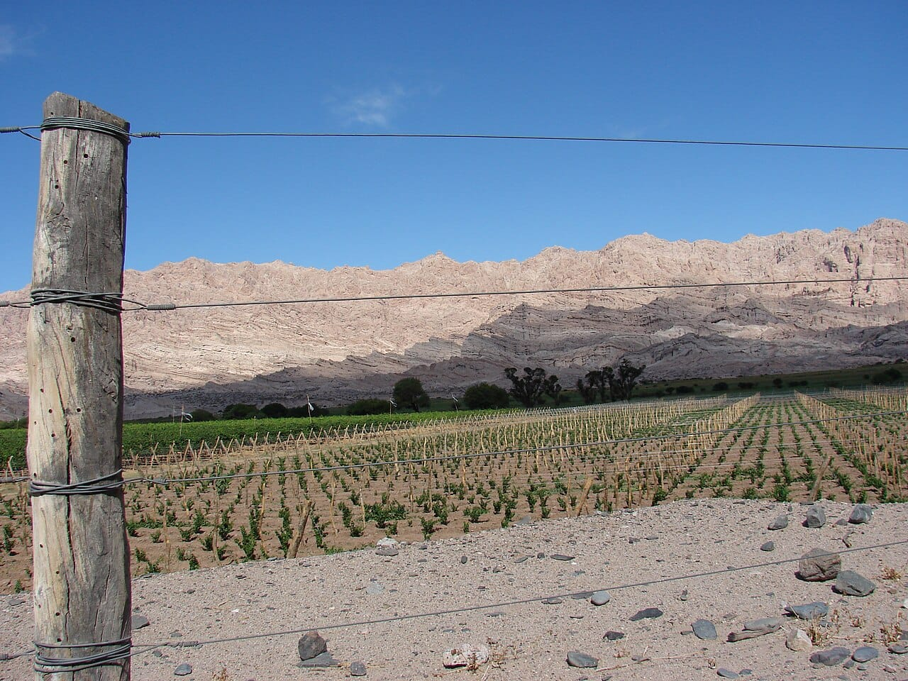
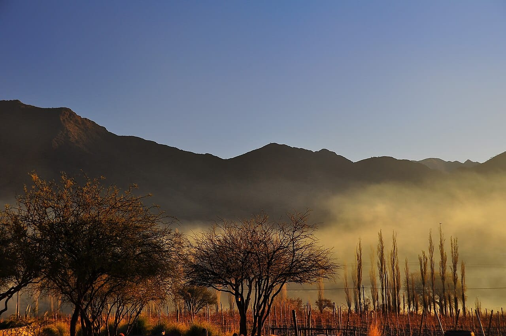
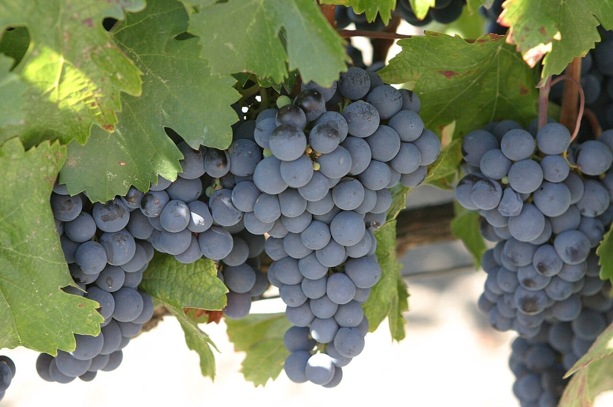

# 萨尔塔

阿根廷西北部的高海拔葡萄酒产区，核心在萨尔塔省的卡法亚特谷；海拔 1,700–3,000 米、日照强、昼夜温差大，以特浓情白葡萄酒与高海拔马尔贝克著称。

图：Salta：Angastaco Salta（Wikimedia Commons）。图片：CarlosA.Barrio，CC BY-SA 4.0，via Wikimedia Commons（[原图页面](https://commons.wikimedia.org/wiki/File:Angastaco_Salta.JPG)）。

## 先划清「萨尔塔」的边界
萨尔塔位于[阿根廷](ref:argentina)西北部，距布宜诺斯艾利斯约 1,500 km，葡萄园沿卡尔查基河谷（Valles Calchaquíes）分布；这是一条南北长约 520 km 的高海拔河谷，地处南纬 26° 附近、南回归线略南。省内登记有五个地理标志：Cafayate、Cachi、Molinos、San Carlos 与 Salta；跨省份的卡尔查基河谷 GI 还延伸至卡塔马卡与图库曼两省。

葡萄园海拔区间为 1,500–3,111 m，是全球最高的商业化葡萄园带之一；核心卡法亚特镇海拔 1,683 m，镇周葡萄园约 1,650–2,000+ m。省境西接智利、北邻玻利维亚，葡萄园集中在东部高山河谷，不在西部安第斯主脉。全省约 3,600 ha 在耕，卡法亚特占其中约 75%；萨尔塔产量仅占全国约 1%，但在国际评审中获奖比例偏高。

阿根廷没有法国式 AOC 分级，酒标上的 GI 只标示产地范围；地块、海拔与生产者比大区名更能指示风格。

## 历史与命名

西班牙殖民时代葡萄传入西北河谷。现存记载中，Bodega Colomé 于 1831 年由萨尔塔最后一任西班牙总督 Nicolás Severo de Isasmendi y Echalar 创立，位于 Molinos，是阿根廷连续经营最久的酒庄。1854 年其女 Ascensión 引入根瘤蚜前的法国马尔贝克与赤霞珠苗木，部分老藤至今仍在结果。

1892 年，法国来的 Michel 兄弟在卡法亚特创立 El Esteco，园内保留着树龄 70 年以上的 Criolla 与特浓情老藤；1862 年 Etchart 种下的特浓情园是阿根廷仍在结果的最老葡萄园之一。现代精品酒时代从 1988 年 San Pedro de Yacochuya（Etchart 与 Rolland 合作）起步；1998 年 Donald Hess 踏勘南美，2001 年收购 Colomé，把高海拔酒作为独立品类推动；Colomé 自 2005 年由酿酒师 Thibaut Delmotte 主持，2009 年庄园内 James Turrell 美术馆开放。

卡法亚特镇名来自 Diaguita-Calchaquí 土著群体 Cafayates；市镇 1840 年前后由传教聚落发展而来，1863 年正式设县。

## 「萨尔塔」的地理与风土
气候为高海拔荒漠半大陆型：年降水 150–250 mm，集中在短夏季；年日照超过 300 天，昼夜温差常达 15–20°C，紫外线比海平面强 30%–40%。夏季白天可达 35°C 上下，夜间降至 10–15°C；西侧安第斯山与 Sierra del Cajón 挡住水汽，河谷处于雨影区。白天暖、夜间冷，葡萄在积累糖分的同时保留酸度；低湿空气压低病害压力，主要天气风险是夏季冰雹。

土壤随谷地变化：卡法亚特以冲积砾石与砂壤土为主，排水快、养分低；Molinos 一带偏火山土；San Carlos 为砂壤土混合。贫瘠土壤迫使根系深扎，果穗小、风味集中。

降水稀少，灌溉全靠安第斯融雪与河谷地下水：老园多为棚架（parral）与渠道漫灌，新植多改篱架滴灌。海拔、坡向与融雪水源把河谷切成多个微气候单元。

## 原料与风格

白葡萄旗舰是特浓情 Riojano（Torrontés Riojano），由亚历山大麝香与 Criolla Chica 自然杂交而来，干型，玫瑰与柑橘花香明显，矿物感与酸度高于门多萨同类；其他白品种有[霞多丽](ref:chardonnay)、长相思。红葡萄中[马尔贝克](ref:malbec)约占红藤面积六成，另有赤霞珠、西拉、美乐、品丽珠、丹娜与黑皮诺。

高海拔马尔贝克比低地版本更紧、更花香，红果与紫罗兰气息突出，单宁结实而酸度明亮；赤霞珠与西拉结构感更强。[白葡萄酒](ref:white)以新鲜芳香为主，[红葡萄酒](ref:red)靠厚皮与强日照积累颜色与多酚。

整体风格明亮、高酸、果香直接；新藤与老藤、棚架与篱架、传统混酿与单品种并存。传统 Criolla 品种在老园仍有保留，多用于本地日常酒与混酿；部分百年前后的老藤采用棚架栽培，果穗通风好、产量低。

## 代表生产者与酒款

Bodega Colomé 在 Molinos 与周边拥有四个海拔 2,300–3,111 m 的葡萄园，其中 El Arenal 园位于 2,600 m，Colomé 本庄园位于 2,300 m；Altura Máxima 园位于 3,111 m，属全球最高商业葡萄园之一。酒款分 Estate、Auténtico、Lote Especial、Reserva 与 Altura Máxima 系列。

Bodega El Esteco 1892 年创立于卡法亚特，海拔约 1,700 m，是当地规模最大的酒庄之一，代表酒款有 Altimus 混酿与 Don David Reserva；Piattelli 在卡法亚特以沙砾土与融雪灌溉园出产特浓情与高海拔马尔贝克；San Pedro de Yacochuya 位于约 2,035 m，是 1988 年开启现代精品时代的标志酒庄。

这些名字不是官方等级，而是市场口碑参照。老牌酒庄有 19 世纪传下的老藤与庄园建筑，新派酒庄在海拔上限与品种试验上更激进；买前看清海拔、品种与是否庄园装瓶。

## 「萨尔塔」的上桌方式
特浓情干白 10–12°C 饮用，配海鲜、白肉、轻奶酪与开胃小食，玫瑰花香呼应柑橘与辛香菜肴；高海拔马尔贝克 16–18°C，年轻款可短暂醒酒，配烤红肉、炖肉与野味。

本地饮食以西北高原菜为主：烤羊肉、肉馅饼（empanada）、玉米粽（humita）、豆类炖菜（locro）、奶酪与辣味香肠，与饱满红酒或芳香白酒都能对接。宽口杯放大气息，年轻果酒不必长时间醒酒。

## 选购、标签与误区

读标先确认 GI 地块（Cafayate、Molinos、Cachi、San Carlos 或 Salta），再看海拔、品种与生产者；阿根廷 GI 不划分内部等级，海拔常比产区名更能说明酒的紧致度与酸度。

常见误解一是把特浓情当甜酒，旗舰款为干型，香气来自品种本身；二是以为高海拔红酒一定厚重，冷凉夜间带来的酸度让高海拔马尔贝克偏轻盈花香。储存以阴凉稳定为先；开瓶后白葡萄酒与轻红酒通常放 1–3 天，重红酒更久。

## 「萨尔塔」周边怎么走
卡法亚特是产区旅游中心小镇，镇周数十家酒庄；从萨尔塔城沿 68 号国道南行约 190 km 可达。河谷景观包括 Conchas 峡谷——以红色层状岩壁闻名的进出门户、红岩地貌与山村 Molinos、Cachi；40 号国道贯穿产区。河谷游览多以卡法亚特镇为住宿基地，酒庄沿河谷道路往返，不必每日更换住处；镇内餐饮与住宿集中，节庆周末与采收季房源偏紧。

酒庄分散在河谷两侧，单次品鉴 60–90 分钟，村镇间车程 30–60 分钟，一天两三个点较从容；高海拔行车注意身体适应与天气变化。采收在南半球夏季 2 至 3 月，出发前通过官网或旅游局确认预约与开放时间；参观时不进入作业地块，品鉴后不驾车。

- 相关条目：[argentina](ref:argentina)、[malbec](ref:malbec)、[chardonnay](ref:chardonnay)、[white-wine](ref:white)、[red-wine](ref:red)。

**关键事实。**

| 项目 | 内容 |
| --- | --- |
| 一句话定位 | 阿根廷西北部的高海拔葡萄酒产区，核心在萨尔塔省的卡法亚特谷；海拔 1,500–3,100 米、日照强、昼夜温差大，以特浓情白葡萄酒与高海拔马尔贝克著称 |
| 层级 | 省/大区 |
| 所属 | 阿根廷 |
| 国家代码 | AR |

## 相关图像

图：Argentina：Miraluna Vineyard, Cachi, Argentina (7126977841)（Wikimedia Commons）。图片：Rod Waddington from Kergunyah, Australia，CC BY-SA 2.0，via Wikimedia Commons（[原图页面](https://commons.wikimedia.org/wiki/File:Miraluna_Vineyard,_Cachi,_Argentina_(7126977841).jpg)）。关联图像：萨尔塔。

图：马尔贝克。图片：Ian L，CC BY 2.0，via Wikimedia Commons（[原图页面](https://commons.wikimedia.org/wiki/File:Malbec_grapes.jpg)）。关联图像：萨尔塔。
