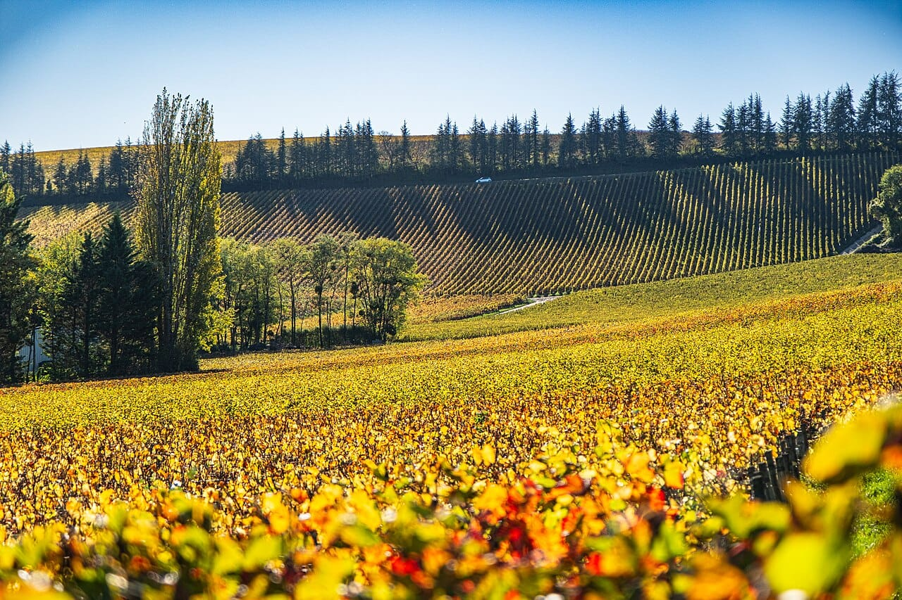

# 桑塞尔

桑塞尔是卢瓦尔河谷东部、谢尔省的丘陵产区，位于卢瓦尔河左岸，以长相思白葡萄酒与黑皮诺红、桃红著称；石灰岩与燧石土壤、凉爽大陆性气候与 1936 年白葡萄酒 AOC（1959 年增补红与桃红），使它成为“矿物感长相思”最常被引用的产地。

图：Sancerre：Sancerre grape vines leading to a tree-lined ridge (54092669721)（Wikimedia Commons）。图片：Winniepix，CC BY 2.0，via Wikimedia Commons（[原图页面](https://commons.wikimedia.org/wiki/File:Sancerre_grape_vines_leading_to_a_tree-lined_ridge_(54092669721).jpg)）。

## 先划清「桑塞尔」的边界
产区位于布尔日以东、卢瓦尔河左岸，覆盖谢尔省 14 个市镇；葡萄园分布在 180–350 米的丘陵坡地上，局部坡度超过 50%，朝南与东南坡地成熟最好。

白桑塞尔必须用长相思；红与桃红用黑皮诺。AOC 名约束品种与产量，不区分土壤地块；同一标签下，燧石坡与石灰岩土长出的酒，在香气与结构上差别明显。

隔河对岸是普伊芙美（Pouilly-Fumé），同样以长相思为主；两岸常被对照品尝，但土壤、生产者结构与法规各自独立，买酒时不要把两个产区混为一谈。

## 历史与命名

20 世纪以前，桑塞尔更以黑皮诺知名；长相思成为产区标志是 20 世纪的事。根瘤蚜灾后补种、市场对白葡萄酒需求上升，逐步把品种结构推向今天的长相思主导格局。

AOC 于 1936 年先覆盖白葡萄酒，1959 年增补红与桃红；法规把长期形成的坡地边界与品种规则固定下来。此后边界与品种条款随修订调整，但核心坡地范围一直稳定。

产区名来自 Sancerre 镇，镇名与中世纪桑塞尔伯爵领地有关；周边 Chavignol、Bué、Ménétréol-sous-Sancerre、Saint-Satur 等市镇名，常出现在地块描述与酒款标注中。今天区内约三百六十多家种植与酿酒经营，规模从家庭小园到中型家族酒庄不等，白葡萄酒在产量与出口份额上都占主导。

## 「桑塞尔」的地理与风土
桑塞尔属凉爽大陆性气候，夏季温暖、冬季寒冷，昼夜温差大，有利于保留酸度与香气精度；年降雨约 69 厘米，坡地排水快。主要风险是春季霜冻、花期雨水与采收期湿度，年份之间果味与草本气息的比重会随之变化。

土壤自西向东分三类：启莫里阶泥灰岩（terres blanches，酒款更浑厚有力）、干多石石灰岩（caillottes，果香清爽）、硅质燧石土（silex 或 chailloux，花香与燧石气息突出）。燧石土约占葡萄园 15%，形成于 5600 万至 3390 万年前，石块白天蓄热、夜间缓慢散热。

微地形上，坡向与海拔决定日照：高处风大、成熟慢，低处谷地易积冷雾。燧石地块的酒更紧、更矿物，石灰岩地块更圆润，泥灰岩地块结构最厚。同一市镇内，坡面高度与石块含量也会拉开酒款距离。卢瓦尔河在谷地底部调节温度，河面反射的光照帮助坡地果实成熟，而朝北的背阴坡通常保留更多草本与青果气息。

## 原料与风格

长相思占主导，白葡萄酒约占产区产量 84%；黑皮诺用于红与桃红，约为 11% 红酒与 5% 桃红。白葡萄酒带柠檬、白花、燧石与草本，部分年份出现西柚与百香果；多数保持不锈钢罐的清爽风格，少量酒庄使用橡木桶。

黑皮诺产量小，红酒轻到中等酒体、高酸，带红樱桃与香料，不是勃艮第式的厚重红；桃红干爽、果香新鲜，适合开胃时段饮用。

酿造上，低温发酵保留芳香，长相思很少用新桶，突出品种与地块香气。偏凉年份草本与矿物感更突出，偏暖年份果味更成熟；生产者在采收日期上的选择，比品种本身更能决定杯中风格。

## 代表生产者与酒款

Henri Bourgeois 是产区规模较大的家族酒庄，白葡萄酒与黑皮诺产品线完整；Domaine Vacheron 以长相思的地块表达著称；Domaine Cotat（François 与 Pascal Cotat）与 Claude Riffault 是燧石与泥灰岩地块的常见参照，Crochet 等种植者也在零售渠道出现。

桑塞尔的这些名字不是官方分级，而是市场长期形成的参照。旗舰地块酒与老年份价高量小，入门长相思在餐厅与零售更容易找到。

比较酒款时先看土壤类型（燧石、石灰岩、泥灰岩），再看生产者与年份；同一酒庄不同地块酒款，香气与结构差别可能大于跨酒庄的同土壤款。

## 「桑塞尔」的上桌方式
饮用温度按品种调整：长相思 8–10°C，桃红 10–12°C，黑皮诺红 14–16°C；杯子用中等肚径白葡萄酒杯即可，不必追求窄口专用杯。

配餐上，长相思配卢瓦尔河淡水鱼、芦笋、山羊奶酪（Chavignol 小山羊酪是本地经典）、牡蛎与海鲜沙拉；黑皮诺配冷肉、香肠、禽肉与蘑菇；桃红配开胃菜与轻食。

谢尔省与卢瓦尔河谷家常菜以河鱼、山羊奶酪、猪肉与时蔬为主，调味清淡，与高酸白葡萄酒衔接自然。选酒时先想主菜的咸鲜与脂肪，再决定用清爽长相思、果香桃红还是轻酒体黑皮诺。

## 选购、标签与误区

AOC 名之下，市镇或地块名提示土壤背景；品种（长相思或黑皮诺）与颜色（blanc、rouge、rosé）比产区名更重要。桑塞尔不是“只有长相思”，但黑皮诺产量确实小，市面酒款仍以白酒为主。

一个误区是把“矿物感”当成法定风味保证：燧石地块的 gunflint（燧石打火石）气息来自土壤与品种，不是每瓶桑塞尔都有。另一个误区是认为桑塞尔白酒一定酸瘦，好年份与好地块可以有圆润中段与余味长度。

储存上，长相思适合年轻时喝，多数不必陈年；优质地块酒可放三到五年。避光、温度稳定、卧放；买老年份酒时留意储存记录与瓶塞状态。

## 「桑塞尔」周边怎么走
产区距布尔日不远，Sancerre 镇坐落在丘陵顶部；酒庄分散在 Chavignol、Bué、Saint-Satur 等市镇，自驾最方便，公共交通班次有限。

半日行程可安排两到三家品鉴室加午餐；一天可以对照燧石坡与石灰岩土的差别，或过河走访普伊芙美。采收季在 9 月，部分酒庄只接受预约，出发前应在酒庄官网确认开放时间。

种植者酒庄规模普遍不大，预约准时、不在发酵与陈酿区随意走动是基本礼仪。坡地土路湿滑，宜穿防滑鞋；带长辈或小孩同行前，先问清无障碍通道与洗手间位置。

- 相关条目：[loire](ref:loire)、[sauvignon-blanc](ref:sauvignon)、[pinot-noir](ref:pinot)、[white-wine](ref:white)、[red-wine](ref:red)。

对照阅读：[卢瓦尔河谷](ref:loire)、[黑皮诺](ref:pinot)。

相关条目：[长相思](ref:sauvignon)。

**关键事实。**

| 项目 | 内容 |
| --- | --- |
| 一句话定位 | 卢瓦尔河谷东部的丘陵产区，以长相思白葡萄酒与黑皮诺红、桃红著称；石灰岩与燧石土壤、凉爽气候与 1936 年 AOC，使它成为“矿物感长相思”最常被引用的产地 |
| 层级 | 省/大区 |
| 所属 | 卢瓦尔河谷 |
| 国家代码 | FR |

## 相关图像

图：卢瓦尔河谷。图片：Wikimedia Commons contributor，CC BY-SA 3.0，via Wikimedia Commons（[原图页面](https://commons.wikimedia.org/wiki/File:Azay_le_rideau.jpg)）。关联图像：桑塞尔。

图：长相思相关实景照片。图片：Geolina163 + 1971markus，CC BY-SA 4.0，via Wikimedia Commons（[原图页面](https://commons.wikimedia.org/wiki/File:HBLA_Klosterneuburg_Sauvignon_Blanc_2.jpg)）。关联图像：桑塞尔。
