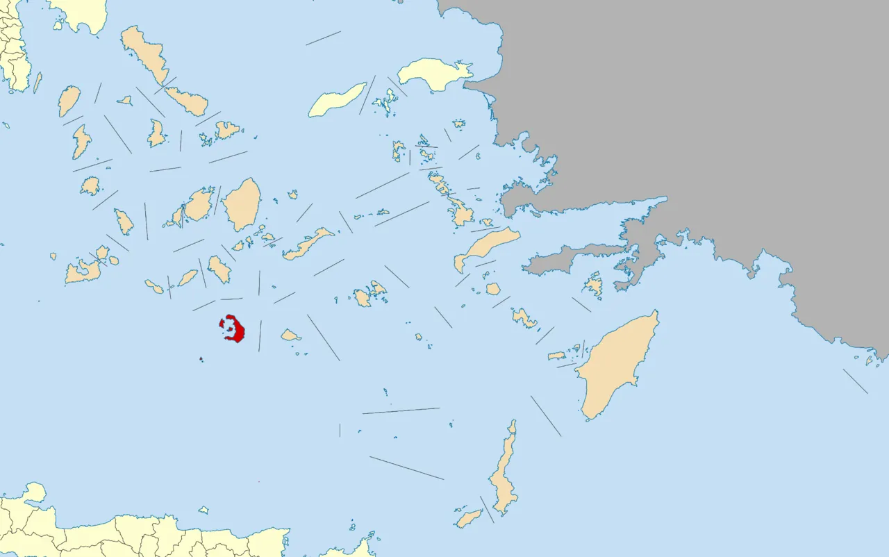
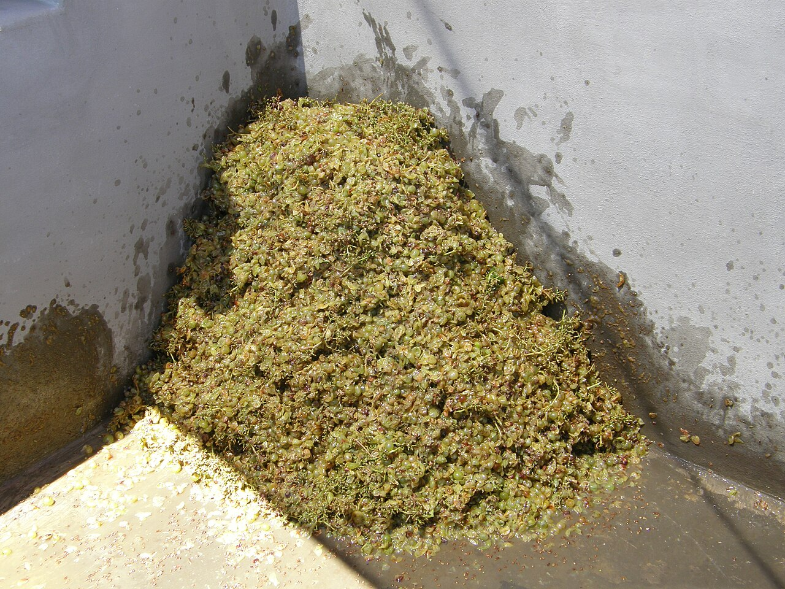
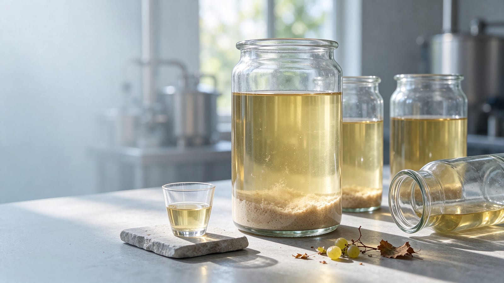

# 圣托里尼

圣托里尼（Santorini，希腊语 Thira）是爱琴海基克拉泽斯群岛中的火山岛，也是希腊最独特的 PDO 白葡萄酒产区。它以 Assyrtiko、火山土与篮式修剪 kouloura 闻名，在极度干旱与强风中维持着一套近乎手工的葡萄种植体系。

图：圣托里尼。图片：Pitichinaccio，CC BY 3.0，via Wikimedia Commons（[原图页面](https://commons.wikimedia.org/wiki/File:2011_Dimos_Thiras.png)）。

## 火山岛上的法定产区

圣托里尼位于爱琴海南部，是基克拉泽斯群岛最南端的岛屿之一。产区范围覆盖岛上的火山台地与坡地，法定名称使用 Santorini，与岛的古称 Thira 并存。这里没有平原农业的条件：土壤是火山喷发留下的浮石、火山灰与碎屑，保水能力差，风大，降雨稀少。

正因如此，圣托里尼的葡萄酒不是靠产量取胜，而是靠品种与栽培方式的极限适应。产区的存在本身，就是一个小岛在贫瘠火山土上维持酿酒传统的案例；岛上的酒庄多为家族经营，产量有限，酒款常带有强烈的地块印记。

## 1971 年与 PDO 的建立

圣托里尼的 PDO 地位确立于 1971 年，是希腊较早获得保护地位的葡萄酒产区之一。2002 年，希腊通过部长决定批准 Vinsanto 与 Nykteri 等传统名称用于圣托里尼 PDO 酒标，使这些历史酒型获得法律位置。

PDO 规则的核心是品种比例：干白与起泡酒须含至少 85% Assyrtiko，其余 15% 只能来自 Athiri 与 Aidani。这一比例曾在欧盟层面调整，从 75% 提高到 85%，理由是提高 Assyrtiko 比例能带来更集中、更具矿物感的酒。Vinsanto 则以晒干的葡萄酿成，是岛上甜酒传统的代表。

## 火山土、干旱与 meltemia 风

圣托里尼的土壤几乎全部来自火山活动：浮石、火山灰、玄武质碎屑与少量沉积物。土壤排水极快、养分有限，尤其缺乏可有效利用的钾，这被认为促使 Assyrtiko 保持极高的酒石酸与锐利的酸度。火山土同时富含钙、镁与铁。

气候是另一种极端。夏季降雨极少，日照强烈，海风强劲，当地称为 meltemia 的季风常年在夏季吹拂。风会撕碎叶片、吹落果实，也会加剧水分蒸发。葡萄园因此不能采用常规的高架引缚，必须贴近地面。

## kouloura：篮式修剪

kouloura 是圣托里尼特有的修剪与引缚方式：葡萄藤被修成一个低矮的圆形篮筐，藤蔓编织在离地约 10 至 20 厘米的环内，果穗在篮内成熟。篮筐像一层屏障，挡住风与部分阳光，内部则保留湿度与遮阴。

这种结构让几乎所有作业都必须手工完成。修剪、绑蔓与采收的耗时远高于常规架式，机械化几乎不可能。研究显示，kouloura 葡萄园的密度约为每公顷 1,800 至 2,200 株，平均产量约 2,080 公斤/公顷，低于法定上限，说明实际生产更依赖低产与品质。

## Assyrtiko 的风格谱系

Assyrtiko 在本岛的表现与其他希腊产区不同：酸度高、pH 低、柑橘与青柠香气清晰，常带盐感与湿石气息，酒体却不单薄。成熟度提高后会出现蜂蜡、白桃与烟熏矿物层次，适合酒泥陈酿与短时间橡木桶处理。

除干白外，Assyrtiko 也用于 Nykteri 与 Vinsanto。Nykteri 是传统干型或近干型酒，历史上以夜间采收与较高成熟度为基础；Vinsanto 则用晒干葡萄，呈琥珀色，带蜂蜜、无花果与氧化香气。原料是[葡萄](ref:grape)，品种比例决定酒标类型。

Vinsanto 的酿造倚赖岛上充足的日照：葡萄采收后在阳光下摊晒，水分蒸发、糖分浓缩，再经长时间发酵与氧化陈年。成酒常带焦糖、坚果与干果气息，酸度仍然清晰，这也是它区别于许多甜酒的地方。Nykteri 则更强调成熟果味与橡木桶带来的质地，适合搭配咸味较强的菜肴。

## 产量、葡萄园与法规

欧盟文件显示，圣托里尼 PDO 的葡萄园约 12,000 stremmata，折合约 1,200 公顷，从海平面一直延伸到约 300 米高度。法定最高产量已从 8,000 公斤/公顷下调到 6,500 公斤/公顷，目的是控制产量、提高成熟质量。

岛上葡萄园多为家庭所有，地块零碎，许多藤龄很高。由于火山土与岛屿隔离，圣托里尼的葡萄长期未受根瘤蚜侵害，许多老藤仍为自根苗。酒标须核对 PDO 名称、品种、[酒精度](ref:abv)与年份，Vinsanto 与 Nykteri 的使用须符合传统名称规则。

旅游业的扩张正在改变葡萄园的经济地位。土地用于酒店与度假设施时，回报远高于酿酒，部分地块因此被弃耕或转用。当地通过合作社、产区协会与旅游酒庄把葡萄园与观光结合，试图让种植在旅游经济中保有位置，但水资源与人工短缺仍是长期约束。

## 饮用、陈年与误区

圣托里尼干白建议在 9 至 11 摄氏度饮用，适合海鲜、番茄、柠檬与地中海香草菜肴。高酸与矿物感让它能搭配酸味与咸味较强的食物，也能压住油炸海鲜的油腻。经[酒泥陈酿](ref:lees-ageing)的酒款质地更丰满，可陈放数年，部分 Assyrtiko 甚至能陈年十年以上。

常见误区有四。第一，把圣托里尼当成甜酒产区：Vinsanto 是甜酒，但产区主体是[干型](ref:dry)白葡萄酒。第二，认为火山土自动带来"矿物味"：矿物感是酸度、盐感与还原性香气的综合描述。第三，把 kouloura 当成景观：它是防风与保水的生产性结构。第四，以为岛上酒都很贵是因为营销：低产、手工与岛屿物流确实是成本来源。

**关键事实。**

| 项目 | 内容 |
| --- | --- |
| 一句话定位 | 希腊基克拉泽斯群岛圣托里尼岛（Thira）的 PDO 产区，建于 1971 年；法定干白须含至少 85% Assyrtiko，其余 15% 只能是 Athiri 与 Aidani |
| 层级 | 其他 |
| 国家代码 | GR |

**来源与边界。** 本页关于「圣托里尼」的关键事实，主要由以下来源交叉核对：Official Journal of the European Union（葡萄园约 12,000 stremmata、海拔至约 300 米、最高产量由 8,000 下调至 6,500 公斤/公顷；干白中 Assyrtiko 最低比例由 75% 提高到 85%）、INRAE / HAL（kouloura 修剪、每公顷 1,800–2,200 株密度与约 2,080 公斤/公顷的平均产量）、Santo Wines（圣托里尼合作社与 Assyrtiko、Vinsanto、Nykteri 等酒款类型）。价格、批次与状态会变，涉及这些字段时以页面所列来源的最新版本为准。正文为项目自写，来源只作核验，不复制原文。

## 参考资料

- [葡萄酒](ref:wine)：理解圣托里尼的大类归属与产地规则。
- [白葡萄酒](ref:white-wine)：白葡萄酒的酿造与风格框架。
- [Assyrtiko](ref:assyrtiko)：圣托里尼的核心品种。
- [发酵](ref:fermentation)：低温发酵与香气保留。
- [酸度](ref:acidity)：火山土与高酸的关系。
- [风土](ref:terroir)：火山土、干旱与海风。
- [干型](ref:dry)：干型与 Vinsanto 甜酒的区分。
- [酒泥陈酿](ref:lees-ageing)：酒泥接触对质地与陈年的影响。
- [葡萄](ref:grape)：酿酒葡萄的成熟指标。
- [酒精度](ref:abv)：酒标上 % vol 的含义。

## 相关图像

图：阿斯蒂科类别配图。图片：Klearchos Kapoutsis，CC BY 2.0，via Wikimedia Commons（[原图页面](https://commons.wikimedia.org/wiki/File:White_wine_grape_pressing_in_Santorini.jpg)）。关联图像：圣托里尼。

图：酒泥陈酿的编辑插图：酒液与底部细酒泥分层，取样管与酒杯用于说明倒罐；AI 辅助绘制，不是实拍。图片：Hejiu 编辑团队，使用豆包 Seedream 5.5 AI 辅助生成；项目自制，不是现场照片（[项目说明](https://hejiu.org/about/)）。关联图像：圣托里尼。
