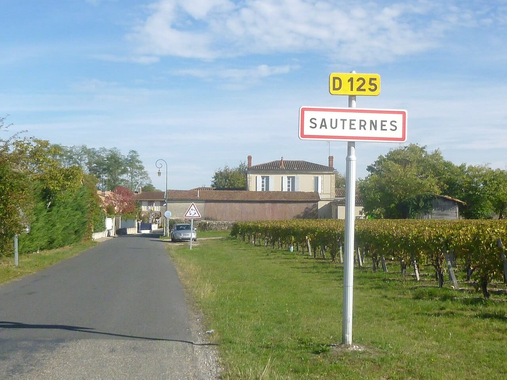
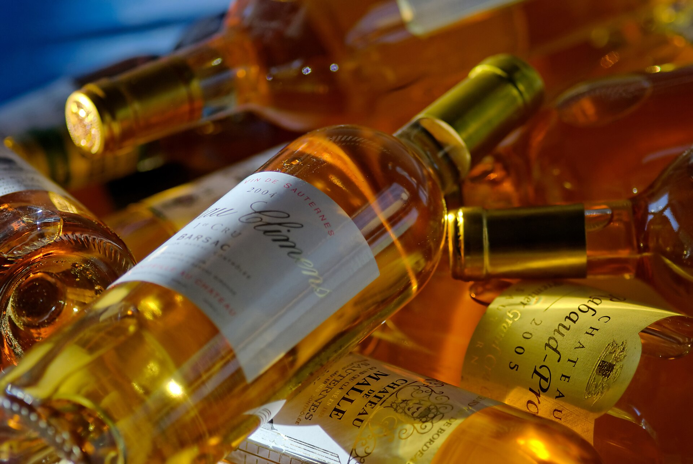
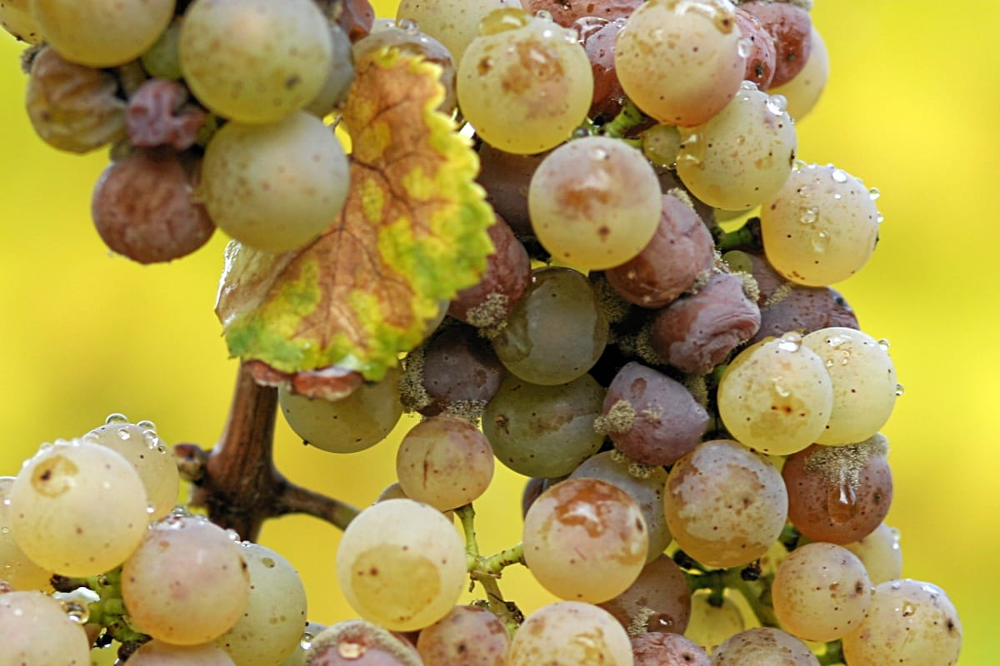

# 苏玳

苏玳（Sauternes）是法国吉伦特省波尔多南部的[贵腐甜白](ref:sauternes-style)产区，覆盖 Sauternes、Barsac、Bommes、Fargues 与 Preignac 五座村庄。它不是一块均质的土地，而是一组沿 Ciron 河与加龙河分布的台地、砾石坡与黏土洼地；雾、河流与真菌把这里变成甜酒产区，1855 年的分级则把它写进市场记忆。它是[波尔多](ref:bordeaux)的一部分，也是[甜酒](ref:dessert-wine)世界里最受注视的产区之一，却以完全不同的方式被理解。

图：苏玳。摄影：File:Vineyard in Sauternes.jpg。署名：davitydave，CC BY 2.0，来自 Wikimedia Commons（[来源](https://commons.wikimedia.org/w/index.php?curid=25673556)）。

## 五座村庄的行政边界

苏玳 AOC 的法定范围由五座村庄组成：Sauternes、Bommes、Fargues、Preignac 与 Barsac。前四座只能标 Sauternes，Barsac 则可以在 Sauternes 与 Barsac 两个 AOC 之间选择。这一安排让 Barsac 成为产区内部的一个特殊存在：地理上属于苏玳体系，法律上拥有自己的名字。

五座村庄沿 Ciron 河两岸分布，地势从河谷向两侧的台地抬升。村庄之间的边界并不对应单一土壤，而是历史、教区与所有权长期累积的结果。理解苏玳，不能只看一张产区地图，还要看河流与坡向。

产区面积约 1,550 公顷，其中 Sauternes 与 Bommes 占据大部分优质砾石坡地；Preignac 靠近加龙河，地势较低；Fargues 与 Barsac 隔河相望。面积数字会随地块重划与登记变化，具体以产品规范为准。

## Ciron 河制造的秋天

苏玳的气候核心是秋季的雾。Ciron 河发源于朗德森林，水温比加龙河低；秋天清晨，冷河与暖河交汇，在河谷形成浓雾。雾气让[贵腐菌](ref:noble-rot)在葡萄果皮上生长，午后阳光又把雾气驱散，让果皮干燥，抑制灰腐。

这种“湿—干”交替每天重复，持续数周。雾太少，贵腐菌无法充分发展；雾太多或下雨，果实会腐烂。苏玳的年份差异因此极大，同一个酒庄在不同年份的风格可以相差很远。

酒农对雾的依赖也解释了产区的空间差异：靠近 Ciron 河的地块雾更浓，贵腐更早出现；地势较高、离河较远的地块则更干燥，果实可能迟迟不感染。同一座村庄内部，不同地块的采收时间可以相差两三周。

## 砾石台地与红色土壤

Ciron 河右岸的 Sauternes、Bommes、Fargues 与 Preignac 位于朝东的台地，底层是第三纪的贝壳石灰岩、泥灰岩与砂质黏土，上面覆盖着加龙河在冰期搬运来的砾石。砾石层排水好、白天吸热、夜间释放，帮助葡萄成熟并降低霜冻风险。

Barsac 在 Ciron 河左岸，土壤结构不同：底层是裂隙发育的石灰岩，表面是薄层红色砂质土，夹杂少量大砾石。排水与根系穿透方式都不一样，这也是 Barsac 能够拥有独立 AOC 的地质理由。两地都适合贵腐，但酒体与香气走向不同：Sauternes 更饱满，Barsac 更轻盈、更矿物。两地的主要品种都是[赛美蓉](ref:semillon)，辅以长相思与少量密斯卡岱。

## 1936 年的 AOC 与 1855 年的榜单

苏玳 AOC 正式确立于 1936 年 9 月 30 日，与 Barsac 同日获得法定产区地位。产品规范规定品种、种植密度、采收方式、最低糖度与产量；现行规则要求葡萄必须逐次手工采收，只取感染贵腐菌的果粒，葡萄汁天然糖度至少 221 克/升。

更早的坐标是 1855 年。那一年巴黎世界博览会期间，波尔多商会把苏玳与巴萨克的 26 家酒庄列入分级，其中 d'Yquem 是唯一的超一级。这份榜单的寿命远超它的编制目的，成为今天理解苏玳[分级制度](ref:grading)的起点。

## Barsac 的双重身份

Barsac 的特别之处在于选择权。它既可以标 Sauternes，也可以标 Barsac；前者借助更大的名气，后者强调自己的风土。历史上，Barsac 的酒常被认为更轻盈、酸度更高，适合较早饮用；Sauternes 的酒则更浓郁、耐久。

这种双重身份也带来市场上的混淆。看到 Barsac 时，应知道它属于苏玳体系，但拥有独立规范；看到 Sauternes 时，则不一定来自 Sauternes 村，也可能来自 Bommes、Fargues、Preignac 或选择标 Sauternes 的 Barsac。对消费者而言，最可靠的方式是看酒标上的 AOC 名称与村庄信息，而不是只记酒庄名。

## 产量、年份与气候变化

苏玳的产量受贵腐条件限制，年份之间的差异远大于普通干白。潮湿的秋季可能让贵腐菌过度发展，干燥的秋季则可能让果实无法感染；冰雹、雨水与秋季高温都会影响收成。产品规范对产量设有上限，但实际产量常低于上限。

气候变化正在改变这套节奏。气温升高让采收期提前，贵腐菌的活跃窗口可能缩短；同时，干旱与热浪又可能让果实停止成熟。霜冻与冰雹的频率也在变化，酒农需要在风险与品质之间重新安排采收。产区正在尝试调整采收时间、品种比例与树冠管理，但贵腐酒对天气的依赖很难被完全消除。

## 到访苏玳

苏玳位于波尔多市以南约 40 公里，从波尔多驾车约一小时。村庄之间有乡间公路连接，葡萄园在秋季最为壮观，但采收期间酒庄通常不接待访客。多数酒庄需要提前预约，部分只接受专业访客。春季新芽初发，夏季绿意最浓，秋季贵腐与采收同时到来；多数酒庄在采收结束后才恢复接待，因此十月下旬到十一月是较好的窗口。

到访时应把品鉴与用餐分开安排，甜酒的酒精与糖分都不低；如果需要驾车，应使用 spit bucket 并控制饮用量。本页关于苏玳的内容涉及酒精饮料；过量饮酒有害健康，未成年人不应饮酒。购买时注意保存条件，甜酒怕热、怕光，长途携带应避免后备箱高温。

对照阅读：[波尔多](ref:bordeaux)、[甜酒](ref:dessert-wine)。

**关键事实。**

| 项目 | 内容 |
| --- | --- |
| 一句话定位 | 法国吉伦特省波尔多南部的贵腐甜白产区，覆盖 Sauternes、Barsac、Bommes、Fargues 与 Preignac 五座村庄；Ciron 河的秋雾、砾石台地与 1855 年分级共同定义了它的身份 |
| 层级 | 其他 |
| 所属 | 波尔多 |
| 国家代码 | FR |

**来源与边界。** 本页关于「苏玳」的关键事实，主要由以下来源交叉核对：Official Journal of the European Union（苏玳 PDO 的地理范围、品种、最低糖度与产量规则）、Conseil Interprofessionnel du Vin de Bordeaux（波尔多产区与甜白的整体框架）、INAO（法国 AOC/AOP 的管理与产品规范体系）等 4 条来源。价格、批次与状态会变，涉及这些字段时以页面所列来源的最新版本为准。正文为项目自写，来源只作核验，不复制原文。

**并读。** 把「苏玳」与「波尔多」、「苏玳」、「甜酒」放在一起读时，先确认它们是同一层级还是上下游关系：先确认边界与法定分类，再比较气候、土壤、海拔与代表酒款。本页负责给出产区的基本坐标，对照条目补上具体案例与差异；读完再回到本页，才能分清哪些差别属于产区本身，哪些只是产地、批次或品牌选择。

## 相关图像

图：苏玳相关实景照片。图片：Pascal MOULIN，CC BY-SA 4.0，via Wikimedia Commons（[原图页面](https://commons.wikimedia.org/wiki/File:Sauternes_2.jpg)）。关联图像：苏玳。

图：贵腐（noble rot）。图片：Photographer: Tom Maack No machine-readable author provided. T.o.m.~commonswiki assumed (based on copyright claims).，CC BY-SA 3.0，via Wikimedia Commons（[原图页面](https://commons.wikimedia.org/wiki/File:Botrytis_riesling.jpg)）。关联图像：苏玳。
