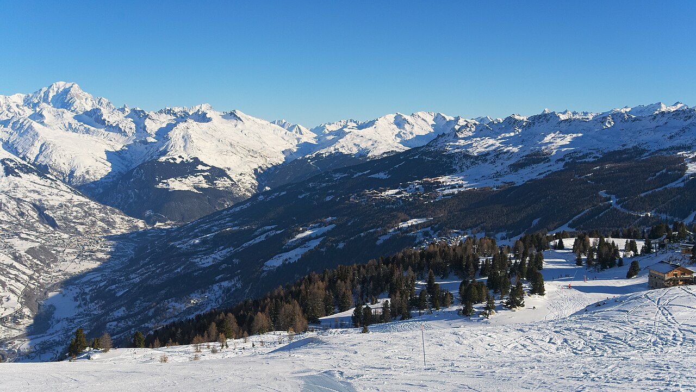

# 萨瓦

萨瓦（Savoie）不是那种可以用“阿尔卑斯山景”一笔带过的产区。它的葡萄园分散在法国东南部的山谷、坡地与冰川沉积台地上，海拔从 250 米延伸到 600 米以上；同一座山的两侧，土壤、坡向和成熟期就可能完全不同。这里既有以雅克儿（Jacquère）为主、清瘦爽脆的白葡萄酒，也有以梦杜斯（Mondeuse）为主、带胡椒与紫罗兰气息的红葡萄酒，还有 2015 年才获得 AOC 的起泡酒。理解萨瓦，关键是把它当成一组“山地小产区”，而不是一个统一风格的品牌。

图：萨瓦。图片：Andreas Eichler，CC BY-SA 4.0，via Wikimedia Commons（[原图页面](https://commons.wikimedia.org/wiki/File:2017.01.21.-02-Paradiski-La_Plagne-Dos_Rond--Blick_Richtung_Les_Arcs.jpg)）。

## 地理：山谷、坡地与湖泊

萨瓦的历史区域包括今萨瓦省、上萨瓦省以及部分伊泽尔省和安省。葡萄园主要分布在尚贝里（Chambéry）、艾克斯莱班（Aix-les-Bains）、阿尔贝维尔（Albertville）周边的山谷，以及布尔歇湖（Lac du Bourget）两岸。安省的布热（Bugey）在地理上属于罗讷河上游，却在法规与市场上常与萨瓦一起讨论。

## 气候：山地大陆性

产区受阿尔卑斯山影响，呈山地大陆性气候：冬季寒冷，夏季温暖，昼夜温差大，生长季比波尔多短。高海拔地块成熟慢、酸度高；朝南或东南的坡面日照充足，成熟度更好。霜冻与冰雹是主要风险，尤其在春季发芽后和秋季采收前。

## 土壤与坡度

萨瓦的土壤以石灰岩、泥灰岩、冰川沉积物和碎石为主。山坡上的薄层土壤排水好，根系扎得深，产量自然受限；谷底土壤更肥沃，酒体通常更轻。夏特朗（Chautagne）、容吉厄（Jongieux）、阿尔班（Arbin）等村的土壤差异明显，这也是同一产区内部风格分化的重要原因。

## 法定框架：一个区域、多个 AOC

萨瓦的法定产区体系由多个 AOC 组成。Vin de Savoie（也写作 Savoie）是区域级 AOC，覆盖红、白、桃红与起泡；Roussette de Savoie 专门针对阿尔泰斯（Altesse）白葡萄酒；Crémant de Savoie 是起泡酒 AOC，于 2015 年 9 月 11 日获得认定；Bugey、Bugey-Cerdon、Seyssel 则属于安省一侧的独立 AOC。它们共享山地气候，却各有品种与酿造规则。

## 16 个 crus：地名比“萨瓦”更具体

Vin de Savoie 允许在酒标上标注 16 个地理名称（crus），包括阿布姆（Abymes）、阿普勒蒙（Apremont）、阿尔班（Arbin）、阿伊兹（Ayze）、夏特朗（Chautagne）、希尼安（Chignin）、希尼安-贝尔热龙（Chignin-Bergeron）、克雷皮（Crépy）、克吕埃（Cruet）、容吉厄（Jongieux）、马里尼安（Marignan）、马兰（Marin）、蒙梅利安（Montmélian）、里帕耶（Ripaille）、圣让-德-拉波特（Saint-Jean-de-la-Porte）与圣让瓦尔-普里厄雷（Saint-Jeoire-Prieuré）。Roussette de Savoie 另有弗朗吉（Frangy）、马雷斯特尔（Marestel）、蒙泰尔米诺（Monterminod）与蒙图（Monthoux）等 crus。

## 品种：雅克儿、阿尔泰斯与梦杜斯

雅克儿是萨瓦种植最广的白葡萄品种，酒体轻、酸度高，常有白花、青苹果、柠檬与湿石气息，适合年轻时饮用。阿尔泰斯（当地称 Roussette）更饱满，带蜂蜡、坚果与黄李子的风味，陈年潜力更好。霞多丽、阿尔高特（Aligoté）与莫莱特（Molette）也有种植。红葡萄以梦杜斯为主，带红樱桃、黑胡椒、紫罗兰与泥土气息，单宁中等；佳美与黑皮诺用于较轻的红酒与起泡酒。

## 起泡酒：Crémant 与 Bugey-Cerdon

Crémant de Savoie 使用传统法酿造，允许的品种包括雅克儿、阿尔泰斯、霞多丽等，风格偏清爽、柑橘与白花。Bugey-Cerdon 则是另一套逻辑：以佳美和普尔萨（Poulsard）为主，用“祖先法”（méthode ancestrale）在瓶中完成发酵，酒精度低、带甜感与草莓香气。两者都属于起泡酒，但甜度、酒精度与法规不同，不能互换。

## 代表生产者与村庄

阿伊兹（Ayze）的 Domaine Belluard 以格林热（Gringet）闻名；塞万（Cevins）的 Domaine des Ardoisières 在陡坡上重建了被废弃的葡萄园；容吉厄的 Domaine Dupasquier 是梦杜斯与阿尔泰斯的代表；希尼安的 Domaine Jean-François Quénard、蒙梅利安的 Domaine Jean Vullien、阿尔班的 Domaine Louis Magnin，以及阿普勒蒙的 Domaine de l'Idylle，都是理解萨瓦风格的重要名字。

## 年份与市场

萨瓦葡萄园面积约 2000 公顷，产量不大，长期以本地消费、滑雪胜地和日内瓦湖周边市场为主。年份差异主要来自霜冻、冰雹与采收期降雨：2017、2019 与 2020 在部分村庄表现较好，但山地气候使“大年份”很难覆盖整个产区。出口市场以日本、美国和北欧为主，价格从日常级的 10-20 欧元到名庄级 30 欧元以上不等。

## 饮用与配餐

雅克儿适合配湖鱼、山地奶酪（如博福尔、托姆）、萨瓦焗土豆与清淡前菜；阿尔泰斯可以配禽肉、奶油酱与蘑菇；梦杜斯适合配烤肉、野味与硬质奶酪。白葡萄酒饮用温度约 10-12℃，红酒略低于室温。开瓶后应冷藏并尽快饮用。

## 常见误区

第一，把萨瓦当成瑞士产区。它是法国产区，法规与酒标体系不同。第二，认为山地酒一定酸涩。品种、成熟度与酿造方式差异很大。第三，把萨瓦与布热混为一谈。两者相邻，但 AOC 范围与规则不同。第四，认为萨瓦只产白葡萄酒。梦杜斯与佳美都有重要地位。第五，只看“Savoie”而不看 cru。具体村庄名往往比区域名更能说明风格。

萨瓦是阿尔卑斯山区的葡萄酒产区，葡萄园分布在海拔较高的山谷与坡地；雅克儿、阿尔泰斯与梦杜斯是核心品种，法定产区包括 Vin de Savoie、Roussette de Savoie、Crémant de Savoie 与 Bugey 等。十六个 crus 的地名通常比“萨瓦”更具体，山地产区也不等于所有酒都轻瘦。

对照阅读：[法国](ref:france)、[红葡萄酒](ref:red-wine)。

## 延伸阅读

- [法国](ref:france)：法国葡萄酒法规与产区体系。
- [白葡萄酒](ref:white-wine)与[红葡萄酒](ref:red-wine)：萨瓦的两个基本类型。
- [葡萄](ref:grape)：萨瓦所用葡萄的成熟度、酸度与单宁判断。

补充阅读：[阿空加瓜谷](ref:c-extra-1)。

相关条目：[白葡萄酒](ref:white-wine)。

**关键事实。**

| 项目 | 内容 |
| --- | --- |
| 一句话定位 | 法国东南部阿尔卑斯山区的葡萄酒产区，葡萄园分布在海拔 250-600 米的山谷与坡地；以雅克儿、阿尔泰斯等白葡萄品种与梦杜斯红葡萄品种著称，法定产区包括 Vin de Savoie、Roussette de Savoie、Crémant de Savoie 与 Bugey 等 |
| 层级 | 其他 |
| 所属 | 法国 |
| 国家代码 | FR |

**来源与边界。** 本页关于「萨瓦」的关键事实，主要由以下来源交叉核对：INAO（萨瓦与布热各法定产区的范围与规则；由原条目末尾参考资料迁移，未逐条复核访问日期）、European Union（欧盟葡萄酒类别、地理标志与标签规则）、Oxford University Press（提供关于萨瓦、雅克儿与梦杜斯的条目；由原条目末尾参考资料迁移，未逐条复核访问日期）等 8 条来源。价格、批次与状态会变，涉及这些字段时以页面所列来源的最新版本为准。正文为项目自写，来源只作核验，不复制原文。

**并读。** 把「萨瓦」与「法国」、「白葡萄酒」、「红葡萄酒」放在一起读时，先确认它们是同一层级还是上下游关系：先确认边界与法定分类，再比较气候、土壤、海拔与代表酒款。本页负责给出产区的基本坐标，对照条目补上具体案例与差异；读完再回到本页，才能分清哪些差别属于产区本身，哪些只是产地、批次或品牌选择。
