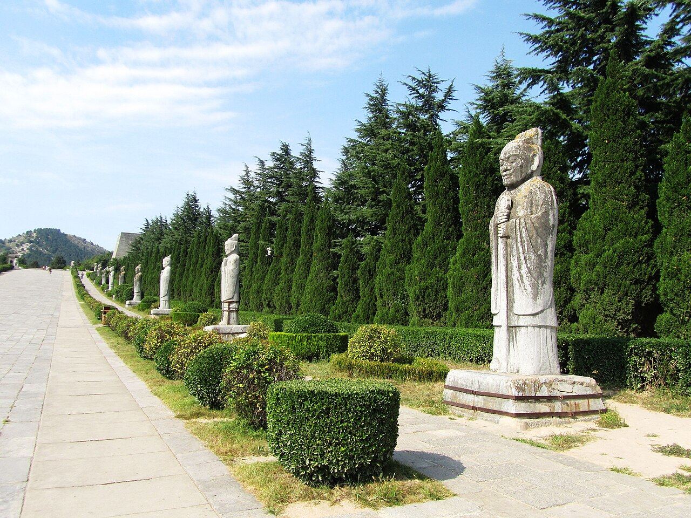

# 陕西

陕西是中国凤香型白酒的核心产区，产业中心在宝鸡市凤翔区柳林镇。凤香型常被形容为“浓清之间”：它有清香型的干净与果香，也有浓香型的窖香与厚度，却不属于任何一端。这种中间位置不是调和出来的，而是由高粱、大麦、豌豆、小麦，中高温大曲，黄土泥窖，混蒸混烧，以及酒海陈贮共同决定的。

图：陕西。图片：(Cat's diary) 猫猫的日记本，CC BY-SA 3.0，via Wikimedia Commons（[原图页面](https://commons.wikimedia.org/wiki/File:Qianling_Mausoleum_25_2013-08.JPG)）。

## 凤香型的产地与法定范围

陕西是省级地区节点，上级为[中国](ref:china)。凤香型属于[白酒](ref:baijiu)的一个香型，代表产品是西凤酒；[凤香型](ref:feng-aroma)既是工艺类型，也是风味类型。核心产区在凤翔，柳林镇是历史与产业中心，宝鸡周边也有相关生产。产区名称、香型名称与企业品牌不能混为一谈。

凤香型的法定定义写在国家标准中：以高粱、大麦、豌豆、小麦为原料，采用大曲为糖化发酵剂，以黄土泥窖为发酵容器，采用混蒸混烧工艺，经固态发酵、固态蒸馏、酒海等陈贮、勾调而成，不直接或间接添加食用酒精及非自身发酵产生的呈色呈香呈味物质。定义把原料、曲、窖、蒸馏与贮存五件事一次写全。

## 凤翔与柳林镇

凤翔位于关中平原西部，地势北高南低，黄土台塬与河谷交错，气候温和、四季分明，适合高粱与制曲用粮生长。柳林镇是凤翔的酿酒重镇，历史上烧坊集中，酒海制作与贮酒传统在这里形成。西凤酒企业资料称，柳林地区的地下水来自六盘山水系，经深层黄土与岩溶通道补给，酿造用水 pH 约为 6.8–7.2，总硬度与矿物质组成适合制曲与发酵。

地理条件不是唯一原因。凤翔的黄土泥窖、曲房、酒海与作坊传统共同构成产区能力；同样的高粱与水源，换一套窖池与贮存容器，香气走向就会改变。把“凤翔”简单等同于“西凤”也不准确：凤翔是产地，西凤是品牌，凤香型是香型类别。

## 浓清之间的工艺

凤香型的香气以乙酸乙酯为主、己酸乙酯为辅，既有清香的果香与爽净，又有浓香的窖香与厚度。入口醇厚，收口干净，回味带一点酒海带来的木质陈香。它不是“清香加浓香”的简单相加，而是同一套发酵与贮存工艺自然形成的复合香。

工艺上，凤香型用黄土泥窖作发酵容器，采用混蒸混烧：原料与酒醅混合蒸煮、蒸馏，边蒸边取酒，再入窖发酵。黄土泥窖与浓香型的泥窖相似，但窖泥微生物、窖池结构与操作节奏不同；混蒸混烧让粮香与酒香更紧密，也提高了对水分、酸度与温度控制的要求。发酵属于[固态发酵](ref:solid-state)，蒸馏与取酒则决定香气浓缩与干净度。

## 酒海贮存

酒海是凤香型最具辨识度的贮存容器。西凤酒企业资料称，酒海制作技艺可追溯到唐代：取初春秦岭山上的野生荆条编成篓，以豆腐、鸡蛋清、菜籽油与蜂蜡做粘胶剂涂封，再用麻枸纸、白棉布一层层裱糊、晾干，一个酒海的制作要持续半年左右。成品酒海呈长方体、圆口、弧肩、深直腹、平底，固定在木架中，遇水则漏、遇酒则香、久而芬芳。

酒海不是普通的木桶或陶缸。荆条、纸张、蛋白质与油脂形成的内壁，让酒在贮存中缓慢氧化、酯化，带来独特的陈香与醇化效果；企业资料还记录，公司现存清代及民国时期的老酒海中，有 2 个国家二级文物、5 个国家三级文物、5 个国家一般文物。酒海是容器，也是产区工艺记忆的一部分。

## 原料与制曲

凤香型用[高粱](ref:sorghum)、[大麦](ref:barley)、[小麦](ref:wheat)与豌豆。高粱提供淀粉与单宁，是酒体的骨架；大麦与豌豆利于制曲，豌豆的蛋白质与脂肪带来曲香；小麦增加曲的粘结与营养。多粮组合让香气有层次，但比例与粉碎度仍由酒厂掌握。

曲为中高温大曲。制曲温度高于低温大曲、低于高温大曲，既能富集霉菌与酵母，又能保留一定的细菌群落。西凤酒企业资料称，其大曲以小麦、大麦、豌豆为原料，培养过程讲究“前缓中挺后缓落”，成品曲有槐瓤、青茬、红心三种风格，出房后储存六个月再按比例搭配使用。[制曲](ref:qu-making)决定糖化力与曲香，也影响后续窖池发酵的起点。

## 标准与地理标志

地理标志产品标准是 GB/T 19508-2007《地理标志产品 西凤酒》，2007 年 9 月 19 日发布，2008 年 5 月 1 日实施，代替 GB 19508-2004，2025 年 8 月 4 日复审结论为继续有效，主要起草单位是陕西西凤酒股份有限公司。现行质量要求则是 GB/T 10781.6-2025《白酒质量要求 第6部分：凤香型白酒》，2025 年 8 月 1 日发布，2026 年 8 月 1 日实施，全部代替 GB/T 14867-2007。

地理标志标准与质量要求标准解决不同问题：前者界定地理标志产品的产地范围、原料、工艺与质量特色，后者把凤香型纳入统一的“白酒质量要求”编号体系，更新术语与理化要求。凤香型的定义强调固态发酵、固态蒸馏与酒海陈贮，并禁止直接或间接添加食用酒精及非自身发酵产生的呈色呈香呈味物质。读酒标时，应核对标准号、产地、香型、酒精度与生产商，而不是只看“西凤”二字。

## 凤香型与酒海的五类误读

第一，凤香型等于清香加浓香。它是独立香型，有独立的原料、窖池、蒸馏与贮存定义。

第二，凤香型等于西凤酒。西凤是代表品牌，其他酒厂也可以按标准生产凤香型白酒。

第三，酒海只是老式容器。酒海的内壁材料与微氧环境直接参与陈化，影响香气与口感。

第四，黄土泥窖与浓香泥窖完全相同。两者都使用泥窖，但窖泥微生物、窖池结构与工艺路线不同。

第五，地理标志标准可以替代质量要求标准。两者层级与适用范围不同，应分别核对。

## 参考资料

- [中国](ref:china)：陕西所属的国家层级地区节点。
- [白酒](ref:baijiu)：白酒的定义、香型与工艺概览。
- [凤香型](ref:feng-aroma)：陕西最具代表性的白酒香型。
- [高粱](ref:sorghum)：凤香型白酒的主要原料。
- [大麦](ref:barley)与[小麦](ref:wheat)：制曲与多粮配方的重要原料。
- [制曲](ref:qu-making)：中高温大曲与三种成品曲的风格。
- [固态发酵](ref:solid-state)：凤香型发酵所属的工艺类别。
- [发酵](ref:fermentation)：黄土泥窖与混蒸混烧对发酵的控制。
- [蒸馏](ref:distillation)：混蒸混烧与掐头去尾对酒体的影响。
- [西凤集团](ref:xifeng)：凤香型的代表性生产者。
