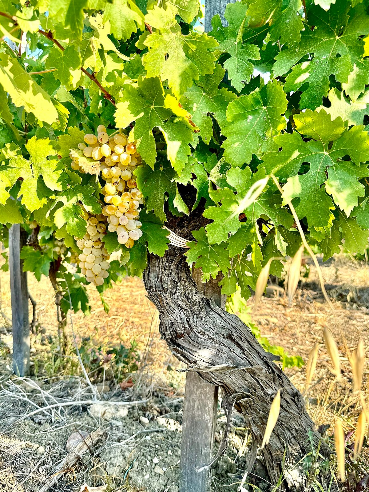
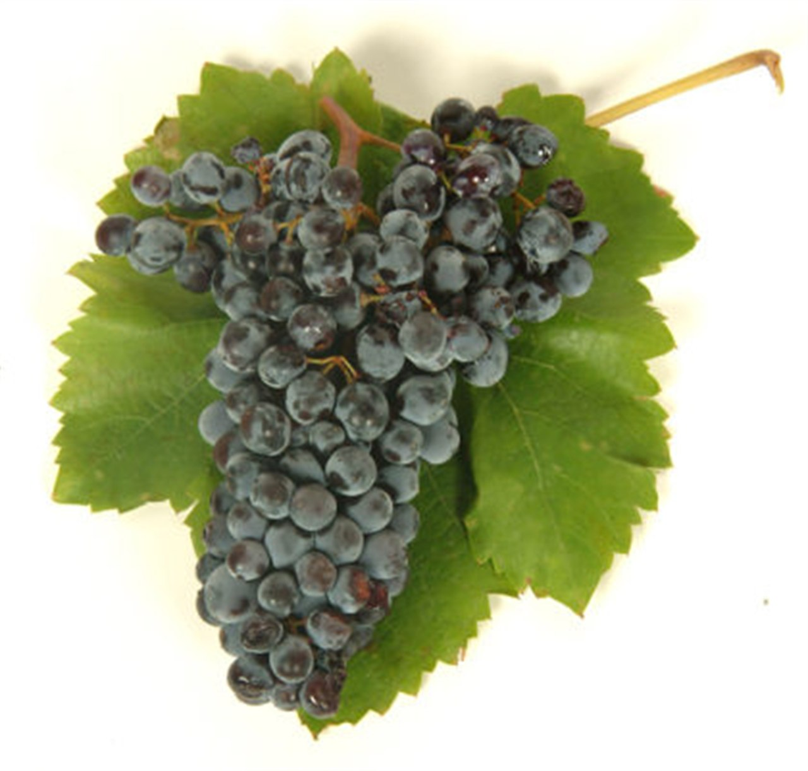
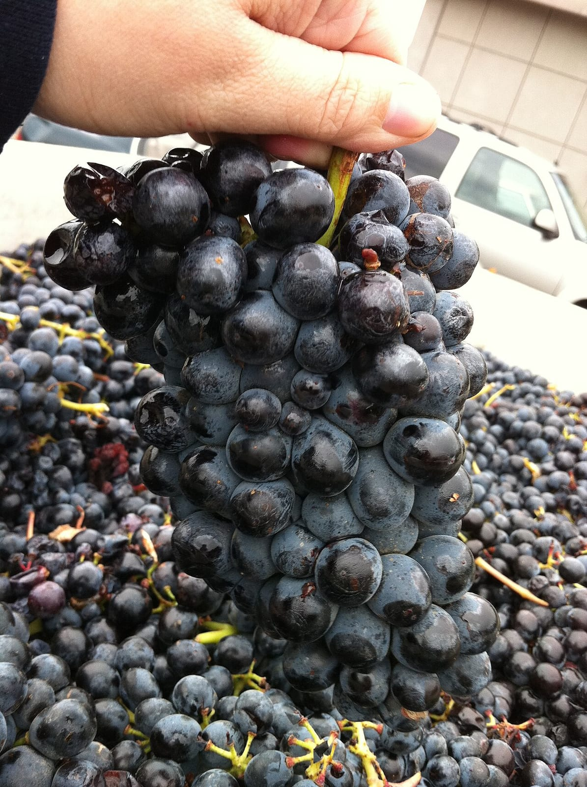

# 西西里

地中海最大的岛屿，意大利产量最大的葡萄酒产区之一；从西部的马萨拉加强酒到东部的埃特纳火山，品种与风格跨度极大，黑达沃拉、卡塔拉托、格里洛与弗拉帕托是核心。

西西里是地中海的岛屿产区，Etna 的火山土、Vittoria 的石灰岩与 Marsala 的加强酒传统，让它既有 Nero d’Avola 的饱满，也有 Nerello Mascalese 的轻盈。

图：Sicily：Old Inzolia vine in vineyard Dietro le Case, Menfi, Sicily（Wikimedia Commons）。图片：Marilena.CantineBarbera，CC BY 4.0，via Wikimedia Commons（[原图页面](https://commons.wikimedia.org/wiki/File:Old_Inzolia_vine_in_vineyard_Dietro_le_Case,_Menfi,_Sicily.jpg)）。

## 定义与边界

西西里是地中海最大的岛屿，也是[意大利](ref:italy)南部最重要的葡萄酒产区之一；它包含 Etna、Vittoria、Marsala、Noto、Pantelleria 等子产区，品种从 Nero d’Avola、Catarratto 到 Zibibbo 与 Nerello Mascalese。

西西里不是单一产区：Etna 的火山土、Vittoria 的红色石灰岩、Marsala 的沿海与岛屿，风格差异极大；酒标上的子产区名比“Sicilia”更能说明风土。

它与意大利本土的 Puglia、Calabria 不同：西西里的岛屿气候、火山与海洋影响，让它的红白葡萄酒都带明显的阳光与矿物。

## 历史与命名

西西里的葡萄酒史可追溯到希腊殖民时期，公元前 8 世纪起，希腊人就在岛上种植葡萄；中世纪与近代，Marsala 加强酒成为贸易大宗。

20 世纪中期，西西里的葡萄酒多用于调酒与散装；1980–90 年代，COS、Occhipinti、Tasca d’Almerita、Planeta 等酒庄重新强调本地品种与低产，让西西里进入精品市场。

“Sicily”是岛屿名，也是产区名；它的历史与希腊、阿拉伯、诺曼、西班牙统治交织，葡萄酒风格也带着多层文化痕迹。

希腊人在公元前 8 世纪把葡萄与酿酒技术带到西西里，后来的阿拉伯、诺曼与西班牙统治也留下饮食与农业传统；Marsala 在 18–19 世纪成为英国贸易的重要加强酒。

20 世纪中期，西西里的葡萄酒多用于调酒与散装；1980–90 年代，COS、Occhipinti 等酒庄用有机种植、本地品种与低干预，让西西里摆脱“廉价酒”形象。

## 地理与风土

西西里位于地中海中心，夏季炎热干燥、冬季温和；岛内有 Etna 火山、丘陵与沿海平原，海拔与海风调节温度，形成多样的微气候。

Etna 的火山土富含熔岩、灰烬与矿物，海拔高、昼夜温差大，Nerello Mascalese 带红樱桃、香料与矿物；Vittoria 的红色石灰岩与海洋影响，让 Nero d’Avola 更饱满、更香料。

西部与南部的沿海平原更热、更干，Catarratto 与 Grillo 带柑橘、白花与盐感；Pantelleria 岛的 Zibibbo 用于甜酒，海风与火山土让糖分浓缩。

Etna 是欧洲最高的活火山，火山土富含熔岩、灰烬与矿物，海拔高、昼夜温差大；Nerello Mascalese 在火山土上带红樱桃、香料与矿物。

Vittoria 的红色石灰岩与海洋影响，让 Nero d’Avola 更饱满、更香料；Pantelleria 岛的 Zibibbo 在火山土与海风中风干，酿成甜酒。

西西里的西部与南部沿海更热、更干，Catarratto 与 Grillo 带柑橘、白花与盐感；海拔与海风是调节成熟的关键。

Etna 的葡萄园分布在火山坡面的不同海拔与朝向，海拔越高、成熟越晚、酸度越高；火山土排水极好，但肥力低，老藤产量很小。

## 原料与风格

[黑达沃拉](ref:nero)（Nero d’Avola）是西西里最重要的红葡萄：黑樱桃、黑莓、李子、甘草与香料，酒体中等到饱满，酸度中等；Etna 的 Nerello Mascalese 更轻、更红果、更矿物。

Catarratto 与 Grillo 是主要白葡萄：柑橘、白花、杏仁与盐感，酸度中等；Zibibbo 用于甜酒与干白，带花香、杏与蜂蜜。

[马沙拉](ref:fortified)（Marsala）是加强酒，风格从干到甜、从琥珀到红宝石；它不是“西西里红酒”的同义词，而是特定工艺与历史。

Nero d’Avola 带黑樱桃、黑莓、李子、甘草与香料，酒体中等到饱满；Etna 的 Nerello Mascalese 更轻、更红果、更矿物，单宁细。

Catarratto 与 Grillo 带柑橘、白花、杏仁与盐感；Zibibbo 带花香、杏与蜂蜜，可酿干白或甜酒；Marsala 是加强酒，风格从干到甜。

西西里的白葡萄酒常带盐感与杏仁苦韵，Catarratto 更中性、Grillo 更柑橘；Zibibbo 的花香与蜂蜜，让它既能做干白，也能做甜酒。

## 代表生产者与酒款

COS 的 Vittoria 系列、Occhipinti 的 SP68、Tasca d’Almerita 的 Rosso del Conte、Planeta 的 Etna 与 Vittoria 酒款，是西西里精品酒的代表；Donnafugata 则以商业与旅游结合。

这些酒庄的酒标常标子产区与品种；读背标的海拔、火山土与年份，比只看“Sicilia”更能判断风格。

COS 的“Pithos”与 Vittoria 系列、Occhipinti 的“SP68”、Tasca d’Almerita 的“Rosso del Conte”、Planeta 的 Etna 与 Vittoria 酒款，是西西里精品酒的代表。

西西里的酒庄从大型合作社到小型自然酒农都有；COS 与 Occhipinti 代表精品与低干预，Tasca d’Almerita 与 Planeta 代表更完整的商业与旅游体系。

## 上桌方式

Nero d’Avola 温度 16–18°C，配烤肉、番茄酱、茄子与硬质奶酪；Nerello Mascalese 14–16°C，配蘑菇、禽肉与轻奶酪；白葡萄酒 8–10°C，配海鲜、沙拉与油炸食物。

Marsala 14–16°C，干型配开胃菜，甜型配干果、巧克力与蓝纹奶酪；Zibibbo 甜酒 6–8°C，配水果塔与杏仁饼。

Nero d’Avola 配番茄酱、茄子、烤肉与硬质奶酪；Nerello Mascalese 配蘑菇、禽肉与轻奶酪；Grillo 与 Catarratto 配海鲜、沙拉与油炸食物。Marsala 干型配开胃菜，甜型配干果与巧克力。

## 选购与误区

买西西里先看子产区：Etna 更轻、更矿物，Vittoria 更饱满、更香料，Marsala 是加强酒；再看品种与年份，Nero d’Avola 的年份差异大。

常见误读：把西西里当成“只会做甜酒与调酒”的产区；以为 Nero d’Avola 都很重；以为 Marsala 就是甜酒。西西里的精品红白葡萄酒可以很精细。

常见误读：把西西里当成“只会做甜酒与调酒”；以为 Nero d’Avola 都很重；以为 Marsala 就是甜酒。西西里的精品红白可以很精细。

西西里的酒标常标“Sicilia”或子产区，买之前看产区与品种；Etna 的 Nerello Mascalese 价格高，Vittoria 的 Nero d’Avola 更亲民。先试单瓶，再考虑整箱。

西西里的白葡萄酒常被低估：Grillo 与 Catarratto 的盐感、杏仁苦韵，适合配海鲜与蔬菜；不要只买 Nero d’Avola。

西西里的酒标如果只写“Sicilia”，品种与地块信息更少；想找典型性，优先选带 Etna、Vittoria、Noto 等子产区名的酒。

## 参见

- [意大利](ref:italy)：南部产区与法规。
- [黑达沃拉](ref:nero)：西西里的标志红葡萄。
- - [马沙拉](ref:fortified)：西西里的加强酒传统。
- [红葡萄酒](ref:red)：红葡萄的发酵与结构。
- [白葡萄酒](ref:white)：白葡萄的发酵与风格。

西西里的酒精度常偏高，配餐时优先选酸度清晰、带矿物感的版本。

**关键事实。**

| 项目 | 内容 |
| --- | --- |
| 一句话定位 | 地中海最大的岛屿，意大利产量最大的葡萄酒产区之一；从西部的马萨拉加强酒到东部的埃特纳火山，品种与风格跨度极大，黑达沃拉、卡塔拉托、格里洛与弗拉帕托是核心 |
| 层级 | 省/大区 |
| 所属 | 意大利 |
| 国家代码 | IT |

**来源与边界。** 本页关于「西西里」的关键事实，主要由以下来源交叉核对：Italian National Tourist Board（意大利葡萄酒产区的旅行与地理背景）、MASAF（意大利农业与葡萄酒产区管理框架）、OIV（葡萄酒定义与全球生产框架）等 4 条来源。价格、批次与状态会变，涉及这些字段时以页面所列来源的最新版本为准。正文为项目自写，来源只作核验，不复制原文。

## 相关图像

图：Nero d’Avola：Grappolo di Nero d'Avola（Wikimedia Commons）。图片：Fabio Ingrosso from Italy，CC BY 2.0，via Wikimedia Commons（[原图页面](https://commons.wikimedia.org/wiki/File:Grappolo_di_Nero_d%27Avola.jpg)）。关联图像：西西里。

图：巴贝拉。图片：Agne27，CC BY-SA 3.0，via Wikimedia Commons（[原图页面](https://commons.wikimedia.org/wiki/File:Barbera_cluster.JPG)）。关联图像：西西里。
