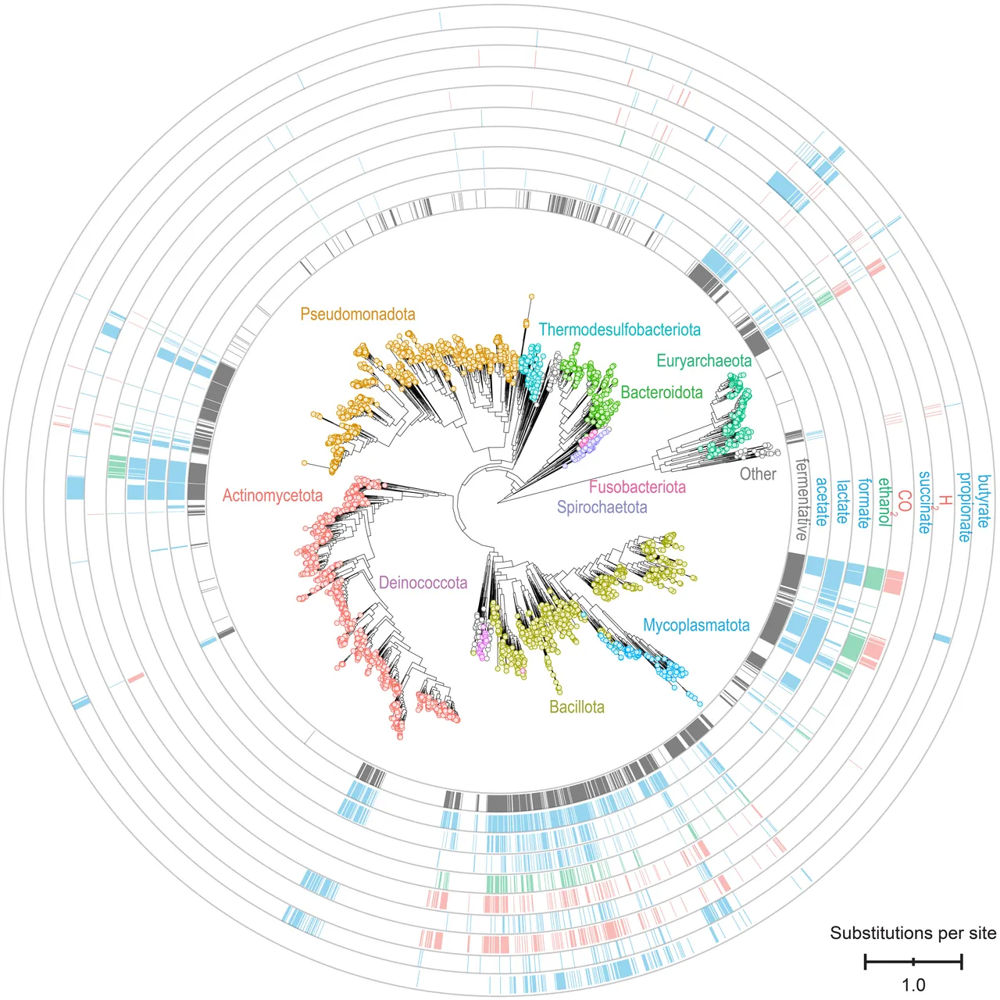

# 索诺马

索诺马（Sonoma）是加州索诺马县的葡萄酒产区，以多样的小气候与 AVA 著称，从冷凉的太平洋海岸一直延伸到温暖的内陆谷地。

图：索诺马。图片：Cullen328，CC BY-SA 3.0，via Wikimedia Commons（[原图页面](https://commons.wikimedia.org/wiki/File:Sonoma_City_Hall_(cropped).jpg)）。

## 定义与范围

索诺马是加州索诺马县内的葡萄酒产区。县面积超过 100 万英亩，其中约 60,000 英亩（约 24,300 公顷）种植葡萄，约占县面积的 6%。县内有 19 个经联邦批准的 AVA，以及 1,800 多个葡萄种植者。

与纳帕谷相比，索诺马的面积更大、 AVA 数量更多、气候梯度更宽。县内既有受海洋影响的冷凉地带，也有内陆的温暖谷地，因此同一县内可以同时生产 Pinot Noir、Chardonnay、Cabernet Sauvignon 与 Zinfandel。

## 「索诺马」的时间线
索诺马是加州最早的葡萄种植区之一，1817 年已有欧洲葡萄（Vitis vinifera）种植记录。19 世纪中叶，传教士与移民建立葡萄园与酒庄，索诺马成为加州葡萄酒业的早期中心。

20 世纪前期经历病害与禁酒令，酒业萎缩；1970 年代以后，酒庄重新扩张。1980 至 1990 年代，Russian River Valley、Sonoma Coast 等冷凉 AVA 建立，Pinot Noir 与 Chardonnay 的声誉上升。2022 年，West Sonoma Coast 成为新的 AVA。

## 地理与气候

索诺马县西临太平洋，东接内陆山地，地形从海岸、山脉到谷地与阶地。太平洋冷流与海雾进入河谷，使西部与 Russian River Valley 生长季凉爽；东部的 Alexander Valley、Knights Valley 与 Sonoma Valley 内陆更暖，夏季日间可达华氏 70 至 90 度（约 21 至 32 摄氏度），夜间降至华氏 40 至 50 度（约 4 至 10 摄氏度）。

5 至 9 月几乎无雨，生长季长而干燥；冬季降雨补充土壤水分。海拔从海平面到约 2,600 英尺（800 米），山坡与谷底的温差、排水与成熟节奏差异明显。

地质历史造成 11 种主要地质构造与 31 个土壤系列，包括火山岩、海相沉积、冲积扇与河流阶地。排水良好、土层浅的坡地适合 Pinot Noir 与 Zinfandel；土层深、保水强的谷地适合 Cabernet Sauvignon 与 Merlot。这些差异构成[风土](ref:terroir)基础。

## AVA 与子产区

索诺马的 19 个 AVA 覆盖海岸、山脉、谷地与阶地，主要包括：

- Russian River Valley：受海雾与冷空气影响，以 Pinot Noir 与 Chardonnay 著称。
- Sonoma Coast 与 West Sonoma Coast：紧邻太平洋，气候冷凉、风大，以 Pinot Noir 与 Chardonnay 为主；West Sonoma Coast 于 2022 年获批，葡萄园约 1,028 英亩。
- Alexander Valley：内陆温暖，以 Cabernet Sauvignon 为主，也有 Merlot 与 Zinfandel。
- Dry Creek Valley：以 Zinfandel 闻名，也有 Syrah 与 Petite Sirah。
- Sonoma Valley 与 Knights Valley：内陆谷地，Cabernet Sauvignon、Merlot 与 Zinfandel 均有种植。
- 其他 AVA 包括 Chalk Hill、Bennett Valley、Green Valley of Russian River Valley、Petaluma Gap、Sonoma Mountain、Rockpile、Fort Ross–Seaview、Moon Mountain District、Fountaingrove District 与 Carneros（与纳帕共享）。

AVA 只划定地理边界，不规定品种或风格。Russian River Valley 内也有温暖地块种植 Cabernet，Alexander Valley 内也有冷凉地块，酒标上的 AVA 需要结合具体地块理解。

AVA 名比“Sonoma”更具体，酒标上的 Russian River Valley 或 Sonoma Coast 往往更能说明气候、品种与成熟节奏。

## 品种与原料

索诺马的品种结构比纳帕谷更分散。Chardonnay 与 Pinot Noir 在冷凉西部占主导，Cabernet Sauvignon 在 Alexander Valley 与 Sonoma Valley 等内陆地带表现突出，Zinfandel 在 Dry Creek Valley 与 Sonoma Valley 有较长历史。其他品种包括 Merlot、Syrah、Petite Sirah、Sauvignon Blanc 与 Viognier。

原料是[葡萄](ref:grape)。索诺马县约 99% 的葡萄园获得可持续认证，覆盖节水、病虫害管理与生态保护等指标。品种选择与 AVA 的气候梯度高度相关：冷凉地带适合早熟、保留酸度的品种，内陆温暖地带适合晚熟、需要充分热量的品种。

## 「索诺马」怎么做出来
红葡萄按品种与 AVA 调整浸渍与陈年。Pinot Noir 多采用较短浸渍、较低发酵温度与旧桶，以保留果味与酸度；Cabernet Sauvignon 与 Zinfandel 浸渍更长，常在新旧混合的[橡木桶](ref:oak-ageing)中陈年。Zinfandel 成熟不均，部分酒庄分批采收或进行田间混选。

白葡萄低温[发酵](ref:fermentation)。Chardonnay 部分酒款经橡木桶、酒泥搅拌与苹果酸乳酸发酵；Sauvignon Blanc 多用不锈钢罐保持清爽。起泡酒在 Russian River Valley 与 Sonoma Coast 也有生产，通常采用传统法。

## AVA 与酒标

就「索诺马」而言，美国产地标识由 27 CFR 4.25 规定。标注 AVA 时，至少 85% 的葡萄酒须来自该 AVA 内的葡萄；标注县或州时，比例为 75%。酒款还须在标注产地所在州完成最终处理（有限例外）。

AVA 是地理名称，不是质量分级；不同酒庄、年份与地块的差异远大于 AVA 名称本身。索诺马的 AVA 数量多，酒标上的地名越具体，通常意味着原料来源越集中，但不必然代表更高品质。

## 「索诺马」的酒标与喝法
酒标应核对 AVA 名称、品种、[年份](ref:vintage)、[酒精度](ref:abv)、容量与装瓶者。标注[单一品种](ref:single-varietal)的酒款须达到联邦品种比例；混酿按法规列出品种。Pinot Noir 建议 14–16 摄氏度，Chardonnay 建议 10–12 摄氏度，Cabernet Sauvignon 与 Zinfandel 建议 16–18 摄氏度，Sauvignon Blanc 建议 8–10 摄氏度。

Pinot Noir 适合禽肉、蘑菇与清淡红肉；Chardonnay 适合海鲜与奶油类菜肴；Cabernet Sauvignon 与 Zinfandel 适合烤肉、红肉与以番茄为底的菜肴。开瓶后冷藏并尽快喝完。本页关于索诺马的内容涉及酒精饮料；过量饮酒有害健康，未成年人不应饮酒。

## 「索诺马」容易被读错的地方
第一，把索诺马当成“另一个纳帕”。索诺马面积更大、AVA 更多、气候梯度更宽，品种结构也更分散。
第二，认为索诺马只产 Pinot Noir。Pinot Noir 集中在冷凉西部，Cabernet Sauvignon、Zinfandel 与 Chardonnay 同样重要。
第三，把 AVA 当成质量等级。AVA 只划定地理范围，不评价酒质。
第四，以为靠海的 AVA 一定更冷。海雾与地形共同作用，Petaluma Gap 等风口比同一海岸的其他地块更冷、风更大。
第五，把 West Sonoma Coast 与 Sonoma Coast 当成同一个 AVA。前者是 2022 年获批的独立 AVA，边界更靠西。

对照阅读：[葡萄酒](ref:wine)、[红葡萄酒](ref:red-wine)。

19 个 AVA 与多种地质构造说明内部差异极大，不能用一个索诺马概括；Russian River 与 Alexander Valley 是两种方向。

索诺马的 AVA 边界与县界并不重合；买酒时看 AVA 名，比只看“Sonoma”更能判断气候与品种。

**关键事实。**

| 项目 | 内容 |
| --- | --- |
| 一句话定位 | 加州索诺马县的葡萄酒产区，葡萄园约 60,000 英亩（约 24,300 公顷），占县面积约 6%，有 19 个 AVA；西侧受太平洋冷雾与海风影响，东侧内陆更暖，葡萄园海拔从海平面到约 800 米，有 11 种主要地质构造与 31 个土壤系列 |
| 层级 | 其他 |
| 所属 | 美国 |
| 国家代码 | US |

**来源与边界。** 本页关于「索诺马」的关键事实，主要由以下来源交叉核对：Sonoma County Winegrowers（葡萄园面积、AVA 数量、种植者数量与可持续认证比例；19 个 AVA、海拔、气候、地质构造与土壤系列）、Electronic Code of Federal Regulations (TTB)（AVA 的 85% 产地规则与县、州级 75% 规则）、OIV（补充核对条目背景、术语与制度口径）。价格、批次与状态会变，涉及这些字段时以页面所列来源的最新版本为准。正文为项目自写，来源只作核验，不复制原文。

## 参考资料
- [葡萄酒](ref:wine)：理解索诺马的类别、年份与产地规则的入口。
- [红葡萄酒](ref:red-wine)与[白葡萄酒](ref:white-wine)：索诺马两大酒类的基本框架。
- [葡萄](ref:grape)：酿酒葡萄的结构与成熟指标。
- [发酵](ref:fermentation)：Pinot Noir 与 Chardonnay 的发酵差异。
- [酸度](ref:acidity)：海雾与昼夜温差对酸度的影响。
- [风土](ref:terroir)：海岸、山脉与谷地如何形成 AVA 差异。
- [橡木桶陈年](ref:oak-ageing)：Pinot Noir 与 Cabernet Sauvignon 的容器选择。
- [干型](ref:dry)：索诺马白葡萄酒的干型定位。
- [年份](ref:vintage)：索诺马的年份差异与干旱、山火影响。
- [单一品种](ref:single-varietal)：索诺马的品种比例与酒标标注规则。
- [酒精度](ref:abv)：酒标上 % vol 的含义。

## 相关图像

图：年份（vintage）。图片：Chiusi Painter，Public domain，via Wikimedia Commons（[原图页面](https://commons.wikimedia.org/wiki/File:Cup_vintage_Cdm_Paris_320_n1.jpg)）。关联图像：索诺马。

图：发酵。图片：Tjhackmann，CC BY-SA 4.0，via Wikimedia Commons（[原图页面](https://commons.wikimedia.org/wiki/File:Phylogenetic_tree_of_bacteria_and_archaea,_highlighting_those_that_carry_out_fermentation.png)）。关联图像：索诺马。
