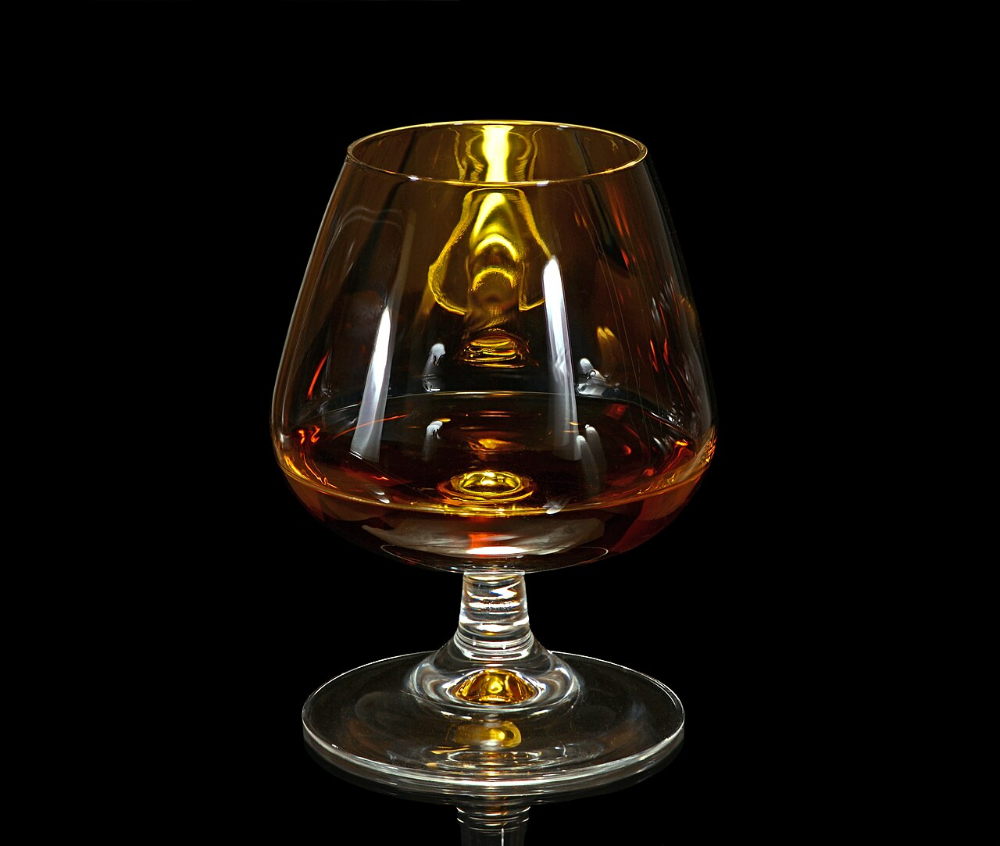
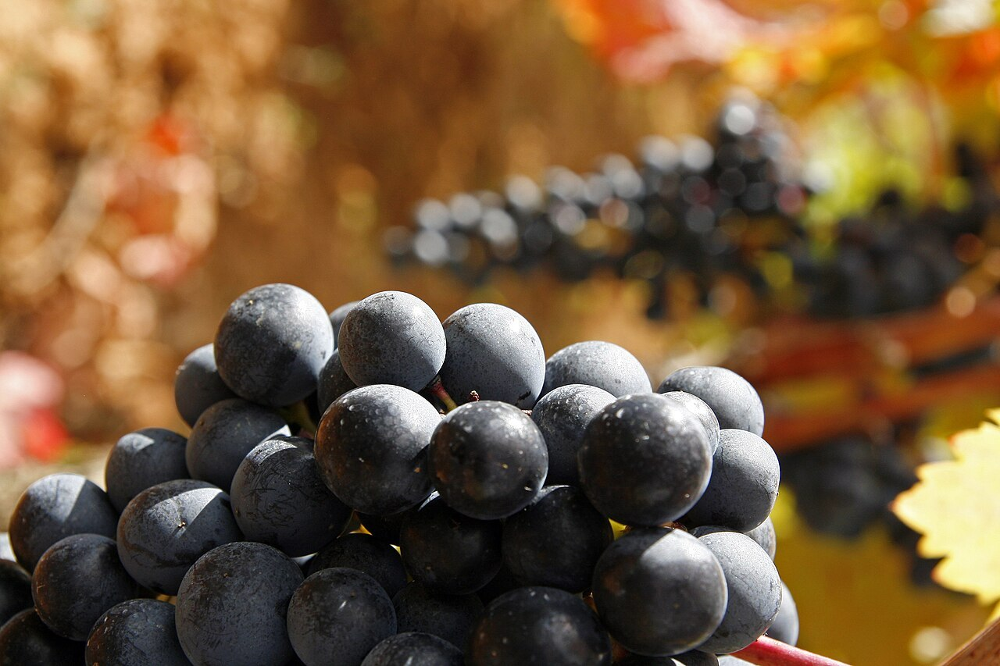

# 西班牙

西班牙是南欧葡萄酒生产大国，葡萄种植面积广、产区层级多。它的酒类版图既有以丹魄为核心的里奥哈红葡萄酒，也有卡瓦起泡酒、赫雷斯加强酒与加利西亚的白葡萄酒。理解西班牙，需要把品种、产区、分级与陈年传统放在一起看。

图：西班牙。摄影：Uga - Lanzarote - Spain. Vineyards -U16。署名：Luis Miguel Bugallo Sánchez，CC BY-SA 3.0，来自 Wikimedia Commons（[来源](https://commons.wikimedia.org/w/index.php?curid=17458062)）。

## 地理与气候

西班牙位于伊比利亚半岛，大部分地区受地中海与大陆性气候影响，夏季炎热干燥，冬季温和或寒冷。北部与西北部受大西洋影响，降水较多、气候更湿润；中部高原海拔较高，昼夜温差大；南部安达卢西亚炎热少雨；东北部加泰罗尼亚临地中海。海拔、海流与山脉让同一国家内部形成多种微气候。

水分是许多产区的关键限制。干旱地区需要通过品种选择、密度控制与灌溉管理来维持成熟度与酸度；湿润的西北部则要面对病害与成熟不足。气候不是背景，而是每年影响产量与风格的主要变量。

## 「西班牙」的时间线
西班牙的葡萄种植与酿酒传统可追溯到古代，中世纪修道院与地方城镇保留了产区雏形。19 世纪后期，法国葡萄园遭受病害，部分酒商与技术人员转向西班牙，推动了酿造技术与贸易的发展。20 世纪逐步建立 DO 体系，后来与欧盟的 PDO 框架衔接，产区规则趋于统一。

## 葡萄酒产区

- 里奥哈：以丹魄为主，常与歌海娜、格拉西亚诺混酿，橡木桶陈酿传统深厚。
- 杜埃罗河岸：大陆性气候，丹魄更浓缩、结构更强。
- 加泰罗尼亚：卡瓦起泡酒与普里奥拉托红葡萄酒。
- 加利西亚：以大西洋气候下的白葡萄酒著称。
- 安达卢西亚：赫雷斯加强酒与雪莉体系。
- 卡斯蒂利亚-拉曼恰：产量大，温度高，灌溉与品种选择影响风格。

## 「西班牙」的品种与风格坐标
[丹魄](ref:tempranillo)是西班牙最具代表性的红品种，果皮较厚、成熟较早，带樱桃、皮革与烟草气息。里奥哈的丹魄常经[橡木桶陈年](ref:oak-ageing)，形成圆润的结构；杜埃罗河岸则更紧实。[歌海娜](ref:grenache)在西班牙东北部与南部广泛种植，常带来红色果味与较高的酒精。

[红葡萄酒](ref:red-wine)之外，西班牙也生产[白葡萄酒](ref:white-wine)、[起泡酒](ref:sparkling)与[加强酒](ref:fortified)。卡瓦以本地白葡萄为主，采用传统法二次发酵；赫雷斯的雪莉在葡萄发酵后加入酒精强化，风格从干型到甜型都有。不同类别的评价体系不同，不能只用红葡萄酒的标准比较。

## 代表酒款与类型

里奥哈与杜埃罗河岸的传统酒款常以丹魄为主，经过不同时长的桶陈，形成从年轻果味到陈年香料气息的谱系。卡瓦是西班牙起泡酒的代表，适合餐前与庆祝场景；赫雷斯则生产从极干到甜的加强酒。西班牙也生产[白兰地](ref:brandy)，其中赫雷斯地区的白兰地有专门的产区与陈年规范。

具体酒款的风格还取决于酒庄、年份、混酿比例与陈年方式。产区名提供框架，酒款页才记录具体产品。

## 法规与分级

西班牙葡萄酒的产区标识以 DO（Denominación de Origen）为核心，并与欧盟 PDO 体系衔接；部分优质产区还有更高层级的分类，如 DO Pago。卡瓦与赫雷斯有各自独立的产区与标签规则。分级规定品种、产量、陈年与标签用语，但不等于质量排名。

阅读酒标时，要区分国家名、DO 名、酒庄名与类型名。同一 DO 内不同酒庄的质量差异可能很大；“陈年”标注也分不同等级，具体含义取决于产区规则。

## 气候与土壤数据

| 区域 | 气候 | 主要土壤 | 代表酒类 |
| --- | --- | --- | --- |
| 北部（加利西亚、巴斯克、纳瓦拉） | 大西洋气候，湿润 | 花岗岩、片岩、冲积土 | 白葡萄酒 |
| 中部（里奥哈、杜埃罗河岸） | 大陆性，昼夜温差大 | 石灰岩、黏土、砾石 | 丹魄红葡萄酒 |
| 东北部（加泰罗尼亚） | 地中海 | 石灰岩、冲积土 | 卡瓦起泡酒、普里奥拉托红葡萄酒 |
| 南部（安达卢西亚） | 地中海，炎热少雨 | 白垩土 | 雪莉加强酒、白兰地 |

这张表是宏观对照，具体地块的土壤、海拔与朝向仍需看单个 DO。把国家气候当成酒款风格保证，会忽略产区内部的差异。

## 市场与饮用

西班牙是重要的葡萄酒生产与出口国，国内消费以餐饮与日常饮用为主。[葡萄酒](ref:wine)的价格跨度很大，从日常餐酒到长期陈年的名庄酒都有。红葡萄酒适合搭配肉类、火腿与奶酪；白葡萄酒适合海鲜与轻食；起泡酒与加强酒则各有自己的饮用场景。

饮用温度与开瓶后的保存会影响体验。对具体酒款，酒标上的 DO、年份、酒精度与类型，是最直接的信息来源。

## 「西班牙」容易被读错的地方
第一，西班牙酒都是甜型或高度数。它有干型红白、起泡与加强酒等多种类型。

第二，里奥哈等于整个西班牙。西班牙还有杜埃罗河岸、普里奥拉托、赫雷斯等产区。

第三，丹魄就是西班牙的赤霞珠。二者在香气、酸度与单宁结构上不同。

第四，DO 级别越高越好。分级保证规则，不保证每一瓶的感官质量。

第五，雪莉都是甜酒。雪莉从极干到甜型都有，风格跨度很大。

对照阅读：[葡萄酒](ref:wine)、[白葡萄酒](ref:white-wine)。

**关键事实。**

| 项目 | 内容 |
| --- | --- |
| 一句话定位 | 南欧葡萄酒生产大国，以丹魄、歌海娜等品种与 DO 分级体系著称；里奥哈、杜埃罗河岸、卡瓦与赫雷斯构成多样的酒类版图 |
| 层级 | 国家 |
| 国家代码 | ES |

**来源与边界。** 本页关于「西班牙」的关键事实，主要由以下来源交叉核对：Reino de España — MAPA（西班牙农业、食品与葡萄酒产区管理的公开信息）、European Union（欧盟葡萄酒类别、地理标志与标签规则）、International Organisation of Vine and Wine (OIV)（全球葡萄酒生产与品种统计的基本口径）等 5 条来源。价格、批次与状态会变，涉及这些字段时以页面所列来源的最新版本为准。正文为项目自写，来源只作核验，不复制原文。

## 参考资料
- [葡萄酒](ref:wine)：理解西班牙的分类、酿造与产区框架。
- [红葡萄酒](ref:red-wine)与[白葡萄酒](ref:white-wine)：两类基本风格与工艺。
- [起泡酒](ref:sparkling)：卡瓦与传统法起泡酒。
- [加强酒](ref:fortified)：雪莉的强化与陈年体系。
- [丹魄](ref:tempranillo)：里奥哈与杜埃罗河岸的核心品种。
- [歌海娜](ref:grenache)：西班牙东北部与南部的常见品种。
- [橡木桶陈年](ref:oak-ageing)：里奥哈红葡萄酒的桶陈传统。

## 相关图像

图：白兰地。图片：Didier Descouens，CC BY-SA 3.0，via Wikimedia Commons（[原图页面](https://commons.wikimedia.org/wiki/File:Cognac_glass.jpg)）。关联图像：西班牙。

图：Tempranillo grapes from Rioja Alavesa。摄影：María Jesús Tomé，CC BY 2.0，来自 Wikimedia Commons。。图片：María Jesús Tomé，CC BY 2.0，via Wikimedia Commons（[原图页面](https://commons.wikimedia.org/w/index.php?curid=16191821)）。关联图像：西班牙。
