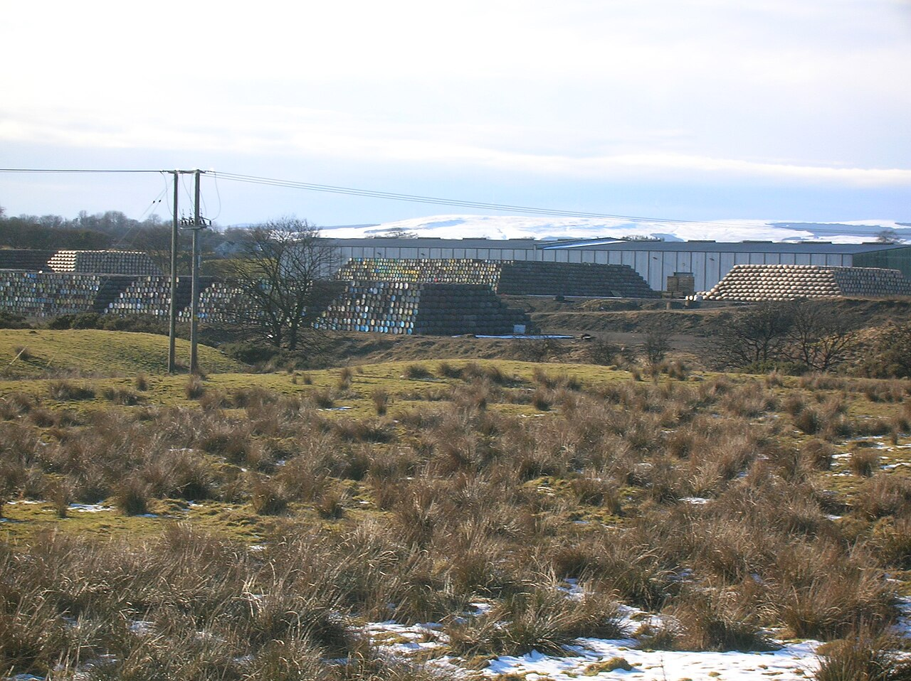

# 斯佩塞

斯佩塞（Speyside）在苏格兰东北部，以斯佩河及其支流谷地为核心。这里的酒厂密度居苏格兰之首，约 50 家蒸馏厂集中在从格伦利维特到罗斯、达夫敦与基思的狭长地带。它既是《2009 年苏格兰威士忌条例》承认的受保护地方名称，也是市场上最常见的风格标签之一；这两层身份需要分开理解。

图：斯佩塞地区的一处实景。图片：Coldupnorth，CC BY-SA 4.0，via Wikimedia Commons（[原图页面](https://commons.wikimedia.org/wiki/File:Glenfiddich_Distillery_View.jpg)）。这张照片来自斯佩塞产区内已核实条目，用于说明当地风貌，不是斯佩塞的全区域地图。

## 范围与法律地位

在《2009 年苏格兰威士忌条例》下，斯佩塞与高地、低地、艾雷岛、坎贝尔镇同列受保护地方名称。标注斯佩塞的苏格兰威士忌必须在划定的斯佩塞区域内蒸馏，并仍然满足苏格兰威士忌的全部条件：在苏格兰陈年、使用橡木桶至少 3 年、装瓶酒精度不低于 40% vol、蒸馏酒精度不超过 94.8% vol。它与可单独注册的欧盟地理标志不同：受保护的是“Scotch Whisky”这一整体名称，斯佩塞是英国法规内部的地方名称，不能脱离苏格兰威士忌单独申请保护。边界由法规与产品规范界定，不以酒厂宣传或市场习惯为准。

## 河流与地形

斯佩河全长约 172 公里，从高地流向马里湾，沿途接纳特罗米、艾文、利维特等支流。谷地被凯恩戈姆山脉与莫纳利亚山脉夹在中间，形成雨影，年降雨少于苏格兰西部，昼夜与季节温差更明显。这种相对干燥的气候不利于霉菌，却也让露天发麦变得更可行；历史上，酒厂因此可以在同一地点完成发芽、糖化与蒸馏。今天多数酒厂仍取用泉水或井水，水质偏软，矿物含量低，适合长时间糖化。

## 从私酿到产业

18 世纪后期，斯佩河谷地私酿盛行，蒸馏常依附农庄，产品经走私网络南下。1823 年消费税法改革降低税负、开放持证生产，1824 年格伦利维特（The Glenlivet）取得执照，成为制度转型的象征。1863 年铁路进入斯佩谷，煤炭、大麦与成品运输成本下降，内陆酒厂得以与南部调和商直接连接。20 世纪中期调和威士忌需求增长，斯佩塞产量扩张，随后又经历合并与关停；近二十年新建与扩建项目重新增多，酒厂旅游与“麦芽威士忌之路”成为地方经济的一部分。

## 原料与工艺

大麦曾是本地作物，如今多由外部供应；传统地板发芽已大幅减少，仅少数酒厂保留，多数使用中央发芽厂的麦芽。糖化后用清澈麦汁发酵，发酵时间从数十小时到超过 100 小时不等，较长的发酵能产生更多酯类，为花果香打底。壶式蒸馏器多经一次或两次蒸馏，蒸馏器形状、林恩臂角度与加热方式改变回流与铜接触，进而影响酒体的油脂感与硫味。陈年以波本桶为主流，雪莉桶、波特桶与葡萄酒桶用于调味或过桶。

## 风格谱系

斯佩塞常被概括为花果香、蜂蜜、青苹果与麦芽甜，但内部至少可以分为几条线。第一条是清淡花香型，格兰菲迪、格兰威特与格兰格兰特常被举为代表，酒体轻、酯香明显。第二条是重雪莉型，麦卡伦、格兰花格与亚伯乐以干果、坚果、香料与浓厚酒体著称。第三条是肉感与硫味并存的复杂型，莫特拉克与克雷盖拉希常被讨论，风味更厚重。第四条是近年新建酒厂的实验路线，尝试长发酵、不同酵母与非常规桶型。把这些统一描述为“斯佩塞风格”，会掩盖酒厂与桶型造成的差异。

## 代表酒厂

格兰菲迪（Glenfiddich）自 1887 年起由格兰特家族经营，是少数仍以单一麦芽为主要定位的酒厂；格兰威特（The Glenlivet）强调花果香与易饮性；麦卡伦（The Macallan）以雪莉桶陈年的浓郁风格建立市场地位；格兰花格（Glenfarclas）保留家族经营与直火蒸馏传统；百富（The Balvenie）以桶陈与过桶实验闻名；亚伯乐（Aberlour）常见雪莉桶的干果与香料。达夫敦（Dufftown）与罗斯（Rothes）是酒厂最密集的城镇，前者常被称为“威士忌之都”。

## 年份、市场与挑战

威士忌的“年份”与葡萄酒不同：酒标上的数字通常是瓶中最低酒龄，而非单一年份收成。斯佩塞的酒厂风格受桶源影响很大，同一酒厂不同年份、不同桶型的装瓶可以完全不同。市场方面，单一麦芽在 21 世纪初的扩张推动了新建与扩产，也带来原酒供应紧张与年轻酒款增多的现象；与此同时，调和威士忌仍是苏格兰威士忌出口的主体，斯佩塞的产量很大一部分进入调和体系。长期挑战包括能源成本、泥煤与碳排放议题，以及旅游旺季对基础设施的压力。

## 常见误区

第一，斯佩塞只有一种风格。实际上从清淡花果到重雪莉都有。第二，斯佩塞是欧盟独立法定产区。它更像英国法规下的地方名称，受保护的是苏格兰威士忌整体的地理标志。第三，斯佩塞威士忌都使用雪莉桶。波本桶仍是主流。第四，酒厂越多越同质。规模与工艺差异依然明显。第五，斯佩塞等于高质量。产区名称不是质量等级。第六，单一麦芽一定优于调和。两者是不同产品逻辑，不能简单比较。

对照阅读：[苏格兰](ref:scotland)、[橡木桶陈酿](ref:oak-ageing)。

斯佩塞是受保护的地方名称，不是可单独注册的欧盟地理标志；Speyside 与 Single Malt 是两个不同层级，不能互相替代。

## 延伸阅读

- [苏格兰](ref:scotland)：苏格兰威士忌的法定框架与产区体系。
- [威士忌](ref:whisky)：威士忌的类型与基本工艺。
- [橡木桶陈年](ref:oak-ageing)：波本桶、雪莉桶与陈年对风格的影响。
- [发酵](ref:fermentation)：发酵时间与风味前体的关系。
- [大麦](ref:barley)：发芽大麦作为威士忌原料。

相关条目：[威士忌](ref:whisky)。

**关键事实。**

| 项目 | 内容 |
| --- | --- |
| 一句话定位 | 苏格兰东北部斯佩河流域的威士忌产区，酒厂密度居苏格兰之首，常被概括为花果香与雪莉桶风格；但它是《2009 年苏格兰威士忌条例》下的受保护地方名称，不是可单独注册的欧盟地理标志，内部风格也从清淡花香一直延伸到重雪莉 |
| 层级 | 其他 |
| 所属 | 苏格兰 |
| 国家代码 | GB |

## 相关图像

图：苏格兰类别配图。图片：Alan Jamieson，CC BY-SA 3.0，via Wikimedia Commons（[原图页面](https://commons.wikimedia.org/wiki/File:Glenmorangie_Distillery_-_panoramio.jpg)）。关联图像：斯佩塞。

图：艾尔郡的威士忌桶陈仓库，桶型、年份与仓库环境构成风味变量。图片：Rosser1954 Roger Griffith，Public domain，via Wikimedia Commons（[原图页面](https://commons.wikimedia.org/wiki/File:Balgray_Bond,_whisky_barrels,_Barrmill,_Ayrshire.JPG)）。关联图像：斯佩塞。
