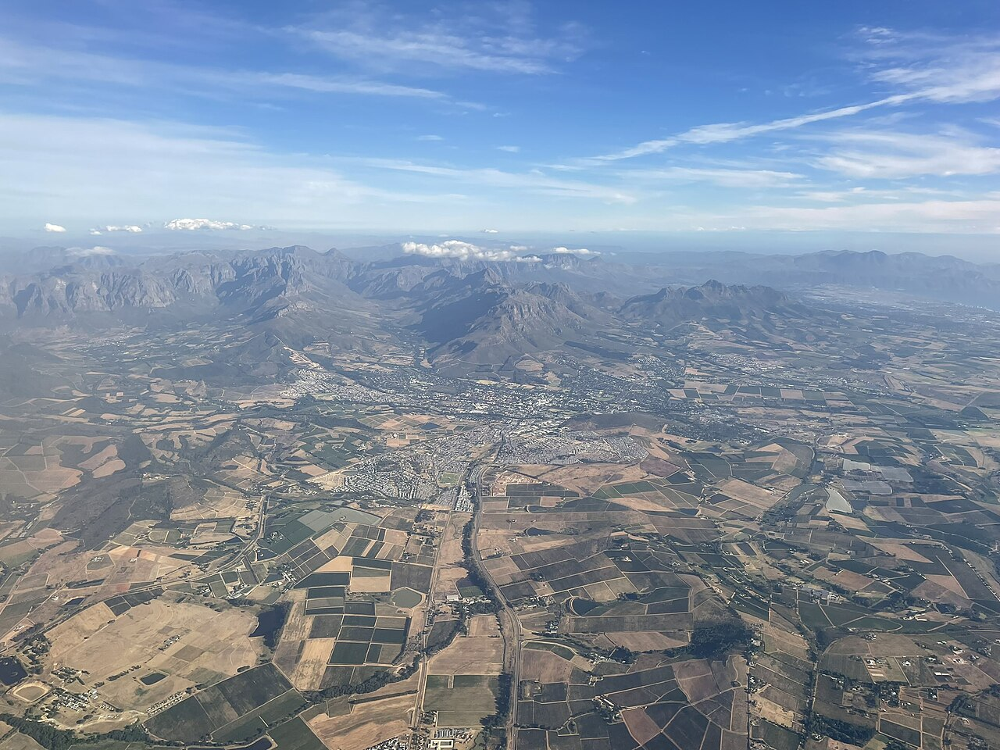

# 斯泰伦博斯

斯泰伦博斯（Stellenbosch）是南非西开普最负盛名的葡萄酒产区，位于开普敦以东约 45 公里，是 Wine of Origin 体系中的 district。它既有 17 世纪的殖民建镇历史，也有南非第一个葡萄酒之路与成熟的高端红酒产业。

图：斯泰伦博斯。图片：CJJ2501，CC0，via Wikimedia Commons（[原图页面](https://commons.wikimedia.org/wiki/File:Stellenbosch_aerial_photo_from_north-west_2024-01.jpg)）。

## 开普敦以东的葡萄酒重镇

斯泰伦博斯属于西开普的 Coastal Region，距离开普敦约 45 公里，是南非葡萄酒业的地理与学术中心之一。产区以斯泰伦博斯镇为核心，葡萄园沿 Eerste 河两岸、Simonsberg 山南坡与周边谷地展开，城镇、大学、酒庄与居住区高度交织。

这里的葡萄酒产业不是孤立存在，而是与大学、研究机构、酒庄旅游和餐饮共同构成一个完整的生态。这种密度使斯泰伦博斯在南非葡萄酒的话语体系中长期占据中心位置。

大学与研究机构为产区提供了品种试验、病害管理与酿造培训的人才基础；酒庄旅游则把历史庄园、山地景观与餐饮体验打包成可销售的产品。产业、学术与旅游的叠加，使斯泰伦博斯既是生产区，也是南非葡萄酒文化的展示窗口。

## 1679 年建镇与开普传统

斯泰伦博斯镇由开普总督 Simon van der Stel 于 1679 年建立，是南非最早的欧洲移民定居点之一。18 世纪，开普殖民地与荷兰东印度公司的贸易网络把葡萄酒纳入地方经济，庄园制度与葡萄酒文化逐步成形。

这段历史留下了两个后果。一是大量历史庄园与老建筑，使产区拥有南非最完整的葡萄酒景观；二是以庄园为核心的产业传统，影响了后来酒庄的规模、所有权与品牌叙事。现代斯泰伦博斯的高端酒形象，与这段殖民时期的土地制度密不可分。

## 1971 年葡萄酒之路与 1973 年 WO

1971 年，斯泰伦博斯成立了南非第一条葡萄酒之路，把酒庄参访组织成一条可运营的旅游线路。这是产区品牌化的早期尝试，也让"到斯泰伦博斯喝酒"成为国际游客的固定项目。

1973 年，南非正式实施 Wine of Origin 制度，按生产区域、品种与年份对酒标进行认证。斯泰伦博斯成为该制度下的 district 之一，法定产区边界与酒标规则从此确立。需要注意，1971 年是葡萄酒之路的年份，1973 年才是 WO 制度正式实施的年份，两者不应混为一谈。

## 山、谷与花岗岩土

斯泰伦博斯的地形由几条山脊与谷地构成。Simonsberg、Helderberg、Stellenbosch Mountain 与 Jonkershoek 山谷共同制造了大量坡向与海拔差异，使同一 district 内可以出现显著不同的成熟条件与风格。

土壤以分解花岗岩为主，另有砂岩、页岩与谷底黏土。花岗岩坡地排水良好、肥力低，适合 Cabernet Sauvignon 与 Syrah；谷底黏土保水更强，适合需要水分的品种与更高产量。山、坡、谷的组合构成产区的[风土](ref:terroir)基础，也是酒庄之间风格差异的主要来源。

来自 False Bay 的凉爽海风会沿山谷进入产区，使靠海一侧的成熟期更长、酸度更高；靠山一侧则更温暖、成熟更充分。这种海陆温差与坡向差异，让同一 district 内的酒款可以呈现从紧致到丰腴的不同风格。

## 品种：Cabernet Sauvignon 与 Chenin Blanc

Cabernet Sauvignon 是斯泰伦博斯最重要的红品种，也是产区高端酒的国际名片。这里的酒通常比波尔多更成熟，黑加仑、雪松、烟草与石墨气息明显，单宁结构扎实，适合[橡木桶陈年](ref:oak-ageing)。Simonsberg 与 Helderberg 的坡地被认为最适合这一品种。

Syrah 在较凉爽的坡地上表现良好，带黑胡椒、紫罗兰与深色果香；Pinotage 是南非本土杂交品种，在斯泰伦博斯也有稳定表现。白品种方面，Chenin Blanc 仍是主力，风格从清爽干型到酒泥陈酿与甜型都有。原料是葡萄，品种比例决定酒标可写的内容。

Pinotage 由 Pinot Noir 与 Cinsaut 杂交育成，带有独特的烟熏、香蕉与深色果香，风格争议较大。它在斯泰伦博斯的历史与南非本土品种叙事紧密相连，但因早熟与产量问题，种植面积并不稳定。支持者认为它是南非风土的独特表达，批评者则嫌其香气过于张扬。

## 法规与酒标

南非的 Wine of Origin 由 Wine and Spirit Board 管理。标注产区来源的酒款须 100% 来自该产区；标注[品种](ref:single-varietal)或[年份](ref:vintage)的酒款须至少 85% 符合标注。酒标还须标明[酒精度](ref:abv)、容量与生产商信息。

斯泰伦博斯的酒标可以只写 Stellenbosch，也可以写到更小的 ward。ward 是法定地理单元，不等于质量等级；同一 ward 内的酒庄风格差异可能比跨 ward 更大。购买时应区分产区名、庄园名与品牌名，并注意酒标是否同时标注品种、年份与产区层级。

## 饮用与误区

斯泰伦博斯红酒建议在 16 至 18 摄氏度饮用，适合烤肉、野味、蘑菇与硬质奶酪。Cabernet Sauvignon 需要醒酒；Syrah 与 Pinotage 可根据年份与风格调整。Chenin Blanc 建议 9 至 11 摄氏度，适合海鲜、禽肉与香料菜肴。

常见误区有四。第一，把 1971 年当成 WO 制度实施年份：1971 年是葡萄酒之路，1973 年才是 WO。第二，认为斯泰伦博斯只有 Cabernet Sauvignon：Syrah、Pinotage、Merlot 与 Chenin Blanc 都很重要。第三，把 ward 当成质量等级：它是地理单元。第四，以为南非酒都便宜：斯泰伦博斯的高端酒款价格已与国际名产区接轨。

**关键事实。**

| 项目 | 内容 |
| --- | --- |
| 一句话定位 | 南非西开普 Coastal Region 内的 Wine of Origin district，位于开普敦以东约 45 公里；1679 年由 Simon van der Stel 建镇，1971 年成立南非第一条葡萄酒之路，1973 年 WO 制度正式实施后成为法定产区之一 |
| 层级 | 其他 |
| 所属 | 南非 |
| 国家代码 | ZA |

**来源与边界。** 本页关于「斯泰伦博斯」的关键事实，主要由以下来源交叉核对：SAWIS / Wine and Spirit Board（WO 制度于 1973 年正式实施、district 层级与产地 100%、品种与年份 85% 的标注规则）、Stellenbosch Wine Routes（1971 年南非第一条葡萄酒之路，以及斯泰伦博斯约占全国 101,957 公顷葡萄园的 18%）、Stellenbosch Cabernet Collective（Cabernet Sauvignon 在斯泰伦博斯的长期种植传统与产区定位）等 4 条来源。价格、批次与状态会变，涉及这些字段时以页面所列来源的最新版本为准。正文为项目自写，来源只作核验，不复制原文。

## 参考资料

- [葡萄酒](ref:wine)：理解斯泰伦博斯的大类归属与产地规则。
- [红葡萄酒](ref:red-wine)：红葡萄酒的酿造与风格框架。
- [南非](ref:south-africa)：南非葡萄酒产区的整体格局。
- [Cabernet Sauvignon](ref:cabernet)：斯泰伦博斯的旗舰红品种。
- [Chenin Blanc](ref:chenin)：南非白品种的主力。
- [Syrah](ref:syrah)：较凉爽坡地上的重要红品种。
- [橡木桶陈年](ref:oak-ageing)：桶型与新桶比例对风格的影响。
- [风土](ref:terroir)：山地、坡向与花岗岩土。
- [年份](ref:vintage)：年份差异与酒标规则。
- [单一品种](ref:single-varietal)：85% 品种标注规则。
- [酒精度](ref:abv)：酒标上 % vol 的含义。
