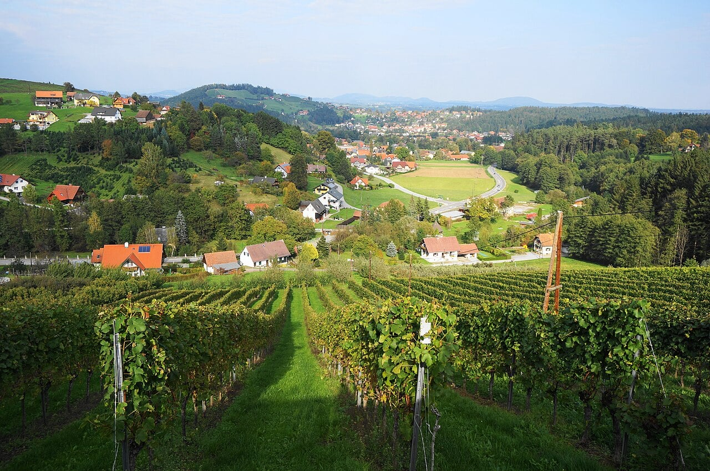

# 施泰尔马克

施泰尔马克（Steiermark，英文 Styria）是奥地利东南部的州级葡萄酒产区，以 Sauvignon Blanc 等干型白葡萄酒与西部桃红 Schilcher 著称。

图：西施泰尔马克（Weststeiermark）的席尔歇（Schilcher）葡萄酒产区，丘陵间的葡萄园与村落。图片：Naturpuur，CC BY 4.0，via [原图页面](https://commons.wikimedia.org/wiki/File:Panorama_Schilcher_Weingegend,_Weststeiermark.jpg)。

## 定义与范围

施泰尔马克是奥地利的三个州级葡萄酒产区之一，葡萄园集中在州的南部与东南部，沿南施泰尔马克葡萄酒之路、Sausal 丘陵与施泰尔马克盆地边缘分布。

产区面积约 5,109 公顷，是奥地利第三大州级产区。白葡萄酒占主体，红葡萄以 Blauer Wildbacher 为主，主要用于酿造桃红。

## 「施泰尔马克」的时间线
施泰尔马克的葡萄种植与阿尔卑斯东麓的农户经济、修道院庄园相关，长期以混合农业与本地消费为主。20 世纪后期，产区转向以 Sauvignon Blanc 为核心的精品白葡萄酒路线，并在国际市场上建立起清爽高酸的风格印象。

2018 年份起，Südsteiermark、Weststeiermark 与 Vulkanland Steiermark 三个子区同时获得 DAC 地位，产区进入以产地分级为核心的新阶段。每年 11 月初上市的 Junker 是当年最早发售的轻盈酒款，用于展示新年份。

## 地理与气候

施泰尔马克位于阿尔卑斯山东缘，葡萄园分布在丘陵与盆地交界处。气候受阿尔卑斯与潘诺尼亚双重影响，夏季温暖、昼夜温差大，秋季凉爽，成熟期较长。

地质上约四分之三的葡萄园位于施泰尔马克盆地的沉积物上，包括粉砂、泥灰岩、砂、砾石与砂岩；约 20% 位于阿尔卑斯推覆体的硬岩上，包括片麻岩、云母片岩、千枚岩与角闪岩；东南部约 3% 位于火山玄武岩、火山渣与凝灰岩上。

当地把泥灰岩与粉砂为主的土壤称为 Opok，排水适中、保水较好，被认为是施泰尔马克白葡萄酒矿物感与酸度的基础。土壤、坡度与朝向共同构成[风土](ref:terroir)差异。

施泰尔马克的 Opok 土壤与昼夜温差，是当地白葡萄酒酸度与矿物感的常见解释；但不同子区的降雨与坡度差异，仍会让同一品种呈现不同风格。

## 三个 DAC

施泰尔马克的三个 DAC 覆盖不同子区，规则统一但风格侧重不同：

- Südsteiermark DAC：南部，覆盖 Kitzeck-Sausal、Eichberg、Leutschach、Gamlitz 与 Ehrenhausen，以 Sauvignon Blanc、Gelber Muskateller 为主，Opok 与石灰质土壤。
- Weststeiermark DAC：西部，覆盖 Ligist、Stainz、Deutschlandsberg 与 Eibiswald，以 Schilcher 为代表，是该区唯一允许的桃红。
- Vulkanland Steiermark DAC：东南部，覆盖 Oststeiermark、Riegersburg、Kapfenstein、St. Anna、Tieschen、Klöch、Straden、St. Peter 与 Gleichenberg，火山土壤，Traminer 表现突出。

三级产地体系为 Gebietswein（产区级）、Ortswein（村庄级）与 Riedenwein（单一地块级）。Gebietswein 最早可在采收次年 3 月上市（Welschriesling 与 Schilcher 可在采收当年 12 月）；Ortswein 与 Riedenwein 最早在采收次年 5 月上市（Schilcher 为 2 月）。标注 Reserve 的酒款须比对应级别再晚 18 个月上市（Schilcher 为 12 个月）。

## 品种与原料

允许品种包括 Welschriesling、Weißburgunder、Morillon（即 Chardonnay）、Grauburgunder、Riesling、Gelber Muskateller、Sauvignon Blanc、Traminer 与 Blauer Wildbacher（仅限 Weststeiermark 作 Schilcher），以及由这些品种组成的混酿。原料是[葡萄](ref:grape)。

Sauvignon Blanc 是面积与产量最大的品种，带黑加仑叶、青椒、百香果与矿物气息；Gelber Muskateller 香气浓、酒体轻；Traminer 在 Vulkanland 表现突出；Weißburgunder 与 Morillon 提供更饱满的结构。红葡萄比例很低。

## 「施泰尔马克」怎么做出来
白葡萄多采用整串压榨或轻柔压榨，低温[发酵](ref:fermentation)，以保留香气与[酸度](ref:acidity)。多数酒款避免苹果酸乳酸发酵，保持清爽锐利的轮廓；部分酒款经酒泥接触增加质感。

DAC 规则要求葡萄手工采收，并对[干型](ref:dry)酒的残糖设上限 4.0 g/L，Riesling 与 Traminer 标为 trocken 时有例外。大型旧桶或不锈钢是主要容器，[橡木](ref:oak-ageing)风味通常很轻。

## Schilcher 与 Sauvignon Blanc

Schilcher 是 Weststeiermark 以 Blauer Wildbacher 酿造的桃红，颜色浅、酸度高，带红醋栗、草莓与明显的辛辣感，是产区最具地方性的酒款。它以早上市与清爽口感为特征，适合搭配当地火腿、南瓜籽油与炸物。

Sauvignon Blanc 则是南施泰尔马克的旗舰白葡萄，风格从青草与接骨木花到成熟的黑加仑芽与热带果香，但保持高酸度与低酒精度。两者代表产区的两条路径：一条是本地品种的桃红传统，一条是国际品种的精品白葡萄酒。

## 「施泰尔马克」的酒标与喝法
酒标应核对 DAC 子区、村庄或 Ried 地块、品种、年份、酒精度与装瓶者。标示单一品种的酒款须为[单一品种](ref:single-varietal)酿造；混酿须按法规列出品种。

Sauvignon Blanc 与 Schilcher 建议 8–10 摄氏度，Weißburgunder 与 Morillon 建议 10–12 摄氏度；Reserve 级别可稍高。适合搭配禽类、河鱼、南瓜籽油沙拉与亚洲料理。开瓶后冷藏并尽快喝完。本页关于施泰尔马克的内容涉及酒精饮料；过量饮酒有害健康，未成年人不应饮酒。

## 「施泰尔马克」容易被读错的地方
第一，把 Schilcher 当成葡萄品种。Schilcher 是酒款名称，品种是 Blauer Wildbacher。
第二，认为施泰尔马克只产白葡萄酒。Weststeiermark 的桃红占重要地位。
第三，把 DAC 三级当成质量等级。Gebietswein、Ortswein 与 Riedenwein 描述产地范围。
第四，认为清爽风格等于未成熟。高酸度是该产区的主动风格选择，与冷凉气候和早采收相关。
第五，忽视上市日期规则。DAC 的上市时间约束与 Reserve 的额外陈年要求，是判断风格与成熟度的实用线索。

对照阅读：[葡萄酒](ref:wine)、[桃红葡萄酒](ref:rose-wine)。

施泰尔马克的 DAC 三级里，只有 Riedenwein 允许标注具体园块；看到酒标上的地名，要先分清是产区、村庄还是葡萄园。

三个 DAC 的品种与规则不同，不能用一个施泰尔马克概括；Schilcher 也只在西部特定区域成立。

**关键事实。**

| 项目 | 内容 |
| --- | --- |
| 一句话定位 | 奥地利东南部的州级葡萄酒产区，葡萄园约 5,109 公顷；2018 年份起 Südsteiermark、Weststeiermark 与 Vulkanland Steiermark 三个子区全部获得 DAC 地位，以 Sauvignon Blanc、Gelber Muskateller 与 Traminer 的干型白葡萄酒著称，西部以 Blauer Wild… |
| 层级 | 其他 |
| 国家代码 | AT |

**来源与边界。** 本页关于「施泰尔马克」的关键事实，主要由以下来源交叉核对：Austrian Wine Marketing Board（面积 5,109 公顷、2018 年三个 DAC、三级产地体系、允许品种与手工采收要求）、European Union（欧盟葡萄酒类别、地理标志与传统术语框架）、OIV（补充核对条目背景、术语与制度口径）等 4 条来源。价格、批次与状态会变，涉及这些字段时以页面所列来源的最新版本为准。正文为项目自写，来源只作核验，不复制原文。

## 参考资料
- [葡萄酒](ref:wine)：理解施泰尔马克的类别、年份与产地规则的入口。
- [白葡萄酒](ref:white-wine)：施泰尔马克的主体酒类。
- [桃红葡萄酒](ref:rose-wine)：Schilcher 所属的类别。
- [葡萄](ref:grape)：酿酒葡萄的结构与成熟指标。
- [发酵](ref:fermentation)：施泰尔马克的低温发酵与苹果酸乳酸发酵差异。
- [酸度](ref:acidity)：施泰尔马克白葡萄酒高酸度的来源。
- [干型](ref:dry)：DAC 对残糖上限的规定。
- [风土](ref:terroir)：Opok 与火山土如何形成产地差异。
- [橡木桶陈年](ref:oak-ageing)：Reserve 级别与容器选择。
- [单一品种](ref:single-varietal)：施泰尔马克的品种比例与酒标标注规则。
