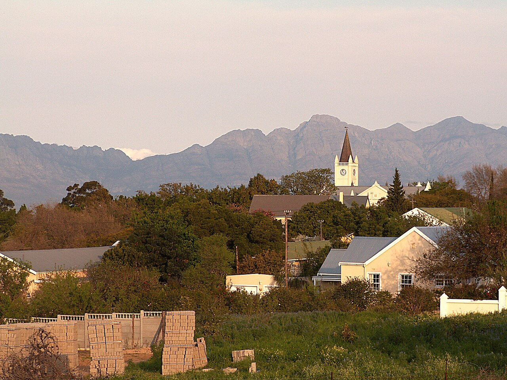

# 斯沃特兰

斯沃特兰（Swartland）是开普敦以北的葡萄酒产区，以旱作灌木藤、老藤 Chenin Blanc 与近二十年来的新风格著称。它同时是南非面积最大的葡萄酒区之一，也是“传统谷仓地带”与“新一代精品酒”重叠得最明显的产区。

图：斯沃特兰。图片：Winfried Bruenken ( Amrum )，CC BY-SA 2.5，via Wikimedia Commons（[原图页面](https://commons.wikimedia.org/wiki/File:Riebeek_Wes_PICT3382.JPG)）。

## 定义与范围

斯沃特兰是西开普 Coastal Region 内的 District，位于开普敦以北。按 2024 年 SAWIS 统计，Swartland 与相邻的 Darling 被合并计入一个统计单元，合计葡萄园 11,585 公顷，占全国酿酒葡萄园的 13.39%；全国同年总计 86,544 公顷。

在 Wine of Origin 层级中，Swartland 是 District，内部划有八个 Ward：Malmesbury、Paardeberg、Paardeberg-South、Piketberg-Bo-Berg、Porseleinberg、Riebeekberg、Riebeeksrivier 与 St Helena Bay。Darling 是另一个独立的 District，其下含 Groenekloof Ward；统计口径的合并不代表行政或酒标层级相同。

## 「斯沃特兰」的时间线
Swartland 长期是开普的谷物产区，小麦、牧业与葡萄并存的景观延续了几个世纪。名称意为“黑色的土地”，与当地深色的灌木植被有关。19 世纪以来，葡萄园主要分布在山麓与 Berg 河两岸，为酒厂与蒸馏酒提供原料。

20 世纪大部分时间里，产区以合作社、高产种植与散装酒为主，灌木藤（bosstok）是常见的栽培方式。1973 年 Wine of Origin 制度建立后，产区边界与酒标规则逐步明确。2000 年代后期，一批年轻酿酒师重新关注未灌溉的老藤地块，以整串发酵、旧桶与更轻的提取方式酿造，使 Swartland 在国际精品酒市场获得新的位置。

## 地理与气候

斯沃特兰位于开普敦以北的内陆与沿海过渡带，东侧与北侧被 Piketberg、Porterville、Riebeek 与 Perdeberg 等山体包围，Berg 河自东向西穿过产区。夏季炎热干燥，降水集中在 5 至 8 月，属于地中海气候；来自大西洋的凉风沿 Berg 河谷与低地进入，夜间降温明显，也降低了真菌压力。

产区内部的海拔与离海距离差异很大。靠近山麓的地块海拔较高、昼夜温差更大，成熟更慢；谷底与河岸地块更热，需要更早采收以保留酸度。St Helena Bay 一带靠近冷凉的大西洋，是八个 Ward 中最靠海的一个。

土壤以 Malmesbury 群页岩为主，这种含铁的页岩风化后形成排水良好、保肥能力中等的土壤；Paardeberg 与 Kasteelberg 一带为分解花岗岩，质地更砂、排水更快；较高处还有 Table Mountain 砂岩。部分地块底层存在铁质硬磐（koffieklip），能在冬季储存水分，使葡萄园在夏季不灌溉也能维持生长。这些差异构成[风土](ref:terroir)基础。

## 分区

八个 Ward 覆盖不同的地貌与气候带，但都只是产地边界，不附带额外的质量等级：

- Malmesbury：产区中部的页岩平原，是传统谷物与葡萄并存的地带。
- Paardeberg 与 Paardeberg-South：围绕 Paardeberg 花岗岩山体，砂质土壤排水快，是旱作老藤最集中的区域之一。
- Riebeekberg 与 Riebeeksrivier：Riebeek Valley 两侧的坡地与河谷，海拔与坡向差异明显。
- Piketberg-Bo-Berg：北侧 Piketberg 山的上部地块，海拔较高，成熟期更凉。
- Porseleinberg：以孤立山体与石质坡地为主，面积不大。
- St Helena Bay：最靠西海岸的 Ward，受大西洋冷凉影响最强。

Ward 名称可以单独出现在酒标上，但同一 District 内的酒款也可以只标 Swartland。标得越具体，覆盖范围越小，并不意味着酒质更好。

## 品种与原料

Chenin Blanc 是斯沃特兰最重要的白品种，许多地块是 40 年以上甚至更老的灌木藤，产量低、果实集中，常带柑橘、蜂蜡、干草与矿物感。Cinsault、Grenache、Syrah 与 Carignan 是红葡萄的主力，常以整串发酵或混酿出现；Colombard 仍有较大面积，多用于蒸馏与散装酒。

老藤是产区的关键资源，但老藤不等于高品质：同一地块的年份、产量控制、采收时机与酿造方式同样决定最终风格。原料是[葡萄](ref:grape)。旱作使果实通常更小、皮的比例更高，颜色与单宁更容易集中，但也带来产量波动与年份差异。

## 「斯沃特兰」怎么做出来
白葡萄多经轻柔压榨后低温[发酵](ref:fermentation)。Chenin Blanc 的风格跨度很大：清爽型使用不锈钢罐并避免苹果酸乳酸发酵；复杂型使用旧橡木桶、陶罐或混凝土罐，配合酒泥接触与部分整串压榨。部分酒庄让白葡萄带皮短时间浸渍，以增加质地与香气层次。

红葡萄的提取普遍偏轻。Cinsault 与 Grenache 常以较大比例整串入罐，通过二氧化碳环境中的整串发酵获得更轻盈的果味与香料感；Syrah 与 Carignan 依地块调整整串比例与浸渍时间，随后在旧的大橡木桶或混凝土罐中陈年。新桶使用相对克制，目的是保留果味与产地感，而不是覆盖[橡木桶](ref:oak-ageing)风味。

## 法规与酒标

斯沃特兰的产地标识遵循南非的 Wine of Origin 制度，由 SAWIS 与 Wine and Spirit Board 管理。标示 Swartland 或某个 Ward 的酒款，须 100% 使用该产地采收的葡萄；标示品种或年份时，相关成分须至少达到 85%。通过认证的酒款可使用 Wine of Origin 封签。

WO 是产地与认证体系，不是质量分级。Swartland、Malmesbury、Paardeberg 等名称只说明来源范围，不说明酒体、价格或风格高低。酒庄名、品牌名与产区名属于不同层面，不能互相替代。

## 「斯沃特兰」的酒标与喝法
酒标应核对产区名、Ward 名（如有）、品种、[年份](ref:vintage)、[酒精度](ref:abv)、容量与装瓶者。标示[单一品种](ref:single-varietal)的酒款须达到 85% 的品种比例；混酿按法规列出品种。Wine of Origin 封签表示通过认证，不等于质量评价。

Chenin Blanc 清爽型建议 8–10 摄氏度，橡木桶型建议 10–12 摄氏度；Cinsault 与 Grenache 建议 14–16 摄氏度，Syrah 建议 16–18 摄氏度。Chenin 适合海鲜、白肉与香料料理；Cinsault 与 Grenache 适合禽肉、炖菜与烧烤；Syrah 适合红肉与硬质奶酪。开瓶后冷藏并尽快喝完。本页关于斯沃特兰的内容涉及酒精饮料；过量饮酒有害健康，未成年人不应饮酒。

## 「斯沃特兰」容易被读错的地方
第一，认为 Swartland 只是谷物产区。它现在是南非面积最大的葡萄酒区之一，酒款风格从清爽白葡萄酒到结构型红葡萄酒都有。
第二，把 SAWIS 的 11,585 公顷全部当作 Swartland District 的面积。该数字合并了相邻的 Darling，酒标层级上两者是不同 District。
第三，把老藤当作质量等级。老藤是栽培事实，品质取决于年份、地块与酿造，没有法定分级。
第四，认为旱作等于有机或自然酒。旱作描述水分管理方式，有机与生物动力另有认证体系。
第五，把 Ward 名称当成品牌或等级。Ward 只是更小的法定产地范围。

## 参考资料
- [葡萄酒](ref:wine)：理解斯沃特兰的类别、年份与产地规则的入口。
- [白葡萄酒](ref:white-wine)与[红葡萄酒](ref:red-wine)：斯沃特兰两大酒类的基本框架。
- [白诗南](ref:chenin)：斯沃特兰最重要的白品种。
- [长相思](ref:sauvignon)：产区白葡萄的另一个重要品种。
- [歌海娜](ref:grenache)与[西拉](ref:syrah)：红葡萄与混酿的核心。
- [葡萄](ref:grape)：酿酒葡萄的结构与成熟指标。
- [发酵](ref:fermentation)：整串发酵与白葡萄低温发酵的差异。
- [酸度](ref:acidity)：旱作与夜间降温对酸度的影响。
- [风土](ref:terroir)：页岩、花岗岩与砂岩如何形成地块差异。
- [橡木桶陈年](ref:oak-ageing)：旧桶与大桶在斯沃特兰的作用。
- [干型](ref:dry)：产区白葡萄酒的干型定位。
- [年份](ref:vintage)：旱作产区的年份波动。
- [单一品种](ref:single-varietal)：85% 品种标注规则。
- [酒精度](ref:abv)：酒标上 % vol 的含义。
