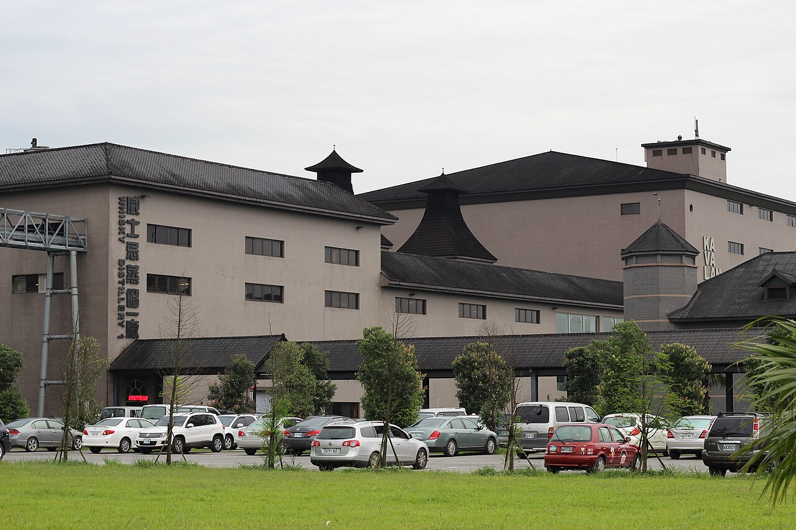

# 中国台湾地区

中国台湾地区的威士忌与酒类产区，宜兰、南投等地有蒸馏厂；亚热带气候使陈年速度极快，Kavalan、Omar 等品牌在国际比赛中受到关注。

图：宜兰金车噶玛兰酒厂的威士忌蒸馏厂区。图片：lovesx-70，CC BY 2.0，via Wikimedia Commons（[原图页面](https://commons.wikimedia.org/wiki/File:Whisky_Distillery_1,_King_Car_Kavalan_Distillery_20120407.jpg)）。

## 先划清「中国台湾地区」的边界
中国台湾地区的威士忌产区以宜兰、南投等地的蒸馏厂为核心；亚热带气候使橡木桶陈年速度远快于苏格兰，天使分享比例高。

这里的“产区”是岛屿蒸馏产业，不是葡萄酒式法定地块。看到“台湾威士忌”先确认蒸馏厂、原料与陈年；品牌名不等于产区，也不等于单一麦芽。

## 历史与命名

宜兰的 Kavalan 与南投的 Omar 是主要威士忌品牌；Kavalan 在 2010 年代多次获得国际烈酒比赛奖项，带起台湾威士忌热潮。

台湾酒类历史还包括葡萄酒、高粱酒与米酒；员林、埔里等地有酒厂，水果利口酒与梅酒是地方特色。威士忌是近二十年新增长点，不是全部。

## 「中国台湾地区」的地理与风土
中国台湾地区位于亚热带，夏季高温高湿、冬季温和；威士忌在橡木桶中陈年速度远快于苏格兰，天使分享比例高。

岛屿气候让仓库温度与湿度成为关键：高温加速木质与香草，湿度过高影响桶与标签。风土是气候与仓库，不是葡萄园坡向。

## 原料与风格

威士忌风格通常浓郁、带热带水果、香草与橡木；高温熟成让年轻酒款也能有饱满口感，但风险是过度木质。

原料以大麦麦芽为主，部分酒款使用本地或进口麦芽；蒸馏与桶型决定风格。高粱酒、米酒与水果酒则走另一条原料路线，不要混为一谈。

## 代表生产者与酒款

代表酒厂与品牌包括 Kavalan（宜兰）、Omar（南投）与 TTL 南投酒厂；参观与品鉴需预约，酒厂多位于工业或观光园区。

看生产者时，区分蒸馏厂自有酒液与采购或调和；Kavalan 与 Omar 的风格差异来自蒸馏、桶型与仓库。先比较同一年份或同一桶型，再谈品牌。

## 「中国台湾地区」的上桌方式
威士忌可净饮或加少量水；台湾气候热，冰化得快，用大冰块或少加冰。高粱酒适合小杯，米酒与水果酒冷藏后喝。

配餐适合烧烤、海鲜、热带水果与咸味零食；威士忌的香草与橡木能接住油脂，高粱酒的烈度适合重口味。甜点与高酒精要小心，甜味会放大灼热。

## 选购、标签与误区

标签重点看：蒸馏厂、原料、陈年、桶型、酒精度与是否单一麦芽。若只写品牌，信息不足；台湾威士忌没有像苏格兰那样的法定产区体系。

常见误区是把所有台湾威士忌当成同一风格，或把高温熟成当成越老越好。开瓶后避光、直立、常温；高温环境尤其要避免阳光与闷热。

## 「中国台湾地区」周边怎么走
宜兰与南投是主要参观方向：宜兰靠海、湿度高，南投在山间；两地都需要预约与交通安排。

从台北出发，宜兰可一日往返，南投需要更长时间；酒厂多在工业或观光园区，公共交通有限。一次选一家酒厂加当地餐厅，比赶两家更从容。

## 进一步阅读

进一步阅读：台湾威士忌的讨论常被“热带熟成”一句话占满，但真正可比的是蒸馏、桶型与仓库三条线。先看蒸馏：同一年份、同一桶型下，不同蒸馏厂的酒体与香气不同；再看桶型：波本桶、雪莉桶与葡萄酒桶带来不同的甜、干与木质；最后看仓库：高温高湿让熟成快，也让木质更容易过头。把这三条线分开，才能判断一款酒是“年轻但饱满”，还是“年份长但过桶”。台湾还有高粱酒、米酒与水果酒，它们的原料与工艺完全不同，不要放在同一张风味表里。参观宜兰与南投要分别安排交通，酒厂多在园区，预约比临时到访可靠。

台湾威士忌的价格与风格常被“比赛获奖”放大，但获奖只说明某一批次在某个赛制里表现好，不等于所有酒款都同一风格。买时先看蒸馏厂、桶型、年份与酒精度；喝时先问自己是否喜欢木质与甜感，再决定加不加冰。若只参观一家，宜兰与南投二选一，把交通时间算进去，比一天赶两地更实际。台湾高温对存放不利，买回家后避免阳光、闷热与厨房灶台，开瓶后尽量三个月内喝完。高粱酒与威士忌不要共用品鉴杯，香气会混。若只买一瓶，选同一年份的波本桶与雪莉桶对照，比跨品牌更容易看出桶型的作用。台湾威士忌的甜感常来自桶，不是原料；先确认这一点，再谈风格，买前尽量试饮。先试饮。

买前先确认是否为单一麦芽、单一桶或调和，这三类不能直接比较。

- 相关条目：[china](ref:china)、[whisky](ref:whisky)、[barley](ref:barley)、[distillation](ref:distillation)、[terroir](ref:terroir)。
关于中国台湾地区，本页只保留产区与风格信息；地图、实时价格与营业时间请查当地官方渠道。

对照阅读：[中国](ref:china)、[大麦](ref:barley)。

相关条目：[威士忌](ref:whisky)。

**关键事实。**

| 项目 | 内容 |
| --- | --- |
| 一句话定位 | 中国台湾地区的威士忌与酒类产区，宜兰、南投等地有蒸馏厂；亚热带气候使陈年速度极快，Kavalan、Omar 等品牌在国际比赛中受到关注 |
| 层级 | 省/大区 |
| 所属 | 中国 |
| 国家代码 | CN |

**来源与边界。** 本页关于「中国台湾地区」的关键事实，主要由以下来源交叉核对：Taiwan Tobacco and Liquor Corporation（南投酒厂 2008 年设威士忌蒸馏工场、铜壶蒸馏与 OMAR 产品，；OMAR 单一麦芽的 46% 酒精度、四年以上橡木桶陈熟与非冷凝过滤）、King Car Kavalan Distillery（宜兰 Kavalan/金车噶玛兰酒厂的品牌与产品信息）、Ministry of Justice, Taiwan（台湾酒类管理、酒精度定义与产销框架）。价格、批次与状态会变，涉及这些字段时以页面所列来源的最新版本为准。正文为项目自写，来源只作核验，不复制原文。

**并读。** 把「中国台湾地区」与「中国」、「威士忌」、「大麦」放在一起读时，先确认它们是同一层级还是上下游关系：先确认边界与法定分类，再比较气候、土壤、海拔与代表酒款。本页负责给出产区的基本坐标，对照条目补上具体案例与差异；读完再回到本页，才能分清哪些差别属于产区本身，哪些只是产地、批次或品牌选择。

**适用边界。** 对「中国台湾地区」而言，产区边界、面积与法定分类会随法规更新；气候描述是长期趋势，不是某一年的天气预报。
