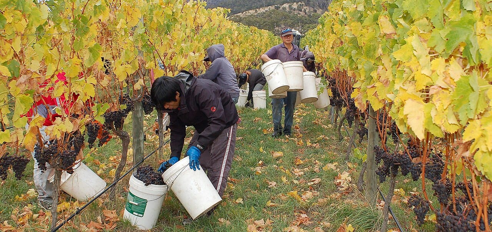

# 塔斯马尼亚

塔斯马尼亚是澳大利亚最南端的岛屿州，地处南纬约 41°–43°，四面被塔斯曼海、巴斯海峡与印度洋环绕；它是澳大利亚一月平均气温最低的葡萄酒产区，以黑皮诺、霞多丽、灰皮诺、雷司令和传统法起泡酒著称，岛内分出塔玛谷、德文特谷、东海岸、煤炭河谷、皮珀斯河、西北与胡恩海峡七个习惯种植片区。

图：Tasmania：Stefano Lubiana Wines Tasmania harvest panorama（Wikimedia Commons）。图片：Mark Smith，CC BY 2.0，via Wikimedia Commons（[原图页面](https://commons.wikimedia.org/wiki/File:Stefano_Lubiana_Wines_Tasmania_harvest_panorama.jpg)）。

> **先给结论**
> **一句话：** 这页判断塔斯马尼亚的风味与旅行价值，以及怎么安排。
>
> - **适合谁：** 正在比较塔斯马尼亚与其他产区、准备买酒或安排旅行的人。
> - **不适合谁：** 只想要“哪个产区最贵”的结论、不关心风格和年份的人。
> - **先看这两点：**
>   - 酒标上的“Tasmania”是 GI；塔玛谷、皮珀斯河、东海岸这类片区名属于行业习惯划分，不是独立 AOC；再往下是单一园与酒款系列。
>   - 朗塞斯顿是塔玛谷与皮珀斯河方向的门户，霍巴特是德文特谷、煤炭河谷与胡恩海峡方向的门户，两城车程约两到三小时。

## 先划清「塔斯马尼亚」的边界
塔斯马尼亚本身是一个完整地理标志（GI），面积约 68,582 平方公里，注册葡萄园约 2,084 公顷，海拔从海岸线到 1,264 米。酒标上的“Tasmania”指岛屿整体；七个种植片区是行业习惯划分，不是独立法定次产区。买酒时先分清“岛产”与“片区”两层，比把产区名当成风味标签更可靠。

与大陆产区不同，这里的边界首先是岛岸线；真正造成酒款差别的是纬度、海拔、离海距离与谷地朝向。皮珀斯河与塔玛谷偏北偏凉，东海岸日照更长，煤炭河谷与胡恩河谷靠近霍巴特、湿润多雾；同一枚 GI 下，这些片区的成熟节奏与香气走向并不相同。

GI 名称只说明果实来自岛内，不承诺子片区、单一园或酿造方式。岛上既有家族小酒庄，也有大集团收购果实；部分黑皮诺与霞多丽被大陆酒商买走调配，是否标注塔斯马尼亚取决于生产者选择。

## 历史与命名

藤蔓抵达很早。1788 年葡萄藤随 HMS Bounty 运到岛上，Bligh 在布鲁尼岛试种未成规模。1823 年获释犯人 Bartholomew Broughton 种下第一片有影响的葡萄园，1826 年份被当作“仿香槟”出售，常被视为澳大利亚最早的起泡酒尝试之一。1834 年 William Henty 从朗塞斯顿带走枝条到维多利亚 Portland，成为维多利亚与南澳最早葡萄园的源头。1856 年 Van Diemen's Land 更名塔斯马尼亚。

淘金热后早期产业衰落，种植休眠大半个世纪。现代复兴从 1956 年开始：法国人 Jean Miguet 在皮珀斯河附近种下 La Provence；1958 年意大利移民 Claudio Alcorso 在霍巴特附近创立 Moorilla，1962 年出第一个年份。1974 年拥有葡萄栽培博士学位的 Andrew Pirie 建立 Pipers Brook，成为冷凉品种与瓶内二次发酵起泡酒的早期标杆。1990 年代种植面积快速扩张，岛产起泡酒在赛事与出口市场同时获得关注，GI 也在这一时期确立。

“Tasmania”一名来自荷兰探险家 Abel Tasman；片区名字多取自河流、海湾与邻近城镇。现代史不是直线：19 世纪初试种、20 世纪中叶重启、1990 年代扩张出口，三次“重新开始”才形成今天的品种结构。

## 「塔斯马尼亚」的地理与风土
塔斯马尼亚一月平均气温约 15.6°C，是澳大利亚各产区中最低的；生长季降雨约 477 毫米，全年降雨约四成落在生长季，春季湿度偏高并伴有霜冻。海洋调节让冬季不算严寒，但春季回暖不稳定，花期霜冻、采收期雨雾与高湿病害压力，是每年都要面对的风险。

岛内土壤南北差异大：德文特谷以砂岩与片岩为主；煤炭河谷是泥炭质冲积土与低腐殖质沙土；皮珀斯河土层深厚、疏松排水快；塔玛谷是黏土与石灰岩基底上的砾石玄武岩。石质坡地迫使根系深扎，限制水分与养分供应，拉长成熟节奏，保留天然酸度。

葡萄园多沿谷地坡面分布，很少开在平坦大田。朝北坡地日照更多，低处河谷夜间易积冷雾；商业葡萄园集中在低缓坡地，高海拔山区不种葡萄。同一谷地内，坡向、石块含量与离海距离造成的微地形差别，往往比产区地图边界更能解释酒款距离。

## 原料与风格

黑皮诺与霞多丽是两大主角，既做静止酒也做起泡酒基酒；灰皮诺、长相思、雷司令次之，另有少量赤霞珠、梅洛与琼瑶浆。传统法起泡酒以黑皮诺和霞多丽为主，经瓶内二次发酵与长时间酒泥接触，常被视为澳大利亚最好的起泡酒之一。冷凉气候下，厚重高酒精的红葡萄并不占优势。

静止黑皮诺偏轻到中等酒体，红樱桃、草莓、干香料与泥土气息，酸度明亮；霞多丽优雅复杂、天然酸度高，一部分走不锈钢清爽路线，一部分经桶陈；雷司令带柑橘与矿物感、可陈年；灰皮诺与长相思主打清爽果香。靠海片区更咸鲜清爽，内陆谷地更圆润丰满。

酿造方式在生产者之间分化明显：起泡酒讲究酒泥时间与补液风格，静止酒在整串比例、橡木桶大小与新桶比例上各有选择。冷凉气候下采收窗口短，生产者要在果味成熟度与保留酸度之间取舍；这个选择比品种本身更能决定酒的性格，年份差异也比大陆暖热产区更突出。

## 代表生产者与酒款

Pipers Brook 由 Andrew Pirie 于 1974 年创立，是现代产区的早期标杆。House of Arras 与 Jansz 集中在皮珀斯河一带，专做或侧重传统法起泡酒，Arras 被视为澳洲高端起泡酒代表之一。Moorilla 位于霍巴特以北德文特河畔，产品线分 Praxis、Muse 与 Cloth 等系列；Stefano Lubiana 在 Granton 北岸坡地走有机与生物动力路线；Josef Chromy、Domaine A、Bream Creek、Holm Oak 分别覆盖塔玛谷、煤炭河谷、东海岸与朗塞斯顿周边。

这些名字不是官方分级，而是市场长期参照。旗舰起泡酒与单一园黑皮诺价高量小；灰皮诺、长相思入门款更易在零售与餐厅酒单找到。比较同一品牌不同系列时，先分清自有园与收购果实，再看桶陈与年份策略，比只看名气更有用。

生产者结构上，既有家族世代经营的小酒庄，也有外来资本或大集团收购果实、持有品牌。同一品牌名下，入门款与旗舰款的地块、树龄与酿造投入可能完全不同。

## 「塔斯马尼亚」的上桌方式
饮用温度随品种调整：起泡酒约 6–8°C，霞多丽与灰皮诺约 10–12°C，黑皮诺约 14–16°C。黑皮诺开瓶后不必长时间醒酒，先倒一小杯等十到二十分钟再判断；起泡酒避免长时间敞口，温度过高会让气泡与香气散失更快。

本地海产品是最稳妥搭配：塔斯马尼亚生蚝、烟熏三文鱼、扇贝与龙虾配起泡酒或清爽霞多丽；羊肉、鸭肉、鹿肉与蘑菇配黑皮诺；柑橘香料或轻度辣味菜配雷司令或高酸长相思。岛产奶酪、烟熏肉与浆果甜点也是本地餐桌常见组合，调味偏简单，突出食材本身。

本地菜与本地酒共享冷凉气候的清淡节奏：海鲜的鲜、羊肉的嫩、乳制品的厚，不需要厚重酱汁去压。选酒时先想主菜的脂肪与盐分，再决定用起泡酒酸度、白葡萄清爽，还是黑皮诺的红果与细单宁去衔接。

## 选购、标签与误区

酒标上的“Tasmania”是 GI；塔玛谷、皮珀斯河、东海岸这类片区名属于行业习惯划分，不是独立 AOC；再往下是单一园与酒款系列。年份在冷凉产区尤其重要：霜冻、雨雾、花期风与采收湿度都会改变产量与成熟度，对比同年份不同生产者，比跨年份比较更容易看出片区差别。

常见误区之一是把塔斯马尼亚理解成“只有黑皮诺”，实际上起泡酒与霞多丽同样是招牌，雷司令与灰皮诺也有稳定表现。另一个误区是认为岛产酒一定更酸：品种、采收时间与酿造方式的影响往往比产区名更大。轻酒体黑皮诺与起泡酒对运输受热敏感，过热仓库里存久的酒，开瓶后果味容易发闷。

价格带跨度不小：入门灰皮诺、长相思属日常价位，旗舰起泡酒与单一园黑皮诺定位高端，部分老藤霞多丽与雷司令有十年以上陈年潜力。购买时留意采收年份、进口商与储存记录；打算陈年的酒，优先选酸度结构完整的年份。

## 「塔斯马尼亚」周边怎么走
朗塞斯顿是塔玛谷与皮珀斯河方向的门户，霍巴特是德文特谷、煤炭河谷与胡恩海峡方向的门户，两城车程约两到三小时。岛内公共交通稀疏，自驾或参加小团是主要方式；品鉴后不驾车是基本规则。

塔玛谷沿 Tamar River 两岸分布多个品鉴室，适合一天两到三个点加午餐；煤炭河谷距霍巴特约半小时车程，适合半日；东海岸酒庄分散，需预留一整天。采收季在南半球 3–4 月，酒庄最忙，部分品鉴室缩短营业时间，出发前应通过酒庄官网或 Wine Tasmania 目录确认预约与开放时间。

岛上酒庄多为小规模家庭经营，预约、准时、不在生产区随意走动是基本礼仪。山路、土路与品鉴室门槛对行动不便者并不总是友好，带长辈或小孩前先问清无障碍通道与洗手间位置。只想做轻松入门体验，从霍巴特走煤炭河谷半日线，或从朗塞斯顿走塔玛谷半日线，距离最短。

- 相关条目：[australia](ref:australia)、[pinot-noir](ref:pinot)、[chardonnay](ref:chardonnay)、[sparkling-wine](ref:sparkling)、[white-wine](ref:white)。

相关条目：[澳大利亚](ref:australia)、[黑皮诺](ref:pinot)、[霞多丽](ref:chardonnay)。
