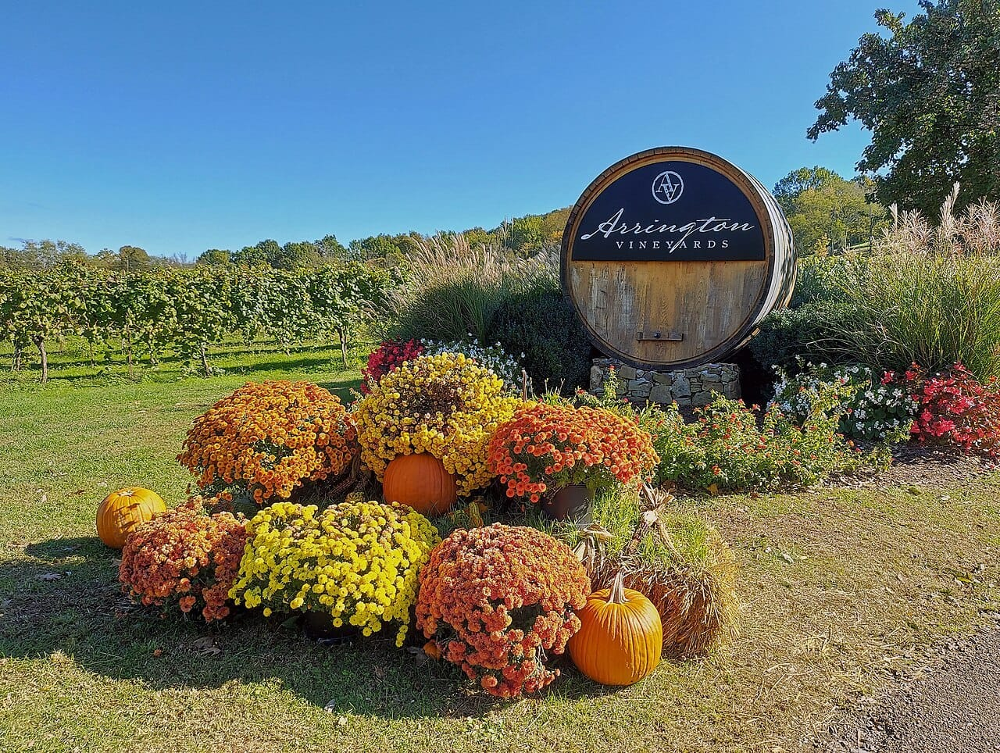

# 田纳西

田纳西（Tennessee）是美国中南部的一个州，也是[田纳西威士忌](ref:tennessee-whiskey)的法定产地。它常被误认为“波本的另一个名字”，但两者并不完全重合：田纳西威士忌在州法层面有一套独立条件，在联邦层面却没有被单列为独立类别。理解这种“州法定义 + 联邦标签”的双层结构，是读懂这个产区的关键。

图：田纳西。摄影：Tennessee - Arrington Vineyards。署名：P. Hughes，CC BY-SA 4.0，来自 Wikimedia Commons（[来源](https://commons.wikimedia.org/w/index.php?curid=128050365)）。

## 州法写下的六项条件

田纳西州法典第 57-2-106 节规定，只有满足以下条件的烈酒才能标注为田纳西威士忌：在田纳西州制造；谷物配方中玉米不少于 51%；蒸馏酒精度不高于 160 proof（80% ABV）；在田纳西州的新烧焦橡木桶中陈年；入桶前经枫木炭过滤；入桶酒精度不高于 125 proof（62.5% ABV），装瓶不低于 80 proof（40% ABV）。

这套条件与[波本](ref:bourbon)共享大部分骨架：玉米多数、新烧焦桶、蒸馏与入桶上限。差别集中在两点：必须在本州完成制造与陈年，以及必须经过枫木炭过滤。州法对个别历史酒厂的过滤方式留有例外，因此不能把“枫木炭过滤”理解为对每一瓶产品的绝对描述，但它仍是田纳西威士忌最核心的工艺标识。

## 林肯县工艺：名字与地点不是一回事

枫木炭过滤通常被称为林肯县工艺（Lincoln County Process）。做法是把新酒缓慢淋过一层厚实的糖枫木炭，让酒液在进入橡木桶之前吸附部分油脂、硫化物与粗糙香气，入口因此更干净、更柔顺。木炭由糖枫木烧制、堆叠并炭化，炭层厚度与酒液流速会影响过滤强度。

工艺得名于林肯县，却不要求酒厂设在林肯县。杰克丹尼（Jack Daniel's）位于摩尔县的林奇堡，乔治迪克尔（George Dickel）位于科菲县的 Cascade Hollow，两家都在田纳西州境内，也都以木炭过滤作为核心工序。乔治迪克尔的官方资料还强调其在过滤前对酒液进行冷凝处理，形成更干净的风格。把工艺名当成地名，是阅读田纳西威士忌时最常见的混淆。

## 与波本共享的骨架

从工艺看，田纳西威士忌的起点与波本几乎相同：以玉米为主的谷物配方，辅以黑麦与发芽大麦；糖化后[发酵](ref:fermentation)，再经[蒸馏](ref:distillation)得到新酒；新酒进入新烧焦橡木桶，在[橡木桶陈年](ref:oak-ageing)中萃取香草、焦糖与木质香气。两者的差别在于产地与过滤，而不是“一个用玉米、一个不用玉米”。

因此，田纳西威士忌可以同时满足 straight 的条件，也可以不标 straight。straight 要求在新烧焦桶中陈年至少两年、不得添加色素或香料；酒液不足四年时通常要标出酒龄。这些规则与波本的 straight 规则一致，说明两者的法律骨架高度重叠，只是田纳西多了州法这一层。

## 联邦标签上的位置

美国联邦蒸馏酒标准把威士忌按谷物与工艺分类，列出 bourbon、rye、wheat、malt、corn 等类型，并没有把“Tennessee whiskey”单列为一个联邦类别。现行 27 CFR 5.143 允许在标签上使用蒸馏与陈年所在地的州名或地名，前提是蒸馏与必要的陈年都在该地完成。田纳西威士忌正是借助这条规则，把州名与产品类型结合在标签上。

换句话说，田纳西威士忌是“州法定义的名称 + 联邦允许的地理标签”，而不是像波本那样由联邦标准直接定义的类别。TTB 的标签审核与产地规则约束它的表述，但具体配方与工艺条件主要来自田纳西州法。把它说成“联邦法定独立类别”，会高估联邦层面的区分度。

## 两家代表酒厂

杰克丹尼是田纳西威士忌最广为人知的品牌。酒厂官方资料称其于 1866 年注册，位于林奇堡，使用 Cave Spring Hollow 的石灰岩水源；Old No. 7 以香草、焦糖与香蕉类酯香为典型印象。乔治迪克尔位于 Cascade Hollow，产品线包括 No. 12、Bottled in Bond 与单桶版本，风格常被描述为更厚、更谷物化。

近二十年，田纳西出现了新一批小型蒸馏厂，分布在纳什维尔、查塔努加与周边乡镇。它们不一定沿用大规模连续蒸馏，也不一定生产传统意义上的田纳西威士忌，但共同扩大了“田纳西产区”的市场含义。具体酒厂的产能、开放时间与产品线应以官方渠道为准。

## 作为产区的边界

田纳西是一个州，不是一个像苏格兰那样由国际条约与国内法规共同保护的产区名称。它的边界由州界决定，生产则集中在纳什维尔以南的中部地带：林奇堡、Cascade Hollow、塔拉霍马与谢尔比维尔一带共享石灰岩地下水、四季分明的气候与玉米种植带。这样的条件适合玉米生长，也适合新桶陈年。

与[美国](ref:usa)其他威士忌产区相比，田纳西的独特之处不在原料，而在“州法 + 木炭过滤”的组合。肯塔基以波本与产业集聚著称，田纳西以田纳西威士忌这一名称与工艺传统建立识别度。两者都在美国联邦框架内运作，产区名称描述的是传统与集中度，不是质量等级。

## 田纳西的六个误读

第一，认为田纳西威士忌是联邦法定独立类别。它更多是州法名称与地理标签的结合。第二，认为酒厂必须设在林肯县。工艺得名于该县，生产可以分布在田纳西州其他县。第三，认为木炭过滤发生在装瓶前。州法要求的是入桶前过滤，过滤后仍要陈年。第四，认为所有田纳西威士忌都是波本。两者共享骨架，但名称与工艺要求不同。第五，认为木炭过滤会加甜。过滤不添加糖，甜感来自玉米与新桶。第六，认为杰克丹尼是波本。它以田纳西威士忌销售，并受州法约束。

品鉴时先找香草、焦糖与烤玉米，再判断黑麦辛香与桶底椰子感。加几滴水可以打开香气；加冰会压低甜感，适合酒精度较高的版本。田纳西威士忌也是 Old Fashioned 与 Highball 的常用基酒。适量饮用，未成年人不应饮酒。

对照阅读：[美国](ref:usa)、[田纳西威士忌](ref:tennessee-whiskey)。

**关键事实。**

| 项目 | 内容 |
| --- | --- |
| 一句话定位 | 美国中南部州，田纳西威士忌的法定产地；州法要求在本州制造、玉米不少于 51%、新烧焦橡木桶陈年并于入桶前经枫木炭过滤，但它在联邦层面并非独立类别，而是受 TTB 标签规则约束的州法名称与地理标识 |
| 层级 | 省/大区 |
| 所属 | 美国 |
| 国家代码 | US |
