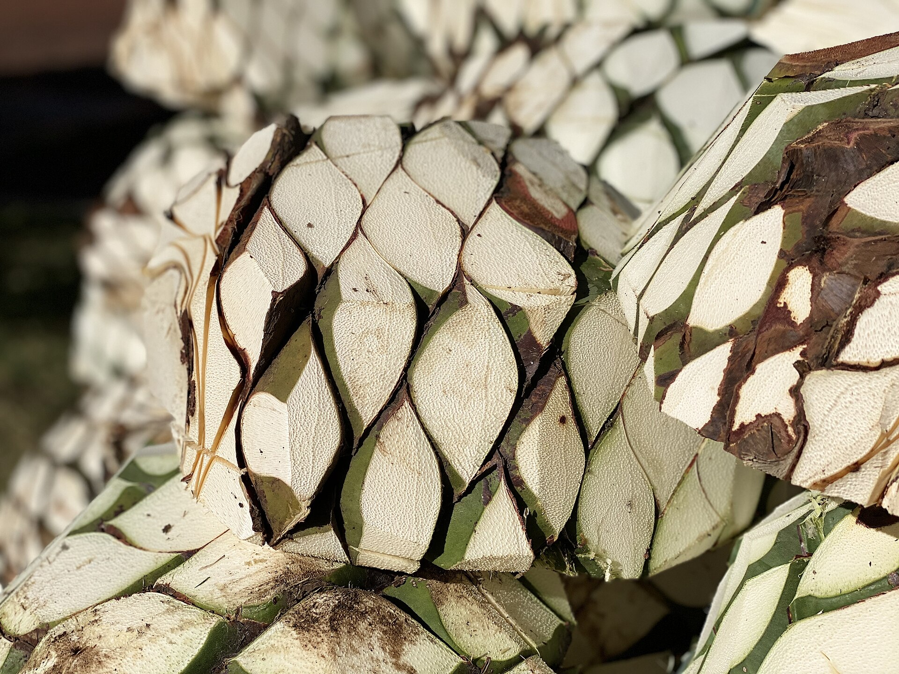

# 龙舌兰酒法定产区

龙舌兰酒法定产区是墨西哥为[龙舌兰酒](ref:tequila)划定的地理范围，核心在哈利斯科州，并包括瓜纳华托、米却肯、纳亚里特与塔毛利帕斯的部分市镇。只有在法定产区内种植蓝色韦伯龙舌兰并按规范生产的产品，才能标注为龙舌兰酒。

图：龙舌兰酒法定产区相关实景照片。图片：Alfonso Jiménez，CC BY-SA 4.0，via Wikimedia Commons（[原图页面](https://commons.wikimedia.org/wiki/File:La_base_del_tequila_agave_azul_tequilana_Weber.jpg)）。

## 地理与法定范围

法定产区的核心是哈利斯科州，产区名称来自该州的小镇特基拉（Tequila）。根据墨西哥标准 NOM-006-SCFI-2012，产区还包括其他四个州的指定区域。具体市镇清单由官方标准与监管机构公布，边界不是按行政大区粗略划分的。

产区范围是法律概念，不是风味标签。同一法定产区内，高地与低地的气候、土壤与种植方式仍有明显差异，酒厂的水平也不一致。把“法定产区”理解为质量保证，会忽略这些内部差异。

## 龙舌兰与风土

龙舌兰酒使用蓝色韦伯龙舌兰（Agave tequilana Weber var. azul）。植株的糖分集中在茎心（piña），通常需要生长数年后才能采收。哈利斯科高地与低地的差异常被用来解释风格：高地植株较大、甜感更足，低地更偏草本与矿物感，但这是倾向而非定律。

特基拉镇附近有火山地貌，红色土壤与日照条件影响龙舌兰的成熟。风土会影响原料，但蒸煮、发酵与蒸馏同样决定风味。把“高地”或“低地”当成等级，是把地理描述误当成质量排序。

## 历史

龙舌兰酒的现代形态与 19 世纪墨西哥的蒸馏技术、铁路与玻璃瓶工业相关。此前，中部高地的龙舌兰发酵饮料已有长期传统。20 世纪，龙舌兰酒在国内与出口市场扩张，白色龙舌兰酒成为调酒基酒，陈年等级也逐渐标准化。

法定产区与监管体系在 20 世纪后期逐步强化。NOM-006-SCFI-2012 规定了原料、产区、类别、陈年与标签要求，由龙舌兰酒监管委员会负责认证与监督。这套体系让“龙舌兰酒”成为可核查的类别，而不是泛称。

## 原料与工艺

蓝色韦伯龙舌兰的茎心富含复杂果聚糖，必须经蒸煮转化为可发酵糖。传统砖石坑蒸煮带烟熏与泥土气息，现代高压蒸煮器更均匀、更干净。蒸煮后通过石磨（tahona）或辊压机取汁，再进入[发酵](ref:fermentation)。

发酵完成后进行两次壶式[蒸馏](ref:distillation)，切割头段与尾段，保留中段。部分产品使用连续蒸馏或不同蒸馏器组合，但类别与工艺要求仍受标准约束。工艺差异会直接影响甜感、植物气息与酒精感。

## 陈年与类别

龙舌兰酒按陈年分为白色（Blanco）、微陈（Reposado）、陈年（Añejo）与额外陈年（Extra Añejo）。白色通常不经桶陈或只短暂接触不锈钢；微陈至少陈年 2 个月；陈年至少 1 年；额外陈年至少 3 年。具体年限与桶型要求以标准与标签为准。

陈年并非越长越好。桶陈带来香草、焦糖与木质风味，也会削弱龙舌兰本身的植物气息。100% 龙舌兰产品与混合型产品（Mixto）在原料比例上不同，标签应明确标注；两者不是等级高低，而是原料类别的差异。

## 产区与生产者

产区内的酒厂从大型企业到小型蒸馏坊都有分布，特基拉镇与哈利斯科高地、低地形成不同的生产集群。生产者会按原料、蒸煮方式与蒸馏器选择风格路线，有的强调白色龙舌兰的植物感，有的强调陈年后的甜润。

参观酒厂时应区分“产区”与“品牌”：产区说明法定范围，品牌说明企业身份。购买时看是否有监管机构认证信息、原料标注与类别词，而不是只看包装上的地名。

## 常见误区

第一，把龙舌兰酒与所有龙舌兰蒸馏酒等同。梅斯卡尔等是独立类别。
第二，认为法定产区内的产品都同质。产区内部差异很大。
第三，把高地或低地当成等级。它们描述地理与风格倾向。
第四，认为陈年越久越好。陈年会改变风格，也削弱植物气息。
第五，把“100% 龙舌兰”当成质量等级。它说明原料类别，不说明工艺水平。

龙舌兰酒法定产区以蓝色韦伯龙舌兰为原料，核心在哈利斯科，并延伸至少数其他州；CRT 与 NOM 构成它的规则体系。 Blanco、Reposado、Añejo 等类别按陈年时间划分，不是甜度或质量排名；“100% 龙舌兰”与“混合龙舌兰”是原料标识，读酒标时要先分清。龙舌兰酒的法定产区跨越多个州，不同产区的气候与土壤会影响龙舌兰的糖分与风味；陈年类别只说明接触木桶的时间。把“龙舌兰”当成一个味道，会掩盖原料比例与陈年方式的差别。

对照阅读：[龙舌兰酒](ref:tequila)、[发酵](ref:fermentation)。

## 延伸阅读

- [龙舌兰酒](ref:tequila)：龙舌兰酒的类别、原料与陈年框架。
- [梅斯卡尔](ref:mezcal)：另一种以龙舌兰为原料的墨西哥蒸馏酒。
- [发酵](ref:fermentation)：龙舌兰糖分转化为酒精的关键环节。
- [蒸馏](ref:distillation)：两次壶式蒸馏与切割的基本原理。

**关键事实。**

| 项目 | 内容 |
| --- | --- |
| 一句话定位 | 墨西哥以蓝色韦伯龙舌兰酿造龙舌兰酒的法定产区，核心在哈利斯科，并延伸至瓜纳华托、米却肯、纳亚里特与塔毛利帕斯的部分区域 |
| 层级 | 其他 |
| 国家代码 | MX |

**来源与边界。** 本页关于「龙舌兰酒法定产区」的关键事实，主要由以下来源交叉核对：Consejo Regulador del Tequila（法定产区范围、原料与生产要求）、Secretaría de Economía, Mexico（龙舌兰酒标准与监管框架；未复制标准原文）、Oxford University Press（提供关于龙舌兰、龙舌兰酒产区与蒸馏的条目）等 4 条来源。价格、批次与状态会变，涉及这些字段时以页面所列来源的最新版本为准。正文为项目自写，来源只作核验，不复制原文。

**并读。** 把「龙舌兰酒法定产区」与「龙舌兰酒」、「梅斯卡尔」、「发酵」放在一起读时，先确认它们是同一层级还是上下游关系：先确认边界与法定分类，再比较气候、土壤、海拔与代表酒款。本页负责给出产区的基本坐标，对照条目补上具体案例与差异；读完再回到本页，才能分清哪些差别属于产区本身，哪些只是产地、批次或品牌选择。

**适用边界。** 对「龙舌兰酒法定产区」而言，产区边界、面积与法定分类会随法规更新；气候描述是长期趋势，不是某一年的天气预报。

**更新提示。** 「龙舌兰酒法定产区」最近核对于 2026-11-24；面积、法定分类、标签规则与年份表现会变，引用前以法规与产区官方文本为准。
