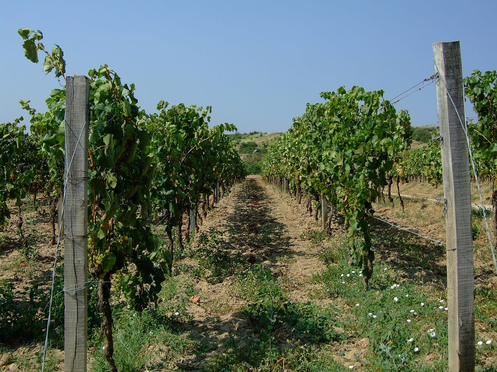
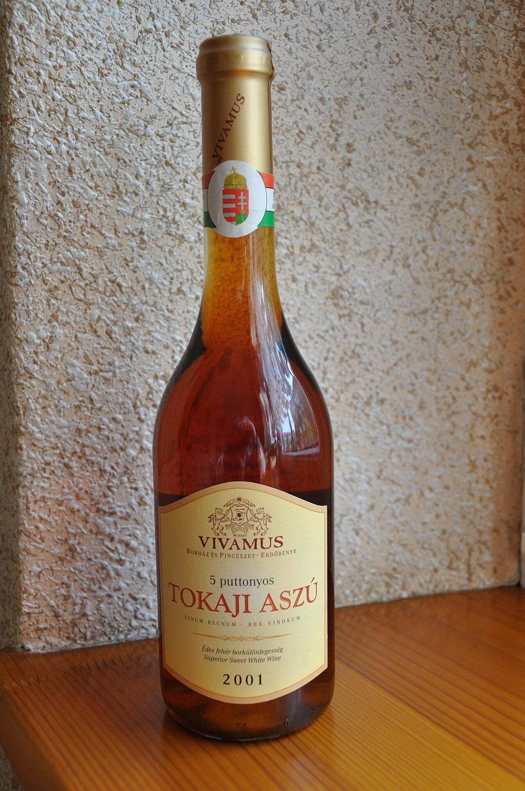
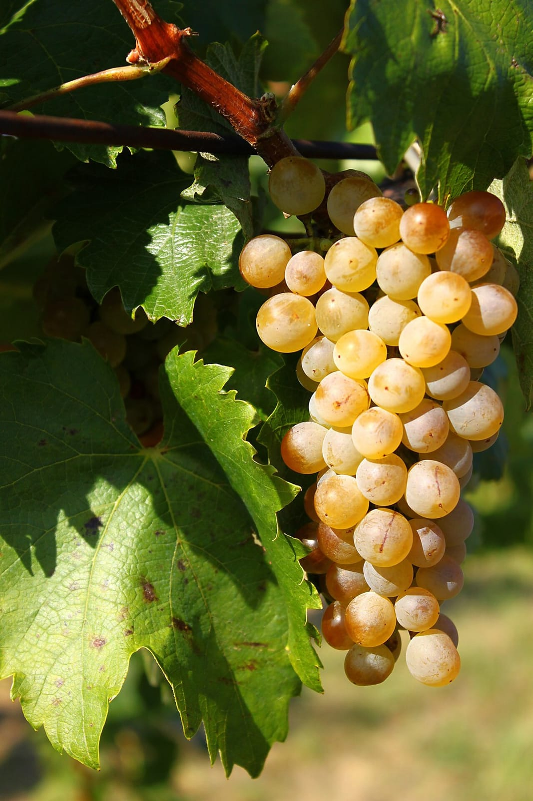

# 托卡伊

托卡伊（Tokaj）是匈牙利东北部的历史葡萄酒产区，沿博德罗格河与蒂萨河展开，由数十座村庄与成千上万块小地块组成。它不是一块平坦的葡萄园，而是火山丘陵、河谷、黄土台地与湿地交织的景观。这里以 [Aszú 贵腐甜酒](ref:tokaji)闻名，也出产越来越受重视的干型[富尔民特](ref:furmint)。理解托卡伊，需要同时看地质、河流与制度。

图：托卡伊。摄影：Tokaj vineyard。署名：Jerzy Kociatkiewicz from Colchester, United Kingdom，CC BY-SA 2.0，来自 Wikimedia Commons（[来源](https://commons.wikimedia.org/w/index.php?curid=4591613)）。

## 一条河与一道山弧

产区位于匈牙利东北部，北面是泽姆普伦山脉，南面是大平原。山脉挡住来自北方的冷空气，平原的暖空气沿河谷进入，形成相对温和的微气候。博德罗格河与蒂萨河在秋季带来湿气，清晨的雾覆盖葡萄园，午后阳光又让果皮干燥。这种节奏让[贵腐菌](ref:noble-rot)稳定发展，也让托卡伊成为世界少有的贵腐酒产区。

产区的形状像一个向西南开口的 V 形，尖端是托卡伊山（Kopasz），山体是一座火山锥。葡萄园沿山谷与坡地分布，海拔不高，但坡向与河流距离造成的差异很大。河谷地带湿度高、雾停留时间长，适合贵腐；山坡中上部排水更好，更适合干型酒。河流与山体的相对位置，几乎决定了每个村庄的风格倾向。

## Tokaj-Hegyalja 的村庄与地块

托卡伊的核心地带常被称为 Tokaj-Hegyalja，意为“托卡伊山麓”。历史上有二十多个村庄被纳入产区，今天的产品规范列出更精确的范围。主要村镇包括 Tokaj、Tarcal、Mád、Tállya、Szerencs、Bodrogkeresztúr、Erdőbénye、Tolcsva 与 Sárospatak 等。产区的边界并非一成不变，历史上有过多次调整，今天以产品规范为准。

每座村庄周围又被划分为大量名为 dűlő 的地块。这些地块有独立名称，历史上与等级、税收与所有权联系在一起。今天，单一地块（single vineyard）标注越来越常见，酒庄希望通过地块名表达土壤与微气候的差异。这些村庄规模都不大，酒庄多为家族经营；同一村庄内部的地块差异，往往比村庄之间更大。

## 四百座火山留下的土

托卡伊的土壤来自约一千四百万年至九百万年前的火山活动。安山岩、英安岩、流纹岩与凝灰岩在风化后形成多种基质，局部覆盖黄土与河积物。当地有“建在四百座火山上的产区”之说，形容土壤类型的复杂与地块之间的细微差别。

最常见的葡萄园土壤是紧实的火山岩风化土，排水好、矿物感强；黄土覆盖层保水，适合较干燥的坡地；流纹岩碎屑形成的白色岩粉则排水过快，需要更谨慎的栽培。土壤差异加上坡向与河谷湿度，构成了托卡伊香气复杂度的基础。

## Furmint、Hárslevelű 与 Aszú

富尔民特是产区的主力品种，晚熟、皮厚、酸度高，易感染贵腐菌。Hárslevelű 提供花香与柔和质地，Sárgamuskotály 贡献葡萄与花朵香气。三者可以单独酿造，也可以混酿。

Aszú 的做法是先把健康葡萄发酵成基酒，再把逐粒挑选的贵腐葡萄加入基酒或仍在发酵的葡萄汁中浸渍，随后压榨、[发酵](ref:fermentation)并在木桶中陈年。贵腐葡萄的比例、浸渍时间与基酒风格决定最终甜度与结构。它与苏玳、冰酒同属[甜酒](ref:dessert-wine)大类，但工艺路径完全不同。

## 1737 年的边界与 2013 年的标签

1737 年，匈牙利王室颁布法令，划定托卡伊产区的边界并规范生产与贸易，这被视为世界上较早的原产地保护制度之一。此后产区经历根瘤蚜、战争、国有化与私有化，边界与规则多次调整。

2013 年，匈牙利修改甜酒标签规则：所有 Aszú 的最低天然残糖统一为 120 克/升，取消 3 个与 4 个 puttonyos 的类别；5 个与 6 个 puttonyos 仍可自愿标注，但需分别达到 120 克/升与 150 克/升。2012 年确立的托卡伊 PDO 产品规范，则把村庄范围、品种与工艺写入欧盟体系。这些变化让酒标更精确，也让旧词逐渐变成历史。

## 世界遗产与酒旅

2002 年，托卡伊葡萄酒产区历史文化遗产被列入 UNESCO 世界遗产名录，范围包括葡萄园、酒窖、村庄与历史建筑。酒窖多开凿在火山凝灰岩中，温度稳定、湿度高，窖壁上的霉菌层是陈年环境的一部分，也被视为活的文化遗产，而不是单纯的建筑。

到访托卡伊通常以 Tokaj、Mád 与 Sárospatak 为落脚点。秋季采收期最热闹，但酒庄忙于生产，参观需提前预约；夏季与春季更适合安排品鉴与葡萄园散步。产区公共交通有限，自驾更灵活，但品鉴后不应驾车。本页关于托卡伊的内容涉及酒精饮料；过量饮酒有害健康，未成年人不应饮酒。

## 气候变暖下的北界

托卡伊位于葡萄种植的北界，气候变暖对它的影响比对南方产区更复杂。一方面，积温增加让葡萄更容易成熟，干型富尔民特的品质提升；另一方面，秋季变暖可能打乱贵腐菌的节奏，让雾季缩短或变得不稳定。

产区正在尝试调整采收时间、树冠管理与品种比例，也在讨论更高海拔地块的潜力。过去以晚熟为风险的品种，如今在部分年份反而更容易达到成熟。贵腐酒依赖的是一种脆弱的平衡，气候变化不会让托卡伊消失，但会改变它的风格与年份差异。

对照阅读：[托卡伊](ref:tokaji)、[贵腐（noble rot）](ref:noble-rot)。

相关条目：[富尔民特](ref:furmint)。

**关键事实。**

| 项目 | 内容 |
| --- | --- |
| 一句话定位 | 匈牙利东北部的历史葡萄酒产区，沿博德罗格河与蒂萨河展开；火山土、秋雾与 Furmint 共同支撑 Aszú 贵腐甜酒，1737 年划定的边界与 2002 年的世界遗产身份延续至今 |
| 层级 | 其他 |
| 国家代码 | HU |

**来源与边界。** 本页关于「托卡伊」的关键事实，主要由以下来源交叉核对：Wines of Hungary（托卡伊的历史、地形、土壤、村庄与产区范围）、Wines of Tokaj（Aszú 等类别的残糖、陈年与酿造规则）、UNESCO World Heritage Centre（托卡伊世界遗产的范围与登录时间）等 4 条来源。价格、批次与状态会变，涉及这些字段时以页面所列来源的最新版本为准。正文为项目自写，来源只作核验，不复制原文。

**并读。** 把「托卡伊」与「托卡伊」、「富尔民特」、「贵腐（noble rot）」放在一起读时，先确认它们是同一层级还是上下游关系：先确认边界与法定分类，再比较气候、土壤、海拔与代表酒款。本页负责给出产区的基本坐标，对照条目补上具体案例与差异；读完再回到本页，才能分清哪些差别属于产区本身，哪些只是产地、批次或品牌选择。

## 相关图像

图：一瓶 Vivamus 5 puttonyos Tokaji Aszú，标签标着 2001 与 5 puttonyos。图片：Beemwej，CC BY-SA 3.0，via Wikimedia Commons（[原图页面](https://commons.wikimedia.org/wiki/File:Tokaji_Aszu.JPG)）。关联图像：托卡伊。

图：富尔民特。图片：Andrs.kovacs，CC BY-SA 3.0，via Wikimedia Commons（[原图页面](https://commons.wikimedia.org/wiki/File:Furmint_grape_cluster.jpg)）。关联图像：托卡伊。
