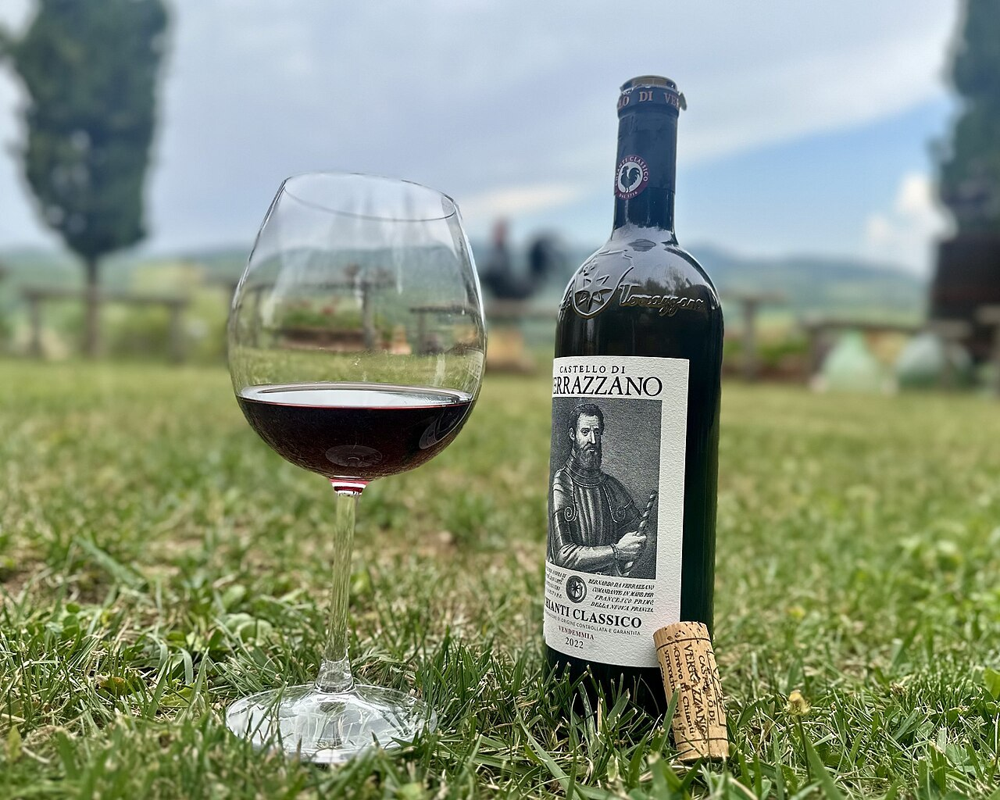
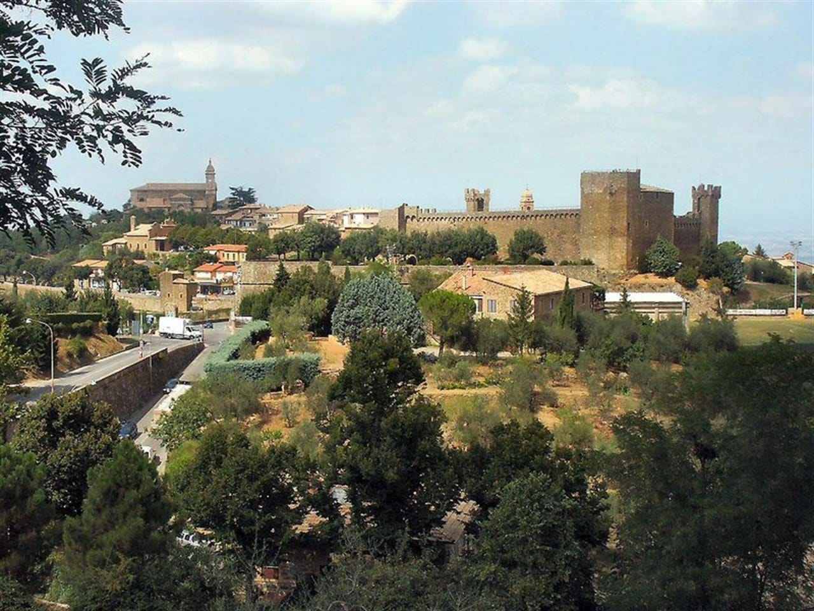

# 托斯卡纳

托斯卡纳（Tuscany，意大利语 Toscana）位于[意大利](ref:italy)中部，是意大利最具辨识度的葡萄酒产区之一。它以[桑娇维塞](ref:sangiovese)为核心，从基安蒂的丘陵到蒙塔奇诺的山城，再到第勒尼安海岸的保格利，形成了以[红葡萄酒](ref:red-wine)为主、同时生产[白葡萄酒](ref:white-wine)与少量起泡酒的版图。

图：托斯卡纳。摄影：Tuscany vineyard。署名：cova69，CC BY 2.0，来自 Wikimedia Commons（[来源](https://commons.wikimedia.org/w/index.php?curid=1393578)）。

## 地理与气候

托斯卡纳大致从亚平宁山脉西侧延伸到第勒尼安海岸，葡萄园主要集中在佛罗伦萨与锡耶纳之间的基安蒂丘陵、蒙塔奇诺、蒙特普尔恰诺，以及南部的马雷玛和西海岸的保格利。丘陵海拔多在 200–600 米，坡向与排水决定成熟节奏。

气候为地中海型，夏季炎热干燥，冬季温和多雨；海岸受海风调节，内陆丘陵昼夜温差更大。秋季降雨与采收时机的博弈，是托斯卡纳年份差异的主要来源之一。

土壤是理解风格的钥匙：基安蒂经典的 galestro 为片状泥灰与黏土，排水良好、持水适中；alberese 为坚硬石灰岩，常出现在较高坡地；蒙塔奇诺多石灰岩与黏土；保格利则有砂质、砾石与冲积土。不同土壤让同一品种呈现不同的酸度、香气与单宁。

## 历史与分级

托斯卡纳的葡萄种植可追溯到伊特鲁里亚时期，中世纪修道院与城市贵族延续了酿酒传统。1716 年，托斯卡纳大公科西莫三世颁布法令划定基安蒂的边界，常被视为欧洲早期产区划定的例子之一。

现代分级沿袭意大利的三层体系：日常餐酒、IGT（地区餐酒）与 DOC、DOCG。DOCG 是法定产区中的最高一级，要求更严格的品种比例、产量、陈年与装瓶规定，并通常需要经过官方品评。基安蒂、基安蒂经典、布鲁奈罗与蒙特普尔恰诺贵族酒都在这一框架内；保格利则以 DOC 与独立的 Bolgheri Sassicaia DOC 存在。

## 子产区

- 基安蒂与基安蒂经典：基安蒂覆盖较广，基安蒂经典限定在佛罗伦萨与锡耶纳之间的历史核心区，后者通常结构更集中。
- 蒙塔奇诺：以 100% 桑娇维塞酿造的布鲁奈罗著称，另有较年轻的 Rosso di Montalcino。
- 蒙特普尔恰诺：以桑娇维塞本地系选酿造的 Vino Nobile 为代表。
- 保格利：海岸地带的波尔多式混酿与西拉，是“超级托斯卡纳”运动的中心之一。
- 圣吉米尼亚诺：以 Vernaccia 白葡萄酒闻名，是意大利较早获得 DOC 的白葡萄酒产区之一。

这些子产区的差异来自海拔、土壤与海风，而不是简单的等级排序。

## 品种与风格

[桑娇维塞](ref:sangiovese)是绝对主角，带来高酸度、中等至强劲的单宁与酸樱桃、番茄叶、紫罗兰和泥土气息。传统混酿会加入 Canaiolo、Colorino 等本地品种；保格利则大量使用赤霞珠、梅洛与西拉。

托斯卡纳[红葡萄酒](ref:red-wine)常见风格从年轻易饮的基安蒂，到经大橡木桶或小桶陈年的布鲁奈罗与超级托斯卡纳。传统派偏好大桶长时间陈年以保留酸度与香气，现代派更重视果味与法国小桶。相关工艺可参见[发酵](ref:fermentation)与[橡木桶陈年](ref:oak-ageing)。

[白葡萄酒](ref:white-wine)产量较小，Vernaccia di San Gimignano 与海岸的白混酿是代表。整体而言，托斯卡纳白葡萄酒比红葡萄酒更少被国际市场讨论。

## 代表酒款与生产者

- [基安蒂经典](ref:chianti-classico)：桑娇维塞为主，酸度清晰，是托斯卡纳最广为人知的红葡萄酒之一。
- [布鲁奈罗](ref:brunello)：蒙塔奇诺的 100% 桑娇维塞，陈年要求长，风格严肃。
- [西施佳雅](ref:sassicaia)：保格利的赤霞珠与品丽珠混酿，常被视为“超级托斯卡纳”的代表。
- 传统生产者如 Biondi-Santi 与布鲁奈罗的渊源、Tenuta San Guido 与西施佳雅的关系，常被用来讲述产区的现代史。

“超级托斯卡纳”是市场与评论界的习惯说法，不是法定类别；这类酒多以 IGT Toscana 标注。

## 常见误区

第一，把基安蒂经典当成一个质量等级。它首先是一个地理范围。
第二，认为布鲁奈罗可以混入国际品种。其规则要求全部使用桑娇维塞。
第三，把“超级托斯卡纳”当成 DOCG。它通常属于 IGT 或 DOC 标注。
第四，认为托斯卡纳只产红葡萄酒。白葡萄酒与起泡酒也有生产。
第五，以为托斯卡纳所有红葡萄酒都要长时间桶陈。年轻风格同样是产区的一部分。

托斯卡纳以桑娇维塞为核心，基安蒂与基安蒂经典、蒙塔奇诺的布鲁奈罗以及海岸的保格利构成不同路线；丘陵、galestro 与 alberese 土壤和地中海气候带来高酸、酸樱桃与泥土气息。DOCG 是分级框架，不是每瓶酒的品质证明；子产区与酒庄更具体。

对照阅读：[意大利](ref:italy)、[红葡萄酒](ref:red-wine)。

## 延伸阅读

- [意大利](ref:italy)：托斯卡纳所属的国家产区框架。
- [桑娇维塞](ref:sangiovese)：托斯卡纳的核心红葡萄品种。
- [基安蒂经典](ref:chianti-classico)、[布鲁奈罗](ref:brunello)与[西施佳雅](ref:sassicaia)：三种代表性红葡萄酒。
- [红葡萄酒](ref:red-wine)与[白葡萄酒](ref:white-wine)：托斯卡纳的基本类型。
- [橡木桶陈年](ref:oak-ageing)与[发酵](ref:fermentation)：影响风格的关键工艺。
- [葡萄酒](ref:wine)：托斯卡纳的产区层级与酒标规则。

**关键事实。**

| 项目 | 内容 |
| --- | --- |
| 一句话定位 | 意大利中部的葡萄酒产区，以桑娇维塞为核心，涵盖基安蒂与基安蒂经典、蒙塔奇诺的布鲁奈罗以及海岸的保格利；丘陵地形、galestro 与 alberese 土壤和地中海气候共同塑造高酸、带酸樱桃与泥土气息的红葡萄酒，DOCG 体系是其质量分级框架 |
| 层级 | 省/大区 |
| 所属 | 意大利 |
| 国家代码 | IT |

**来源与边界。** 本页关于「托斯卡纳」的关键事实，主要由以下来源交叉核对：Italian Ministry of Agriculture（意大利葡萄酒法定产区与 DOCG 名录；由原条目末尾参考资料迁移，未逐条复核访问日期）、European Commission（托斯卡纳各原产地名称的注册状态与产品规格；由原条目末尾参考资料迁移，未逐条复核访问日期）、Federdoc（意大利产区协会与 DOCG 规则概览；由原条目末尾参考资料迁移，未逐条复核访问日期）等 8 条来源。价格、批次与状态会变，涉及这些字段时以页面所列来源的最新版本为准。正文为项目自写，来源只作核验，不复制原文。

**并读。** 把「托斯卡纳」与「意大利」、「桑娇维塞」、「红葡萄酒」放在一起读时，先确认它们是同一层级还是上下游关系：先确认边界与法定分类，再比较气候、土壤、海拔与代表酒款。本页负责给出产区的基本坐标，对照条目补上具体案例与差异；读完再回到本页，才能分清哪些差别属于产区本身，哪些只是产地、批次或品牌选择。

## 相关图像

图：Chianti Classico example bottle - Annata type。图片：FranzKafka2000，CC BY-SA 4.0，via Wikimedia Commons（[原图页面](https://commons.wikimedia.org/w/index.php?curid=168690826)）。关联图像：托斯卡纳。

图：布鲁奈罗。图片：O.S，CC BY-SA 3.0，via Wikimedia Commons（[原图页面](https://commons.wikimedia.org/wiki/File:Montalcino_001.jpg)）。关联图像：托斯卡纳。
