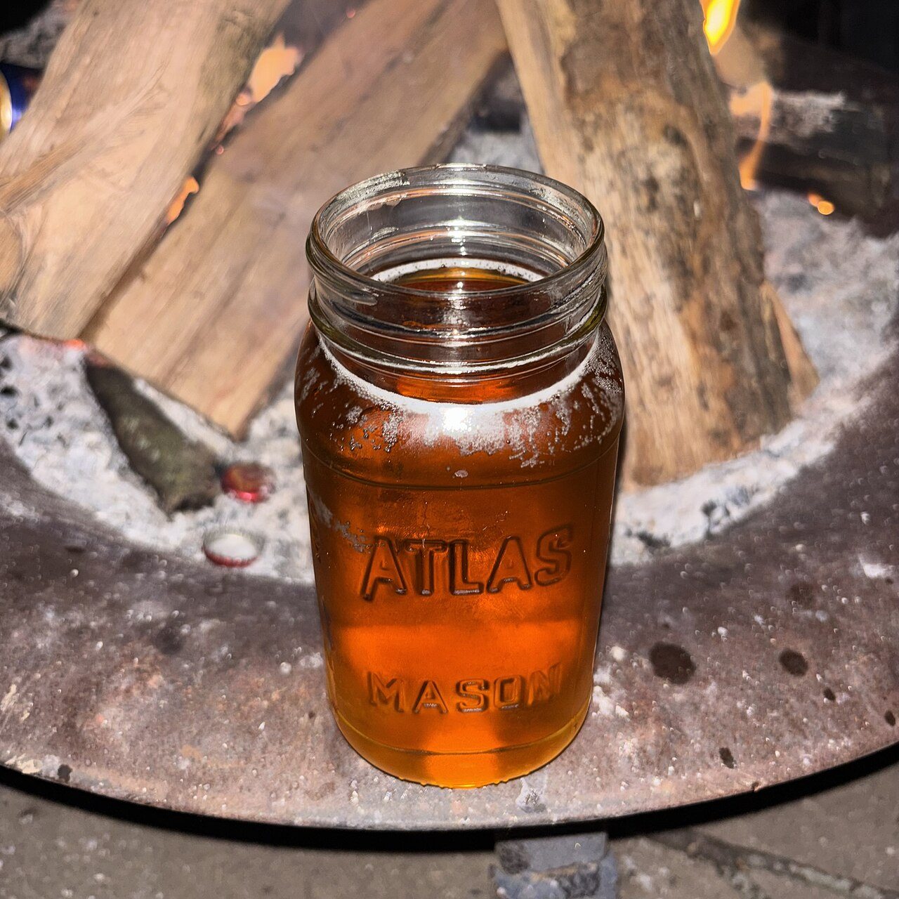

# 英国

英国是由英格兰、威尔士、苏格兰与北爱尔兰组成的岛国。它的酒类版图常被苏格兰威士忌的光芒掩盖，但英格兰与威尔士的起泡酒、英国的金酒、啤酒与苹果酒同样有清晰的传统与市场。本页聚焦英格兰、威尔士与北爱尔兰；苏格兰威士忌请参见[苏格兰](ref:scotland)页。

图：英国地区的一处实景。图片：Decatur Wine & Spirits，CC BY-SA 3.0，via Wikimedia Commons（[原图页面](https://commons.wikimedia.org/wiki/File:DecaturGins.jpg)）。这张照片来自英国产区内已核实条目，用于说明当地风貌，不是英国的全区域地图。

## 地理与气候

英国位于欧洲西北部，受大西洋与墨西哥湾暖流影响，气候温和湿润、四季温差较小。降水分布不均，西部与北部更多，东部与东南部较干。葡萄酒产区主要集中在英格兰南部与东南部，白垩土与石灰岩土壤、朝南坡地与较长的生长季，为起泡酒提供了接近法国北部的条件。

热量不足是英国葡萄酒的主要限制。静止葡萄酒在凉爽年份可能难以完全成熟，因此起泡酒与早熟品种更受重视。海洋性气候也带来湿度与病害压力，生产者需要通过选址、树冠管理与采收决策来应对。

## 历史脉络

英国有悠久的啤酒、苹果酒与金酒传统。金酒在 18 世纪成为城市消费的重要酒类，随后发展出伦敦干金等类型。现代英国葡萄酒产业在 20 世纪后期成长，英格兰南部的起泡酒在 21 世纪获得国际关注。英国也是重要的葡萄酒与烈酒进口市场。

## 葡萄酒

英格兰与威尔士的葡萄酒以[起泡酒](ref:sparkling)最具代表性，采用传统法在瓶中进行二次发酵，风格常带柑橘、青苹果、面包与矿物气息。静止[葡萄酒](ref:wine)也有生产，包括白葡萄酒、红葡萄酒与桃红，但产量较小，受年份影响明显。

产区主要集中在肯特、东萨塞克斯、西萨塞克斯、汉普郡与威尔特郡等地。白垩土与朝南坡地有利于成熟，海洋性气候则保留酸度。具体酒款请参见酒款页；产区页只描述地理与制度框架。

## 金酒

[金酒](ref:gin)是英国最具代表性的烈酒之一，以谷物酒精为基础，加入杜松子与其他植物香料，经蒸馏或浸泡得到。伦敦干金强调杜松子与柑橘、香料的平衡，适合纯饮、加汤力水或调制鸡尾酒。[必富达](ref:beefeater)是伦敦干金的代表酒款之一，说明品牌、配方与产地如何共同塑造风格。

金酒的类型还包括老汤姆、普利茅斯金酒与当代风味金酒。不同法规对原料、蒸馏与标签有不同要求，阅读酒标时要区分类型与产地。

## 啤酒与苹果酒

[啤酒](ref:beer)在英国有深厚传统，从艾尔、苦啤到世涛与精酿都有。[大麦](ref:barley)与[水](ref:water)是基础原料，麦芽烘烤、酒花品种与发酵温度决定风味。英国啤酒强调麦芽与酒花的平衡，部分传统风格以桶中二次发酵与自然碳酸化著称。

[苹果酒](ref:cider)在英格兰西部与西南部有悠久传统，以苹果发酵而成，风格从干型到甜型、从静止到含气都有。苹果酒与啤酒共享部分饮用场景，但原料与工艺不同，不能混为一类。

## 苏格兰与其他地区

苏格兰的[威士忌](ref:whisky)产业有独立的地理、工艺与法规体系，详见[苏格兰](ref:scotland)页。北爱尔兰也有啤酒、苹果酒与部分烈酒生产。英国层面的酒类法规、税率与标签规则适用于各地区，但具体产区与产品仍有地方差异。

## 法规与标识

英国有本国的地理标志保护体系，葡萄酒、金酒、苹果酒等可以使用受保护的产地名称。葡萄酒标签需要标注产地、品种、年份与酒精度等信息；金酒的类型与产地名称也有使用规则。英国脱欧后，部分标签与地理标志规则发生变化，阅读酒标时应以现行规则为准。

产地名称与质量等级不是同一件事。受保护名称保证来源与规则，不保证每瓶的感官质量。

## 气候与土壤数据

| 区域 | 气候 | 主要土壤 | 代表酒类 |
| --- | --- | --- | --- |
| 英格兰东南部（肯特、萨塞克斯、汉普郡） | 海洋性，温和湿润 | 白垩土、石灰岩 | 起泡酒、静止葡萄酒 |
| 英格兰西南部（德文、萨默塞特） | 海洋性，降水较多 | 黏土、砂土 | 苹果酒、啤酒 |
| 威尔士 | 海洋性，湿润多风 | 页岩、黏土 | 葡萄酒、啤酒 |
| 北爱尔兰 | 海洋性，温和湿润 | 黏土、玄武岩 | 啤酒、苹果酒 |

这张表是宏观对照，具体地块的土壤与朝向仍需看单个产区。把国家气候当成酒款风格保证，会忽略产区内部的差异。

## 市场与饮用

英国是重要的酒类消费与进口市场。[葡萄酒](ref:wine)在餐饮、零售与收藏市场都有分层；金酒从酒吧调酒到家庭饮用都有稳定需求；啤酒与苹果酒是日常消费的重要品类。饮用应适量，开瓶后的保存、温度与器皿都会影响体验。

## 常见误区

第一，英国不产葡萄酒。英格兰与威尔士有起泡酒与静止葡萄酒产业。

第二，英国威士忌等于苏格兰威士忌。苏格兰威士忌有独立体系，英国还有其他地区的威士忌生产。

第三，金酒都产自伦敦。伦敦干金是类型名称，不表示所有金酒都在伦敦生产。

第四，苹果酒都是甜的。苹果酒从干型到甜型都有。

第五，英国只有进口酒。英国有本地葡萄酒、金酒、啤酒与苹果酒产业。

对照阅读：[葡萄酒](ref:wine)、[金酒](ref:gin)。

## 延伸阅读

- [葡萄酒](ref:wine)：理解英国的分类、酿造与产区框架。
- [起泡酒](ref:sparkling)：英格兰传统法起泡酒。
- [金酒](ref:gin)与[必富达](ref:beefeater)：伦敦干金的类型与代表酒款。
- [啤酒](ref:beer)与[苹果酒](ref:cider)：英国的发酵酒传统。
- [大麦](ref:barley)与[水](ref:water)：啤酒的基础原料。
- [苏格兰](ref:scotland)与[威士忌](ref:whisky)：苏格兰威士忌的独立体系。

**关键事实。**

| 项目 | 内容 |
| --- | --- |
| 一句话定位 | 由英格兰、威尔士、苏格兰与北爱尔兰组成的岛国；本页聚焦英格兰、威尔士与北爱尔兰的葡萄酒、金酒、啤酒与苹果酒，苏格兰威士忌另见苏格兰页 |
| 层级 | 国家 |
| 国家代码 | GB |

**来源与边界。** 本页关于「英国」的关键事实，主要由以下来源交叉核对：UK Government — Defra（英国食品、农业与葡萄酒相关政策的公开信息）、WineGB（英格兰与威尔士葡萄酒产业、产区与品种的公开信息）、Oxford University Press（提供关于英国葡萄酒历史、产区与起泡酒的条目；提供关于金酒历史、类型与英国饮用文化的条目）。价格、批次与状态会变，涉及这些字段时以页面所列来源的最新版本为准。正文为项目自写，来源只作核验，不复制原文。

## 相关图像

图：苹果酒。图片：ChuckDabs，CC BY 3.0，via Wikimedia Commons（[原图页面](https://commons.wikimedia.org/wiki/File:Midwest_hard_cider.jpg)）。关联图像：英国。

图：金酒。图片：Decatur Wine & Spirits，CC BY-SA 3.0，via Wikimedia Commons（[原图页面](https://commons.wikimedia.org/wiki/File:DecaturGins.jpg)）。关联图像：英国。
