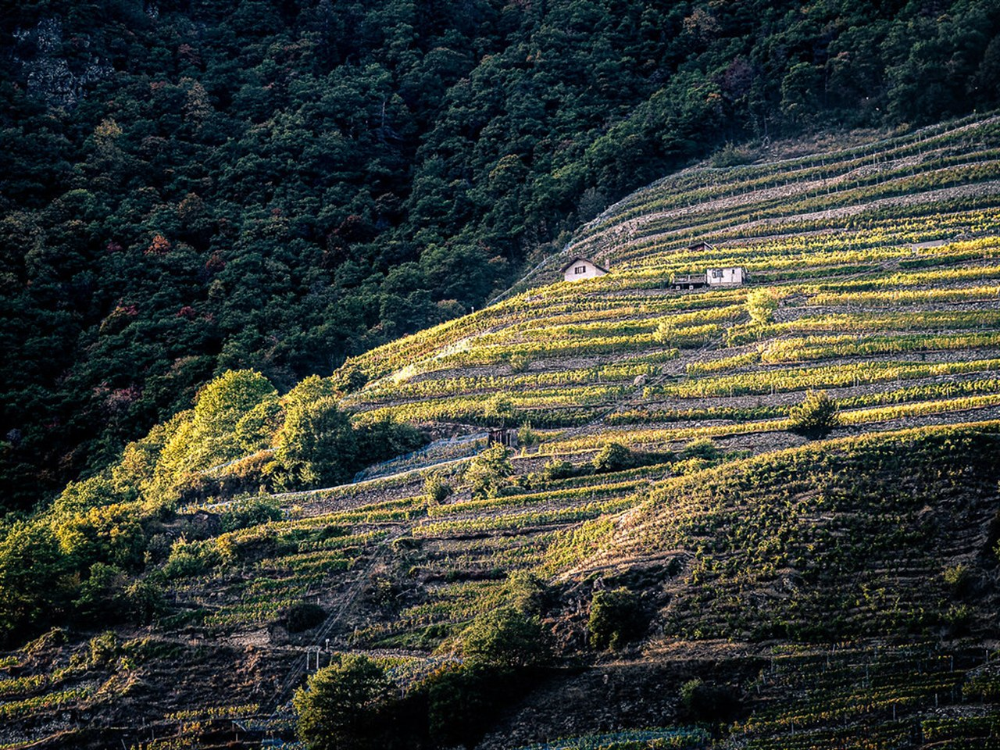

# 瓦莱

瓦莱（Valais，德语 Wallis）是瑞士最大的葡萄酒产区，葡萄园沿罗讷河上游分布在阿尔卑斯山谷两侧。

图：瓦莱。摄影：Fully - Valais, Switzerland - Landscape photography。署名：Giuseppe Milo (www.pixael.com)，CC BY 2.0，来自 Flickr / Openverse（[来源](https://www.flickr.com/photos/87690240@N03/48868951406)）。

## 定义与范围

瓦莱是瑞士的州级葡萄酒产区，范围覆盖罗讷河从布里格（Brig）到日内瓦湖入湖口的河谷，以及两侧支谷的部分坡地。产区约占瑞士葡萄园面积的三分之一，是瑞士产量最大的州。

葡萄园以陡坡梯田为主，从河谷底部一直延伸到高处。产区内部按村庄与地块划分，酒标常以村庄名与地块名标注，而不是只写州名。

## 「瓦莱」的时间线
瓦莱的葡萄种植可追溯到罗马时期，中世纪由修道院与地方贵族扩展。19 世纪末的霜霉病与根瘤蚜重创葡萄园，随后重建并引入嫁接与抗病管理。

20 世纪后期，产区逐步建立以产地为核心的标识体系。瑞士不是欧盟成员，其 AOC 属于本国与州层面的保护体系，与欧盟的 PDO/PGI 框架并行但不等同。瓦莱目前有 1 个 AOC 与 10 个 AOC Grand Cru。

## 地理与气候

瓦莱是冰川在 2 万年前切出的阿尔卑斯山谷，谷底干燥少雨，年降雨约 650 毫米，年日照约 2,500 小时。强而热的焚风从阿尔卑斯北侧下沉，进一步降低湿度、加快成熟，使晚熟品种也能稳定成熟。

干燥气候减少了真菌压力，但也带来水分胁迫与土壤侵蚀风险。葡萄园多朝南或西南，坡面获得直射光；高处昼夜温差大，有利于保留[酸度](ref:acidity)。Visperterminen 的葡萄园可达海拔约 1,100 米，是欧洲最高的葡萄园之一。

土壤类型多样，包括冰川堆积物、花岗岩与片麻岩风化层、片岩、石灰岩与河谷冲积土。不同母质排水与保热能力差异明显，构成产区内部的[风土](ref:terroir)分化。

## 梯田与地块

瓦莱的葡萄园以梯田（Terrassen）与陡坡地块为主，石墙支撑的梯田在坡度极大的地段仍靠人工维护。

- 下瓦莱（Bas-Valais）：靠近日内瓦湖，海拔较低，冲积土与石灰岩较多。
- 中瓦莱（Valais central）：Sion、Sierre 一带，日照最强、最干燥，是 Grand Cru 地块最集中的区域。
- 上瓦莱（Haut-Valais）：靠近布里格与 Visperterminen，海拔最高，成熟期最晚。
- 侧谷：如 Val d'Anniviers 与 Val d'Hérens，坡度更陡，面积小。

地块名称与 Grand Cru 标注描述来源范围与历史声誉，不等于统一的质量等级。

## 品种与原料

红葡萄约占 59%，白葡萄约 41%，共有 55 个品种。面积最大的品种是 Pinot Noir（约 1,275 公顷，28%），其后为 Chasselas（约 755 公顷，16%）、Gamay（约 457 公顷，10%）、Silvaner（约 317 公顷，7%）、Petite Arvine（约 259 公顷，6%）、Sauvignon Blanc（约 214 公顷，5%）、Syrah（约 172 公顷，4%）、Cornalin（约 163 公顷，4%）与 Humagne Rouge（约 143 公顷，3%）。原料是[葡萄](ref:grape)。

Chasselas 在瓦莱被称为 Fendant，是标志性白葡萄；Petite Arvine 带柑橘与紫藤花香，收尾有咸感；Ermitage（Marsanne）用于部分 Grand Cru 白葡萄酒。红葡萄中，Syrah 在瓦莱有稳定表现，Cornalin 与 Humagne Rouge 是本地品种。

## 「瓦莱」怎么做出来
白葡萄经轻柔压榨后低温[发酵](ref:fermentation)，多数酒款避免苹果酸乳酸发酵，以保持清爽与矿物感。Fendant 常在不锈钢或大型旧桶中发酵，装瓶前短暂酒泥接触。

红葡萄按品种与风格调整浸渍时间。Pinot Noir 与 Gamay 多追求果味与柔顺，Syrah 与 Cornalin 需要更长的浸渍以提取颜色与单宁；部分酒款在[橡木桶](ref:oak-ageing)中陈年，新桶比例通常不高。

## AOC 与 Grand Cru

瓦莱的 AOC 规定葡萄来源、允许品种、产量与酿造方式。AOC Valais 是州级标识；AOC Grand Cru 是更严格的地块级标识，只适用于特定市镇内的划定地块。

Grand Cru 是瑞士州级体系中的产地标识，不是全国统一的等级，也不按酒体或甜度排序。酒标上的 Grand Cru 须与具体地名一起理解。

## 「瓦莱」的酒标与喝法
酒标应核对 AOC Valais 或具体 Grand Cru 名称、村庄与地块、品种、[年份](ref:vintage)、[酒精度](ref:abv)、容量与装瓶者。标示单一品种的酒款须为[单一品种](ref:single-varietal)酿造；混酿按法规列出品种。

Fendant 建议 8–10 摄氏度，Petite Arvine 与 Ermitage 建议 10–12 摄氏度，Syrah 与 Cornalin 建议 15–17 摄氏度。Fendant 适合河鱼、奶酪与亚洲料理；红葡萄酒适合红肉与野味。开瓶后冷藏并尽快喝完。本页关于瓦莱的内容涉及酒精饮料；过量饮酒有害健康，未成年人不应饮酒。

## 「瓦莱」容易被读错的地方
第一，认为瓦莱只产 Fendant 白葡萄酒。红葡萄占 59%，Pinot Noir 是面积最大的品种。
第二，把 Fendant 当成独立品种。Fendant 是 Chasselas 在瓦莱的地方名称。
第三，认为海拔越高品质越好。高海拔带来晚熟与高酸度，但风格取决于地块、品种与年份。
第四，把 Grand Cru 当成全国等级。它是州级 AOC 框架内的地块标识。
第五，用欧盟 PDO 体系读瑞士酒标。瑞士 AOC 是本国的保护体系，与欧盟框架并行但不等同。

对照阅读：[葡萄酒](ref:wine)、[红葡萄酒](ref:red-wine)。

**关键事实。**

| 项目 | 内容 |
| --- | --- |
| 一句话定位 | 瑞士最大的葡萄酒产区，沿罗讷河上游分布，约占全国葡萄园面积的 32%、约 4,600 公顷；阿尔卑斯山谷年降雨约 650 毫米、日照约 2,500 小时，并有焚风，葡萄园可升至 Visperterminen 约 1,100 米 |
| 层级 | 其他 |
| 国家代码 | CH |

**来源与边界。** 本页关于「瓦莱」的关键事实，主要由以下来源交叉核对：Swiss Wine Promotion（面积占比、降雨与日照、Visperterminen 海拔、品种面积与 AOC 数量）、Canton du Valais（瓦莱州葡萄园面积 4,564 公顷与红白品种比例）、OIV（补充核对条目背景、术语与制度口径）等 4 条来源。价格、批次与状态会变，涉及这些字段时以页面所列来源的最新版本为准。正文为项目自写，来源只作核验，不复制原文。

**并读。** 把「瓦莱」与「葡萄酒」、「白葡萄酒」、「红葡萄酒」放在一起读时，先确认它们是同一层级还是上下游关系：先确认边界与法定分类，再比较气候、土壤、海拔与代表酒款。本页负责给出产区的基本坐标，对照条目补上具体案例与差异；读完再回到本页，才能分清哪些差别属于产区本身，哪些只是产地、批次或品牌选择。

**适用边界。** 对「瓦莱」而言，产区边界、面积与法定分类会随法规更新；气候描述是长期趋势，不是某一年的天气预报。

**更新提示。** 「瓦莱」最近核对于 2026-11-21；面积、法定分类、标签规则与年份表现会变，引用前以法规与产区官方文本为准。

## 参考资料
- [葡萄酒](ref:wine)：理解瓦莱的类别、年份与产地规则的入口。
- [白葡萄酒](ref:white-wine)与[红葡萄酒](ref:red-wine)：瓦莱两大酒类的基本框架。
- [葡萄](ref:grape)：酿酒葡萄的结构与成熟指标。
- [发酵](ref:fermentation)：瓦莱的低温发酵与苹果酸乳酸发酵差异。
- [酸度](ref:acidity)：高海拔与昼夜温差对酸度的影响。
- [风土](ref:terroir)：母质、坡向与焚风如何形成产地差异。
- [橡木桶陈年](ref:oak-ageing)：红葡萄酒陈年的容器选择。
- [干型](ref:dry)：Fendant 等白葡萄酒的干型定位。
- [年份](ref:vintage)：瓦莱的年份差异。
- [单一品种](ref:single-varietal)：瓦莱的品种比例与酒标标注规则。
- [酒精度](ref:abv)：酒标上 % vol 的含义。
