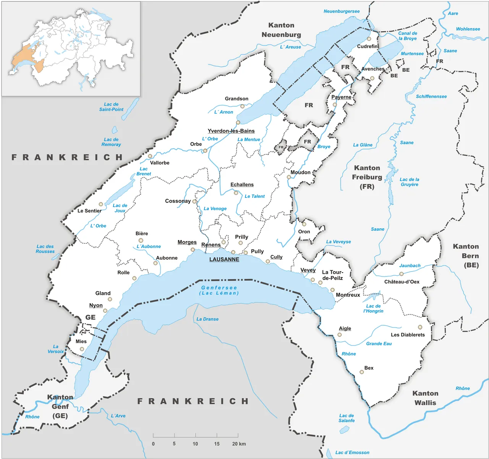

# 沃州

沃州（Vaud，德语 Waadt）是瑞士西部以日内瓦湖北岸为核心的葡萄酒产区，以 Chasselas 白葡萄酒与 Lavaux 梯田景观著称。

图：沃州。图片：Tschubby，CC BY-SA 3.0，via Wikimedia Commons（[原图页面](https://commons.wikimedia.org/wiki/File:Karte_Kanton_Waadt_2010.png)）。

## 定义与范围

沃州是瑞士的州级葡萄酒产区，葡萄园沿日内瓦湖北岸与纳沙泰尔湖一带分布，并向内陆丘陵延伸。全州葡萄园约 3,782 公顷，是瑞士第二大产区。

沃州是瑞士唯一以白葡萄为主的产区，白葡萄占 65%、红葡萄占 35%。产区内部划分为六个子区，并以地名而非品种作为酒标的主要识别。

## 「沃州」的时间线
沃州的葡萄种植与湖畔修道院、洛桑与日内瓦的城市市场相关。Lavaux 的梯田由中世纪以来逐步修筑，石墙与排水系统延续至今。

2007 年，Lavaux 葡萄园与文化景观列入联合国教科文组织世界文化遗产；列入的对象是梯田景观与石墙，而不是某一款酒。20 世纪后期，沃州建立 AOC 体系，把子区、市镇与地块纳入规范。

## 地理与气候

沃州葡萄园位于日内瓦湖北岸的向阳坡地，海拔约 380 至 600 米。湖面反射阳光、调节温度，秋季延长成熟期，使 Chasselas 达到较高成熟度同时保留酸度。

Lavaux 的微气候被称为“三个太阳”：直射阳光、湖面反射光与石墙白天蓄热夜间释放。土壤以石灰岩与冰碛物为主，Chablais 一带石灰质更明显，La Côte 为石灰岩与磨拉石，Côtes de l'Orbe 黏土与石灰岩比例更高。

土壤与湖面共同构成[风土](ref:terroir)差异：石灰岩带来矿物感与张力，冰碛物与黏土带来更饱满的酒体。

## 六个子区

沃州的六个子区各有 AOC 与风格侧重：

- Chablais：西南部，约 590 公顷，石灰质土壤与焚风，Aigle、Yvorne 与 Ollon 为代表，Chasselas 带咸感与矿物感。
- Lavaux：洛桑至蒙特勒之间的梯田，约 800 公顷，以 Chasselas 为主，梯田与石墙构成景观。
- La Côte：沃州最大的子区，约 2,000 公顷，洛桑至日内瓦之间，缓坡与石灰岩，Chasselas 清新带花果香。
- Bonvillars：纳沙泰尔湖以北，约 190 公顷，石灰质土壤，Chasselas 优雅、Pinot Noir 细致。
- Côtes de l'Orbe：洛桑与 Yverdon-les-Bains 之间，约 170 公顷，黏土与石灰岩，酒体较有力、带香料与泥土气息。
- Vully：纳沙泰尔湖与穆尔滕湖之间，面积最小，红白葡萄兼有。

子区之间风格差异明显，但同一子区内部的地块与年份差异同样重要。

## 品种与原料

Chasselas 占 59%、约 2,233 公顷，是绝对主导品种；其后为 Pinot Noir（约 476 公顷，13%）、Gamay（约 311 公顷，8%）、Gamaret（约 148 公顷，4%）、Garanoir（约 126 公顷，3%）与 Chardonnay（约 47 公顷，1%）。原料是[葡萄](ref:grape)。

Chasselas 酒体轻盈、酸度中等、香气偏含蓄，风格主要由土壤与地块决定，因此酒标通常写 Yvorne、Féchy 或 Dézaley 等地名，而不是品种名。红葡萄以 Gamay 与 Pinot Noir 为主，Gamaret 与 Garanoir 是瑞士培育的品种。

## 「沃州」怎么做出来
Chasselas 多经轻柔压榨、低温[发酵](ref:fermentation)，在不锈钢或大型旧桶中完成，通常避免苹果酸乳酸发酵，以保留清爽与矿物感。部分酒款经酒泥接触增加质感。

红葡萄按 Gamay 与 Pinot Noir 的风格调整浸渍时间，多以果味与柔顺为目标，部分酒款在[橡木桶](ref:oak-ageing)中短暂陈年。Dézaley 等 Grand Cru 白葡萄酒常经更长时间的酒泥接触与更晚装瓶。

## AOC 与 Grand Cru

沃州的 AOC 体系包括州级 AOC Vaud 与地区级 AOC：Chablais、La Côte、Lavaux、Bonvillars、Côtes de l'Orbe 与 Vully。此外还有 Calamin、Dézaley 与 Dézaley-Marsens 三个 AOC Grand Cru。

Lavaux 范围内容纳三个 AOC：Lavaux AOC 约 798 公顷、Calamin Grand Cru 约 16 公顷、Dézaley Grand Cru 约 54 公顷。Grand Cru 是更小的划定地块，规定更严，但不是全国统一等级。

## 「沃州」的酒标与喝法
酒标应核对 AOC 名称、子区、市镇或地块、品种（如标示）、[年份](ref:vintage)、容量与装瓶者。沃州酒标常以地名代替品种；标示单一品种的酒款须为[单一品种](ref:single-varietal)酿造。

Chasselas 建议 8–10 摄氏度，Dézaley 与 Calamin 等 Grand Cru 可稍高至 10–12 摄氏度；Gamay 与 Pinot Noir 建议 14–16 摄氏度。Chasselas 适合河鱼、奶酪与清淡料理，红葡萄酒适合禽类与红肉。开瓶后冷藏并尽快喝完。本页关于沃州的内容涉及酒精饮料；过量饮酒有害健康，未成年人不应饮酒。

## 「沃州」容易被读错的地方
第一，认为 Chasselas 平淡无味。它的香气含蓄，风格差异主要来自土壤与地块。
第二，认为沃州只有 Lavaux。La Côte 面积最大，Chablais 与另外三个子区同样重要。
第三，把 Dézaley 当成独立产区。它是 Lavaux 内的 Grand Cru 名称。
第四，用欧盟 PDO 体系读瑞士酒标。瑞士 AOC 是本国的保护体系，与欧盟框架并行但不等同。
第五，认为 Grand Cru 一定更浓郁。Grand Cru 规定更严的产地与产量，风格仍取决于年份与酒庄。

沃州是瑞士以白葡萄为主的产区，Chasselas 占主导，酒标常写地名而非品种，如 Yvorne、Féchy 与 Dézaley；分为 Chablais、Lavaux、La Côte、Bonvillars、Côtes de l'Orbe 与 Vully 六个子区。Lavaux 梯田是世界文化遗产，但“沃州”不是单一风格，Grand Cru 也只对应特定地块。沃州的 Grand Cru 只对应特定地块与命名，不代表整个产区或所有 Chasselas 都同一风格；Lavaux 梯田的世界遗产身份也不等于质量等级。读酒标时先看地名与子区。

对照阅读：[葡萄酒](ref:wine)、[红葡萄酒](ref:red-wine)。

沃州酒标常以地名代替品种，Chasselas 也不一定写在正面；看到 Yvorne 或 Dézaley，先确认它是村庄还是 Grand Cru 名称，再判断风格，再决定是否购买。

**关键事实。**

| 项目 | 内容 |
| --- | --- |
| 一句话定位 | 瑞士沃州的葡萄酒产区，葡萄园约 3,782 公顷，是瑞士唯一以白葡萄为主的产区（白葡萄占 65%）；Chasselas 占 59%、约 2,233 公顷，酒标通常不写品种而写地名，如 Yvorne、Féchy 与 Dézaley |
| 层级 | 其他 |
| 国家代码 | CH |

**来源与边界。** 本页关于「沃州」的关键事实，主要由以下来源交叉核对：Swiss Wine Promotion（面积 3,782 公顷、六个子区、AOC 与 Grand Cru 名单、品种面积与 Lavaux 概况）、Association Lavaux Patrimoine mondial（Lavaux AOC 798 公顷、Calamin Grand Cru 16 公顷与 Dézaley Grand Cru 54 公顷）、OIV（补充核对条目背景、术语与制度口径）等 4 条来源。价格、批次与状态会变，涉及这些字段时以页面所列来源的最新版本为准。正文为项目自写，来源只作核验，不复制原文。

**并读。** 把「沃州」与「葡萄酒」、「白葡萄酒」、「红葡萄酒」放在一起读时，先确认它们是同一层级还是上下游关系：先确认边界与法定分类，再比较气候、土壤、海拔与代表酒款。本页负责给出产区的基本坐标，对照条目补上具体案例与差异；读完再回到本页，才能分清哪些差别属于产区本身，哪些只是产地、批次或品牌选择。

## 参考资料
- [葡萄酒](ref:wine)：理解沃州的类别、年份与产地规则的入口。
- [白葡萄酒](ref:white-wine)：沃州的主体酒类。
- [红葡萄酒](ref:red-wine)：Gamay 与 Pinot Noir 的风格框架。
- [葡萄](ref:grape)：酿酒葡萄的结构与成熟指标。
- [发酵](ref:fermentation)：沃州的低温发酵与苹果酸乳酸发酵差异。
- [酸度](ref:acidity)：湖面微气候与酸度平衡。
- [风土](ref:terroir)：石灰岩、冰碛物与梯田如何形成产地差异。
- [干型](ref:dry)：Chasselas 的干型定位。
- [年份](ref:vintage)：沃州的年份差异。
- [单一品种](ref:single-varietal)：沃州的品种比例与酒标标注规则。
- [橡木桶陈年](ref:oak-ageing)：红葡萄酒与 Grand Cru 白葡萄酒的陈年。
