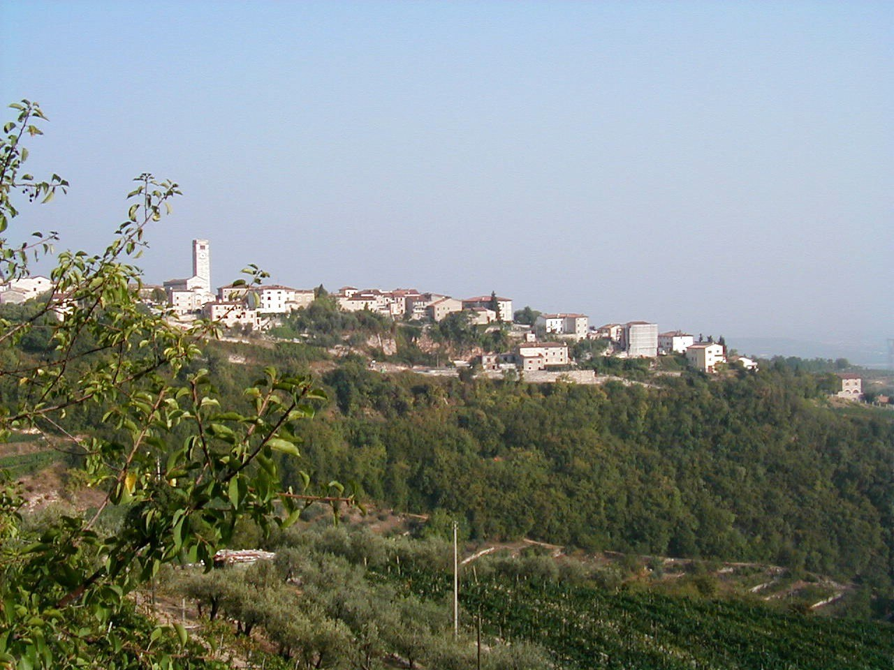
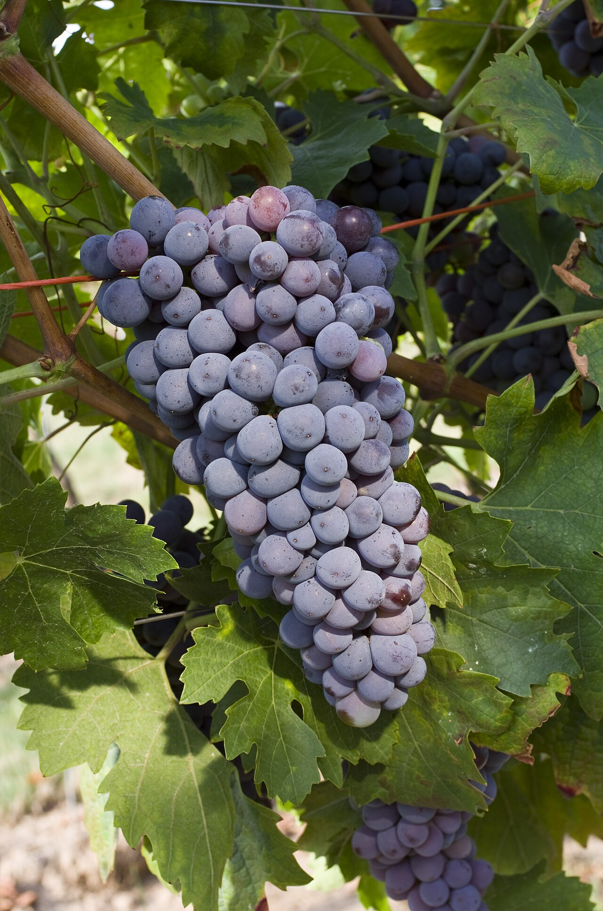
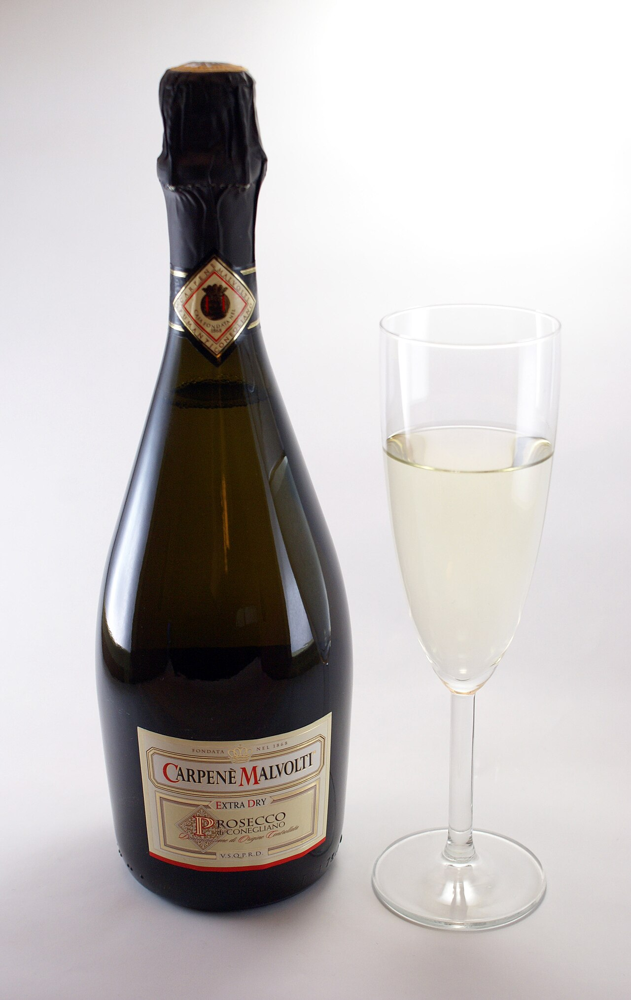

# 威尼托

威尼托（Veneto，意大利语 Veneto）位于[意大利](ref:italy)东北部，从阿尔卑斯山南麓的多洛米蒂一直延伸到亚得里亚海与威尼斯潟湖。它是意大利重要的葡萄酒产区，以瓦坡里切拉的红葡萄酒、苏阿韦的白葡萄酒与普罗塞克的起泡酒三大板块最为人熟知。

图：威尼托。摄影：Vineyard, San Giorgio di Valpolicella, Veneto, Italy。署名：Unknown photographer，CC BY-SA 2.0，来自 Wikimedia Commons（[来源](https://commons.wikimedia.org/w/index.php?curid=354325)）。

## 地理与气候

威尼托的地形分为北部山地、中部丘陵与南部平原。葡萄园集中在维罗纳周边的瓦坡里切拉、苏阿韦与巴多利诺，以及东北部的科内利亚诺与瓦尔多比亚德内丘陵。

气候从北部的阿尔卑斯大陆性过渡到南部平原与沿海的温和型。加尔达湖对周边气温有调节作用；丘陵坡地的昼夜温差有利于香气与酸度的保留。秋季降雨与采收时间，是瓦坡里切拉风干工艺需要重点考虑的因素。

土壤多样：苏阿韦与瓦坡里切拉部分地块为火山岩（玄武岩）与石灰质，丘陵有泥灰岩与砂岩，平原则以冲积土为主。火山土常被用来解释苏阿韦的矿物感与酸度。

## 历史与分级

威尼托的酿酒传统可追溯到古罗马与威尼斯共和国时期，葡萄酒贸易借助港口与河运发展。20 世纪以来，合作社与小农酒庄共同推动了产量与出口的增长。

意大利的 DOCG 是法定产区中的最高一级，DOC 次之，IGT 为地区餐酒。瓦坡里切拉的阿玛罗尼与雷乔托、苏阿韦的雷乔托，以及科内利亚诺与瓦尔多比亚德内普罗塞克、阿索罗普罗塞克都拥有 DOCG 地位。普罗塞克在 2009 年完成名称调整：产地名称保留，品种名改用格莱拉。

按产量口径，威尼托是意大利 DOC 葡萄酒产量最大的产区之一；普罗塞克与瓦坡里切拉系列是主要贡献者。具体产量数据逐年变化，应以官方统计为准。

## 子产区

- 瓦坡里切拉：维罗纳西北的丘陵，以科维纳、科维诺内与罗迪内拉为主，涵盖 Valpolicella、Ripasso 与 Amarone 等不同标注。
- 苏阿韦：维罗纳以东的丘陵，以卡尔卡耐卡为主体，分 Soave、Soave Classico 与 Colli Scaligeri 等范围。
- 巴多利诺：加尔达湖东岸，以科维纳为主，生产清淡红葡萄酒与桃红 Chiaretto。
- 科内利亚诺与瓦尔多比亚德内：普罗塞克的核心丘陵，拥有 DOCG。
- 阿索罗：另一处普罗塞克 DOCG 丘陵。
- 皮亚韦与东部平原：以普罗塞克 DOC 与多种白葡萄酒为主。

这些子产区的差别来自地形、土壤与品种，而不是单一的质量排序。

## 品种与风格

[科维纳](ref:corvina)是瓦坡里切拉的核心，带来酸樱桃、杏仁与香料气息，常搭配科维诺内与罗迪内拉。阿玛罗尼把葡萄在通风室内风干数月，浓缩糖分与风味后再发酵，酒体饱满、酒精高，风格从果干到香料与巧克力。

里帕索（Ripasso）是把普通瓦坡里切拉酒液与阿玛罗尼酒渣接触后再发酵，增加颜色、酒体与风味；它不是阿玛罗尼的稀释版。雷乔托则是保留残糖的甜型版本。

卡尔卡耐卡（Garganega）是苏阿韦的主体品种，带来梨、柑橘、白花与杏仁气息；风格从轻盈清爽到经桶陈的饱满白葡萄酒都有。相关类型可参见[白葡萄酒](ref:white-wine)。

[格莱拉](ref:glera)是普罗塞克的核心品种，带青苹果、梨与白花香气。普罗塞克多用罐式二次发酵，强调新鲜果香与易饮性，与瓶中二次发酵的传统法不同。相关类型可参见[起泡酒](ref:sparkling-wine)与[红葡萄酒](ref:red-wine)。

陈年与发酵的基础可参见[橡木桶陈年](ref:oak-ageing)与[发酵](ref:fermentation)。

## 代表酒款与生产者

- [阿玛罗尼](ref:amarone)：瓦坡里切拉的风干红葡萄酒，酒体饱满、酒精高。
- [普罗塞克](ref:prosecco)：以格莱拉酿造的起泡酒，罐式发酵，清新易饮。
- Soave Classico 与 Recioto di Soave：苏阿韦的干型与甜型代表。
- Valpolicella Ripasso：介于日常瓦坡里切拉与阿玛罗尼之间的风格。
- 生产者如 Allegrini、Dal Forno Romano、Pieropan、Nino Franco 与 Bisol，常被用作各子产区的参考。

生产者风格随年份与地块变化，品牌知名度不等于每一瓶都符合预期。

## 常见误区

第一，以为阿玛罗尼是甜酒。常规阿玛罗尼发酵至干型，甜型对应雷乔托。
第二，把里帕索等同于阿玛罗尼。它只是与酒渣接触的再发酵工艺。
第三，认为普罗塞克与香槟是同义词或同一种工艺。它通常用罐式发酵。
第四，认为苏阿韦都是廉价平淡的白葡萄酒。经典子产区与老藤可以很有结构。
第五，把威尼托的产量优势等同于质量优势。产量与风格多样性是两件事。

对照阅读：[意大利](ref:italy)、[科维纳](ref:corvina)。

## 延伸阅读

- [意大利](ref:italy)：威尼托所属的国家产区框架。
- [格莱拉](ref:glera)与[科维纳](ref:corvina)：两个核心品种。
- [阿玛罗尼](ref:amarone)与[普罗塞克](ref:prosecco)：两种代表性酒款。
- [红葡萄酒](ref:red-wine)、[白葡萄酒](ref:white-wine)与[起泡酒](ref:sparkling-wine)：三种基本类型。
- [橡木桶陈年](ref:oak-ageing)与[发酵](ref:fermentation)：影响风格的关键工艺。
- [葡萄酒](ref:wine)：威尼托的产区层级与酒标规则。

**关键事实。**

| 项目 | 内容 |
| --- | --- |
| 一句话定位 | 意大利东北部的葡萄酒产区，从阿尔卑斯山南麓延伸到亚得里亚海；以瓦坡里切拉的阿玛罗尼与里帕索、苏阿韦的卡尔卡耐卡以及普罗塞克的格莱拉为代表，是意大利 DOC 葡萄酒产量最大的产区之一 |
| 层级 | 省/大区 |
| 所属 | 意大利 |
| 国家代码 | IT |

**来源与边界。** 本页关于「威尼托」的关键事实，主要由以下来源交叉核对：Italian Ministry of Agriculture（威尼托法定产区与 DOCG 名录；由原条目末尾参考资料迁移，未逐条复核访问日期）、European Commission（阿玛罗尼、苏阿韦与普罗塞克等原产地名称的注册状态与产品规格；由原条目末尾参考资料迁移，未逐条复核访问日期）、Federdoc（威尼托产区协会与 DOCG 规则概览；由原条目末尾参考资料迁移，未逐条复核访问日期）等 8 条来源。价格、批次与状态会变，涉及这些字段时以页面所列来源的最新版本为准。正文为项目自写，来源只作核验，不复制原文。

**并读。** 把「威尼托」与「意大利」、「格莱拉」、「科维纳」放在一起读时，先确认它们是同一层级还是上下游关系：先确认边界与法定分类，再比较气候、土壤、海拔与代表酒款。本页负责给出产区的基本坐标，对照条目补上具体案例与差异；读完再回到本页，才能分清哪些差别属于产区本身，哪些只是产地、批次或品牌选择。

**适用边界。** 对「威尼托」而言，产区边界、面积与法定分类会随法规更新；气候描述是长期趋势，不是某一年的天气预报。

## 相关图像

图：科维纳。图片：Please note: This photo can be reproduced. Please quote the source as indicated below: Ursula Brühl, Julius Kühn-Institut (JKI) Bundesforschungsinstitut für Kul，CC BY-SA 4.0，via Wikimedia Commons（[原图页面](https://commons.wikimedia.org/wiki/File:VIVC2863_CORVINA_VERONESE_Cluster_in_the_field_19664.jpg)）。关联图像：威尼托。

图：普罗塞克。图片：Sandstein，CC BY 3.0，via Wikimedia Commons（[原图页面](https://commons.wikimedia.org/wiki/File:Prosecco_di_Conegliano_bottle_and_glass.jpg)）。关联图像：威尼托。
