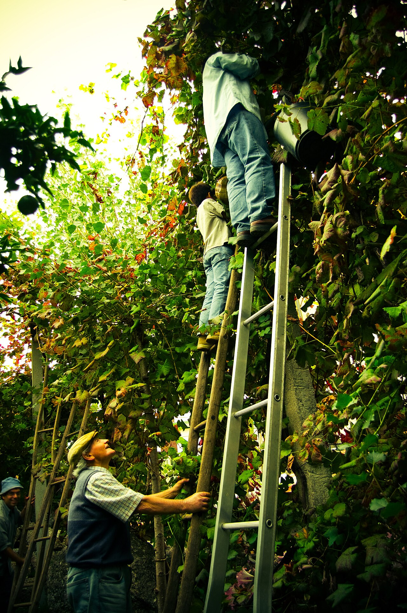

# 绿酒

绿酒（Vinho Verde）是[葡萄牙](ref:portugal)西北部米尼奥地区的法定产区，以清新、低酒精度、酸度高的白[葡萄酒](ref:wine)著称。名称里的“verde”指酒年轻、宜早饮，不指酒的颜色。

图：绿酒。图片：Feliciano Guimarães，CC BY 2.0，via Wikimedia Commons（[原图页面](https://commons.wikimedia.org/wiki/File:Vindimadores_em_vinha_de_enforcado_15.jpg)）。

## 定义与范围

绿酒是受保护的法定产区名称，葡萄必须来自划定的米尼奥地区，并在产区范围内完成酿造。它与更宽松的“米尼奥地区餐酒”标识不是同一套规则，酒标上应区分 Vinho Verde 与 Minho。

产区覆盖葡萄牙西北部多条河谷，从沿海向内陆延伸。范围之大意味着气候、土壤与品种差异明显，因此法规允许在酒标上标注子产区，但子产区是地理描述，不是质量分级。

## 「绿酒」的时间线
绿酒产区在 1908 年完成划界，1926 年成立产区葡萄酒委员会（CVRVV），负责监管生产与贸易。这套制度比许多欧洲产区的现代法定体系更早建立。

20 世纪后期，产区从传统棚架栽培转向现代架式，并引入温控发酵。酒风格从略带气泡、酸度尖锐的农家酒，逐步分化为两类：一类保持轻盈清新，另一类以 Alvarinho 为代表，追求更成熟的果味与结构。

## 地理与气候

产区受大西洋强烈影响，降雨多、湿度高、气温温和，季节温差小。河流谷地是葡萄园的主要分布带，坡地与河谷的排水和通风条件决定成熟度。

土壤以花岗岩为主，部分区域为片岩与冲积土。花岗岩风化形成的砂质土壤排水好、肥力低，有利于控制产量；河谷冲积土保水性强，需要更谨慎的栽培管理。

传统栽培方式包括爬树、棚架与地块边缘种植，现代则以低干架式与篱架为主。棚架能改善通风、减少湿度带来的病害，但机械化程度低。

## 子产区

法规承认九个子产区：Amarante、Ave、Baião、Basto、Cávado、Lima、Monção e Melgaço、Paiva 与 Sousa。

- Monção e Melgaço：位于最北端、米尼奥河沿岸，受地形遮挡，较温暖干燥，是 Alvarinho 的原产地与核心。
- Lima：围绕利马河谷，Loureiro 表现突出，香气以月桂与白花为主。
- Baião：内陆、海拔较高，Avesso 在这里更常见，酸度与矿物感明显。
- Cávado 与 Ave：近海、海拔低、湿度大，风格偏轻盈。
- Basto、Amarante、Paiva 与 Sousa：更靠内陆，大陆性增强，成熟度与酸度平衡不同。

子产区之间是气候与地形的差异，不是等级高低。同一品种在沿海与内陆可以呈现不同的成熟度、酸度与香气。

## 品种与原料

白葡萄以 Alvarinho、Loureiro、Arinto（当地也称 Pedernã）、Avesso、Trajadura、Azal 与 Batoca 为主；红葡萄以 Vinhão（也称 Sousão）、Padeiro、Espadeiro 等为主。原料是[葡萄](ref:grape)。

Alvarinho 皮厚、香气浓，成熟度高时仍有足够酸度；Loureiro 香气优雅但结构较轻；Arinto 酸度高、耐热；Avesso 在内陆表现更佳。混酿常用不同品种补齐香气、酸度与酒体。

红葡萄 Vinhão 果皮颜色深、出汁色浓，酿出的酒颜色深、酸度高、单宁明显，是产区红[葡萄酒](ref:red-wine)的代表。

## 「绿酒」怎么做出来
白葡萄经压榨、澄清后在低温下进行[发酵](ref:fermentation)，通常控制在 20 摄氏度以下，以保留香气与酸度。发酵完成后多数酒款会避免苹果酸乳酸发酵，防止酸度下降与果香被覆盖。

红葡萄带皮发酵，浸渍时间较短，以取得颜色与果味而不过度萃取单宁；红葡萄酒通常允许苹果酸乳酸发酵，使酸度更柔和。

部分酒款保留发酵产生的少量二氧化碳，带来轻微气泡感；也可以做成完全无泡的静酒。气泡来自工艺选择，不代表酒质高低。

## 酒精度与风格

法规规定葡萄酒最高总酒精度为 14% vol，最低实际[酒精度](ref:abv)为 8% vol；标注子产区的酒款最低 9% vol，标示 Alvarinho 的酒款最低 11.5% vol。

常规绿酒多在 8.5%–11.5% vol，酒体轻、[酸度](ref:acidity)高，带柑橘、青苹果、白花与矿物气息，适合年轻饮用。Alvarinho 单品种酒款多在 11.5%–13% vol，果味更成熟，结构更完整，部分可以短期陈年。

低酒精度是风格与法规共同作用的结果，不等于加水或低质量。糖分未完全转化的清爽感，正是产区追求的目标。

## 起泡酒与晚收

产区除静酒外，还生产 Espumante de Vinho Verde 与 Espumante de Qualidade de Vinho Verde，属于[起泡酒](ref:sparkling-wine)类别。起泡酒最高总酒精度 15% vol，最低实际酒精度 10% vol，风格从轻盈到带酵母气息都有。

部分酒庄还生产晚收（Vindima Tardia）酒款，用延后采收的葡萄酿成带甜度与更高酒精度酒款，产量较小。它不属于常规绿酒的清淡风格，应单独看待。

## 「绿酒」的酒标与喝法
酒标应核对 Vinho Verde 法定产区名称、子产区、品种、酒精度、容量与装瓶者。标示单一品种时，若只写 Alvarinho，必须全部由该品种酿造；若与其他品种同时标示，Alvarinho 至少占 30%。这是[单一品种](ref:single-varietal)标示在产区的具体规则。

“Origem do Alvarinho”是仅限 Monção e Melgaço 子产区、且有权标示 Alvarinho 的酒款使用的可选术语。

饮用温度建议 8–10 摄氏度，适合搭配海鲜、沙拉、清淡白肉与亚洲酸辣菜。起泡酒可更低一些。开瓶后应冷藏并尽快喝完。本页关于绿酒的内容涉及酒精饮料；过量饮酒有害健康，未成年人不应饮酒。

## 「绿酒」容易被读错的地方
第一，把“绿酒”理解成绿色的酒。名称指年轻，酒液通常接近无色或浅柠檬黄。
第二，认为绿酒都带气泡。轻微气泡是部分酒款的工艺特征，静酒同样常见。
第三，认为酒精度越低质量越差。低酒精度是产区风格与法规的结果。
第四，认为所有绿酒都必须当年喝完。常规酒款宜早饮，但优质 Alvarinho 可以瓶中陈年数年。
第五，把子产区当成等级。子产区描述地理与风格差异，不构成高低排序。

绿酒指产区与年轻饮用的风格，不是绿色酒液；它有红、白与桃红版本，酒精度通常偏低，但甜度并不统一。

**关键事实。**

| 项目 | 内容 |
| --- | --- |
| 一句话定位 | 葡萄牙西北部米尼奥地区的法定产区，以大西洋影响下的清新、低酒精度白葡萄酒著称；名称中的“verde”指年轻而非颜色，常规酒款实际酒精度最低 8% vol、标注子产区时 9% vol、标示 Alvarinho 时 11.5% vol，最高总酒精度 14% vol |
| 层级 | 其他 |
| 所属 | 葡萄牙 |
| 国家代码 | PT |

## 参考资料
- [葡萄牙](ref:portugal)：绿酒所属的国家产区框架。
- [葡萄酒](ref:wine)：理解绿酒的类别、年份与产地规则的入口。
- [白葡萄酒](ref:white-wine)：绿酒主流风格所属的类别。
- [红葡萄酒](ref:red-wine)：Vinhão 等红葡萄酿成的酒款。
- [起泡酒](ref:sparkling-wine)：Espumante de Vinho Verde 的类别背景。
- [葡萄](ref:grape)：绿酒所用葡萄的成熟度、酸度与单宁判断。
- [发酵](ref:fermentation)：绿酒的低温发酵与苹果酸乳酸发酵差异。
- [酸度](ref:acidity)：绿酒高酸度对风格与配餐的影响。
- [单一品种](ref:single-varietal)：Alvarinho 标示规则的相关概念。
- [酒精度](ref:abv)：8% vol 至 14% vol 的标签含义。
