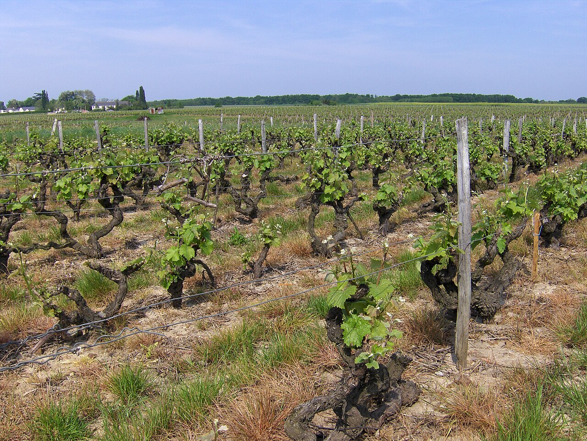

# 武弗雷

武弗雷是卢瓦尔河谷图尔以东、卢瓦尔河右岸的白葡萄酒产区，1936 年获 AOC；法定品种以白诗南（当地称 Pineau de la Loire）为主，同一片葡萄园可酿成干型、半干、甜型、贵腐甜型与起泡酒。图弗石灰岩台地、凉爽湿润的秋季与连片洞穴酒窖，使这里成为观察白诗南多面性最集中的产地。

图：Vouvray：Vouvray Vineyard after budbreak（Wikimedia Commons）。图片：Peter Dutton，CC BY 2.0，via Wikimedia Commons（[原图页面](https://commons.wikimedia.org/wiki/File:Vouvray_Vineyard_after_budbreak.jpg)）。

> **先给结论**
> **一句话：** 这页判断武弗雷的风味与旅行价值，以及怎么安排。
>
> - **适合谁：** 正在比较武弗雷与其他产区、准备买酒或安排旅行的人。
> - **不适合谁：** 只想要“哪个产区最贵”的结论、不关心风格和年份的人。
> - **先看这两点：**
>   - 标签读法上，AOC 名之下，风格词 sec、demi-sec、moelleux、liquoreux 比产区名更重要；残留糖分决定口感，“干型”不等于高酒精。
>   - 产区距图尔市区约十公里上下，车程一刻钟左右；自驾最方便，也可沿卢瓦尔河谷自行车道（Loire à Vélo）连接图尔与沿岸酒庄，公共交通班次有限。

## 先划清「武弗雷」的边界
产区位于图尔上游近郊，高原被多条干谷切割，边缘是俯瞰卢瓦尔河的陡崖，海拔在 85–110 米之间。法定范围沿卢瓦尔河及汇入谷地的八个市镇展开，包括 Vouvray、Rochecorbon、Vernou-sur-Brenne、Parçay-Meslay、Chançay 等；葡萄园集中在朝南、东南的坡地与台缘地带。

“Vouvray”是法定产区名，只约束品种、产量与酿造规则，并不区分坡地与台地。同一 AOC 内，朝南坡地的黏土石灰岩与台缘的硅质黏土，在排水、持水与成熟节奏上差别明显；酒标不写地块时，生产者与单一园名称才是进一步分辨的依据。

河左岸的 Montlouis-sur-Loire 是另一个独立 AOC，品种相同，但土壤与风格自成一系。买卢瓦尔中部白葡萄酒时，不要把右岸的武弗雷与左岸的蒙路易混为一谈；两者隔河相望，却各有各的法规与参照生产者。

## 历史与命名

按当地传说，372 年 Marmoutier 修道院建立时，圣马丁把葡萄品种与修剪技术带到这一带；13 世纪起，白葡萄被限定在多石的石灰质坡地种植。白诗南至少自 9 世纪起就与武弗雷绑定，许多著名地块在 14 世纪已经知名。产区名声先于现代法规存在，AOC 只是把长期形成的边界与规则固定下来。

图弗（tuffeau）软白垩岩自古罗马时期起被开采，采石留下的洞穴从罗马时代一直沿用到 20 世纪，陆续用作发酵、起泡、陈年与贮藏酒窖。恒温恒湿的岩洞是当地葡萄酒贸易的基础设施，也是今天游客最容易辨认的产区景观。

现代标杆 Domaine Huet 于 1928 年由 Victor Huet 与儿子 Gaston 创立；Clos du Bourg 地块 1953 年购入，Le Mont 地块 1957 年购入。2003 年 Hwang 家族收购酒庄，Noël Pinguet 酿酒至 2012 年。这家酒庄把武弗雷干、半干、甜与起泡酒的品质上限同时拉高，是产区现代史绕不开的名字。

## 「武弗雷」的地理与风土
武弗雷属于退化海洋性气候，处在海洋与大陆影响的交汇点上。卢瓦尔河调节沿岸温度，谷地把坡地冷空气排走；年降雨约 680 毫米，秋季晴朗天气利于果实过熟甚至贵腐侵染。这里处在白诗南这种晚熟品种的气候边界上：年份偏凉时糖分积累不足，偏暖的秋季才有可能做甜酒。

土壤基底是晚白垩世土伦期图弗软白垩岩，上覆森诺阶、始新世与上新世硅质黏土，表层盖着第四纪风成粉土。坡地为黏土石灰岩：表层 30–40 厘米石灰质黏土当地称 aubuis，深层硅质砂黏土称 perruches；台缘以硅质黏土为主。石灰岩地块通常酸度高、矿物感清晰，黏土地块更圆润饱满。

微地形上，朝南与东南坡地日照最好，干谷同时挡风；台地排水快但持水有限，坡地持水更稳。主要风险是花期雨水、采收期湿度，以及贵腐年份的不确定性：贵腐甜酒不是每年都能做，好的甜酒年份稀少，价格也明显高于干型。

## 原料与风格

白诗南是唯一主角；法规允许少量辅助品种（如 Orbois B），市面酒款几乎全部由白诗南酿成。这个品种皮厚、酸度高、糖分积累慢，同一地块按采收日期、糖分水平与发酵控制，可以走向干型、半干或甜型不同方向。

风格谱系覆盖很宽：干型（sec）清爽高酸，带青果、白花与矿物感；半干（demi-sec）以残留糖分平衡酸度；甜型（moelleux）与贵腐甜型（liquoreux）呈现蜂蜜、果干、核果与矿物气息，好年份可陈年数十年；起泡酒经瓶内二次发酵，气泡细腻、口感清爽。

酿造上，低温慢发酵、保留天然酸度是主流；甜酒依靠多次采摘选摘贵腐或过熟果实。橡木桶使用因生产者而异：多数干型用不锈钢或旧桶，突出矿物与果香；部分甜酒在新桶中发酵或陈年，增加质地厚度。

## 代表生产者与酒款

Domaine Huet 是产区最知名的名字，约 30 公顷生物动力种植，分三块单一园：Haut-Lieu 15 公顷，位于台地棕黏土，果香清新；Clos du Bourg 6 公顷；Le Mont 9 公顷，位于坡地，结构更集中。Huet 的干、半干、甜与起泡酒都有很长陈年潜力，是对照地块风格的标准参照。

Clos Naudin（Philippe Foreau）以严谨的白诗南与甜酒著称；François Pinon、Domaine Brochet 与当地合作社也是零售与酒单上的常见来源。这些名字不是官方分级，而是市场长期形成的共识；它们可以作为入口，不能代替自己对酸度、甜度与香气的判断。

价位分层明显：Huet 单一园与老年份甜酒价高量小；合作社与入门干型更容易在餐厅和零售渠道找到。比较酒款时先分清风格（干、半干、甜），再看地块与年份，比只记酒庄名气更有效。

## 「武弗雷」的上桌方式
饮用温度随风格调整：干型与起泡约 8–10°C，半干与甜型约 10–12°C，甜酒不必冰镇过头，否则蜂蜜与矿物感会被收住。杯子用中等肚径白葡萄酒杯即可，年轻干型开瓶后稍放十分钟即可进入状态。

配餐上，干型配卢瓦尔河淡水鱼、芦笋与时蔬沙拉，搭配山羊奶酪（如 Sainte-Maure de Touraine）很稳妥；半干能接轻微辣味或亚洲风味菜；甜型配鹅肝、蓝纹奶酪、果挞与干果甜点。本地家常菜以河鱼、奶酪、猪肉与时蔬为主，调味清淡，与本地酒的酸度和清爽节奏一致。

饮用节奏也要分开：年轻干型宜趁鲜喝，果味与酸度最完整；好年份甜酒可放十年以上，瓶内逐渐发展出蜂蜡、蘑菇与坚果气息。先定菜再选甜度，比反过来更不容易出错。

## 选购、标签与误区

标签读法上，AOC 名之下，风格词 sec、demi-sec、moelleux、liquoreux 比产区名更重要；残留糖分决定口感，“干型”不等于高酒精。地块名（如 Le Mont、Clos du Bourg）是生产者自有园标识，不是法定分级，同一地块名在不同酒庄名下表现并不相同。

常见误区之一是把武弗雷理解成只有甜酒，实际上干型与起泡同样是传统产品；另一个误区是认为甜酒一定厚重腻口，高酸度托住糖分时，甜型武弗雷仍可以清爽收尾。贵腐甜酒受年份限制，产量稀少，价格与普通干型不在同一档。

陈年与储存方面，白诗南天然酸度高，干型可放五到十年，优质甜型可达数十年。储存要求避光、温度稳定、卧放；买老年份酒时留意储存记录与瓶塞状态，长期受热或直立存放的瓶，开瓶后果香容易发闷。

## 「武弗雷」周边怎么走
产区距图尔市区约十公里上下，车程一刻钟左右；自驾最方便，也可沿卢瓦尔河谷自行车道（Loire à Vélo）连接图尔与沿岸酒庄，公共交通班次有限。多数品鉴室需要预约，采收季 9–10 月酒庄最忙，出发前应在酒庄官网确认开放时间。

半日行程可安排两到三家带洞穴酒窖的品鉴室，加一顿午餐；以图尔市区为住宿基地当天往返最从容。洞穴酒窖内温度偏低、地面湿滑，跟随工作人员路线参观；预约准时，不在发酵与陈酿区随意走动。

时间充裕时，可以把武弗雷与河左岸的蒙路易排成对照路线，同一天品尝两岸白诗南，体会坡地、台地与河谷微地形的差别。两家以上品鉴安排之间留出车程时间，不要把地图距离当成真实路程。

- 相关条目：[loire](ref:loire)、[chenin-blanc](ref:chenin)、[sparkling-wine](ref:sparkling)、[white-wine](ref:white)、[terroir](ref:terroir)。

相关条目：[卢瓦尔河谷](ref:loire)、[白诗南](ref:chenin)、[起泡酒](ref:sparkling)。

## 相关图像

图：卢瓦尔河谷。图片：Wikimedia Commons contributor，CC BY-SA 3.0，via Wikimedia Commons（[原图页面](https://commons.wikimedia.org/wiki/File:Azay_le_rideau.jpg)）。关联图像：武弗雷。

图：白诗南。图片：Benjamin Smith，CC BY-SA 4.0，via Wikimedia Commons（[原图页面](https://commons.wikimedia.org/wiki/File:Rochecorbon_-_Vignoble_-_02.jpg)）。关联图像：武弗雷。
