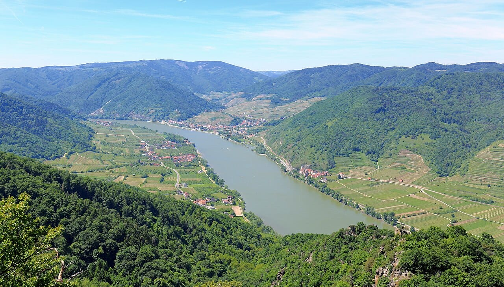
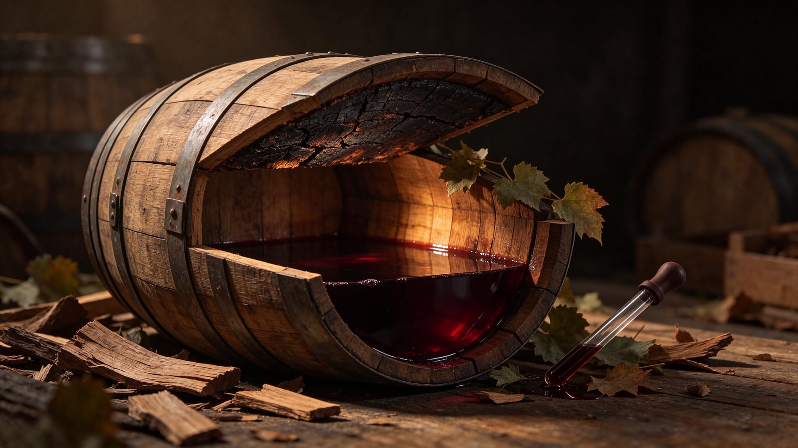

# 瓦豪

瓦豪（Wachau）是奥地利下奥地利州多瑙河峡谷中的法定产区，位于梅尔克（Melk）与克雷姆斯（Krems）之间，约 1,340 公顷陡峭阶地，以 Grüner Veltliner 与 Riesling 的干型酒著称。

图：瓦豪。图片：C.Stadler/Bwag，CC BY-SA 4.0，via Wikimedia Commons（[原图页面](https://commons.wikimedia.org/wiki/File:Wachau_(2).JPG)）。

## 定义与范围

瓦豪是受保护的法定产区名称，葡萄必须来自多瑙河两岸划定的阶地，并在区内酿造。产区范围狭长，葡萄园集中在河谷两侧的陡坡与阶地上。

2020 年份起，瓦豪成为 Wachau DAC，可按 DAC 规则标注产区、村庄与地块。产区内红葡萄酒与桃红占比极低，白葡萄酒是绝对主体。

## 「瓦豪」的时间线
瓦豪的葡萄种植与多瑙河沿岸的修道院密切相关，梅尔克修道院与迪恩施泰因一带的中世纪建筑构成了产区的历史骨架。陡坡上的石墙阶地在数百年间逐步修筑，形成今天的景观。

1983 年，当地酒庄成立 Vinea Wachau 协会，确立了 Steinfeder、Federspiel 与 Smaragd 三个风格名称，用以区分不同酒精度与酒体的干型酒。2000 年，瓦豪文化景观列入联合国教科文组织世界文化遗产；2020 年份起产区获得 DAC 地位。

## 地理与气候

瓦豪是多瑙河切穿结晶岩山地形成的峡谷，河谷狭窄、坡地陡峭。葡萄园多朝南或东南，河面反射阳光与热量，夜间山风带来冷空气，昼夜温差有利于保留酸度。

气候属冷凉大陆性，生长季长、成熟缓慢，秋季干燥。结晶岩（片麻岩、花岗岩与片岩）是主要土壤，风化后排水好、保热能力强；部分阶地覆盖黄土，保水与肥力更高。

陡坡坡度常超过 30%，部分地块更陡，机械化几乎无法进入。石墙阶地依靠人工维护，是高成本与低产量的结构性原因。

## 多瑙河阶地与地块

瓦豪的葡萄园以阶地（Terrassen）和陡坡地块为主，酒标上的 Ried 名称对应具体地块。

- 西部：围绕 Spitz 与 Aggsbach，坡地较缓，黄土比例较高。
- 中部：Weißenkirchen、Joching 与 Wösendorf，阶地密集，是 Grüner Veltliner 与 Riesling 的核心。
- 东部：Dürnstein 与 Krems 一带，陡坡与结晶岩裸露，Riesling 表现突出。
- 河谷两侧的支谷：更冷凉，成熟期更晚。

地块名称是地理描述，不是等级排序；同一村庄内部的地块差异往往大于村庄之间。

## 品种与原料

Grüner Veltliner 与 Riesling 是两大主导品种。Grüner Veltliner 酒体更饱满，带胡椒、柑橘与豆类气息；Riesling 更清瘦，酸度高，矿物感明显。

其他白葡萄包括 Neuburger、Weißburgunder、Chardonnay、Gelber Muskateller 与 Sauvignon Blanc，面积较小。红葡萄有少量 Zweigelt、Blaufränkisch 与 Pinot Noir，多用于本地消费。原料是[葡萄](ref:grape)。

## 「瓦豪」怎么做出来
白葡萄经压榨、澄清后低温[发酵](ref:fermentation)，以保留香气与[酸度](ref:acidity)。传统使用大型旧橡木桶，现代酒庄更多使用不锈钢罐控温；部分酒款经酒泥接触增加质感。

多数酒款避免苹果酸乳酸发酵，保持酸度锐利。Smaragd 级别常经更长时间的酒泥接触与更晚装瓶，以增加结构。这里的[橡木桶](ref:oak-ageing)主要是容器，不是风味来源。

## DAC 与三级风格

奥地利葡萄酒分为 Wein、Landwein、Qualitätswein 与 Prädikatswein。DAC（Districtus Austriae Controllatus）是在法定产区基础上、对品种与风格作出更严格规定的优质酒类别；瓦豪自 2020 年份起适用 Wachau DAC。

Wachau DAC 采用产地金字塔：Gebietswein（产区级）、Ortswein（村庄级）与 Riedenwein（单一地块级）。等级描述产地范围，不是质量高低。

Steinfeder、Federspiel 与 Smaragd 是 Vinea Wachau 协会注册的传统风格标识，按成酒酒精度划分，全部为干型：

- Steinfeder：不超过 11.5% vol，最轻盈，适合早饮。
- Federspiel：11.5–12.5% vol，平衡清爽与结构，是产量与出口的主力。
- Smaragd：不低于 12.5% vol，成熟度最高、结构最强，可陈年。

这三个名称不是国家 Prädikat 等级，也不等同于 DAC 的产地金字塔；它们描述风格与酒精度，酒标可同时出现 DAC 与 Ried 信息。

## 「瓦豪」的酒标与喝法
酒标应核对 Wachau DAC、Ried 地块名、品种、年份、酒精度、容量与装瓶者。标示单一品种时须为[单一品种](ref:single-varietal)酿造；混酿则按法规列出品种。

Steinfeder 建议 8–10 摄氏度，Federspiel 与 Smaragd 建议 10–12 摄氏度。Grüner Veltliner 适合猪肉、禽类、河鱼与亚洲菜；Riesling 适合海鲜、油炸食物与酸度较高的菜肴。开瓶后冷藏并尽快喝完。本页关于瓦豪的内容涉及酒精饮料；过量饮酒有害健康，未成年人不应饮酒。

## 「瓦豪」容易被读错的地方
第一，把 Smaragd 当成葡萄品种。它是 Vinea Wachau 的风格级别，不是品种名。
第二，认为 Steinfeder 是甜酒。三级风格都是干型，差异在酒精度与成熟度。
第三，把 Wachau DAC 与 Vinea 三级混为一谈。前者是国家认可的产地体系，后者是协会注册的风格标识。
第四，认为瓦豪只有 Grüner Veltliner。Riesling 在陡坡结晶岩地块同样重要。
第五，把阶地景观当成天然条件。石墙阶地需要持续人工维护，是成本与产量的直接原因。

瓦豪是多瑙河峡谷中的奥地利产区，陡峭阶地与结晶岩、黄土上的 Grüner Veltliner 和 Riesling 干型酒是核心；Wachau DAC 与 Vinea Wachau 的 Steinfeder、Federspiel、Smaragd 三级风格并存。三级按成酒酒精度划分，不是甜度等级；读酒标时要区分 DAC 与协会标识。

对照阅读：[葡萄酒](ref:wine)、[葡萄](ref:grape)。

**关键事实。**

| 项目 | 内容 |
| --- | --- |
| 一句话定位 | 奥地利下奥地利州多瑙河峡谷中的法定产区，位于梅尔克与克雷姆斯之间，约 1,340 公顷陡峭阶地，以结晶岩（片麻岩、花岗岩与片岩）与黄土上的 Grüner Veltliner 和 Riesling 干型酒著称；2020 年份起成为 Wachau DAC，另有 Vinea Wachau 协会自 1983 年使用的 Steinfeder、Federspiel 与 … |
| 层级 | 其他 |
| 国家代码 | AT |

**来源与边界。** 本页关于「瓦豪」的关键事实，主要由以下来源交叉核对：Bundesministerium für Land- und Forstwirtschaft, Regionen und Wasserwirtschaft（产区面积 1,344 公顷、陡峭阶地与主要品种）、Vinea Wachau Nobilis Districtus（Steinfeder、Federspiel 与 Smaragd 的酒精度区间）、BMLUK（由原条目末尾参考资料迁移，未逐条复核访问日期）等 4 条来源。价格、批次与状态会变，涉及这些字段时以页面所列来源的最新版本为准。正文为项目自写，来源只作核验，不复制原文。

**并读。** 把「瓦豪」与「葡萄酒」、「白葡萄酒」、「葡萄」放在一起读时，先确认它们是同一层级还是上下游关系：先确认边界与法定分类，再比较气候、土壤、海拔与代表酒款。本页负责给出产区的基本坐标，对照条目补上具体案例与差异；读完再回到本页，才能分清哪些差别属于产区本身，哪些只是产地、批次或品牌选择。

**适用边界。** 对「瓦豪」而言，产区边界、面积与法定分类会随法规更新；气候描述是长期趋势，不是某一年的天气预报。

## 参考资料
- [葡萄酒](ref:wine)：理解瓦豪的类别、年份与产地规则的入口。
- [白葡萄酒](ref:white-wine)：瓦豪主流风格所属的类别。
- [葡萄](ref:grape)：酿酒葡萄的结构与成熟指标。
- [发酵](ref:fermentation)：瓦豪的低温发酵与苹果酸乳酸发酵差异。
- [酸度](ref:acidity)：瓦豪干型酒高酸度的来源与作用。
- [酒精度](ref:abv)：三级风格按酒精度划分的含义。
- [橡木桶陈年](ref:oak-ageing)：大桶在瓦豪白葡萄酒中的角色。
- [单一品种](ref:single-varietal)：瓦豪的品种比例与酒标标注规则。

## 相关图像

图：橡木桶陈酿的编辑插图：桶壁烘烤层、酒液与取样管；AI 辅助绘制，不是酒窖实拍。。图片：Hejiu 编辑团队，使用豆包 Seedream 5.5 AI 辅助生成；项目自制，不是现场照片（[项目说明](https://hejiu.org/about/)）。关联图像：瓦豪。

图：葡萄酒。图片：André Karwath，CC BY-SA 2.5，via Wikimedia Commons（[原图页面](https://commons.wikimedia.org/wiki/File:Red_and_white_wine_in_glass.jpg)）。关联图像：瓦豪。
