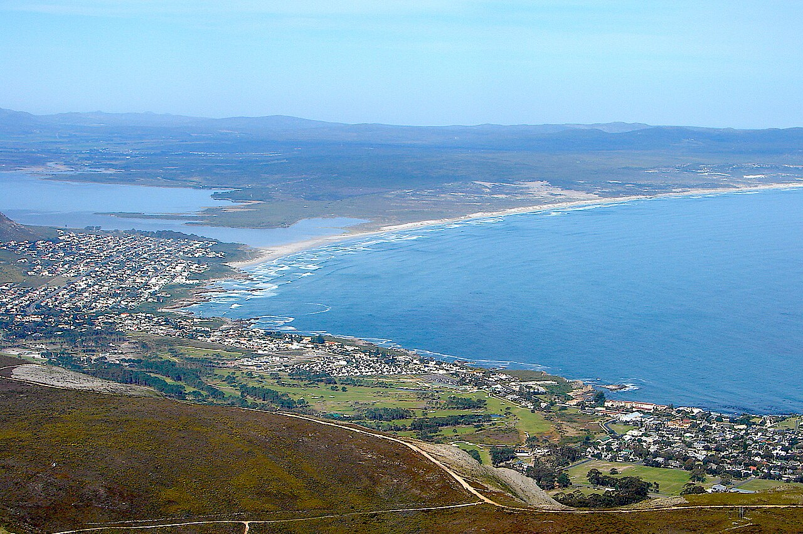

# 沃克湾

沃克湾（Walker Bay）是南非南海岸的冷凉葡萄酒产区，环绕海滨城镇 Hermanus，以 Hemel-en-Aarde 山谷的 Pinot Noir 与 Chardonnay 最为知名。它的风格来自海洋与山地的相互作用，而不是单一的品种标签。

图：沃克湾。图片：Olga Ernst，CC BY-SA 4.0，via Wikimedia Commons（[原图页面](https://commons.wikimedia.org/wiki/File:Coastline_of_Walker_Bay_(South_Africa).jpg)）。

## 定义与范围

沃克湾是西开普 Cape South Coast 产区内的 District，位于开普敦以东、Hermanus 周边。沃克湾本身是印度洋一侧的海湾，产区从海岸向内陆山地延伸。Wine of Origin 层级中，Walker Bay 之下有四个 Ward：Hemel-en-Aarde Ridge、Hemel-en-Aarde Valley、Upper Hemel-en-Aarde Valley 与 Bot River。

SAWIS 2024 年统计把整个 Cape South Coast 产区列为 2,671 公顷，占全国酿酒葡萄园的 3.09%；该数字包括 Elgin、Walker Bay、Cape Agulhas、Overberg 与 Plettenberg Bay 等 District，官方统计未单列 Walker Bay 的面积。产区面积不大，酒庄数量也少于 Stellenbosch 或 Paarl。

## 「沃克湾」的时间线
在 1970 年代以前，Walker Bay 周边以谷物、牧业与海滨小镇为主，葡萄种植规模有限。1975 年，Tim Hamilton Russell 为寻找南非最南端的冷凉酒产地，购入 Hemel-en-Aarde 一处 170 公顷的未开发土地；1976 年种下葡萄，1981 年发布首个年份。此后，Pinot Noir 与 Chardonnay 在 Hemel-en-Aarde 山谷逐步建立声誉。

1991 年，Anthony Hamilton Russell 接手酒庄，并在 1994 年买下产业，把产品线集中到 Pinot Noir 与 Chardonnay。此后更多酒庄进入山谷，Wine of Origin 的 Ward 边界也随种植扩张而划定。Hemel-en-Aarde 意为“人间天堂”，是产区最具辨识度的地名之一。

## 地理与气候

沃克湾位于非洲南端附近，受大西洋本格拉寒流影响，海水温度低，沿海气温比内陆同纬度地区更凉。夏季来自海洋的东南风沿山谷进入，带来降温与干燥空气；冬季受西风带影响，降水较多。山体阻挡了部分内陆热量，使 Hemel-en-Aarde 山谷形成相对独立的中气候。

海拔与坡向造成明显差异：谷底与低坡较温暖，适合较早成熟的 Chardonnay；高处与靠近山体的地块更凉，成熟期更长，Pinot Noir 的酸度与香气更细腻。靠近海湾的地块受海雾与海风影响更强，真菌压力与风害需要额外的栽培管理。

土壤以 Bokkeveld 页岩为主，常见 Glen Rosa 与 Klapmuts 土系，含黏土、保水能力较强；Upper Hemel-en-Aarde Valley 一带还有分解花岗岩，质地更砂；高处与山脊可见 Table Mountain 砂岩风化土，排水更快、肥力更低。页岩、花岗岩与砂岩的分布决定了根系深度、水分供应与成熟节奏，构成[风土](ref:terroir)基础。

## 分区

四个 Ward 覆盖不同的地形与气候，但都是产地边界，不构成质量排序：

- Hemel-en-Aarde Valley：山谷下部，页岩与黏土比例较高，是产区最早建立声誉的地带，Chardonnay 与 Pinot Noir 都能达到较高成熟度。
- Upper Hemel-en-Aarde Valley：山谷上部，海拔更高，土壤含分解花岗岩与页岩黏土，风格更紧致、酸度更清晰。
- Hemel-en-Aarde Ridge：三个 Ward 中最高、最靠内陆的一个，石质黏土与页岩土壤，成熟期最晚，以结构细密的 Pinot Noir 与 Chardonnay 著称。
- Bot River：位于 Walker Bay 的西侧入口，围绕 Bot River 村庄与泻湖，土壤为 Bokkeveld 页岩与 Table Mountain 砂岩；受泻湖与海风影响，适合 Chenin Blanc、Sauvignon Blanc、Pinotage、Syrah 与其他罗讷品种。

Ward 名称可以单独标注，但标得越具体只说明范围越小，不说明酒质更高。

## 品种与原料

Pinot Noir 与 Chardonnay 是沃克湾的核心品种，尤其在 Hemel-en-Aarde 三个 Ward。Pinot Noir 常表现为红樱桃、覆盆子、香料与泥土气息，单宁细、酸度高；Chardonnay 带柑橘、白花、坚果与矿物感，部分酒款经橡木桶与酒泥处理。Sauvignon Blanc 在较凉地块表现清爽，Pinotage 与 Syrah 在 Bot River 一带也有种植。

冷凉气候使果实成熟缓慢，糖分积累与酸度下降不同步，采收窗口较窄。原料是[葡萄](ref:grape)。同一品种在不同 Ward 的成熟度差异明显，酒庄通常按地块分批采收，以保留酸度与香气层次。

## 「沃克湾」怎么做出来
Pinot Noir 多采用部分整串发酵，轻柔压帽或淋皮，避免过度提取；发酵后常在法国[橡木桶](ref:oak-ageing)中陈年，新桶比例依酒庄风格而定。Chardonnay 经轻柔压榨后，部分在橡木桶中[发酵](ref:fermentation)，配合酒泥搅拌与苹果酸乳酸发酵，增加质地与复杂度；清爽型则使用不锈钢罐或大桶，避免明显的橡木味。

Sauvignon Blanc 多以低温发酵保留香气；Pinotage 常缩短浸渍以保留果味，结构型酒款延长浸渍并在旧桶中陈年；Syrah 依地块调整整串比例，风格从胡椒与黑莓到更饱满的成熟果味。白葡萄酒的酸度是产区风格的核心，酿造上通常避免过度降酸或过度澄清。

## 法规与酒标

沃克湾的产地标识遵循南非的 Wine of Origin 制度。标示 Walker Bay 或某个 Ward 的酒款，须 100% 使用该产地采收的葡萄；标示品种或年份时，相关成分须至少达到 85%。通过认证的酒款可使用 Wine of Origin 封签。

WO 是产地与认证体系，不是质量分级。Walker Bay、Hemel-en-Aarde Valley 与 Hemel-en-Aarde Ridge 是不同范围的法定地名；Hemel-en-Aarde 不是酒庄品牌，也不代表某个固定风格。酒标上的产区名、酒庄名与品牌名属于不同层面。

## 「沃克湾」的酒标与喝法
酒标应核对产区名、Ward 名（如有）、品种、[年份](ref:vintage)、[酒精度](ref:abv)、容量与装瓶者。标示[单一品种](ref:single-varietal)的酒款须达到 85% 的品种比例；混酿按法规列出品种。Wine of Origin 封签表示通过认证，不等于质量评价。

Pinot Noir 建议 14–16 摄氏度，Chardonnay 建议 10–12 摄氏度，Sauvignon Blanc 建议 8–10 摄氏度，Syrah 建议 16–18 摄氏度。Pinot Noir 适合禽肉、蘑菇与浅色红肉；Chardonnay 适合海鲜、白肉与奶油料理；Sauvignon Blanc 适合海鲜与沙拉。开瓶后冷藏并尽快喝完。本页关于沃克湾的内容涉及酒精饮料；过量饮酒有害健康，未成年人不应饮酒。

## 「沃克湾」容易被读错的地方
第一，把 Walker Bay 当成一个 Ward。Walker Bay 是 District，下含四个 Ward。
第二，把 Hemel-en-Aarde 当成品牌。它是法定 Ward 名称的一部分，不是某家酒庄的商标。
第三，认为冷凉产区无法酿出饱满的酒。冷凉影响成熟节奏与酸度，酒体仍取决于年份、地块与酿造。
第四，认为沃克湾只产 Pinot Noir 与 Chardonnay。Bot River 一带的 Chenin Blanc、Sauvignon Blanc、Pinotage 与 Syrah 同样重要。
第五，把 Wine of Origin 封签当作质量等级。它认证来源、品种与年份，不评价酒质。

**关键事实。**

| 项目 | 内容 |
| --- | --- |
| 一句话定位 | 南非西开普 Cape South Coast 产区的 District，环绕海滨城镇 Hermanus，位于开普敦以东；官方分区包括 Hemel-en-Aarde Ridge、Hemel-en-Aarde Valley、Upper Hemel-en-Aarde Valley 与 Bot River 四个 Ward |
| 层级 | 其他 |
| 所属 | 南非 |
| 国家代码 | ZA |

## 参考资料
- [葡萄酒](ref:wine)：理解沃克湾的类别、年份与产地规则的入口。
- [白葡萄酒](ref:white-wine)与[红葡萄酒](ref:red-wine)：沃克湾两大酒类的基本框架。
- [黑皮诺](ref:pinot-noir)：Hemel-en-Aarde 的核心红品种。
- [霞多丽](ref:chardonnay)：产区的核心白品种。
- [长相思](ref:sauvignon)：Bot River 与较凉地块的白品种。
- [西拉](ref:syrah)：Bot River 的罗讷品种之一。
- [葡萄](ref:grape)：冷凉气候下的成熟指标。
- [发酵](ref:fermentation)：整串发酵与橡木桶发酵的差异。
- [酸度](ref:acidity)：冷凉产区酸度保留的机制。
- [风土](ref:terroir)：页岩、砂岩与海风如何形成 Ward 差异。
- [橡木桶陈年](ref:oak-ageing)：Pinot Noir 与 Chardonnay 的桶陈选择。
- [干型](ref:dry)：产区白葡萄酒的干型定位。
- [年份](ref:vintage)：冷凉产区的年份差异。
- [单一品种](ref:single-varietal)：85% 品种标注规则。
- [酒精度](ref:abv)：酒标上 % vol 的含义。

## 相关图像

图：Syrah Grapes on the Vine。图片：U.S. Geological Survey，CC0，via Wikimedia Commons（[原图页面](https://commons.wikimedia.org/w/index.php?curid=114429512)）。关联图像：沃克湾。

图：霞多丽。图片：Jenavive at English Wikipedia，Public domain，via Wikimedia Commons（[原图页面](https://commons.wikimedia.org/wiki/File:Chardonnay.jpg)）。关联图像：沃克湾。
