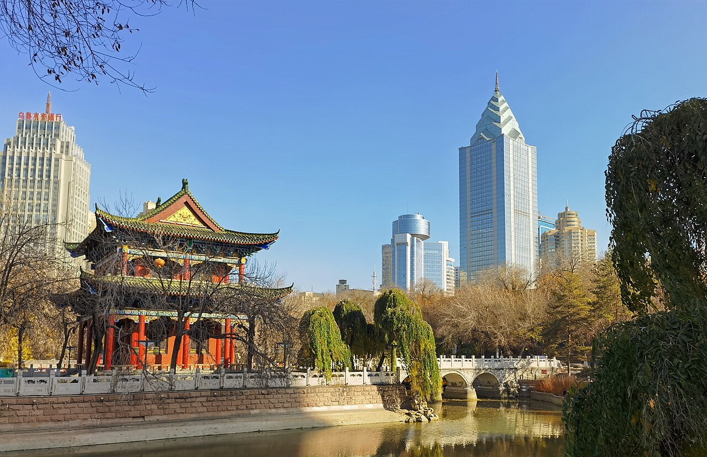

# 新疆

新疆位于中国西北，是中国葡萄种植面积最大的省级行政区之一，也是国产[葡萄酒](ref:wine)的重要原料基地。酿酒葡萄集中在天山北麓、伊犁河谷与焉耆盆地，吐鲁番等传统葡萄区则以制干与鲜食为主。与东部产区相比，新疆的葡萄酒产业更多由大型企业和原料基地主导。

图：新疆。图片：HaziiDozen，CC BY-SA 4.0，via Wikimedia Commons（[原图页面](https://commons.wikimedia.org/wiki/File:%E4%B9%8C%E9%B2%81%E6%9C%A8%E9%BD%90%E4%BA%BA%E6%B0%91%E5%85%AC%E5%9B%AD%E5%B0%81%E9%9D%A2.jpg)）。

## 地理与气候

新疆深居内陆，属温带大陆性干旱气候：年降水量少，蒸发量大，日照时间长，昼夜温差显著。夏季白天气温高、夜间降温快，有利于糖分积累与酸度保留的平衡；空气干燥使真菌病害压力远低于湿润产区，多数年份不需要密集的防病用药。

代价是必须灌溉。产区普遍依赖滴灌与井渠系统，水资源分配直接决定可开垦的葡萄园规模。北疆冬季严寒，葡萄藤需要埋土防寒，这一工序每年耗费大量人工，也限制了树形选择。

土壤多为砾石、砂壤与灰漠土，排水性好、升温快。天山北麓的冲积扇地带土层深厚，焉耆盆地则在博斯腾湖附近形成湖相沉积与砾质土壤的组合。

## 主要子产区

- 天山北麓：包括昌吉、呼图壁、玛纳斯、石河子、乌苏一带，是新疆酿酒葡萄最集中的带状区域，大型酒业与原料基地多分布于此。
- 伊犁河谷：向西开口的河谷地形，气候相对温和湿润，适宜种植中早熟品种，是新疆较特殊的冷凉小区。
- 焉耆盆地：位于巴音郭楞蒙古自治州焉耆回族自治县一带，海拔约 1000–1200 米，博斯腾湖对气温有一定调节作用，是南疆主要酿酒葡萄区。
- 吐鲁番—哈密：以鲜食与制干葡萄著称，酿酒葡萄比例较低。

这些子产区之间尚无统一的法定分级，行业更多按地理带与企业基地划分。

## 品种与风格

[赤霞珠](ref:cabernet-sauvignon)是新疆栽培最广的酿酒品种，成熟度高、单宁充足，常用来做结构型的[红葡萄酒](ref:red-wine)；[梅洛](ref:merlot)用于柔化混酿与早饮型产品；[霞多丽](ref:chardonnay)是主要白葡萄品种，用于[白葡萄酒](ref:white-wine)。此外还有西拉、蛇龙珠与少量小品种。

干旱与强日照让果实糖分上升较快，采收窗口偏窄；酿造上常通过提早采收、控制产量与适度[橡木桶](ref:oak-ageing)陈年来平衡酒精与新鲜度。[发酵](ref:fermentation)温度控制对保留果香尤为关键。

整体风格偏成熟、果味浓，酒精度较高；近年来部分酒庄通过降低产量、提高海拔与调整采收时间，做出更清爽、结构更紧致的酒款。

## 产业与法规

葡萄酒的基本定义、分类与标签要求适用国家标准 GB/T 15037。新疆部分子产区登记了地理标志产品，具体名称与保护范围以主管部门公告为准。

产业层面的特点是原料基地与品牌分离：大量葡萄由种植户或基地供应给酒企，酒庄自有园比例不高。运输距离长、冬季埋土成本高、水资源紧张，是新疆葡萄酒成本结构中的三个长期因素。近年精品酒庄数量增加，但整体仍以规模化生产为主。

## 代表酒款与生产者

- 中信国安葡萄酒业：基地在玛纳斯一带，是新疆规模较大的葡萄酒生产企业之一，产品覆盖多个价位带。
- 乡都酒业：位于焉耆盆地，是南疆较早建立自有葡萄园与酒庄的企业之一。
- 天山北麓的原料基地：为多家国内品牌提供原酒与贴牌产品，是理解新疆产业角色的关键。

## 常见误区

第一，把新疆等同于“吐鲁番葡萄”。吐鲁番以鲜食与制干葡萄为主，酿酒葡萄另有主产区。
第二，认为干旱产区不需要防病。干燥降低了真菌压力，但灌溉带来的湿度与局部小气候仍需管理。
第三，以为日照强就一定甜。糖分高不等于品质高，酸度与单宁成熟度同样关键。
第四，把新疆葡萄酒都当成低价原料酒。当地也有追求产量控制与地块表达的精品酒庄。
第五，忽略埋土防寒的成本。它直接影响新疆葡萄的种植成本与可持续性。

新疆以天山北麓、伊犁河谷与焉耆盆地为核心，温带大陆性干旱气候带来强日照与昼夜温差，砂砾质土壤、滴灌与埋土防寒是基本条件；赤霞珠等国际品种为主，也是重要原料基地。产区跨度极大，不能用一个“新疆”概括所有风格；子产区、海拔与酒庄更关键。

对照阅读：[中国](ref:china)、[梅洛](ref:merlot)。

## 延伸阅读

- [中国](ref:china)：新疆所属的国家产区框架。
- [赤霞珠](ref:cabernet-sauvignon)、[梅洛](ref:merlot)与[霞多丽](ref:chardonnay)：新疆的主要酿酒品种。
- [红葡萄酒](ref:red-wine)与[白葡萄酒](ref:white-wine)：新疆的两类主要产品。
- [葡萄酒](ref:wine)：新疆的产区层级与酒标规则。
- [发酵](ref:fermentation)与[橡木桶陈年](ref:oak-ageing)：影响新疆酒风格的关键工艺。

**关键事实。**

| 项目 | 内容 |
| --- | --- |
| 一句话定位 | 中国西北的葡萄酒产区，以天山北麓、伊犁河谷与焉耆盆地为核心；温带大陆性干旱气候带来强日照与昼夜温差，砂砾质土壤与滴灌、埋土防寒是当地葡萄栽培的基本条件，赤霞珠等国际品种为主，是中国葡萄与葡萄酒的重要原料基地 |
| 层级 | 省/大区 |
| 所属 | 中国 |
| 国家代码 | CN |

**来源与边界。** 本页关于「新疆」的关键事实，主要由以下来源交叉核对：People's Government of Xinjiang Uygur Autonomous Region（新疆的行政区划、气候与农业概况；由原条目末尾参考资料迁移，未逐条复核访问日期）、OIV（中国葡萄园面积与全球葡萄酒生产口径；由原条目末尾参考资料迁移，未逐条复核访问日期）、国家标准化管理委员会（葡萄酒的定义、分类与标签基本要求）等 8 条来源。价格、批次与状态会变，涉及这些字段时以页面所列来源的最新版本为准。正文为项目自写，来源只作核验，不复制原文。

**并读。** 把「新疆」与「中国」、「赤霞珠」、「梅洛」放在一起读时，先确认它们是同一层级还是上下游关系：先确认边界与法定分类，再比较气候、土壤、海拔与代表酒款。本页负责给出产区的基本坐标，对照条目补上具体案例与差异；读完再回到本页，才能分清哪些差别属于产区本身，哪些只是产地、批次或品牌选择。

**适用边界。** 对「新疆」而言，产区边界、面积与法定分类会随法规更新；气候描述是长期趋势，不是某一年的天气预报。
