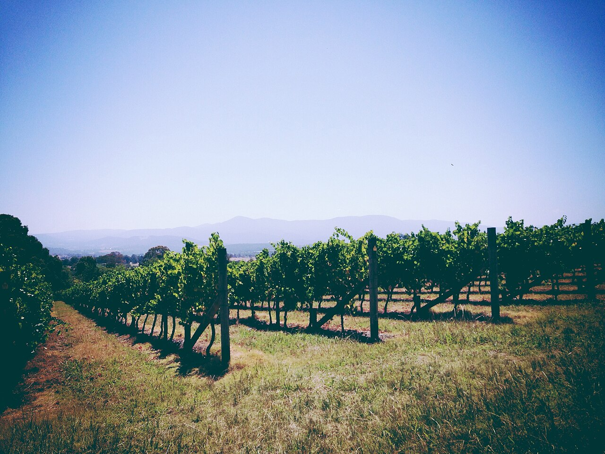

# 雅拉谷

雅拉谷位于墨尔本东北约五十公里，是维多利亚州最早种葡萄的产区，1838 年便种下第一批葡萄；冷凉气候下以黑皮诺、霞多丽与西拉著称，1990 年代获得 GI 身份，风格常被拿来对照勃艮第与北罗讷。

图：Yarra Valley：Yarra Valley vines (12740490444)（Wikimedia Commons）。图片：DearEdward from New York, NY, USA，CC BY 2.0，via Wikimedia Commons（[原图页面](https://commons.wikimedia.org/wiki/File:Yarra_Valley_vines_(12740490444).jpg)）。

## 先划清「雅拉谷」的边界
雅拉谷在维多利亚州中部、墨尔本东北方，GI 面积约 3,130 平方公里，葡萄园约 2,837 公顷；谷地沿雅拉河展开，西起 Whittlesea，北至 Kinglake，东抵 Mount Gregory，南到 Gembrook。1996 年 10 月 30 日，雅拉谷作为 Port Phillip GI 下的子产区注册；标签标注 GI 名要求至少 85% 果实来自该产区。雅拉河在谷内蜿蜒，支流与森林坡地调节湿度；谷地南北狭长，海拔与坡向差异比纬度差异更能解释葡萄成熟节奏。

谷内非正式地分成 Valley Floor（下雅拉，海拔 50 至 80 米，较暖）与 Upper Yarra（塞维勒、Warburton、Hoddles Creek 一带，海拔升至约 400 米，更冷凉）。前者偏暖适合赤霞珠与西拉，后者以黑皮诺、霞多丽与起泡基酒见长；村镇与河谷位置比“雅拉谷”笼统地名更能提示风格。Valley Floor 靠近墨尔本一侧，交通便利、旅游设施成熟；Upper Yarra 更偏远，地块更分散，保留更多林地与牧场。

## 历史与命名

1838 年，苏格兰裔 Ryrie 兄弟在今天的 Yering Station 地块种下维多利亚第一批葡萄；1850 年地块售予 Paul de Castella，1863 年 Hubert de Castella 创立 St Hubert's，Guillaume de Pury 建立 Yeringberg。1889 年 Yering Station 在巴黎万国博览会拿下大奖，是南半球唯一获此荣誉的酒庄。Ryrie 兄弟最初放牧牛群，种下的两个品种为黑汉堡与甜水；de Castella 家族把庄园发展成区域性酿酒中心，1861 年曾获维多利亚最佳葡萄园奖项。

20 世纪初市场转向加强型葡萄酒，加上经济萧条，到 1937 年谷内葡萄全部改作牧场。复兴从 1963 年 Wantirna Estate 开始；1969 年 Bailey Carrodus 创立 Yarra Yering，1971 年 John Middleton 创立 Mount Mary，1973 年酿出五十多年来第一批商业雅拉谷酒款。1982 年 TarraWarra 建立，1985 年 James Halliday 创立 Coldstream Hills，1986 年 Moët & Chandon 在 Coldstream 的 Green Point 设立 Domaine Chandon。复兴一代受冷凉气候理念影响，Carrodus 主张不灌溉、低产葡萄；1978 年 Chateau Yarrinya 拿下雅拉谷第一座 Jimmy Watson 奖杯，后来 De Bortoli 于 1997 年再度获奖。

## 「雅拉谷」的地理与风土
雅拉谷属冷凉气候，一月平均气温约 18.9 摄氏度，年降雨 750 至 950 毫米，降雨集中在冬春；海拔 50 至 430 米，西南风与海洋调节让夏季不过热。下雅拉为灰棕砂壤土上覆红棕黏土，Upper Yarra 多较年轻的红色火山土；河谷与坡向造成明显微气候差别。海洋风从菲利普港与南部海湾进入谷地，夏季午后降温明显；春秋多雾，坡地与台面受光条件优于低洼地。

高处与火山土地块晚熟、酸度高，适合霞多丽与黑皮诺；低暖平地早熟，可支撑赤霞珠与西拉。主要风险是春季霜冻、花期多雨与采收期降雨；冷凉年份黑皮诺单宁可能偏紧，赤霞珠未必达到充分成熟。火山土富含矿物质，排水快，霞多丽酸度清晰；黏土地块保水保肥，果味更宽但纤维感略重。

## 原料与风格

按近年压榨量，黑皮诺约占 44%，霞多丽约 30%，两者合计约四分之三；其余有西拉、赤霞珠、梅洛等红品种，以及长相思、雷司令等白葡萄。西拉常混小比例维欧尼发酵，最冷地块的霞多丽与黑皮诺多用于起泡酒基酒。近年内比奥罗、阿内斯、佳美与绿维特利纳等替代品种在小块地块试种，丰富了产区品种结构。

黑皮诺常带红樱桃、草莓、香料与泥土气息，酸度高、单宁细；霞多丽从清爽柑橘到橡木桶发酵的丰满版本都有；西拉在暖地块偏香料与黑果，风格接近北罗讷。起泡酒采用传统法，是产区声誉的一部分。产区白葡萄酒常经酒泥搅拌与部分橡木发酵，增加圆润度；黑皮诺新桶比例普遍克制，突出果香与酸度。

## 代表生产者与酒款

代表酒庄包括 Yarra Yering（Dry Red Wine No.1 为经典波尔多式混酿）、Mount Mary、Coldstream Hills、Oakridge、Giant Steps、Dominique Portet，以及 Yeringberg、TarraWarra、De Bortoli 与 Domaine Chandon；谷内酒庄约 160 家。Domaine Chandon 是澳洲传统法起泡酒的重要推动者，Yeringberg 则延续 19 世纪家族庄园风格。

这些名字是市场参照，不是官方分级。家族小酒庄与大公司品牌并存，精品酒庄在低产、整串发酵、少硫与皮肤接触等方向上做实验；旗舰款与入门款价格层级明显，比较同一生产者不同地块更能看出风土差别。不少酒庄兼营餐厅与住宿，品鉴室面向游客；精品小批量酒款多通过酒庄直售与订阅渠道。

## 「雅拉谷」的上桌方式
黑皮诺适饮 14 至 16 摄氏度，霞多丽 10 至 12 摄氏度，起泡酒 8 至 10 摄氏度；年轻酒款不必久醒，陈年黑皮诺可提前半小时透气。

配餐以烤禽、鸭肉、蘑菇、羊排与清淡红肉为主；黑皮诺接鸭肉与菌菇，霞多丽配烤鸡、海鲜与奶油酱，起泡酒可独立开胃或配炸物与软质奶酪，西拉配烤香肠与炖肉。本地饮食受澳式烤肉与现代澳菜影响，蘑菇、芦笋、羊奶酪与时蔬常入菜，与产区清爽酸度相合。

## 选购、标签与误区

标签先看 GI 层级与 85% 果实规则，再看 Valley Floor 或 Upper Yarra、村镇与地块名；黑皮诺与霞多丽在冷暖地块之间风格差别明显，年份降雨与成熟度影响很大。GI 之下无法定村级分级，地块与村名是生产者约定俗成的参照；同一名庄不同园号差别可能很大。

常见误区是把“澳洲冷凉产区”当成单一风格，或认为澳大利亚酒都饱满高酒精。雅拉谷以酸度与纹理见长，多数红葡萄酒酒体中等；购买时留意生产者、年份与储存条件，陈年潜力款应选好年份。

## 「雅拉谷」周边怎么走
距墨尔本市区约一小时车程，Coldstream、Yering、Healesville 一带酒庄集中；酒庄多需预约，单次品鉴 60 至 90 分钟，一天两三家加午餐从容。采收季（2 至 4 月，南半球）最忙。Healesville 是 Upper Yarra 方向的门户小镇，周边散布多家酒庄与画廊。

雅拉谷是墨尔本周边热门酒乡，夏季周末有市集、餐厅与观景品鉴室；可结合雅拉河步道、自行车与山谷花园走访。公共交通有限，自驾或参加墨尔本出发的酒乡团更方便。春秋两季坡景与植花期最适合走访；夏季周末建议提前预约午餐与品鉴。

- 相关条目：[australia](ref:australia)、[pinot-noir](ref:pinot)、[chardonnay](ref:chardonnay)、[white-wine](ref:white)、[red-wine](ref:red)。
- 出行前可在 Wine Australia 或雅拉谷酒庄协会官网核对 GI 规则、当年开放时间与品鉴预约方式。

相关条目：[澳大利亚](ref:australia)、[黑皮诺](ref:pinot)、[霞多丽](ref:chardonnay)。
