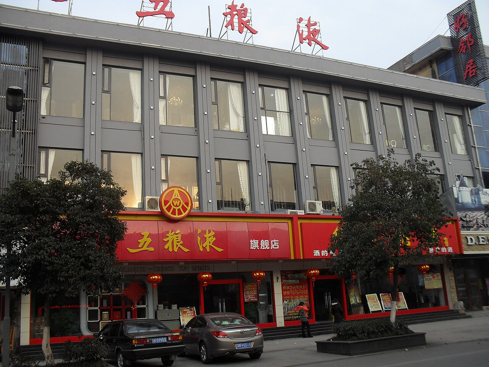

# 宜宾市

宜宾位于四川盆地南缘，金沙江与岷江在城区合江门一带汇合，以下始称长江。这个“江口”位置决定了宜宾的交通史，也决定了它的酒业史：粮食、曲药、燃料与成品酒都可以沿水路和陆路集散，城市因此长期是川南的商贸节点。今天的宜宾以五粮液最为人熟知，但把宜宾只等同于一个品牌，会漏掉它作为[四川](ref:sichuan)南部产区城市的层次。

图：五粮液品牌门店外景，用于识别品牌视觉；不是宜宾城市全景。图片：东京村子，CC BY-SA 3.0，via Wikimedia Commons（[原图页面](https://commons.wikimedia.org/wiki/File:%E4%BA%94%E7%B2%AE%E6%B6%B2%E6%97%97%E8%88%B0%E5%BA%97_-_panoramio.jpg)）。

## 位置与到达

宜宾是地级市，位于[四川](ref:sichuan)南部，东接泸州，南邻云南，西连乐山，北靠自贡。中心城区被金沙江、岷江与长江切分，桥多、坡多，城市空间沿江展开。对外交通有宜宾五粮液机场、成贵高铁与多条高速公路；从成都、重庆、贵阳方向进入都比较方便。具体车次、航班与末班时间会变，出发前应以铁路、机场和客运站当日信息为准。

市区内部建议把“江口”和“酒厂片区”分开安排。合江门、冠英街一带适合看城市与江河的关系；五粮液园区在翠屏区岷江西路一带，属于另一条动线。两者之间不是步行距离，打车或公交更合适。若只停留半天，优先选一个点，不要在江边与厂区之间来回穿城。

## 酒业与产区

宜宾的白酒以浓香型为主，[五粮液](ref:wuliangye)是代表品牌。浓香型白酒强调泥窖续糟、固态发酵与多轮次取酒；宜宾的气候湿润、冬暖、夏季较长，窖池与曲房的温湿度管理需要随季节调整。江河带来的水运条件，则让高粱、小麦、玉米等原料与成品酒更容易集散。

五粮液的名字来自高粱、大米、糯米、小麦、玉米五种粮食的配方。五种粮食并不是“越多越香”的简单加法，它们各自提供淀粉、蛋白质与风味前体，制曲、蒸煮、摊晾、入窖和蒸馏的配合才决定最终风格。把“五粮”理解成一种原料叙事，比把它当作固定配方更准确。

宜宾不只一家酒企，但五粮液规模最大、产业链最完整，围绕它形成了制曲、玻璃、印刷、物流与包装配套。城市酒业的结构因此呈现“一个核心品牌带动多条配套链”的特点。参观时看到的现代化灌装线与老窖池并存，正是这种结构的缩影。

## 风味与工艺

[浓香型白酒](ref:strong)的典型描述是窖香突出、粮香明显、入口绵甜、尾味较短而干净。具体到宜宾，五粮液系产品的香气通常更强调复合粮香与窖香，不同度数、年份与产品线之间差异很大。不要用一个品牌的某一款酒代替整个产区；同样，也不要把“香气大”直接等同于“质量高”。

工艺上，浓香型白酒依赖泥窖中的微生物群落。窖池使用时间、窖泥养护、母糟延续与季节温度都会影响发酵。宜宾地处江边，空气湿度较高，夏季窖池降温与车间通风是管理重点；冬季则要防止温度过低导致发酵停滞。参观时如果看到“续糟”“滴窖”“双轮底”等术语，可以把它们理解为围绕窖池与糟醅的一系列操作，而不是神秘配方。

对普通饮用者，最有用的判断不是背工艺名词，而是比较三件事：香气是否干净、入口是否协调、落口后是否有明显粗糙感。把[白酒](ref:baijiu)小杯慢饮，先闻空杯，再小口入口，比大口干杯更容易分辨层次。

## 参访与行程

宜宾最直接的酒文化参访点是[五粮液酒文化博物馆](ref:museum)，地址在翠屏区岷江西路150号。博物馆适合了解企业历史、器具、工艺与产品体系；它回答“五粮液如何讲述自己”，不等于完整的产区调查。开放时间、预约方式与是否接待散客会调整，出发前应以国家文物局页面和馆方公告为准。

建议的半日动线是：上午先到合江门看两江汇流，理解宜宾为什么成为码头城市；中午在旧城吃一顿燃面或家常川菜；下午再去博物馆。若对生产环节感兴趣，应提前确认是否有对外开放的参观线路。厂区与办公区不是景区，不能自行进入；拍摄要遵守现场规定。

如果安排两天，可以把[四川](ref:sichuan)南部的泸州、自贡或乐山串成一条线。宜宾到泸州有高铁与公路，适合做“浓香型双城”对比；但不要把两个城市的酒厂参观压在同一天，车间与博物馆的信息量都很大。

## 饮食与季节

宜宾饮食偏川南风格，燃面、把把烧、河鲜与腌腊都有代表性。搭配白酒时，咸鲜、油脂与花椒香能托住酒精的刺激；重辣与重麻会放大灼热感，品鉴时不宜先吃。若只是用餐，少量佐酒即可，不需要用宴席劝酒来证明“懂酒”。

春季与秋季是最舒服的城市步行季节；夏季江边湿热，厂区参观更要注意补水和避暑；冬季阴冷，室内外温差明显。酒厂车间温度与市区不同，夏季不要穿过于贴身的衣服，参观前问清是否允许进入高温区域。

## 常见误区

第一，把宜宾只当成“五粮液所在地”。宜宾还有港口、竹产业与川南饮食，城市本身值得半天。

第二，把“五粮”当成固定配方。不同产品线的原料比例与工艺并不相同，品牌不能替代具体酒款。

第三，把博物馆当成厂区参观。博物馆在市区，生产区是否开放是另一件事。

第四，用香气大小判断酒质。干净、协调与回味长度比单纯的“冲”更重要。

## 继续读

- 想理解浓香型的共同语言，读[浓香型白酒](ref:strong)。
- 想比较四川与贵州的产区差异，读[四川](ref:sichuan)与[中国](ref:china)的产区条目。
- 想把宜宾放进一条旅行线，先看泸州老窖与川南交通，再决定是否增加自贡或乐山。
