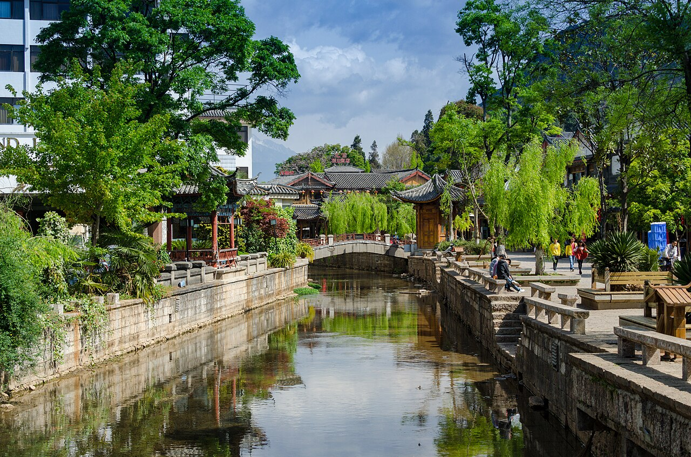

# 云南

云南位于中国西南，葡萄酒产区可以分为两个截然不同的世界：一个是迪庆香格里拉高原上的德钦，葡萄园沿金沙江与澜沧江的干旱河谷分布，海拔从 1800 米一直到 2800 米；另一个是红河州弥勒的低海拔坝区，葡萄园高度约 1480 米。把这两个地方放在同一页，是因为它们共同构成云南葡萄酒的地理跨度，而不是因为它们的风格相同。

图：云南。图片：xiquinhosilva，CC BY 2.0，via Wikimedia Commons（[原图页面](https://commons.wikimedia.org/wiki/File:55936-Lijiang_(27941831943).jpg)）。

## 两个云南：高原与坝区

云南的葡萄酒产区不是一块连续、均质的土地。迪庆藏族自治州以香格里拉产区为品牌核心，德钦县是种植与酒庄最集中的县份；弥勒则位于滇东南，属于另一条低海拔路线。迪庆州地处三江并流区域，官方资料把优质葡萄种植带描述为北纬 27 度、海拔 1800–2800 米；德钦县的葡萄基地分布在金沙江、澜沧江两江干旱河谷，高海拔地块可达 2400–2800 米。

本页是地区层级中的省级节点，上级为[中国](ref:china)。云南葡萄酒属于[葡萄酒](ref:wine)大类，以[红葡萄酒](ref:red-wine)为主，也有[白葡萄酒](ref:white-wine)。产区名称与行政边界不能简单画等号：迪庆香格里拉是产区品牌，德钦是核心县份，弥勒是另一条独立路线。

## 高海拔风土：紫外线、温差与河谷

德钦的高海拔葡萄园大致在 2400–2800 米。空气稀薄、云量较少，紫外线强度高于低海拔地区，昼夜温差大，葡萄生长季被拉长。香格里拉酒业的公开资料给出的产区数据是：生长期长达 180–200 天，葡萄园全年日照达 2500 小时，年降雨量 200–600 毫米，年平均蒸发量 1240 毫米，蒸发量远大于降雨量。

这些数字解释了为什么德钦的葡萄园必须依赖灌溉。河谷底部干燥，山坡与冲积扇上的沙质、砾质土壤排水快，雪山融水与山泉构成主要水源。强紫外线与较大的昼夜温差让果皮增厚、酚类物质积累，也让酸度在夜间得到保留；但同样的条件会带来风害、冰雹与成熟不均的风险。高海拔不是一张统一的质量证书，而是需要精细地块管理的一套约束。

## 德钦：梅里雪山下的村落

德钦的葡萄产业在 2000 年启动，早期在阿东、说日、斯农、西当等村落种植赤霞珠与品丽珠，海拔约 2200–2600 米。Ao Yun 的公开资料记录，2000 年当地农民在四个村庄种下 14 公顷葡萄，2014 年在阿东建成海拔 2600 米的酒厂，随后把 314 个地块细分为 900 个子地块，按微气候与土壤分别管理。这种“碎片化地块”的管理方式，是高海拔河谷酒庄的典型做法。

德钦县国投集团的数据显示，全县葡萄基地 14057 亩，年产量 4711 吨，规模化基地 7 个，有机绿色产品认证面积 3996.31 亩，辐射 6 个乡镇、19 个村委会、3000 户农户。2026 年 6 月，迪庆州在昆明发布香格里拉葡萄酒产区与品牌酒庄，把德钦、香格里拉等地的酒庄进一步纳入统一的产区叙事。数字背后是一个县级产业：葡萄不是观光背景，而是农户收入与酒庄原料的共同基础。

## 弥勒：低海拔的另一极

弥勒位于红河哈尼族彝族自治州，葡萄园海拔约 1480 米，北纬 24 度附近，气候比德钦温暖，红土与坝区条件适合早熟品种。云南红 1997 年成立，在弥勒拥有约 1300 公顷葡萄园，主要品种包括玫瑰蜜、水晶、云中舞与法国野，这些品种在云南以外很少大面积种植。

弥勒与德钦的差异不只是海拔。德钦靠雪山融水、强紫外线和长生长季，酒体更紧致、酸度更清晰；弥勒热量充足、成熟更快，酒体更圆润，香气更偏果酱与热带水果。把两地都称为“云南葡萄酒”会模糊这些差别，更准确的说法是：云南同时拥有高海拔河谷与低海拔坝区两种葡萄酒地理。

## 品种、酿造与风格

云南高原红葡萄酒以赤霞珠、品丽珠为主，部分酒庄使用西拉、梅洛；白葡萄酒以霞多丽为主，也有其他白品种。[赤霞珠](ref:cabernet)与[霞多丽](ref:chardonnay)分别支撑红、白两类酒款，原料都是[葡萄](ref:grape)。高海拔果实的皮厚、籽成熟度高，发酵时需要注意单宁提取的强度；部分酒庄采用较长的浸皮与温和萃取，避免过重的结构掩盖香气。

红葡萄酒多经控温[发酵](ref:fermentation)、压榨与橡木桶或惰性容器陈年。[橡木桶陈年](ref:oak-ageing)的使用取决于酒庄风格：新桶过多会掩盖高原果香，旧桶则更适合保持清爽。白葡萄酒通常低温发酵，强调酸度与柑橘、白花香气。弥勒的品种与工艺路线更接近温暖产区的果味表达，与德钦的高海拔风格形成对照。

## 产业、品牌与制度

德钦的产业数据说明，云南葡萄酒不是零散的家庭作坊，而是有基地、有认证、有县级规划的产业。2000 年启动葡萄产业，2018 年香格里拉酒业牵头起草《迪庆高原酿酒葡萄种植技术规程》，官方资料称其标志着中国首个单一葡萄园标准的建立。2026 年的产区发布会则把“香格里拉”作为核心品牌，推动产区化、品牌化与文旅融合。

制度层面，云南的葡萄酒生产受食品安全法规与国家标准约束，地理标志、产区品牌与单一园标准是不同层级的概念。酒标上的“香格里拉”“德钦”“弥勒”指向不同的地理范围，购买时应结合酒庄、年份与品种判断，而不是只看产区名称。

## 云南葡萄酒的常见误读

第一，把云南葡萄酒等同于香格里拉。弥勒的低海拔产区同样有规模化种植与品牌。

第二，认为海拔越高酒越好。高海拔带来强紫外线与温差，也带来成熟不均、风害与灌溉压力。

第三，把“高原”理解成单一风格。德钦不同村落、不同海拔的地块差异很大。

第四，认为弥勒只是“低端产区”。弥勒有悠久的种植历史与稳定的品种体系，风格评价应看具体酒款。

第五，把产区品牌当作地理标志。品牌、产区、单一园与地理标志是不同层级的标识，不能混用。

## 参考资料

- [中国](ref:china)：云南所属的国家层级地区节点。
- [葡萄酒](ref:wine)：葡萄酒的分类、年份与产地规则。
- [红葡萄酒](ref:red-wine)：赤霞珠、品丽珠等红葡萄酿成的酒款。
- [白葡萄酒](ref:white-wine)：霞多丽等白葡萄酿成的酒款。
- [赤霞珠](ref:cabernet)：德钦与弥勒红葡萄酒的主要品种。
- [霞多丽](ref:chardonnay)：云南白葡萄酒的主要品种之一。
- [葡萄](ref:grape)：酿酒葡萄的结构与成熟指标。
- [发酵](ref:fermentation)：控温发酵与浸皮萃取对风格的影响。
- [橡木桶陈年](ref:oak-ageing)：新桶与旧桶对高原葡萄酒的影响。
