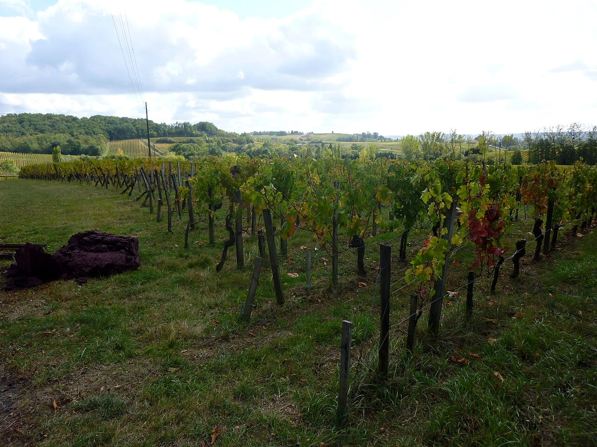

# 波尔多 AOC 法令

“Bordeaux”在酒标上是一个区域级原产地命名，不是一个酒庄名，也不是一个品牌。它覆盖吉伦特省适宜种植的葡萄园，1936 年 11 月 14 日获得 AOC 认定，现行产区规范在 2025 年 9 月 19 日批准。

区域级 AOC 的好处是门槛清晰：只要地块在范围内、品种与产量符合规范、酿造与标签合规，就可以使用“Bordeaux”这个名字。但在这层之下，还有玛歌、波亚克、波美侯、圣埃美隆等更具体的市镇级 AOC；名字越具体，规则越紧，价格通常也越高。

图：波尔多是区域级 AOC，覆盖吉伦特省适宜种植的地块；图为波尔多葡萄园。图片：davitydave，CC BY 2.0，via Wikimedia Commons（[原图页面](https://commons.wikimedia.org/wiki/File:Vineyard_in_Bordeaux.jpg)）。

## 区域级 AOC 在体系中的位置

波尔多的 AOC 体系像一套同心圆。最外圈是区域级 Bordeaux 与 Bordeaux Supérieur；往里是 Côtes de Bordeaux 等区域子区；再往里是 Saint-Émilion、Pauillac 这样的市镇级；最内层是列级庄与单一园的名称。

区域级 AOC 不规定某一块地必须种什么，而是给出一个允许范围。生产者在这个范围内做选择：种 Merlot 还是 Cabernet Sauvignon，早采还是晚采，用新桶还是旧桶。选择的结果，才是酒庄之间的差别。

## 地理：两条河、砾石与黏土

波尔多位于加龙河与多尔多涅河汇成吉伦特河的河口地带。左岸以砾石为主，排水好、升温快，适合 Cabernet Sauvignon；右岸以黏土与石灰岩为主，保水性强，适合 Merlot 与 Cabernet Franc。

海洋性气候带来温和冬季与湿润春季，也带来霜冻与秋季降雨的风险。2025 年规范对产区边界做了更新，但核心逻辑没变：地块必须能稳定成熟，而不是靠年份运气。

## 品种：红、白与桃红

红葡萄酒允许的品种包括 Merlot、Cabernet Sauvignon、Cabernet Franc、Petit Verdot、Malbec 与 Carménère。白葡萄酒以 Sémillon、Sauvignon Blanc 与 Muscadelle 为主。桃红通常用红品种短浸渍，颜色浅、果味直接。

波尔多传统是混酿，而不是单一品种。规范不强制某一品种的比例，但要求最终酒体符合该 AOC 的风格描述。混酿的意义在于分散风险：某个品种在某个年份成熟不好，可以用另一个品种补结构。

## 产量、修剪与采收

2025 年规范给出的产量上限是：红葡萄酒 60 至 64 百升/公顷，最高不得超过 68；白葡萄酒 67 至 77，最高不得超过 77；桃红 62 至 72，最高不得超过 72。修剪方式、留芽数与行距也有约束。

这些数字不是官僚主义。产量越高，单果风味越淡，酒体越薄；波尔多要靠陈年与混酿撑结构，原料必须足够浓缩。遇到霜冻或干旱，规范允许按程序申请调整，但不会无条件放宽。

## 酿造、陈年与风格

红葡萄酒经过浸渍、发酵与压榨，再进入橡木桶或混凝土罐陈年。区域级 AOC 不强制新桶比例，也不规定陈年时长；这些属于酒庄选择。白葡萄酒通常在桶中发酵或带酒泥陈年，以增加质地。

规范对最低天然酒度、挥发酸、二氧化硫等有要求，但具体数值以最新文本为准。对消费者而言，更实用的判断是：AOC 保证的是产地与基本工艺，不保证某一酒庄的风格或品质高低。

## 标签与分级

酒标必须出现“Bordeaux”与“Appellation Bordeaux Contrôlée”。年份、酒庄名、“Château”字样、以及“Cru Bourgeois”等分级标识，都有各自的使用条件。1855 年列级庄名单是历史形成的私人分级，不是 AOC 法规的一部分，但在市场中影响巨大。

2025 年规范对标签的地理名称、字体大小与附加信息做了细化。对出口商而言，最容易出错的是把区域级酒标成市镇级，或在酒庄名上使用未经授权的“Château”。

## 市场与争议

波尔多面临产量下降、霜冻与干旱加剧、以及中国市场需求波动三重压力。小酒庄与合作社的利润被挤压，部分地块转向其他作物或休耕。与此同时，列级庄的价格体系仍然稳固，形成明显的两极分化。

争议还包括：1855 分级是否该更新；新桶与微氧技术是否削弱了产地特征；以及“Bordeaux”这个区域名是否被过度使用，稀释了子产区的价值。规范能划定边界，但无法决定市场偏好。

2025 年规范还把部分子产区的产量上限下调了约一成，目的是在气候变暖、成熟度上升的背景下维持酒体平衡。小酒庄的应对方式各异：有人减少产量、提高单价，有人转向合作社销售，也有人改种更耐旱的品种。规范提供的是上限，不是出路。对消费者而言，这意味着同一子产区、不同酒庄的酒，价格与风格差距可能比年份更大；只看产区名，仍不足以判断一瓶酒。产区名只是起点，酒庄与年份才是答案。

## 另见与参考资料

- 波尔多产区的整体地理，见 [波尔多](ref:region-bordeaux)。
- 左岸的玛歌，见 [玛歌](ref:region-margaux)。
- 左岸的波亚克，见 [波亚克](ref:region-pauillac)。
- 右岸的波美侯，见 [波美侯](ref:region-pomerol)。
- 右岸的圣埃美隆，见 [圣埃美隆](ref:region-saint-emilion)。
- “原产地命名”的概念，见 [原产地命名](ref:term-appellation)。

1. INAO / Planète Bordeaux，Cahier des charges de l'appellation Bordeaux，2025 年。
2. INAO，appellations viticoles，访问于 2026 年 11 月 20 日。
3. CIVB，Bordeaux wines — the appellations，访问于 2026 年 11 月 20 日。
4. Légifrance，arrêtés d'homologation，访问于 2026 年 11 月 20 日。
5. CIVB，Le vignoble de Bordeaux — chiffres clés，访问于 2026 年 11 月 20 日。

对照阅读：[波尔多](ref:region-bordeaux)、[波亚克](ref:region-pauillac)。

**关键事实。**

| 项目 | 内容 |
| --- | --- |
| 一句话定位 | 波尔多是区域级原产地命名，1936 年获得认定，现行规范于 2025 年 9 月批准；它规定红、白、桃红三类酒的品种、产量上限、修剪与标签，其下还叠着数十个更具体的市镇级 AOC |
| 发布机构 | 法国国家原产地与质量研究院（INAO） |
| 标准编号 | Cahier des charges de l'AOC Bordeaux |
| 生效日期 | 2025-09-19 |
| 适用范围 | 波尔多区域级 AOC 的种植、酿造与标签 |

**来源与边界。** 本页关于「波尔多 AOC 法令」的关键事实，主要由以下来源交叉核对：Planète Bordeaux / INAO（2025 年规范全文）、INAO（确认 AOC 的批准机构与产区边界管理）、Conseil Interprofessionnel du Vin de Bordeaux（波尔多 AOC 体系与子产区的层级关系；种植面积与产量结构）等 5 条来源。价格、批次与状态会变，涉及这些字段时以页面所列来源的最新版本为准。正文为项目自写，来源只作核验，不复制原文。

**并读。** 把「波尔多 AOC 法令」与「波尔多」、「玛歌」、「波亚克」放在一起读时，先确认它们是同一层级还是上下游关系：先确认适用范围与强制或推荐属性，再比较术语、标签与检测方法。本页负责给出标准的基本坐标，对照条目补上具体案例与差异；读完再回到本页，才能分清哪些差别属于标准本身，哪些只是产地、批次或品牌选择。

**适用边界。** 对「波尔多 AOC 法令」而言，标准文本会修订，引用时以发布机构的最新版本为准；本页是导读，不替代原文。

**更新提示。** 「波尔多 AOC 法令」最近核对于 2026-11-20；标准版本、过渡期与检测方法会更新，执行前以现行标准文本为准。
