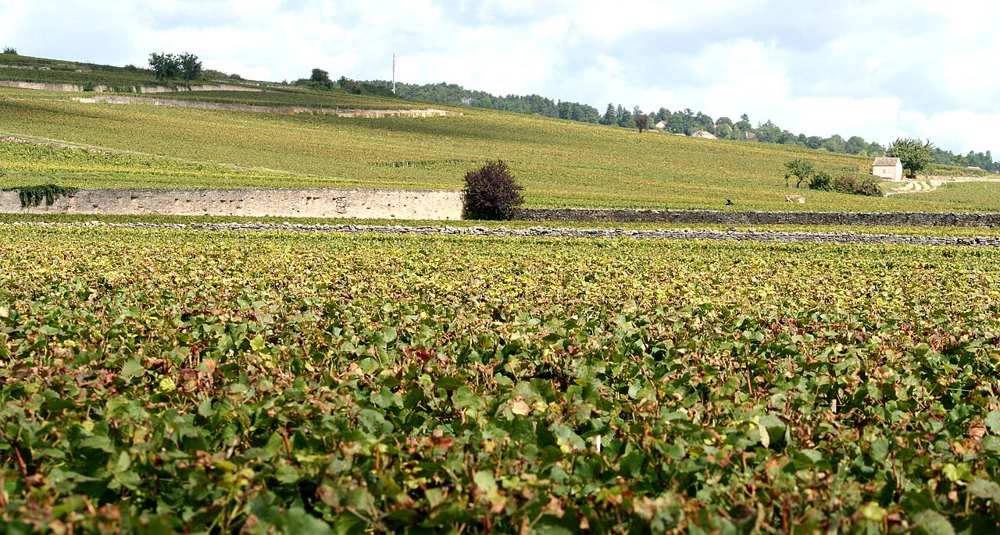

# 勃艮第 AOC 法令

勃艮第的复杂，不在于酒庄数量，而在于地块名字。同一座山丘，山顶、山腰、山脚可能分属三个不同的 AOC；同一条路两侧，酒标上的名字可以完全不同。理解这套制度，等于理解勃艮第为什么贵。

现行体系有 84 个原产地命名，分为三层：7 个区域级、44 个村庄级、33 个特级园。村庄级内部还有 640 个“一级园”地块标识，它们不是独立的 AOC，而是挂在村庄级名下的更具体地块。

图：勃艮第把地块细到 climat；图为伯恩丘的葡萄园。图片：Megan Mallen，CC BY 2.0，via Wikimedia Commons（[原图页面](https://commons.wikimedia.org/wiki/File:C%C3%B4te_de_Beaune,_Burgundy_vineyard.jpg)）。

## 三层结构：区域、村庄与特级园

区域级 AOC 覆盖整个勃艮第，包括 Bourgogne、Bourgogne Aligoté、Bourgogne Passetoutgrain 等。它们给出最基本的品种与产量框架，适合日常饮用，也是酒厂调配的底座。

村庄级 AOC 以村子命名，例如 Gevrey-Chambertin、Meursault、Pommard。酒标上可以只写村名，也可以在村名后加“Premier Cru”与具体地块名。特级园则是 33 个独立 AOC，名字直接印在酒标上。

层级越高，规则越紧：产量上限更低，采收成熟度要求更高， tasting 与标签审查更严。特级园不是“更好喝”的法律保证，而是“这块地有更严格的生产约束”。

## 地理：从夏布利到马贡

勃艮第葡萄园沿着索恩河谷与石灰岩坡地分布，分为夏布利、夜丘、伯恩丘、夏隆内丘与马贡五个大区。夏布利靠北，以 Kimmeridgian 泥灰岩闻名；夜丘与伯恩丘是核心，坡向朝东，排水良好。

土壤差异被放大到极致：同一面坡上，泥灰岩比例、土层厚度与碎石含量不同，酒体就从轻盈转为厚重。勃艮第的“地块”概念，本质上是对这种细微差异的法律承认。

## Climats：地块名，不是气候

“Climat”在勃艮第指一块有历史名称的葡萄园，不是气象学意义上的气候。2015 年，勃艮第的 climats 被列入联合国教科文组织世界遗产，理由是一套持续数百年的地块命名与人类耕作传统。

今天被记录的地块超过 1500 个，其中 640 个被认定为一级园。所有权碎片化让同一块 climat 可能由十几个家族持有，每个家族的做法不同，这也是同一地块的酒风格差异巨大的原因。

## 品种与种植

红葡萄酒以 Pinot Noir 为主，少量使用 Gamay；白葡萄酒以 Chardonnay 为主，Aligoté 用于区域级白葡萄酒。品种规则不是建议，而是 AOC 条件：标错品种，酒就不能用该名称。

种植密度、修剪方式、留芽数与产量上限由各 AOC 规范分别规定。特级园的上限最低，区域级最高；遇到冰雹或霜冻，生产者可以申请减产补偿，但不能突破上限。

## 酿造与陈年

红葡萄酒通常去梗或部分整串发酵，浸渍时间从几天到数周不等，之后进入橡木桶。白葡萄酒在桶中发酵或带酒泥陈年，搅桶频率决定质地。AOC 规范约束最低酒度、挥发酸与二氧化硫，但不规定新桶比例。

这意味着，同一特级园可以出现截然不同的风格：有人追求轻盈透明，有人追求浓缩与力量。规范保证产地，酒庄决定表达。

## 标签与市场

酒标必须出现 AOC 名称与“Appellation Contrôlée”字样。村庄级可以加地块名，特级园直接以园名命名。酒庄名、 negociant 名与“Domaine”字样各有条件；标错层级是最常见的合规问题。

勃艮第的价格由稀缺性推动：特级园面积小、需求全球分布、年份波动大。拍卖市场与亚洲需求进一步放大了价格，也让“地块名”成为投资标的。

酒商（négociant）与酒庄（domaine）的标签差异也影响价格。酒庄装瓶通常意味着全程控制，酒商装瓶则可能收购葡萄或原酒；同一块特级园，酒庄装瓶的酒往往比酒商装瓶贵出数倍。消费者若只看园名，很容易忽略装瓶者是谁。这也是勃艮第酒标上“Domaine”与“Maison”两个词值得细看的原因。

另一个细节是“Clos”与“Lieu-dit”：前者通常指有围墙的地块，后者只是地名，两者都不等于等级。酒标上多一个词，价格可能差一倍。读懂这些词，比记住分级更有用。在勃艮第，读懂地名比背下分级更重要。

## 争议：气候、遗产与扩张

气候变暖让采收提前，酸度下降，传统成熟度标准受到挑战；霜冻与冰雹的频率上升，保险成本增加。遗产分割让地块越来越碎，机械化管理难度上升。

另一个争议是特级园边界是否应该调整。支持者认为，气候已经改变了成熟条件，边界应随现实更新；反对者认为，AOC 是历史与文化的产物，不应被短期市场利益改写。

## 另见与参考资料

- 勃艮第的整体地理，见 [勃艮第](ref:region-burgundy)。
- 夜丘的村庄与地块，见 [夜丘](ref:region-cote-de-nuits)。
- 伯恩丘的村庄与地块，见 [伯恩丘](ref:region-cote-de-beaune)。
- 北端的夏布利，见 [夏布利](ref:region-chablis)。
- “原产地命名”的制度，见 [原产地命名](ref:term-appellation)。
- “风土”这个概念，见 [terroir](ref:term-terroir)。

1. BIVB，Burgundy wines — appellations and climats，访问于 2026 年 11 月 20 日。
2. BIVB，Burgundy appellations — press kit，访问于 2026 年 11 月 20 日。
3. INAO，appellations viticoles，访问于 2026 年 11 月 20 日。
4. UNESCO，The Climats, terroirs of Burgundy，访问于 2026 年 11 月 20 日。
5. Légifrance，cahiers des charges des AOC，访问于 2026 年 11 月 20 日。

对照阅读：[勃艮第](ref:region-burgundy)、[博讷丘](ref:region-cote-de-beaune)。

**关键事实。**

| 项目 | 内容 |
| --- | --- |
| 一句话定位 | 勃艮第有 84 个原产地命名，分区域级、村庄级与特级园三层，地块细到名为“climat”的历史单元；2015 年，climats 被列入联合国教科文组织世界遗产，让一套葡萄园地名获得了文化身份 |
| 发布机构 | 法国国家原产地与质量研究院（INAO） |
| 标准编号 | Cahiers des charges des AOC de Bourgogne |
| 生效日期 | 1936-07-31 |
| 适用范围 | 勃艮第各 AOC 的种植、酿造与标签 |

**来源与边界。** 本页关于「勃艮第 AOC 法令」的关键事实，主要由以下来源交叉核对：Bourgogne Wines / BIVB（84 个 AOC 的层级、品种与产量框架；7 个区域级、44 个村庄级与 33 个特级园的数字）、INAO（确认各 AOC 规范的批准与修订程序）、UNESCO World Heritage Centre（2015 年列入世界遗产的范围与理由）等 5 条来源。价格、批次与状态会变，涉及这些字段时以页面所列来源的最新版本为准。正文为项目自写，来源只作核验，不复制原文。

**并读。** 把「勃艮第 AOC 法令」与「勃艮第」、「夜丘」、「博讷丘」放在一起读时，先确认它们是同一层级还是上下游关系：先确认适用范围与强制或推荐属性，再比较术语、标签与检测方法。本页负责给出标准的基本坐标，对照条目补上具体案例与差异；读完再回到本页，才能分清哪些差别属于标准本身，哪些只是产地、批次或品牌选择。

**适用边界。** 对「勃艮第 AOC 法令」而言，标准文本会修订，引用时以发布机构的最新版本为准；本页是导读，不替代原文。

**更新提示。** 「勃艮第 AOC 法令」最近核对于 2026-11-20；标准版本、过渡期与检测方法会更新，执行前以现行标准文本为准。
