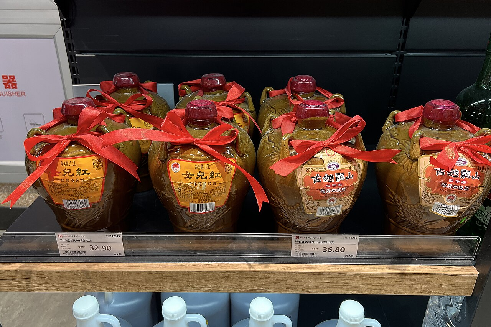

# 中国地理标志保护制度

中国的地理标志保护不是一部法律、一个部门、一张名单就能概括的制度。它至少涉及三条轨道：地理标志产品保护、地理标志集体商标或证明商标、农产品地理标志。酒类页面里常说的“地理标志产品”，通常指第一条轨道，由《地理标志产品保护办法》规范。把三条轨道混成一套，是理解中国 GI 时最常见的起点错误。

图：北京超市里的绍兴酒坛；绍兴酒是地理标志产品的一个例子，画面不是专用标志，也不能据此判断这坛酒是否获准使用标志。图片：N509FZ，CC BY-SA 4.0，via Wikimedia Commons（[原图页面](https://commons.wikimedia.org/wiki/File:Jarred_Shaoxing_wine_at_a_supermarket_in_Beijing_(20241109164501).jpg)）。

> **先给结论**
> **一句话：** 这页讲清中国地理标志保护制度的适用范围、限制和容易误读的地方。
>
> - **适合谁：** 需要快速理解中国地理标志保护制度的适用范围和限制的人。
> - **不适合谁：** 需要标准全文或合规裁定的人。
> - **先看这两点：**
>   - 《地理标志产品保护办法》第二条把地理标志产品定义为：产自特定地域，所具有的质量、声誉或者其他特性本质上取决于该产地的自然因素、人文因素的产品。
>   - 现行规章是国家知识产权局令第80号《地理标志产品保护办法》，2023-12-29 公布，2024-02-01 施行。

## 定义与四个特性

《地理标志产品保护办法》第二条把地理标志产品定义为：产自特定地域，所具有的质量、声誉或者其他特性本质上取决于该产地的自然因素、人文因素的产品。它包括两类：一是来自本地区的种植、养殖产品；二是原材料全部来自本地区，或者部分来自其他地区，但在本地区按照特定工艺生产和加工的产品。这个定义的关键不是“名字里带地名”，而是产品特性与产地之间存在可说明的关联。

第三条进一步提出四项特性：真实性、地域性、特异性和关联性。真实性指名称经过长期持续使用，被公众普遍知晓；地域性指全部生产环节或者主要生产环节发生在限定的地域范围内；特异性指产品具有较明显的质量特色、特定声誉或者其他特性；关联性指这种特异性由特定地域的自然因素和人文因素决定。四项缺一不可，单有地名或单有传统工艺，都不足以构成地理标志产品。

## 法律框架与主管机关

现行规章是国家知识产权局令第80号《地理标志产品保护办法》，2023-12-29 公布，2024-02-01 施行。它适用于地理标志产品的保护申请、审查认定、撤销、变更以及专用标志的使用管理。第五条规定，国家知识产权局负责全国地理标志产品以及专用标志的管理和保护工作，统一受理和审查保护申请，依法认定地理标志产品；地方知识产权管理部门负责本行政区域内的管理和保护。

这部规章与原国家质量监督检验检疫总局的《地理标志产品保护规定》存在部分内容交叉。国家知识产权局的制定说明明确，在具体适用时，根据新规定优于旧规定的原则，对于地理标志产品认定、管理和保护内容，两个规章不一致的，适用新规章；涉及行政执法的，按相关法律、法规执行。因此，引用旧规定时要注意时间与事项范围，不能把 2005 年的程序直接当成 2024 年后的现行程序。

## 申请、审查与专用标志

申请人可以是县级以上人民政府，或者其指定的具有代表性的社会团体、保护申请机构。申请需要提交产品名称、产地范围、质量特色、与产地的关联性、生产技术规范、检测报告等材料。审查程序包括形式审查、技术审查，异议程序被置于技术审查之后，以提高效率；审查通过后，国家知识产权局发布批准公告，明确产地范围、质量技术要求与专用标志使用要求。

获得保护后，申请人应当采取措施，对地理标志产品名称、专用标志的使用和产品特色质量进行管理；生产者应当按照相应标准组织生产。使用专用标志通常需要注册登记，未按标准生产且限期未改正的，可能被注销专用标志使用注册登记。专用标志不是“自己印一个就可以”，它是有注册、有监督、有退出机制的制度工具。

## 三条轨道：产品保护、商标、农产品

第一条轨道是地理标志产品保护，依据就是这部办法，重点在“产品—产地—特定质量”的认定与专用标志。第二条轨道是地理标志集体商标、证明商标，依据《商标法》及商标注册程序，重点在标志的注册与许可使用。第三条轨道是农产品地理标志，由农业农村部门管理，重点在农产品产地、生产规范与质量控制。三者的申请人、审查机关、标志样式、保护期限和法律依据都不同。

这意味着“某个酒有地理标志”这句话，必须说明是哪一条轨道。一个产品可能同时拥有地理标志产品保护和地理标志证明商标，也可能只有其中一项；一个地名可能是地理标志产品名称，也可能被注册为普通商标或集体商标，但后者不等于前者。把“有 GI”直接等同于“有官方认证”或“质量更好”，会掩盖制度差异。

## 酒类地理标志的例子

酒类是中国地理标志中很活跃的一类。绍兴酒是黄酒的代表性地理标志产品，产地范围、原料、工艺和感官要求都有相应的技术规范；贵州茅台酒、五粮液等白酒也有地理标志产品保护或相关商标保护；贺兰山东麓葡萄酒是宁夏葡萄酒产区的重要地理标志。不同产品的保护路径不完全相同，有的以产品保护为主，有的以证明商标为主，有的两者并行。

以绍兴酒为例，地理标志保护的核心不是“绍兴”两个字，而是绍兴特定地域的糯米、麦曲、水、酿造季节和传统工艺共同形成的风味。离开这些条件，即使在同一城市生产，也不当然能用受保护的名称。反过来，地理标志也不是“只有一家企业能做”；在产地范围内、符合技术规范的生产者，可以按规则申请使用专用标志。

## 中欧互认

中国与欧盟在 2020-09-14 签署《中华人民共和国政府与欧洲联盟地理标志保护与合作协定》，协定于 2021-03-01 生效。第一批清单包括约 100 个中国地理标志和 96 个欧盟地理标志，自生效日起开始保护；第二批双方各 175 个，计划在协定生效后 4 年内完成相关保护程序。酒类是清单中的重要类别，欧盟的慕尼黑啤酒、爱尔兰威士忌、卡瓦、雅文邑、托卡伊葡萄酒等都在第一批之列。

中欧互认的意义，是让符合协定的地理标志在对方市场获得保护，并可使用对方的官方标志。但它不是“自动全球保护”，也不是“所有酒类都能互认”。纳入清单的产品、保护范围、技术规范和后续变更，都要按协定与双方公告执行。看一款酒是否享有中欧互认保护，最可靠的方式是查国家知识产权局的公告与清单，而不是看营销文案。

## 常见误读

第一，地理标志不是普通商标。地理标志产品名称通常不能由一家企业独占；它保护的是产地范围内符合规范的生产者群体。第二，地理标志不是质量排名。它说明产地、规范与特色，不说明所有使用该名称的产品都一样好，也不说明未使用该名称的产品一定差。第三，地理标志不是“地名+产品”就能成立。没有长期使用、产地关联、技术规范和审查认定，单写“某某产地酒”不构成地理标志。

第四，地理标志产品保护不等于地理标志商标。两者可以并存，但申请人、审查程序、标志与维权路径不同。第五，专用标志不是随便印。使用需要注册登记，并受监督；伪造、冒用专用标志属于违法行为。第六，中欧互认不是自动生效。只有列入协定清单并完成相应程序的产品，才在对方市场享有协定保护。

## 对酒类消费者与写作者的意义

对消费者来说，地理标志提供的是一条可追溯的产地与规范线索，而不是一张“品质保证书”。买酒时可以看产品名称、产地、生产者、执行标准、专用标志和批号；如果名称是受保护的地理标志，还可以查公告中的产地范围和技术要求，判断这款酒是否在范围内、是否按规范生产。对写作者来说，准确的说法是“某产品获得地理标志产品保护”，而不是“某产品是地理标志”，更不是“某产品因此更好”。

地理标志制度的价值，在于把地方知识、自然条件和生产规范固定下来，让消费者能够识别，让产地内的合规生产者能够获得保护。它也会带来边界争议：产地范围怎么划、传统工艺怎么界定、专用标志怎么监督。理解这些争议，比背一张名单更有助于判断一款酒的真实身份。

相关条目：[中国](ref:china)、[白酒](ref:baijiu)、[黄酒](ref:yellow-wine)。

## 延伸阅读与另见

- [中国](ref:china)：地理标志产品的国家层级背景。
- [白酒](ref:baijiu)：酒类地理标志中最活跃的品类之一。
- [黄酒](ref:yellow-wine)：绍兴酒所属的酒种。
- [宁夏](ref:ningxia)：贺兰山东麓葡萄酒的产区背景。
- [绍兴](ref:shaoxing)：绍兴酒的地理与工艺背景。
