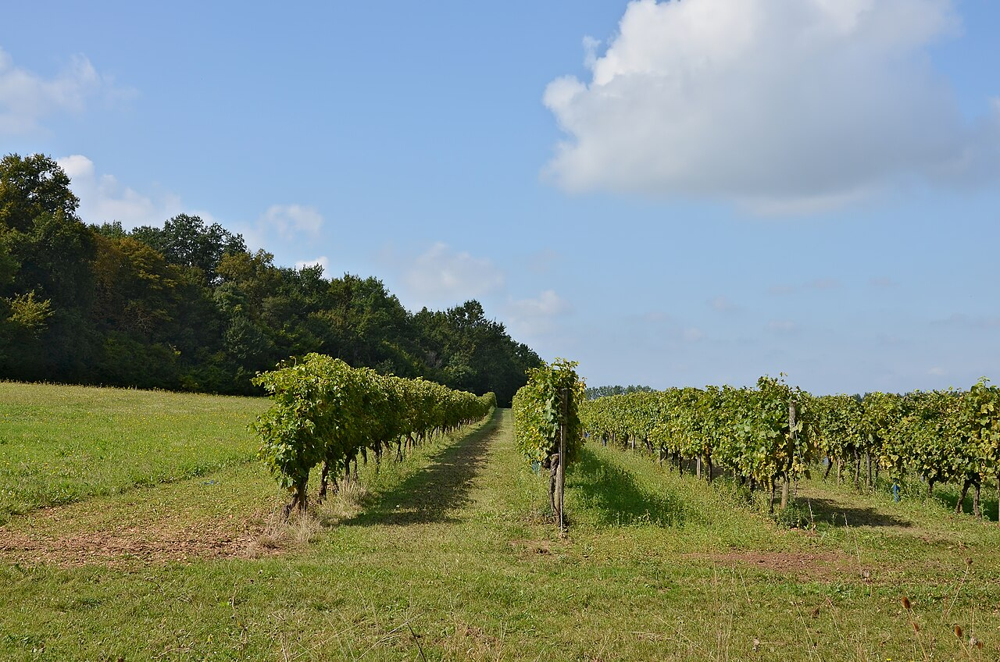

# 干邑 AOC 法令

干邑的法律身份比很多人想象的更早。1909 年，法国政府首次划定干邑的种植边界；1936 年，干邑正式获得原产地命名（AOC）。现行的产区规范则在 2022 年 10 月 10 日由法国国家原产地与质量研究院批准，10 月 16 日在官方公报公布。

这份文件读起来不像营销册，而像一份工程规范：哪些地块可以种、种什么品种、怎么修剪、每公顷产多少、什么时候蒸馏、在什么桶里放多久。VS、VSOP、XO 这些消费者熟悉的词，最终都要回到这些条款。

图：干邑分六个种植区；图为夏朗德省 Borderies 产区的葡萄园。图片：JLPC，CC BY-SA 3.0，via Wikimedia Commons（[原图页面](https://commons.wikimedia.org/wiki/File:Cherves-Richemont_16_Vignoble_du_cognac_Borderies_2014.jpg)）。

## 三层文件：法令、规范与行业管理

第一层是 1909 年的地理划定与 1936 年的 AOC 认定，它们确定了“干邑”这个名字的合法边界。第二层是产区规范（cahier des charges），逐项规定种植、酿造、蒸馏与陈年。第三层是行业管理机构 BNIC 与 UGVC 的日常执行。

法国于 2009 年把 AOC 纳入欧盟 PDO 体系，因此干邑同时受法国法令与欧盟地理标志规则保护。两层规则的修改节奏不同，但名称保护是叠加的：在欧盟境内冒用“Cognac”，既违反法国法，也违反欧盟法。

## 六个 cru：从大香槟到普通林区

干邑产区分为六个种植区：Grande Champagne、Petite Champagne、Borderies、Fins Bois、Bons Bois、Bois Ordinaires。它们不是行政省份，而是按土壤与气候划出的酒质地带。

Grande Champagne 的白垩土最典型，酒体细腻、陈年潜力长；Petite Champagne 与之相邻，结构稍厚；Borderies 面积最小，常带花香与坚果感。Fins Bois、Bons Bois 与 Bois Ordinaires 更靠海或靠内陆边缘，风格更直接。

如果一款酒同时使用 Grande Champagne 与 Petite Champagne，且前者占比不低于 50%，可以标注“Fine Champagne”。这是一个受保护的组合名称，不是任意两个产区的混合。

## 品种与种植：Ugni Blanc 的统治

Ugni Blanc 占干邑葡萄种植的约 98%。它酸度高、糖度低，蒸馏后保留清晰的果香与花香，适合长时间陈年。Folle Blanche、Colombard、Montils、Sémillon 等品种仍被允许，但面积很小。

种植密度、修剪方式、采收日期与产量上限都由规范约束。产量不是无限追求：葡萄太丰产，风味会被稀释，蒸馏后的酒体支撑不住长时间橡木桶陈年。年份差异因此直接反映在原酒质量上。

## 蒸馏：两次铜壶，必须赶在 3 月 31 日前

采收压榨后，葡萄汁发酵成约 8% 至 9% 的酒液。随后进入夏朗德铜壶，进行两次蒸馏。第一次得到“brouillis”，第二次得到“bonne chauffe”，酒头与酒尾被分离，只保留中段。

规范要求第二次蒸馏在采收次年的 3 月 31 日前完成。这个日期不是形式主义：它保证原酒在气温回升前进入橡木桶，避免发酵与微生物状态失控。铜壶的容量、形状与加热方式也有传统约束。

蒸馏师的经验体现在“切酒”上：酒头与酒尾的比例、什么时候切换收集容器，决定了原酒的干净程度与陈年潜力。规范只能规定温度与酒度范围，无法规定手感；这也是同一产区、同一品种的酒厂之间差异巨大的原因。第二次蒸馏得到的“bonne chauffe”通常不超过 72.4% 酒度，随后进入橡木桶。

橡木桶多来自 Limousin 或 Tronçais 森林，桶壁厚、纹理疏，赋予干邑更柔和的单宁。新桶比例由酒厂决定，常见做法是先用新桶一段时间，再转入旧桶，避免木质味压过果香。桶龄与烘烤程度，往往比年份更能解释两家酒厂风格的差异。这也是为什么两家同样标 XO 的酒，颜色、甜感与余味可以相差很远；年份只说明最短陈年时间，不说明风格。选酒时，酒庄与调配师比等级更值得看。

## 陈年与年龄标示：VS 到 XXO

原酒必须在橡木桶中陈年，最短 2 年。陈年过程中，酒精度缓慢下降，木质素与单宁进入酒体，颜色从无色转为琥珀。调配师会把不同年份、不同产区的原酒组合，形成稳定的酒厂风格。

消费者熟悉的标示对应法定最短陈年：VS 为 2 年，VSOP 为 4 年，Napoléon 为 6 年，XO 为 10 年，XXO 为 14 年。XO 的门槛在 2018 年从 6 年提高到 10 年，2022 年规范把这一变化正式写死。

## 标签、市场与争议

标签必须出现“Cognac”与产地命名标识，酒度不得低于 40%。标注 cru 名称时，所用葡萄必须全部来自该 cru；“Fine Champagne”则要满足前述比例。酒厂名称、装瓶信息与批次也要可追溯。

干邑的产量与出口高度集中，BNIC 负责统计与推广。争议主要集中在三处：气候变暖使采收提前、酸度下降；年轻消费者转向低度酒与即饮酒；以及产量控制是否保护了中小酒农。规范能管住标签，却管不住口味的变化。

相关条目：[干邑](ref:drink-style-cognac)。

## 另见与参考资料

- 干邑产区的城镇与地理，见 [干邑产区](ref:region-cognac)。
- 干邑作为酒种的风格，见 [干邑](ref:drink-style-cognac)。
- 更广泛的白兰地家族，见 [白兰地](ref:drink-style-brandy)。
- 另一套法国起泡酒规范，见 [香槟原产地命名法令](ref:standard-champagne-aoc-decree)。
- “原产地命名”的制度史，见 [原产地命名](ref:term-appellation)。

1. BNIC，A protected origin，访问于 2026 年 11 月 20 日。
2. BNIC，How cognac is made，访问于 2026 年 11 月 20 日。
3. INAO，Cahier des charges de l'appellation Cognac，访问于 2026 年 11 月 20 日。
4. Légifrance，Arrêté du 10 octobre 2022，访问于 2026 年 11 月 20 日。
5. BNIC，访问于 2026 年 11 月 20 日。

对照阅读：[干邑](ref:region-cognac)、[白兰地](ref:drink-style-brandy)。

**关键事实。**

| 项目 | 内容 |
| --- | --- |
| 一句话定位 | 干邑是法国最早划定的葡萄酒产地之一，现行规范于 2022 年 10 月批准并公布；它规定六个种植区、允许的葡萄品种、两次铜壶蒸馏与橡木桶陈年，并把 VS、VSOP、XO 等年龄标示写进法律 |
| 发布机构 | 法国国家原产地与质量研究院（INAO） |
| 标准编号 | Cahier des charges de l'AOC Cognac |
| 生效日期 | 2022-10-16 |
| 适用范围 | 干邑产区的种植、蒸馏、陈年与标签 |

**来源与边界。** 本页关于「干邑 AOC 法令」的关键事实，主要由以下来源交叉核对：Bureau National Interprofessionnel du Cognac（六个 cru、AOC 历史与产区边界；Ugni Blanc 比例、两次蒸馏与橡木桶陈年）、INAO（确认产区规范的批准机构与法律地位）、Légifrance（2022 年 10 月 10 日批准、10 月 16 日公布的时间点）等 5 条来源。价格、批次与状态会变，涉及这些字段时以页面所列来源的最新版本为准。正文为项目自写，来源只作核验，不复制原文。

**并读。** 把「干邑 AOC 法令」与「干邑」、「干邑」、「白兰地」放在一起读时，先确认它们是同一层级还是上下游关系：先确认适用范围与强制或推荐属性，再比较术语、标签与检测方法。本页负责给出标准的基本坐标，对照条目补上具体案例与差异；读完再回到本页，才能分清哪些差别属于标准本身，哪些只是产地、批次或品牌选择。

**适用边界。** 对「干邑 AOC 法令」而言，标准文本会修订，引用时以发布机构的最新版本为准；本页是导读，不替代原文。

**更新提示。** 「干邑 AOC 法令」最近核对于 2026-11-20；标准版本、过渡期与检测方法会更新，执行前以现行标准文本为准。
