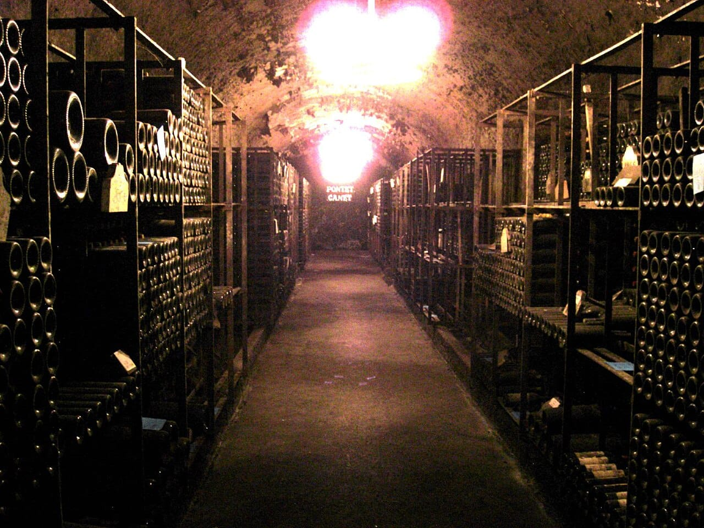

# EU 葡萄酒法规 1308/2013

欧盟的葡萄酒规则常被误读成一份“酿酒配方”。它更像一本市场准入手册：规定一款酒在欧盟境内如何被命名、如何被标注、如何跨成员国流通，以及产区名称在什么条件下受保护。真正的工艺细节分散在授权法案与成员国执行规则里，而这部法规提供的是框架。

它于 2013 年 12 月 17 日由欧洲议会与欧盟理事会通过，2014 年 1 月 1 日起适用，取代了此前把多个农产品市场打包管理的旧条例。葡萄酒从此与水果、蔬菜、乳制品等共享一套“共同市场组织”结构，但仍保留独立的葡萄酒章节。

图：欧盟葡萄酒法规覆盖从葡萄园到标签的整条链；图为波尔多一家酒庄的地下酒窖。图片：seligmanwaite，CC BY 2.0，via Wikimedia Commons（[原图页面](https://commons.wikimedia.org/wiki/File:Underground_wine_cellar_of_Pontet-Canet.jpg)）。

## 一部市场法规，而非酿造教科书

法规的核心不是告诉酒农该不该加糖，而是划定四类事项：生产潜力（谁能种、能种多少）、质量政策（哪些名字受保护）、标签与消费者信息、以及与第三国的贸易规则。具体的技术参数——加糖上限、酸化条件、二氧化硫限量——由欧盟委员会以授权法案补充，成员国再指定机构执行。

这种“框架加授权”的写法有一个直接后果：只读 1308/2013 并不能判断某一款酒是否合规。你需要同时查阅实施条例、成员国法令与产区规范。这也是为什么同一瓶酒在法国、意大利和西班牙的标签细节会有差异，但底层的强制信息是同一套。

## 从种植授权到酒款的合规链条

2016 年 1 月 1 日起，欧盟改用种植授权制度管理葡萄园面积。新植葡萄园需要成员国批准的授权，重植则通过许可流转。制度的目标是避免产能无序扩张，同时给年轻酒农留出入口。授权有效期、面积上限与优先条件由成员国在规定框架内决定。

在酒窖层面，生产者需要登记产量、保存酿造记录，并在跨成员国销售时提供随附文件。葡萄酒的加糖、酸化、脱酸与浓缩，只能在法规允许的条件下进行；在气候异常年份，部分产区还会获批临时调整。检查由成员国指定的机构执行，欧盟委员会负责审计各国系统是否一致。

## 标签：必须说什么，可以说什么

强制信息包括品类名称、酒精含量、净含量、批号、生产商或进口商名称、原产国（在特定情形下）、含硫物质提示与过敏原。产区名称、年份、品种与“酒庄装瓶”等属于可选信息，但一旦标注，就必须满足相应条件。PDO 与 PGI 的名称受保护，不能随意翻译或改写。

2023 年 12 月 8 日起，葡萄酒还需提供营养声明与配料表。为减轻瓶身负担，欧盟允许把完整信息放在电子标签上，瓶面只保留能量值与链接。这一变化对小型酒庄是成本，对消费者则是透明度提升；争议在于电子标签的可及性与老年人使用习惯。

## 质量政策：PDO 与 PGI 的分界

PDO 要求 100% 的葡萄来自划定产区，且 100% 在产区内酿造。PGI 的门槛略低：至少 85% 的葡萄来自该地理区域，其余环节可在更大范围内完成。两者都必须有产区规范、检查机构与可追溯记录；名称在欧盟层面注册后，成员国负责境内保护。

法国的 AOC 是 PDO 在国家层面的具体形态。香槟、干邑、波尔多都先由法国法令划定范围，再进入欧盟注册名录。因此，当你在酒标上看到“Appellation d'Origine Contrôlée”，它背后既有一套法国产区规范，也有一层欧盟 PDO 保护。两层规则的修改节奏并不总同步，这是酒农与监管者长期拉扯的地方。

## 执行、改革与争议

执行由欧盟委员会农业总司牵头，成员国海关与农业部门负责抽查。常见违规不是“假酒”，而是标签不符：把 PGI 写成 PDO、年份与装瓶记录对不上、营养声明缺失。处罚由成员国设定，轻重差异很大。

改革压力主要来自三处：气候变暖使传统产区边界与成熟度标准失灵；健康政策要求更醒目的酒精警示；种植授权被批评为限制竞争。2021 年的标签修订是一次妥协，2024 年后的政策对话则更关注“减产与转型”。对生产者而言，合规成本正在从酒窖转移到标签与数据管理。

相关条目：[香槟原产地命名法令（Champagne AOC）](ref:standard-champagne-aoc-decree)。

## 另见与参考资料

- 欧盟烈酒地理标志的规则，见 [EU 烈酒法规 2019/787](ref:standard-eu-spirits-regulation-2019-787)。
- 法国香槟的产区规范，见 [香槟原产地命名法令](ref:standard-champagne-aoc-decree)。
- 波尔多如何把区域级 AOC 落到具体酒款，见 [波尔多产区](ref:region-bordeaux)。
- 葡萄酒的基本分类，见 [葡萄酒](ref:drink-style-wine)。
- “原产地命名”这个概念的历史，见 [原产地命名](ref:term-appellation)。

1. 欧洲议会与欧盟理事会，Regulation (EU) No 1308/2013，EUR-Lex，2013 年 12 月 17 日。
2. 欧洲议会与欧盟理事会，Regulation (EU) 2021/2117，EUR-Lex，2021 年。
3. 欧盟委员会农业与农村发展总司，Wine — market measures and labelling，访问于 2026 年 11 月 20 日。
4. INAO，Institut national de l'origine et de la qualité，访问于 2026 年 11 月 20 日。
5. OIV，International Organisation of Vine and Wine，访问于 2026 年 11 月 20 日。

对照阅读：[欧盟烈酒法规 (EU) 2019/787](ref:standard-eu-spirits-regulation-2019-787)、[波尔多](ref:region-bordeaux)。

**关键事实。**

| 项目 | 内容 |
| --- | --- |
| 一句话定位 | 欧盟葡萄酒共同市场组织的框架法规：2013 年 12 月通过、2014 年 1 月起适用，统一了种植授权、产地命名、标签与贸易规则；它不规定某款酒怎么酿，而是规定一款酒凭什么可以叫某个名字、装进瓶子后必须告诉消费者什么 |
| 发布机构 | 欧洲议会与欧盟理事会 |
| 标准编号 | Regulation (EU) No 1308/2013 |
| 生效日期 | 2014-01-01 |
| 适用范围 | 欧盟葡萄酒共同市场组织：生产潜力、产地命名、标签、贸易与检查 |

**来源与边界。** 本页关于「EU 葡萄酒法规 1308/2013」的关键事实，主要由以下来源交叉核对：EUR-Lex（法规全文；2023 年 12 月 8 日起的营养声明与配料表要求）、European Commission, Directorate-General for Agriculture and Rural Development（欧盟葡萄酒市场政策、标签与产地命名制度的官方说明）、INAO（法国 AOC 与欧盟 PDO 的衔接方式）等 5 条来源。价格、批次与状态会变，涉及这些字段时以页面所列来源的最新版本为准。正文为项目自写，来源只作核验，不复制原文。

**并读。** 把「EU 葡萄酒法规 1308/2013」与「欧盟烈酒法规 (EU) 2019/787」、「香槟原产地命名法令（Champagne AOC）」、「波尔多」放在一起读时，先确认它们是同一层级还是上下游关系：先确认适用范围与强制或推荐属性，再比较术语、标签与检测方法。本页负责给出标准的基本坐标，对照条目补上具体案例与差异；读完再回到本页，才能分清哪些差别属于标准本身，哪些只是产地、批次或品牌选择。

**适用边界。** 对「EU 葡萄酒法规 1308/2013」而言，标准文本会修订，引用时以发布机构的最新版本为准；本页是导读，不替代原文。
