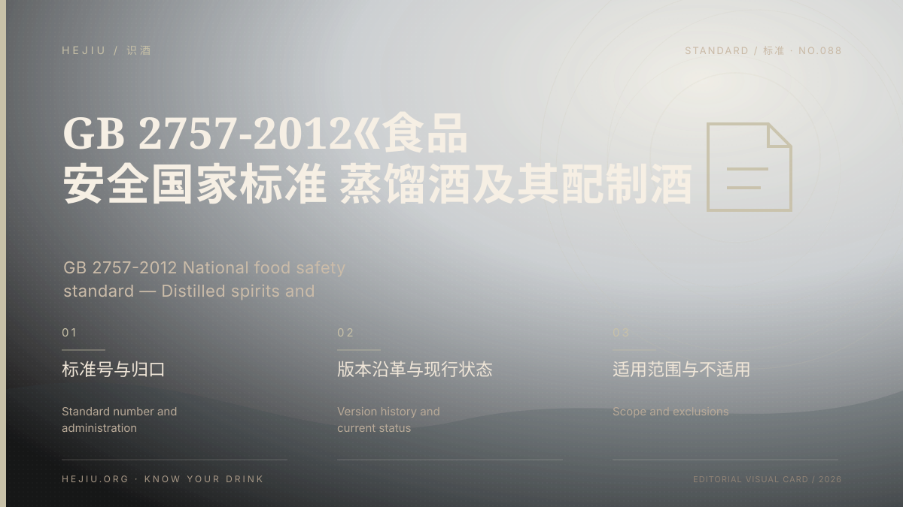

# GB 2757-2012《食品安全国家标准 蒸馏酒及其配制酒》

GB 2757-2012 是现行强制性食品安全国家标准，2012-08-06 发布，2013-02-01 实施，代替 GB 2757-1981《蒸馏酒及配制酒卫生标准》及其第 1 号、第 2 号修改单。它管的是“安全底线”，不是香型、等级或风格：甲醇、氰化物等指标合格，只说明产品达到最低安全要求，不说明酒质高低。标准号为“GB”，没有“GB/T”版本，企业不能自愿选择是否执行；只要在中国境内生产、销售蒸馏酒及其配制酒，就受它约束。

图：GB 2757-2012《食品安全国家标准 蒸馏酒及其配制酒》 双语视觉卡（项目自绘 SVG）。不是实拍。

## 标准号与归口

标准号是 GB 2757-2012，属于强制性食品安全国家标准。它由中华人民共和国卫生部发布；食品安全国家标准由国家卫生健康委员会（原卫生部）组织制定与解释，不设全国专业标准化技术委员会归口，也不存在推荐性版本。标准前言说明，与 GB 2757-1981 相比，本次修改了标准名称、修改了氰化物限量、取消了锰的限量、增加了标签标识要求。标准正文 4.2 至 4.4 自 2013-08-01 起实施，其余条款自 2013-02-01 起实施。标准正文的著作权归发布机构，本站只作事实性介绍。

## 版本沿革与现行状态

GB 2757-1981 是计划经济时期制定的卫生标准，名称是《蒸馏酒及配制酒卫生标准》，曾以第 1 号、第 2 号修改单调整。2012 年版把它改为食品安全国家标准，名称改为《食品安全国家标准 蒸馏酒及其配制酒》，并按食品安全法的框架重写：原料、感官、理化、污染物与真菌毒素、食品添加剂、标签。取消锰限量，是因为锰不再是这类食品的主要风险指标；修改氰化物限量，是为了与当时的风险评估和行业实际相匹配；增加标签要求，则把酒精度标示与警示语写入强制条款。该标准目前仍为现行版本，尚未被代替。

## 适用范围与不适用

标准适用于蒸馏酒及其配制酒。蒸馏酒的定义是：以粮谷、薯类、水果、乳类等为主要原料，经发酵、蒸馏、勾兑而成的饮料酒。蒸馏酒的配制酒的定义是：以蒸馏酒和（或）食用酒精为酒基，加入可食用的辅料或食品添加剂，进行调配、混合或再加工制成的、已改变了其原酒基风格的饮料酒。它不适用于发酵酒，发酵酒由 GB 2758 约束；也不适用于普通食品、保健食品或药品。它不规定白酒的香型、等级、总酸、总酯，这些属于产品标准；它也不规定葡萄酒、啤酒的感官与质量。理解“蒸馏酒的配制酒”这一限定很重要：并非所有露酒、药酒或浸泡酒都自动落入本标准，关键看酒基与工艺。

## 关键指标与限值

理化指标只有两项。甲醇：以粮谷类为原料的蒸馏酒及其配制酒，限量为 0.6 g/L；以其他原料（如薯类、水果、乳类等）为原料的，限量为 2.0 g/L。氰化物（以 HCN 计）：限量为 8.0 mg/L。两项指标均按 100% 酒精度折算，检验方法引用 GB/T 5009.48。折算的意思是：先把样品按实测酒精度换算到纯酒精基准，再与限量比较；因此同样一瓶酒，酒精度越高，按原样计算的允许甲醇绝对量也越高，但折算后必须落在限值内。

污染物限量应符合 GB 2762，真菌毒素限量应符合 GB 2761，食品添加剂的使用应符合 GB 2760。需要特别指出：GB 2757-2012 本身没有规定铅限量。铅属于污染物，归 GB 2762 管理；把铅写成 GB 2757 的指标是常见错误。同理，塑化剂、农药残留等也不在本标准表 1 中，而由相应的食品安全国家标准或监管公告约束。

## 检测方法

甲醇与氰化物按标准引用的 GB/T 5009.48 检验。该方法后来经过多次修订，实际检验应采用现行有效的食品安全国家标准方法；标准正文引用的是发布时的版本。污染物按 GB 2762 对应的检验方法，真菌毒素按 GB 2761 对应的方法，食品添加剂按 GB 2760 与相应检验方法。采样、抽样与判定应结合产品标准和生产许可要求。由于甲醇与氰化物均按 100% 酒精度折算，检验报告必须同时给出实测酒精度，否则无法复算；这也是审核标签与检验报告时要对齐的关键字段。

## 与相邻标准的区别

与 GB 2758《发酵酒及其配制酒》相比，本标准管蒸馏酒，GB 2758 管发酵酒，两者按工艺分流，不能混用。与 GB 2762 相比，后者管污染物（包括铅），本标准只管甲醇与氰化物，并指向 GB 2762。与 GB 2760 相比，后者管添加剂使用，本标准只作引用。与白酒产品标准（如 GB/T 10781 系列）相比，产品标准管香型、感官、总酸、总酯与等级，本标准管安全底线；符合产品标准不等于自动符合本标准，反之亦然。与 GB/T 17204-2021《饮料酒术语和分类》相比，后者负责分类与术语，本标准负责安全指标。与“露酒”标准相比，露酒有独立的产品标准与分类，是否同时适用本标准，要看其酒基是否为蒸馏酒。

## 合规与标签要求

标签除酒精度、警示语和保质期外，应符合 GB 7718 的规定。酒精度应以“%vol”为单位标示。应标示“过量饮酒有害健康”，可同时标示其他警示语。酒精度大于或等于 10%vol 的饮料酒可免于标示保质期。这三点是强制要求，不是建议。进口蒸馏酒及其配制酒同样要符合本标准，中文标签应载明酒精度与警示语。企业不能以“纯粮酿造”“传统工艺”为由省略警示语；也不能把“配制酒”标成“蒸馏酒”以规避更严格的类别要求。标签、说明书与广告中的“保健”“治疗”等表述，还受食品安全法与广告法约束。

## 常见误区

第一，把 GB 2757 当成白酒产品标准。它不规定香型、等级、总酸、总酯，只规定甲醇、氰化物与标签等安全要求。第二，认为标准里有铅限量。铅在 GB 2762，不在 GB 2757-2012 的表 1。第三，把“纯粮酿造”当成安全保证。粮谷类原料的甲醇限量更严（0.6 g/L），但纯粮不等于不会超标，工艺控制仍是关键。第四，把 0.6 g/L 与 2.0 g/L 直接按原样比较。两项都按 100% 酒精度折算，必须先换算。第五，认为“配制酒”就是药酒或保健酒。标准定义强调的是以蒸馏酒和（或）食用酒精为酒基、加入辅料或添加剂、改变原酒基风格，与保健食品审批不是一回事。第六，认为符合本标准就“合格”。食品安全只是底线，产品还需符合产品标准、标签标准与生产许可要求。

## 另见

- [白酒](ref:baijiu)：蒸馏酒的主要类别。
- [配制酒](ref:compounded-liquor)：以蒸馏酒或食用酒精为酒基的调配酒。
- [露酒](ref:lujiu)：以蒸馏酒为酒基的中国特色配制酒。
- [白兰地](ref:brandy)：以水果为原料的蒸馏酒。
- [威士忌](ref:whisky)：以谷物为原料的蒸馏酒。
- [GB/T 17204-2021](ref:gbt-17204)：饮料酒术语和分类。
- [蒸馏](ref:distillation)：甲醇与氰化物的工艺来源。

对照阅读：[白酒](ref:baijiu)、[露酒](ref:lujiu)。
