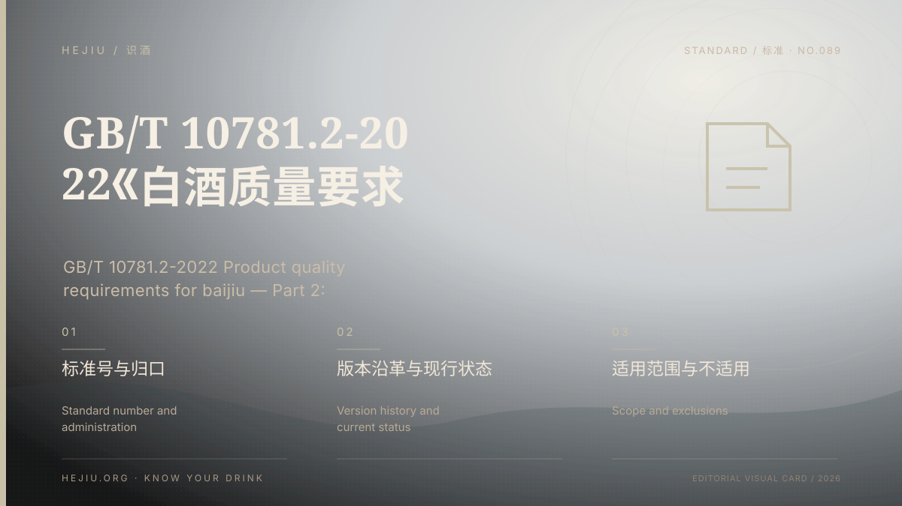

# GB/T 10781.2-2022《白酒质量要求 第2部分：清香型白酒》

GB/T 10781.2-2022 是现行清香型白酒质量要求。它于 2022-07-11 发布，2023-02-01 实施，代替 GB/T 10781.2-2006。与上一版最大的结构差异是：新版删除了“高度酒、低度酒”的产品分类，把酒精度统一为 21.0%vol 至 69.0%vol，改设特级、优级、一级三档；同时按产品自生产日期一年内、一年后分别考核酸酯指标，以回应清香型白酒在贮存中酸升酯降的实际变化。山西[汾酒](ref:fenjiu)是清香型的代表，但标准适用于整个品类。

图：GB/T 10781.2-2022《白酒质量要求 第2部分：清香型白酒》 双语视觉卡（项目自绘 SVG）。不是实拍。

## 标准号与归口

标准号是 GB/T 10781.2-2022，属于推荐性国家标准（GB/T），不是强制性标准，也不是食品安全国家标准。它由国家市场监督管理总局、国家标准化管理委员会发布，由中国轻工业联合会提出，由全国白酒标准化技术委员会（SAC/TC 358）归口。它是 GB/T 10781《白酒质量要求》系列的第 2 部分；该系列按香型分部分编排，第 1 部分为浓香型，第 4 部分为酱香型，第 8 部分为浓酱兼香型等。引用时应写全“GB/T 10781.2-2022”，只写“10781”会与同系列其他香型混淆。

## 版本沿革与现行状态

清香型白酒国家标准于 1989 年首次发布为 GB/T 10781.2-1989；2006 年第一次修订时，并入了 GB/T 11859.2-1989《低度清香型白酒》的内容；2022 年版为第二次修订。2022 年版的主要变化包括：更改清香型白酒定义；删除产品分类；更改感官要求；更改理化要求；删除卫生要求，因为食品安全指标已由食品安全国家标准承接。新标准自 2023-02-01 起实施，旧版同时废止。全国标准信息公共服务平台显示，该标准目前为现行版本，并已立项修订；在修订版发布前，2022 年版仍是唯一依据。

## 适用范围与不适用

标准适用于清香型白酒的生产、检验与销售。定义是以粮谷为原料，采用大曲、小曲、麸曲及酒母等为糖化发酵剂，经缸、池等容器固态发酵，固态蒸馏、陈酿、勾调而成，不直接或间接添加食用酒精及非自身发酵产生的呈色呈香呈味物质的白酒。它覆盖大曲清香、小曲清香与麸曲清香等不同曲种路线，不适用于浓香、酱香、凤香等其他香型，也不适用于液态法白酒、固液法白酒或以食用酒精加香精调配的配制酒。它不规定产区、年份、价格或品牌等级，不能用来证明一瓶酒是否来自山西杏花村。食品安全要求由 GB 2757、GB 2762、GB 2760 等标准约束。

## 关键指标与限值

感官要求设特级、优级、一级。色泽和外观均为无色或微黄、清亮透明、无悬浮物、无沉淀、无杂质；香气从特级的“清香纯正，具有陈香、粮香、曲香、果香、花香、坚果香、芳草香、蜜香、醇香、焙烤香、糟香等多种香气形成的幽雅、舒适、和谐的自然复合香，空杯留香持久”，到优级的“清雅、和谐”，再到一级的“清香正、复合香、空杯有余香”；口味从“醇厚绵甜、丰满细腻、协调爽净、回味绵延悠长”到“醇和柔甜、协调爽净、回味长”。标准还规定，酒温低于 10℃时允许出现白色絮状沉淀或失光，10℃以上应逐渐恢复正常。

理化指标为：酒精度 21.0%vol 至 69.0%vol；固形物不大于 0.50 g/L。产品自生产日期一年内，总酸（以乙酸计）特级不低于 0.50 g/L、优级不低于 0.40 g/L、一级不低于 0.30 g/L；总酯（以乙酸乙酯计）特级不低于 1.10 g/L、优级不低于 0.80 g/L、一级不低于 0.50 g/L；乙酸乙酯特级不低于 0.65 g/L、优级不低于 0.40 g/L、一级不低于 0.20 g/L。产品自生产日期一年后，改考核“总酸+乙酸乙酯+乳酸乙酯”，特级不低于 1.60 g/L、优级不低于 0.60 g/L、一级不低于 0.40 g/L，并按 45.0%vol 折算。酒精度实测值与标签标示值的允许差为 ±1.0%vol。

这套设计的意思是：一年内的新酒用总酸、总酯、乙酸乙酯看“香气物质是否足”；一年后酯类水解、酸类上升，继续用总酯考核会误伤正常陈酿，所以改用“总酸+乙酸乙酯+乳酸乙酯”的加和，既承认酸的增长，也保留对主体酯的要求。

## 检测方法

感官要求按 GB/T 10345《白酒分析方法》执行。酒精度按 GB 5009.225《食品安全国家标准 酒中乙醇浓度的测定》执行。固形物、总酯与乙酸乙酯按 GB/T 10345 执行。总酸按 GB 12456《食品安全国家标准 食品中总酸的测定》执行，以 g/L 表示。总酸+乙酸乙酯+乳酸乙酯的加和，先分别测得总酸、乙酸乙酯、乳酸乙酯，再按标准给出的公式折算到 45.0%vol；重复性条件下两次独立测定结果的绝对差值不应超过算术平均值的 5%。净含量按 JJF 1070 检验。检验规则与标志、包装、运输、贮存按 GB/T 10346 执行。

## 与相邻标准的区别

与 GB/T 10781.2-2006 相比，新版删除高度酒、低度酒分类，删除卫生要求，增加特级，改用一年内、一年后两套酸酯指标，并把折算基准统一为 45.0%vol。与浓香型标准相比，清香型的主体香是乙酸乙酯，乳酸乙酯比例较低，强调“清香纯正”而不是窖香浓郁。与酱香型标准相比，清香型不要求高温制曲、高温堆积与多轮次取酒。与 GB/T 15109-2021《白酒工业术语》相比，后者只定义术语，本标准定义直接引用其体系；与 GB/T 17204-2021《饮料酒术语和分类》相比，后者负责大类归属；与 GB 2757-2012 相比，后者是强制性安全底线。三者层次不同，不能互相替代。

## 合规与标签要求

标签应符合 GB/T 10346 与预包装食品标签通用要求，标明产品名称、香型、酒精度、净含量、生产日期、生产者与执行标准。酒精度以“%vol”表示，允许差为 ±1.0%vol。标准明确要求预包装产品应标识产品类型为“固态法白酒”，这是 2022 年版新增的标签义务；企业不能只写“清香型”而不写工艺类型。产品可以标特级、优级、一级，但等级必须与检验结果对应。食品安全方面，甲醇、氰化物、铅、食品添加剂等仍须符合现行食品安全国家标准。标准号是推荐性标准，但企业一经标注执行，就成为明示承诺。

## 常见误区

第一，认为“清香型等于低度酒”。新版已删除高度酒、低度酒分类，酒精度统一为 21.0%vol 至 69.0%vol，香型与度数没有绑定关系。第二，把“特级”当成官方认证。它只是标准内的质量等级，不是政府授牌。第三，认为一年后总酯下降就是不合格。新版对一年后改用“总酸+乙酸乙酯+乳酸乙酯”，正是为避免这种误判。第四，把“清香”理解成“没有香气”。清香型强调清雅、纯净的复合香，不是寡淡。第五，认为所有清香型都用大曲。标准允许大曲、小曲、麸曲及酒母，曲种不同，风格与成本也不同。第六，把标准号当成产区证明；杏花村产区需要另行核对。

## 另见

- [清香型白酒](ref:light-aroma)：风格、工艺与代表产品。
- [白酒](ref:baijiu)：白酒分类与基本工艺。
- [汾酒](ref:fenjiu)：清香型代表品牌。
- [山西汾酒产品](ref:shanxi-fenjiu)：具体产品与标签信息。
- [中国](ref:china)：清香型的主要产区背景。
- [GB/T 15109-2021](ref:gbt-15109)：白酒工业术语。
- [GB/T 17204-2021](ref:gbt-17204)：饮料酒术语和分类。
- [制曲](ref:qu-making)：大曲、小曲与麸曲的差异。

对照阅读：[白酒](ref:baijiu)、[汾酒](ref:fenjiu)。
